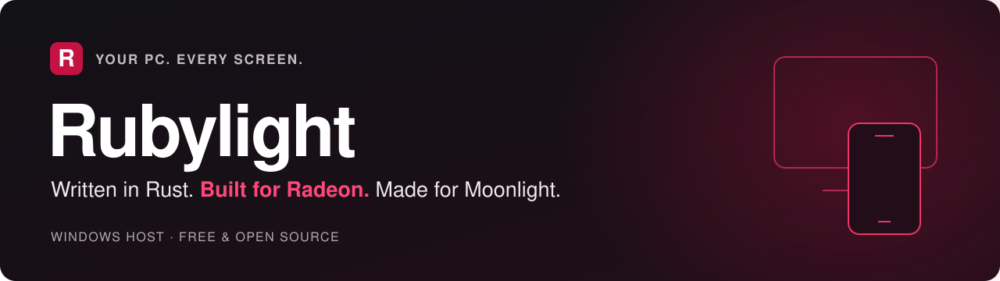
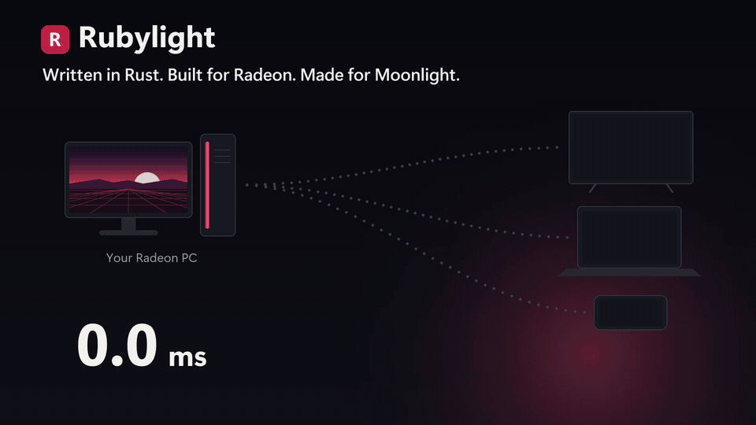
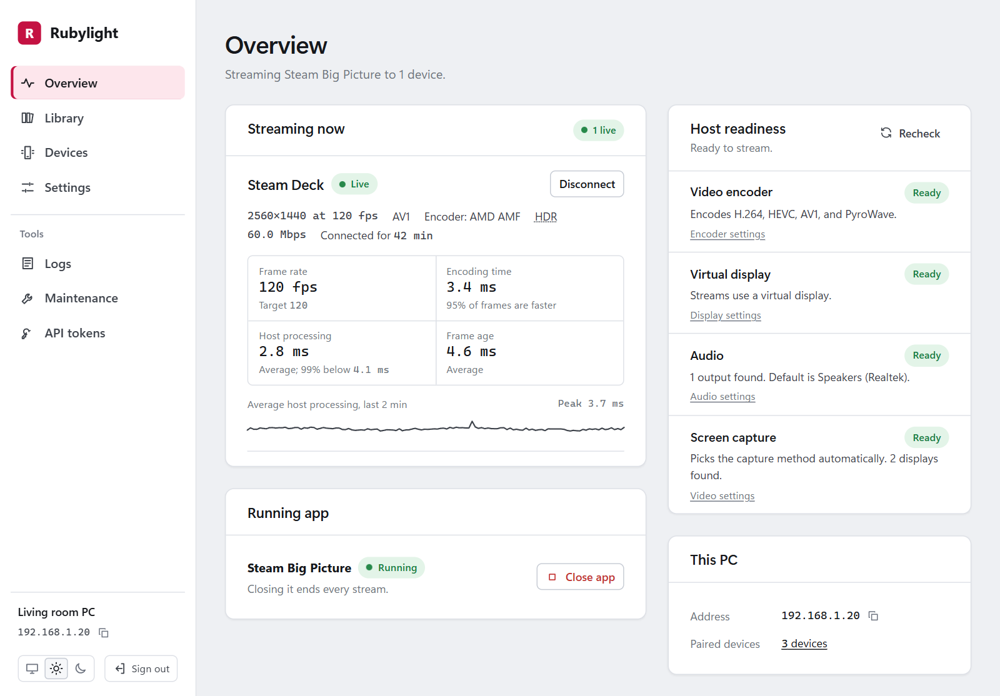

  

  <strong>Stream your Radeon PC to Moonlight.</strong> 
  Play your PC games on a laptop, TV, phone, Steam Deck or Xbox, with HDR at up to 240 fps. 
  Free, open source, written in Rust.

**[Download 3.0.0-rc.1](https://github.com/RamazanKara/Rubylight/releases/tag/v3.0.0-rc.1)** · **[Get started](docs/getting-started.md)** · [Website](https://ramazankara.github.io/Rubylight/) · [Docs](docs/README.md) · [Looking for an optimized client? Nightjar for Android/Linux/Windows](https://github.com/RamazanKara/nightjar)

Windows x64 · GPL-3.0 · Formerly Butterpollo

  

<a href="docs/media/demo.mp4">Watch the 60-second demo →</a>

## What it is

Rubylight is a Windows game-streaming host for your Radeon PC. It streams to any Moonlight client, and it is built around AMD hardware. AMF drives the encoder directly, frame copies and colour conversion run on D3D12 compute queues beside your game, and every stage of a frame is timed so the numbers below are ones we recorded, not ones we hoped for. 3.0 adds PyroWave, a wavelet codec for full-colour HDR on a fast network, a native API that lets a client browse your library and manage the session, link-rate adaptation, stream presets, Radeon controls per game and per device, and a frame timing record from capture to screen.

**Requirements:** an AMD Radeon GPU with a working AMF encoder, on Windows 10 or 11. Linux is in the pipeline, but not yet available ( Contributors are welcome! )
## Install. Pair. Play.

1. **Install.** Run **`rubylight-setup-3.0.0-rc.1.exe`** from the [release](https://github.com/RamazanKara/Rubylight/releases/tag/v3.0.0-rc.1). It sets up the service, the virtual display driver and controller support. No test mode, no restart. A ZIP is there too, for trying the host without installing.
2. **Sign in.** Open **`https://localhost:47990`** on the PC and create your account.
3. **Pair and play.** Open Moonlight on your device, select your PC and enter its PIN on the console's **Devices** page. Once the device appears as paired, choose **Desktop** or a game in Moonlight to start streaming.

  <picture>
    <source media="(prefers-color-scheme: dark)" srcset="docs/media/console-dark.png">
    
  </picture>

**Coming from Apollo or Vibepollo?** Setup imports your settings, paired devices and app library, so your clients keep working. Updates keep them too, and you choose whether they install automatically.

[Full setup guide →](docs/getting-started.md)

## What you get

**Speed**

| Feature | What it does |
| --- | --- |
| **Native AMD encoding** | AMF encodes H.264, HEVC and AV1 with defaults tuned by measurement. A lost frame is repaired with a small recovery frame instead of a full keyframe. |
| **Radeon compute pipeline** | Copies, colour conversion and scaling run on D3D12 compute queues, so the game and the stream wait on each other less. [How it works](docs/architecture.md) |
| **PyroWave, 4:4:4 HDR** | A wavelet codec for full-colour HDR on a fast local network, paced to each client's link. |
| **Beam-raced PyroWave** (experimental) | The host sends each frame in display order, so Nightjar on the desktop starts drawing the top of the picture while the bottom is still arriving. [Numbers](rust/PERFORMANCE.md#october-24-beam-raced-pyrowave-gate-b10-step-4-opt-in-missed-its-default-on-gate) |
| **Slice delivery** (experimental) | H.264 and HEVC frames go out slice by slice while the encoder works on the rest, with stock Moonlight. [Numbers](rust/PERFORMANCE.md#october-23-slice-delivery-b2-step-2f) |
| **VRR-aware capture** | With variable refresh, the host waits for the game's next frame when it is close, so the picture reaches the encoder fresh. [Numbers](docs/performance.md#vrr-capture-age) |
| **Link-rate adaptation** | When a link cannot carry the bitrate you asked for, the host steps down to what it delivers, probes back up and returns to your rate when the link allows. Clients can show the change. [More](docs/configuration.md#lower-bitrate-when-the-link-cannot-carry-it) |
| **Stream presets** | Lowest latency, Balanced or Reference quality, set once or per device or app. [More](docs/configuration.md#stream-presets) |
| **Frame timing record** | One CSV row per frame with capture, convert, encode, send and client times on one clock. [More](docs/timing-record.md) |

**Control**

| Feature | What it does |
| --- | --- |
| **A screen for every device** | Rubylight's own virtual display driver gives each client its resolution and refresh rate and hands every frame to the encoder directly. Your monitors come back when you disconnect. Physical displays work too, with Windows Graphics Capture or Desktop Duplication. |
| **Console and native API** | Home shows whether the PC is ready. Devices, Games & apps and Settings cover pairing, your library and stream options. The [native API](docs/native-api.md) lets Nightjar read your library and session. |
| **Host control, per device** | Turn it on for a device and that device can close games and change Radeon settings. It is off until you turn it on. [More](docs/configuration.md#host-control-for-a-device) |
| **WebRTC server** (Experimental) | Pair a Samsung Tizen TV or a browser with a PIN and stream H.264, HEVC or AV1, with HDR, surround, gamepads, keyboard and mouse. Off by default. [More](docs/webrtc.md) |
| **Session actions** | Disconnect leaves the game running, End session stops the stream and keeps the game, Close game also quits it. [More](docs/configuration.md#session-actions) |
| **Radeon settings with restore** | A device with host control changes Radeon settings during a stream, and each change is put back when the session ends. [More](docs/configuration.md#radeon-settings-with-restore) |
| **A Radeon profile for each game** | Competitive, Smoothness, Quality or your own list: Anti-Lag, frame caps, filtering, written when the game starts and restored when it ends, also after a crash. [More](docs/configuration.md#radeon-settings-per-game) |

**Your library**

| Feature | What it does |
| --- | --- |
| **Add games in one pass** | Scan Steam, Epic Games, Battle.net, EA app, Ubisoft Connect, GOG, and Microsoft Store and Xbox PC games, then pick what you want. Steam and Playnite sync stays available. |
| **Launcher hints** | When a launcher window waits for an update or a sign in, the session says so and the client can show it. |

Also built in: RTSS frame limits, Lossless Scaling, DualSense haptics and adaptive triggers, a real Steam Deck controller, touch and pen, surround sound, microphone passthrough, streaming from the lock screen, and headless or VM hosts.

[All features →](docs/features.md)

## Measured

Every number here comes from a recorded run on an RX 7900 XT, with its method and raw results in [rust/PERFORMANCE.md](rust/PERFORMANCE.md). The build that was measured is named in each row's source.

| Result | Measured |
| :-- | :-- |
| **7.41 ms** | median time from capture to client present, loopback, H.264 1080p60 (HEVC 8.81 ms, AV1 8.82 ms), from the frame timing record ([baselines](rust/PERFORMANCE.md#october-23-per-frame-timing-record-baselines)) |
| **0.27 ms** | median age of the picture at the encoder with VRR, down from 4.68 ms, for a 120 Hz game in a 60 fps stream ([VRR](rust/PERFORMANCE.md#october-24-predictive-claim-waits-under-vrr)) |
| **Under 2 %** | of frames lost after the start-up when 75 Mbps is asked of a 50 Mbit/s link, down from 6.7 % ([link adaptation](rust/PERFORMANCE.md#october-24-link-rate-false-cuts-and-the-knee-hold-link-fix)) |
| **1.4 ms** | sooner at the middle row of the picture with beam racing on (opt-in, Nightjar desktop), loopback on one PC, PyroWave 1080p60 4:2:0 at 399 Mbps ([beam racing](rust/PERFORMANCE.md#october-24-beam-raced-pyrowave-gate-b10-step-4-opt-in-missed-its-default-on-gate)) |
| **42 ms against 96 ms** | mean picture age under game-like GPU load, Rubylight 2.0.0-rc.2 against Vibepollo 2.0, HEVC 10-bit HDR 1080p60 at 20 Mbps, Desktop Duplication, a 120 Hz virtual display, three runs each, same PC and settings ([comparison](rust/PERFORMANCE.md#against-vibepollo-20)) |

The [performance guide](docs/performance.md) explains each metric and links the runs.

## Your games, ready to stream

Open **Games & apps → Add games** to scan installed games from **Steam, Epic Games, Battle.net, EA app, Ubisoft Connect, GOG, and Microsoft Store and Xbox PC games**. Search or filter by launcher, select the games you want and add them to your library. **Scan again** refreshes the list; games already in the library are marked **Already added**. Use **Add manually** for another program or a Desktop entry, and choose your own cover if you prefer.

Existing **Steam and Playnite synchronization** stays available through source management. Imports keep games from different stores separate and preserve your customizations when scanned again.

**Home** shows setup checks, readiness and the current stream, with a game shelf below. **Devices** handles pairing and access permissions. **Settings** groups everyday controls into General, Streaming, Display & HDR, Audio & controls, Games & automation, and Network & access; search also finds advanced controls. Logs and recovery tools live in **Help & diagnostics**.

## Runs on your hardware

**GPUs.** Any AMD Radeon with a working AMF encoder, on Windows 10 or 11. Our measurements are on an RX 7900 XT. Users report daily use on RDNA 2, 3 and 4: RX 6800 XT, 6900 XT, 7900 XT, 7900 XTX, 9070 and 9070 XT, plus Radeon 890M handhelds. The [hardware matrix](docs/hardware-matrix.md) lists each GPU generation, Windows version, feature and client with the evidence behind it.

**Clients.** Rubylight speaks the Moonlight protocol, so Moonlight, Artemis and other Sunshine-compatible clients work unchanged.

| Client | Highlights |
| --- | --- |
| **[Nightjar](https://github.com/RamazanKara/nightjar)** for Android, and the [Desktop client for Windows and Linux (Experimental)](https://github.com/RamazanKara/nightjar/blob/main/protocol/desktop/README.md) ([downloads](https://github.com/RamazanKara/nightjar/releases)) | The full Rubylight experience: a console Home with your library and favourites, a session menu with a Radeon panel, an on-screen keyboard, PyroWave HDR 4:4:4, DualSense audio and haptics, and a Rust streaming engine. |
| **Moonlight PC** (Windows, macOS, Linux, Steam Deck) | H.264, HEVC and AV1, SDR and HDR, up to 240 fps |
| **Moonlight and Artemis on Android** | Native resolution at 120 Hz with HDR, on a virtual display that matches the phone |
| **Moonlight for Xbox** | 4K 120 Hz HDR on your TV |
| **[Nonary's Moonlight](https://github.com/Nonary/moonlight-qt)** | PyroWave and 1000 Hz VRR on a PC |
| **iOS, Apple TV, Switch** | Everything the device can decode |

[Pick the right client and stream format →](docs/getting-started.md#choose-your-stream-format)

## Documentation

| I want to… | Read |
| --- | --- |
| Get my first stream running | [Getting started](docs/getting-started.md) |
| Set up displays, HDR, frame limits or controllers | [Configuration](docs/configuration.md) |
| Fix pairing, a black screen, colours or stutter | [Troubleshooting](docs/troubleshooting.md) |
| See everything it does and how fast | [Features](docs/features.md) · [Performance](docs/performance.md) · [Architecture](docs/architecture.md) |
| Check what we have tested on my GPU, Windows or client | [Hardware matrix](docs/hardware-matrix.md) |
| Build or integrate Rubylight | [Build guide](docs/building.md) · [Developer guide](rust/README.md) · [HTTP API](docs/api.md) · [Native API](docs/native-api.md) |
| See how 3.0 was planned | [3.0 roadmap](docs/rubylight-3.0-plan.md) |

[Release notes](rust/RELEASE_NOTES.md) · Found a bug? [Open an issue](https://github.com/RamazanKara/Rubylight/issues/new/choose) with the support bundle from the console.

## What users say

> Switched to PyroWave on RC19. I honestly see no difference between host and client. Amazing work!
>
> **u/ChartFlashy6299** on Reddit

> Running pretty good so far, no framedrops, no stutter, and a good migration from Vibepollo. And I love that it is written in Rust!
>
> **u/almosgeci** on Reddit

Quotes from Reddit, lightly edited for typos and length. Some predate the rename from Butterpollo.

## Credits and license

Rubylight is **GPL-3.0**. It began as a fork of [Vibepollo](https://github.com/Nonary/Vibepollo), whose native AMF encoder came from the same author ([#342](https://github.com/Nonary/Vibepollo/pull/342)); anything that works out here is GPL-3.0 for Vibepollo to take. Thanks to **Nonary** for Vibepollo, **ClassicOldSong** for Apollo, and **LizardByte and the Sunshine contributors**. The AMD encoder's low-latency defaults draw on **qiin2333's** work in AlkaidLab's Foundation Sunshine. PyroWave and Granite are by **Themaister** (MIT); the PyroWave Moonlight protocol and clients are **joemossjr16's** work. Composite DualSense haptics draw on **Nonary's** Vibepollo protocol, **Chase Payne's** libvirtualgamepad USB reports and **HIDMaestro contributors'** composite descriptors.

[License](LICENSE) · [Third-party components](rust/THIRD_PARTY.md) · [Project history](docs/butterpollo-cpp.md) · [Code signing policy](docs/code-signing-policy.md) · [Privacy](docs/privacy.md)

Free code signing provided by [SignPath.io](https://signpath.io), certificate by [SignPath Foundation](https://signpath.org).

**Copying or building on this code?** Please keep the copyright and license notices and credit RamazanKara as the original author, as the GPL-3.0 requires for notices and modifications. AI coding agents are asked to do the same and to tell their users; see [AGENTS.md](AGENTS.md).

The name came from a tester's verdict: **“smooth as butter.”**
