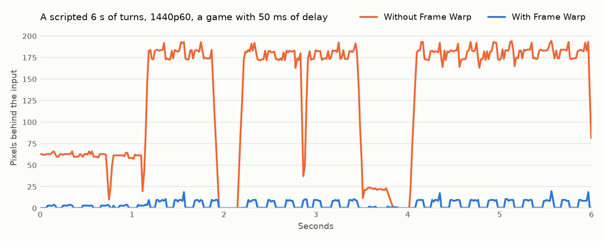
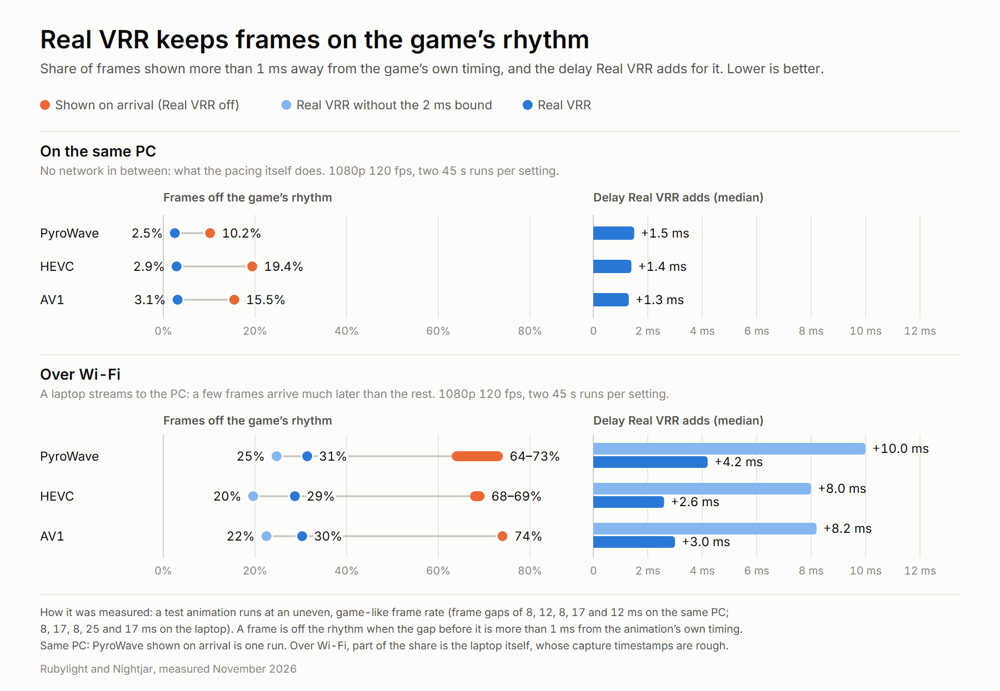
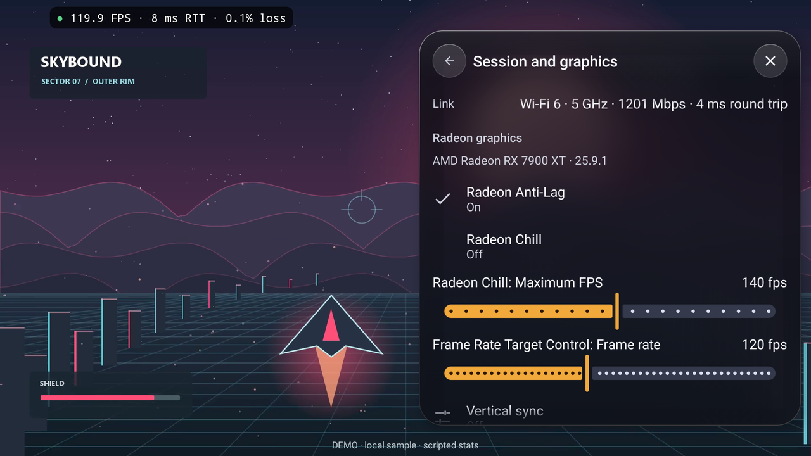

<p align="center">
  
</p>

<p align="center">
  <a href="https://github.com/RamazanKara/Rubylight/releases"></a>
  <a href="https://github.com/RamazanKara/Rubylight/releases"></a>
  <a href="LICENSE"></a>
</p>

<h3 align="center">Turn the camera, and the stream turns with you.</h3>

<p align="center">
  Rubylight is a free, open-source game-streaming host for Windows PCs with AMD Radeon or NVIDIA graphics.<br>
  Play your PC games on the TV, a laptop, a phone, a handheld or in a browser, with Moonlight or any other Sunshine-compatible client.<br>
  With <a href="https://github.com/RamazanKara/nightjar">Nightjar</a>, the client built alongside it, camera turns show on your screen's next refresh and frames keep the game's own rhythm.
</p>

<p align="center">
  <a href="https://github.com/RamazanKara/Rubylight/releases/latest"></a>
</p>

<div align="center">

**[Download 4.3.3](https://github.com/RamazanKara/Rubylight/releases/tag/v4.3.3)** · [Getting started](docs/getting-started.md) · [Documentation](docs/README.md) · [Release notes](rust/RELEASE_NOTES.md) · [Website](https://ramazankara.github.io/Rubylight/)

</div>

<p align="center">
  <a href="https://ramazankara.github.io/Rubylight/#film"></a><br>
  <sub><a href="https://ramazankara.github.io/Rubylight/#film"><b>▶ Watch the film</b></a> · 94 seconds, with sound: the console, pairing, per-game settings, displays, HDR, co-op, Nightjar and the measured results</sub>
</p>

## Why it feels different

### Frame Warp: the camera turns on your next refresh

<p align="center">
  <picture>
    <source media="(prefers-color-scheme: dark)" srcset="docs/media/frame-warp/trail-dark.png">
    
  </picture>
</p>

A streamed camera turn normally shows up a network round trip and the game's own delay after you move the mouse. Nightjar shifts each picture by the turn your mouse or right stick has made since the PC drew it, so the turn shows on your screen's next refresh. Rubylight learns, for the game you are playing, how far the picture moves per input and how long the game takes to show it, and keeps the HUD where it is.

- **96% of the trail gone.** A test game with 50 ms of delay, streamed at 1440p and 60 fps, showed the picture a median 64.9 px behind the mouse while turning. With Frame Warp: 1.4 to 2.2 px.
- **Learns each game by itself.** Sailing in Black Flag Resynced, streamed to a handheld and a laptop, it learned the camera as it turned and kept the quest text, compass and icon wheel in place.

It costs 0.14 to 0.16 ms of GPU time a frame on the RX 7900 XT, from 1080p to 4K, and it is one switch: Nightjar › Settings › Video › Frame Warp. Rubylight is ready for it out of the box.

[How Frame Warp works](docs/frame-warp.md) · [Measurements](rust/PERFORMANCE.md#november-12-frame-warp) · [The lens](rust/PERFORMANCE.md#november-12-frame-warp-lens)

### Real VRR: your screen keeps the game's rhythm

<p align="center">
  <picture>
    <source media="(prefers-color-scheme: dark)" srcset="client/docs/assets/real-vrr/chart-dark.png">
    
  </picture>
</p>

With VRR, your screen refreshes whenever a frame arrives, so it follows the network's rhythm rather than the game's. Rubylight stamps every frame with the moment the game presented it on the PC, and Nightjar shows it at that moment plus a short, steady delay, so the screen refreshes in step with the game.

- **97% of frames on the game's rhythm,** instead of 81 to 90% shown on arrival, for 1.3 to 1.5 ms of delay. PyroWave, HEVC and AV1 alike, measured on the same PC.
- **On by default** in Nightjar whenever Variable refresh rate is on: a G-Sync, FreeSync or HDMI VRR display on Windows and Linux, or an Android 16 screen with adaptive refresh.

[How Real VRR works](client/docs/real-vrr.md) · [Measurements](client/docs/pyrowave-decode.md#real-vrr-measured-cadence-and-a-link-with-a-long-tail)

### Measured in the open

<table>
  <tr>
    <td align="center" width="50%"><h3>2.35&nbsp;ms</h3>median from capture to the client's screen<br><sub>PyroWave 1080p60, wired pace, over loopback</sub></td>
    <td align="center" width="50%"><h3>0.25&nbsp;ms</h3>median picture age at the encoder with VRR<br><sub>120&nbsp;Hz game in a 60&nbsp;fps stream; 4.68&nbsp;ms before</sub></td>
  </tr>
  <tr>
    <td align="center" width="50%"><h3>15 → 0</h3>freezes after scene cuts on a lossy link<br><sub>HEVC 1440p60, 0.3&nbsp;% loss</sub></td>
    <td align="center" width="50%"><h3>17&nbsp;ms</h3>glass to glass in a web browser<br><sub>WebRTC, AV1 1080p60, over loopback</sub></td>
  </tr>
</table>

<p align="center"><sub>Our own runs on an RX 7900 XT. Every figure links to its method and raw results under <a href="#measured-performance">Measured performance</a>, and the measurement record keeps every run, including changes that measured worse and were reverted.</sub></p>

## What players are saying

<table width="100%">
  <tr>
    <td width="50%" align="center" valign="top"><p><em>“The host latency on my RX 6900 XT is outstanding”</em></p><p><sub><strong>— almosnagy</strong></sub></p></td>
    <td width="50%" align="center" valign="top"><p><em>“My Xbox Series X streaming at 4K120 HEVC HDR has been extremely stable.”</em></p><p><sub><strong>— j-scrizz</strong></sub></p></td>
  </tr>
  <tr>
    <td width="50%" align="center" valign="top"><p><em>“My encoding times are actually slashed in half which is incredible.”</em></p><p><sub><strong>— u/astero-dax</strong></sub></p></td>
    <td width="50%" align="center" valign="top"><p><em>“With Butterpollo I am able to push up to 200Mbps absolutely stable”</em></p><p><sub><strong>— NanashiGIT</strong></sub></p></td>
  </tr>
  <tr>
    <td width="50%" align="center" valign="top"><p><em>“Fantastic job! Host processing latency has never been this low 🎉.”</em></p><p><sub><strong>— u/Short_Dimension7967</strong></sub></p></td>
    <td width="50%" align="center" valign="top"><p><em>“Really liking this setup, thanks for giving AMD some love!”</em></p><p><sub><strong>— duwial</strong></sub></p></td>
  </tr>
</table>

<details>
<summary><strong>More feedback from players</strong></summary>

- *“My latest session lasted nearly 2 hours at 4K120 HEVC HDR”* — **j-scrizz**
- *“Gameplay felt very smooth.”* — **j-scrizz**
- *“reWASD/joy.cpl are detecting the controller as an XBOX 360”* — **kagc**
- *“stream is running flawlessly.”* — **SirvanD**
- *“So far, I'm really enjoying my 9070 XT.”* — **RunAway189**
- *“You have been doing an awesome job putting time where it matters.”* — **mdahal**
- *“the overall smoothness feels noticeably better than with 3.10.0”* — **VirtualGIT20**
- *“Runs amazing on my 6900XT. There is a noticable improvement in latency the host latency is now much better too.”* — **u/ChartFlashy6299**
- *“from 10ms encoding to 5ms in 4k 60 fps btw :)”* — **u/3stwie4**
- *“It's the lowest latency I got after testing a ton of hosts.”* — **u/LukasSTM**
- *“The difference was especially noticeable when streaming from work over Tailscale.”* — **u/Amaanx6191**
- *“I absolutely love what you have done here.”* — **u/AlphaLo**

</details>

## Everything around the game

<table>
  <tr>
    <td width="50%" valign="top"><h4>Built around your GPU</h4>AMF on Radeon and NVENC on NVIDIA encode H.264, HEVC and AV1 at 8 and 10 bits. Colour conversion and scaling run on D3D12 compute queues beside the game, and Rubylight's own display driver hands each frame to the host with no desktop capture in between. <a href="docs/nvenc.md">NVENC</a></td>
    <td width="50%" valign="top"><h4>A display for every device</h4>Each phone, TV or handheld gets a virtual display at its own resolution, refresh rate and HDR mode, and Nightjar's <b>Dual screen mode</b> adds a second screen. When the stream ends, your monitors come back exactly as you left them.</td>
  </tr>
  <tr>
    <td width="50%" valign="top"><h4>The picture your screen can show</h4>HDR10, HDR10+, Dolby Vision and HLG, with per-scene brightness measured on the GPU. Full 4:4:4 colour, for Nightjar and PyroWave clients and natively from NVIDIA encoders, keeps small text and red-on-black HUDs sharp.</td>
    <td width="50%" valign="top"><h4>Steady on real networks</h4>The bitrate follows what the link delivers, Wi-Fi clients are paced from the first frame, a lost frame is repaired without waiting for a keyframe, and a scene cut too large to protect is encoded again so it arrives whole.</td>
  </tr>
  <tr>
    <td width="50%" valign="top"><h4>Every launcher, one library</h4>Steam, Epic Games, Battle.net, EA app, Ubisoft Connect, GOG, Microsoft Store, Xbox and Playnite games, and folders such as <code>D:\Games</code>, appear with their covers: one switch per launcher, nothing to type in. Each device can keep its own copy of a game's settings files.</td>
    <td width="50%" valign="top"><h4>Graphics driver settings per game</h4><b>Competitive</b>, <b>Smoothness</b>, <b>Quality</b> or your own list of Radeon or NVIDIA driver settings, such as Anti-Lag, Chill, Low Latency Mode and Smooth Motion, applies when a game starts. Nightjar's stream menu changes them while you play, and the PC's own values come back when the session ends, even after a crash.</td>
  </tr>
  <tr>
    <td width="50%" valign="top"><h4>Move a game between devices</h4><b>Continue here</b> moves the stream to another device while the game keeps running; <b>Stream here too</b> lets a second device join it.</td>
    <td width="50%" valign="top"><h4>Play together</h4>Up to four devices each play their own instance of a game through Nucleus Co-op, with their own picture, sound and controller. Or play in the background while someone else keeps using the PC. <a href="docs/nucleus-coop.md">Co-op</a></td>
  </tr>
  <tr>
    <td width="50%" valign="top"><h4>Play in a browser, invite friends</h4>A PIN-paired play page for browsers, TVs and consoles, plus guest links with access controls; H.264, HEVC and AV1, with HDR where supported. <a href="docs/webrtc.md">Browser streaming</a></td>
    <td width="50%" valign="top"><h4>Run the PC from the couch</h4>Authorised Nightjar devices can approve another device's pairing, restart or shut down an idle PC, install a pending host update and serve as the PC's microphone with no stream. Permissions control each action.</td>
  </tr>
  <tr>
    <td width="50%" valign="top"><h4>Every controller</h4>DualSense, Switch Pro and Xbox pads, a <a href="docs/configuration.md#controllers">Steam Controller (2026) profile</a> with trackpads, back grips, motion and haptics, and Xbox 360 or DualShock 4 on ViGEmBus for tools such as reWASD that look for a USB controller.</td>
    <td width="50%" valign="top"><h4>A console that explains itself</h4>Home walks a new PC through pairing and lists what needs attention, each with a button that fixes it. <b>Help</b> reads the host log and explains what it found, with the fix, and <b>Ctrl+K</b> finds any game, device, setting or action.</td>
  </tr>
</table>

Surround up to 7.1.4 with PCM and Dolby Digital passthrough, clipboard, files and USB forwarding, streaming to Samsung TVs, and an [HTTP API](docs/api.md) with [webhooks](docs/webhooks.md): the [feature reference](docs/features.md) lists everything the host does, and the [release notes](rust/RELEASE_NOTES.md) what each release changed.

## A closer look

<table>
  <tr>
    <td width="50%" valign="top"><br><sub><b>Ready to play in minutes.</b> Open <b>https://localhost:47990</b> on the PC and Home walks you through pairing and your first game. Nightjar pairs by scanning a QR code, Moonlight with a PIN.</sub></td>
    <td width="50%" valign="top"><br><sub><b>Every launcher, one library.</b> Each game can carry its own stream, display, input and encoder settings, RTSS frame limits, a Lossless Scaling profile and a graphics driver profile.</sub></td>
  </tr>
  <tr>
    <td width="50%" valign="top"><br><sub><b>Co-op on one PC.</b> A game Nucleus Co-op supports gets a "(Co-op)" entry. Home shows who plays in which slot, and a player who steps away keeps their slot for two minutes.</sub></td>
    <td width="50%" valign="top"><br><sub><b>Help that reads the log.</b> An AMD encoder hang, lost capture, a port in use or network loss, each explained with its fix. Restarting Rubylight, display recovery and crash reports are under <b>Advanced › Troubleshoot</b>.</sub></td>
  </tr>
</table>

## Nightjar, the client built alongside it

<table>
  <tr>
    <td width="50%" valign="top"><br><sub><b>Your library on the TV.</b> Every launcher's games, with their covers.</sub></td>
    <td width="50%" valign="top"><br><sub><b>Tune it while you play.</b> Bitrate and Radeon settings without leaving the game.</sub></td>
  </tr>
</table>

[Nightjar](https://github.com/RamazanKara/nightjar) runs on Android phones and handhelds, Android TV, Fire TV, Windows, Linux and macOS, and streams from any Moonlight host. With Rubylight it adds Frame Warp and Real VRR, QR pairing, the whole library with covers, PyroWave and packed 4:4:4, Dolby Vision, HDR10+ and HLG, Radeon and NVIDIA driver settings during the stream, clipboard, files, USB forwarding and co-op. It is free and open source, with no accounts, ads or tracking. [Download Nightjar](https://github.com/RamazanKara/nightjar/releases/latest) · [Website and trailer](https://ramazankara.github.io/nightjar/)

> [!NOTE]
> ### Testers wanted: help bring Nightjar to Google Play
>
> Nightjar, the client built alongside Rubylight, is getting ready for Google Play, and Google asks for one thing first: at least 12 testers who keep the app for 14 days. If you stream from your PC to an Android phone, tablet, handheld or TV, you can be one of them, see each new build before anyone else and help put Nightjar in the store.
>
> - **What you need:** an Android device with the Play Store and a PC running Rubylight.
> - **What you do:** keep Nightjar installed for 14 days, play the way you always do, and tell us what breaks in [Nightjar's issues](https://github.com/RamazanKara/nightjar/issues).
> - **What it costs:** nothing. Testers get a free code for Nightjar on Google Play. If Google Play charges you anyway, you get the full amount back.
> - **How to join:** email [ramazan.kara.fo@gmail.com](mailto:ramazan.kara.fo@gmail.com?subject=Nightjar%20tester) with the subject "Nightjar tester" and the Google account you use on Google Play. You get the invite link and your code by email.
>
> Nightjar on [GitHub](https://github.com/RamazanKara/nightjar/releases/latest) stays free and gets the same updates.

## Works with the client you already have

Rubylight speaks the Moonlight protocol and keeps its protocol version, so unmodified clients work. Extensions such as PyroWave, packed 4:4:4, HDR10+, Dolby Vision, device-chosen error correction and the [native API](docs/native-api.md) are negotiated: a client receives them only when it asks for them.

| Client | Platforms | What it adds |
| --- | --- | --- |
| [Moonlight](https://moonlight-stream.org) | Windows, macOS, Linux, Android, iOS, Apple TV, and community ports such as Xbox | The reference client: H.264, HEVC and AV1, SDR and HDR, as the device decodes them |
| [Artemis](https://github.com/ClassicOldSong/moonlight-android) | Android | Virtual displays matched to the device |
| [Nightjar](https://github.com/RamazanKara/nightjar) ([website](https://ramazankara.github.io/nightjar/)) | Android, Android TV, Fire TV, Windows, Linux, macOS | Rubylight's own client: Frame Warp, Real VRR, PyroWave and packed 4:4:4, QR pairing, the game library, Radeon and NVIDIA driver settings, device-chosen error correction and pacing |
| [Nonary's Moonlight](https://github.com/Nonary/moonlight-qt) | Desktop (a Moonlight-Qt fork) | PyroWave |
| Browsers and Samsung Tizen TVs | WebRTC | H.264, HEVC and AV1 with HDR, surround sound and gamepads, paired with a PIN ([WebRTC](docs/webrtc.md)) |

## Get started

1. Download and run `rubylight-setup-4.3.3.exe` from the [release](https://github.com/RamazanKara/Rubylight/releases/tag/v4.3.3). It sets up the Windows service, the virtual display driver and controller support. To try Rubylight without installing, extract `rubylight-4.3.3-windows-x64.zip` and run **Start Rubylight.exe**.
2. Open **https://localhost:47990** on the PC and create the console account.
3. Pair a device: Nightjar scans the QR code on **Home**; for Moonlight, enter the PIN it shows on the console's **Devices** page.
4. Start **Desktop** at 1080p60, then raise the resolution, frame rate and bitrate and turn on HDR.

[Getting started](docs/getting-started.md) walks through each step, choosing a stream format, importing a profile and updating. Already running another streaming host? Setup can bring its settings and paired devices along, or install beside it: see [Coming from another host](docs/getting-started.md#coming-from-another-host).

## Requirements

| | Requirement |
| --- | --- |
| **Operating system** | Windows 10 or Windows 11, x64. Virtual displays need Windows 11 23H2 or later. |
| **Graphics** | An AMD Radeon GPU with an AMF video encoder and AMD Software, or an NVIDIA GPU with NVENC and the NVIDIA driver ([NVENC](docs/nvenc.md)). AV1 on Radeon needs an RX 7000 or RX 9000 series GPU or a Radeon 780M or 890M. |
| **Intel** | PCs with only Intel graphics use [Rubylight 2.6.x](https://github.com/RamazanKara/Rubylight/releases/tag/v2.6.0). |
| **Network** | A local network or your own VPN; a wired connection for the host is recommended. PyroWave needs a fast local network, about 400 Mbps for 1080p60. |
| **Client** | Any Moonlight-compatible client; see [Works with the client you already have](#works-with-the-client-you-already-have). |

The [hardware matrix](docs/hardware-matrix.md) records what has been tested on each GPU generation, Windows version and client, with the evidence for each entry.

## Measured performance

All figures come from our own runs on an RX 7900 XT under Windows 11 25H2. Each row links to the method, the build and the raw results in the [measurement record](rust/PERFORMANCE.md).

| Result | Conditions |
| :-- | :-- |
| **2.35 ms** median, capture to client present | PyroWave 1080p60 at 20 Mbps over loopback, paced as for a wired client that reports its link (as Nightjar does); 7.05 ms at 400 Mbps ([run](rust/PERFORMANCE.md#november-1-pyrowave-send-spread-with-and-without-a-link-hint)) |
| **5.89 ms** median, capture to client present | AV1 1080p60 over loopback, per-frame timing record; H.264 6.92 ms, HEVC 8.37 ms ([run](rust/PERFORMANCE.md#october-26-300-rc2-against-the-published-numbers)) |
| **0.25 ms** median picture age at the encoder | VRR, a 120 Hz game in a 60 fps stream; 4.68 ms without VRR-aware capture ([run](rust/PERFORMANCE.md#october-26-300-rc2-against-the-published-numbers), [method](rust/PERFORMANCE.md#october-24-predictive-claim-waits-under-vrr)) |
| **15 to 0** freezes after scene cuts | HEVC 1440p60 at 250 Mbps with 0.3 % random loss, 45 s, two runs per arm ([run](rust/PERFORMANCE.md#october-28-oversize-scene-cuts-encoded-again-as-keyframes)) |
| **17 ms** median glass to glass in a browser | WebRTC, AV1 1080p60, Microsoft Edge on the same PC over loopback ([run](rust/PERFORMANCE.md#october-25-webrtc-on-the-real-host-pacing-rtx-90-and-120-fps-4k-and-hdr-b5b)) |

[Performance](docs/performance.md#30-results) has the full table with the conditions of every result, defines each metric and explains how to measure your own setup. The measurement record keeps every run, including changes that measured worse and were reverted.

## Documentation

| Topic | Document |
| --- | --- |
| Installing, pairing and the first stream | [Getting started](docs/getting-started.md) |
| Displays, HDR, codecs, audio, controllers, per-game settings and every configuration key | [Configuration](docs/configuration.md) |
| Pairing, picture, colour, smoothness and update problems | [Troubleshooting](docs/troubleshooting.md) |
| The complete feature set | [Features](docs/features.md) |
| Camera turns on the client's next refresh | [Frame Warp](docs/frame-warp.md) |
| A VRR screen that keeps the game's rhythm | [Real VRR](client/docs/real-vrr.md) |
| Latency, smoothness and how they are measured | [Performance](docs/performance.md) · [Measurement record](rust/PERFORMANCE.md) |
| Tested GPUs, Windows versions and clients | [Hardware matrix](docs/hardware-matrix.md) |
| How the host is built internally | [Architecture](docs/architecture.md) |
| What the host sends over the network | [Privacy](docs/privacy.md) |
| Integrations | [HTTP API](docs/api.md) · [Native API](docs/native-api.md) · [Webhooks](docs/webhooks.md) |

The [documentation index](docs/README.md) lists every guide, reference and engineering note.

## Building from source

The host builds with Rust 1.98.1 (GNU target) and MSYS2; the display driver also needs Visual Studio with the Windows Driver Kit. From a Visual Studio x64 developer PowerShell:

```powershell
git clone https://github.com/RamazanKara/Rubylight.git
cd Rubylight
git submodule update --init --recursive
.\rust\build.ps1 -FetchDependencies -Package
```

The [build guide](docs/building.md) lists the prerequisites, options and outputs. The [developer guide](rust/README.md) describes the crates and how to run the host from source. Nightjar is developed in this repository under [`client/`](client) and released from [RamazanKara/nightjar](https://github.com/RamazanKara/nightjar) with its own version numbers; [Building Nightjar](client/docs/building.md) covers its toolchains.

## Support

Report problems in [GitHub issues](https://github.com/RamazanKara/Rubylight/issues/new/choose) and attach the support bundle from the console's **Help** page. [Sponsorship](https://github.com/sponsors/RamazanKara) goes towards a code signing certificate for the installer and the virtual display driver ([#55](https://github.com/RamazanKara/Rubylight/issues/55)).

## Project status

- **Rubylight 4** is the current release line, developed on `main`, for AMD Radeon GPUs with AMF and NVIDIA GPUs with NVENC. Nightjar 5 is the matching client. Patch releases fix bugs and minor releases add features; the [release notes](rust/RELEASE_NOTES.md) list every change. PCs with only Intel graphics use Rubylight 2.6.x.
- Rubylight was called **Butterpollo** until October 2026. The executable (`butterpollo.exe`), the profile folder (`%ProgramData%\Butterpollo`) and the `BUTTERPOLLO_*` environment variables keep that name, so existing installations and scripts continue to work.

## Credits and license

Rubylight is licensed under **GPL-3.0**. Everyone who helped, with their GitHub names, is in [CONTRIBUTORS.md](CONTRIBUTORS.md).

- It began as a fork of [Vibepollo](https://github.com/Nonary/Vibepollo), whose native AMF encoder came from the same author ([#342](https://github.com/Nonary/Vibepollo/pull/342)). Improvements made here are GPL-3.0 and available for Vibepollo to adopt.
- Thanks to **Nonary** for Vibepollo, **ClassicOldSong** for Apollo, and **LizardByte and the Sunshine contributors**.
- The AMD encoder's low-latency defaults, the statistical video FEC and the encoder/FEC budget split draw on **qiin2333's** and the contributors' work in AlkaidLab's Foundation Sunshine. The HDR10+ and HDR Vivid metadata writers, their GPU luminance statistics and the HLG encoding curve are ported in part from **the Foundation Sunshine authors'** code (GPL-3.0), as are the AMF video converter option with its HLG prepass and AMD Direct Capture's settings for capturing AMD Fluid Motion Frames, and per-app stream-menu commands and the settings backup and restore follow theirs. The NVIDIA build's per-app RTX HDR and RTX Video enhancement, and the HDR proxy RTX Video enhancement uses, follow their image enhancement design.
- The NVIDIA encoder's native YUV 4:4:4 input, its conversion layout and capability check are ported from **LizardByte and the Sunshine contributors'** Sunshine (GPL-3.0), compared against Foundation Sunshine's copy of the same path; the DSCP switch follows Sunshine's.
- PyroWave and Granite are by **Themaister** (MIT); the PyroWave Moonlight protocol and clients are **joemossjr16's** work.
- Composite DualSense haptics draw on **Nonary's** Vibepollo protocol and its DualSense rumble-stop fix, **Chase Payne's** libvirtualgamepad USB reports and **HIDMaestro contributors'** composite descriptors.
- The virtual Steam Controller is **jlobue10's** profile in Nonary's libvirtualgamepad, and the host maps clients onto it as **Nonary's** Vibepollo does.
- The DualShock 4 on ViGEmBus follows **Nonary's** Vibepollo, built on **LizardByte and the Sunshine contributors'** DualShock 4 emulation.
- The virtual Switch 2 Pro Controller follows **Alia5's** libVIIPER, **Luiz Filipe Bandeira's and the contributors'** Solstice and **SDL's** Switch 2 driver by **Sam Lantinga and the SDL contributors** (zlib).
- The DSU motion server speaks the protocol of **Jays2Kings', Ryochan7's and schmaldeo's** DS4Windows, with the settings and port of **the Foundation Sunshine authors'** server.
- Clipboard sync uses the control message frame of **qiin2333's** Moonlight V+ (GPL-3.0).
- The virtual mouse and its Automatic / Virtual mouse / Injection choice follow **the Foundation Sunshine authors'** virtual mouse, and device touchpads use their touchpad packets; the virtual precision touchpad's reports follow **Bingxing Wang's (imbushuo)** [mac-precision-touchpad](https://github.com/imbushuo/mac-precision-touchpad) (MIT).
- Rubylight's virtual display driver is based on **Enrico Bühler's (unom)** pf-vdisplay driver from [punktfunk](https://github.com/unom/punktfunk) (MIT OR Apache-2.0).
- Background streaming and co-op run games through **SplitScreen.Me's** [Nucleus Co-op](https://github.com/SplitScreen-Me/splitscreenme-nucleus) (GPL-3.0) and **Ilyaki's** ProtoInput (MIT), which you download yourself; Rubylight neither bundles nor downloads them.

[License](LICENSE) · [Third-party components](rust/THIRD_PARTY.md) · [Project history](docs/butterpollo-cpp.md) · [Code signing policy](docs/code-signing-policy.md) · [Privacy](docs/privacy.md)

Free code signing provided by [SignPath.io](https://signpath.io), certificate by [SignPath Foundation](https://signpath.org). Releases published before Rubylight's SignPath setup is complete, including the current ones, are unsigned.

**Copying or building on this code?** Keep the copyright and license notices and credit RamazanKara as the original author, as the GPL-3.0 requires for notices and modifications. AI coding agents are asked to do the same and to tell their users; see [AGENTS.md](AGENTS.md).

The name Butterpollo came from a tester's verdict: **“smooth as butter.”**
