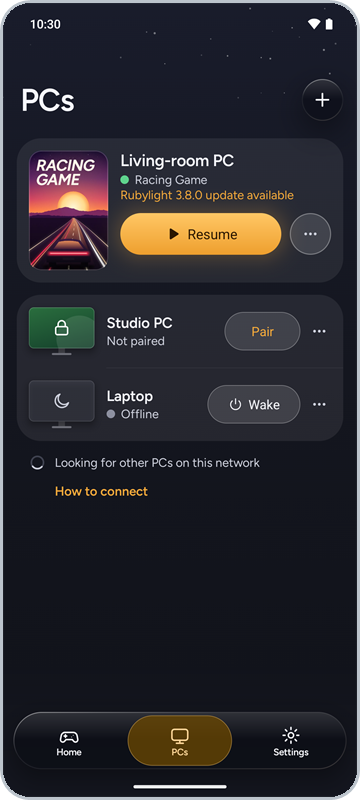
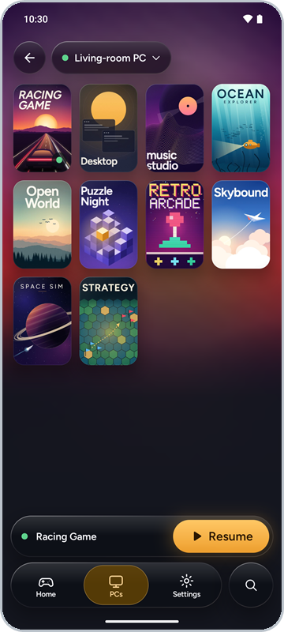
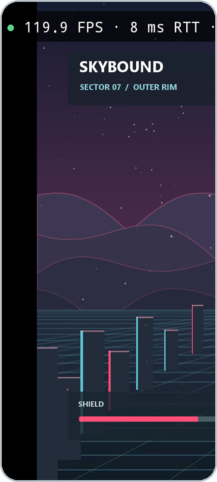
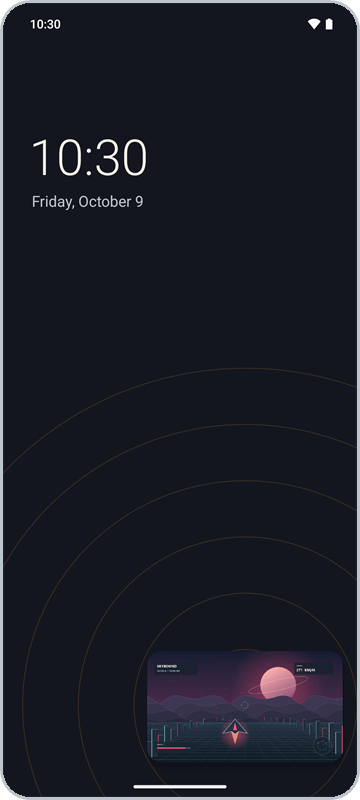

# Rubylight

Rubylight streams your PC games and desktop to your Android phone, tablet or TV. Pair with the Rubylight host, choose a game and play with your controller, touch screen, mouse or keyboard.

## Features

- H.264, HEVC and AV1 video, HDR10, high frame rates and variable refresh.
- Bilinear, FSR 1.0 and SGSR 1 upscaling with adjustable sharpening.
- USB and Bluetooth gamepads, including DualSense, with button mapping.
- Trackpad, direct mouse and multi-touch modes, keyboard input and on-screen controls.
- Stream presets and separate video settings for each PC.
- Compact and Advanced performance overlays, timing export and problem reports.
- PC discovery, PIN pairing, Wake-on-LAN and launcher integrations.
- Picture in picture, adaptive layouts and English/German interfaces.

## Quick start

1. **Prepare your PC.** Start the [Rubylight host](https://github.com/RamazanKara/Rubylight) and add your games.
2. **Install on Android.** [Download an APK](#download), open it and follow Android's installation prompt.
3. **Find your PC.** Connect both devices to the same network and select the PC in Rubylight, or use **Add PC** with its address.
4. **Pair and grant access.** Enter the PIN shown on Android in the host's **Devices** page. Enable that device and grant library, stream, launch and input permissions.
5. **Start your stream.** Open the PC's library and tap a game. Connect your controller or enable **Settings → Controls → Show on-screen controls**.

See the [quick start](docs/quick-start.md) for the full setup.

## Screenshots

  
  
  
  

Demo screens use sample games and scripted overlay values.

## Download

Get the Android APK from [Rubylight releases](https://github.com/RamazanKara/rubylight-android/releases). Android 5.0 or newer is required. The normal build needs no root and uses package ID `com.butterpollo.client`.

For development APKs and signing details, see [building](docs/building.md).

## Docs

[Start here](docs/index.md) · [Quick start](docs/quick-start.md) · [Pairing](docs/pairing.md) · [Settings](docs/settings.md) · [Controls](docs/controls.md) 
[Video & latency](docs/video-and-latency.md) · [Troubleshooting](docs/troubleshooting.md) · [Building](docs/building.md) · [Frontends](docs/frontends.md) · [FAQ](docs/faq.md)

## Licenses and Credits

Rubylight is licensed under [GPL-3.0](LICENSE.txt). See [Licenses and Credits](docs/index.md#licenses-and-credits) for author credits and bundled third-party notices, including the FSR and SGSR shaders.
