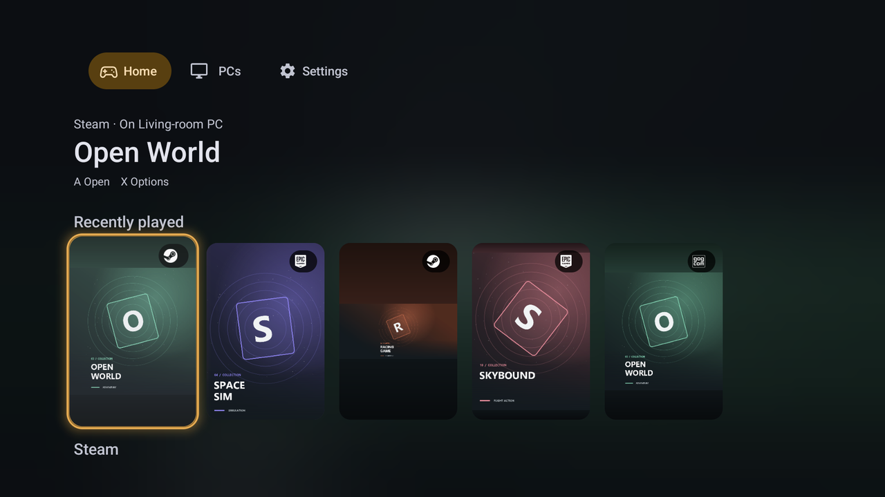
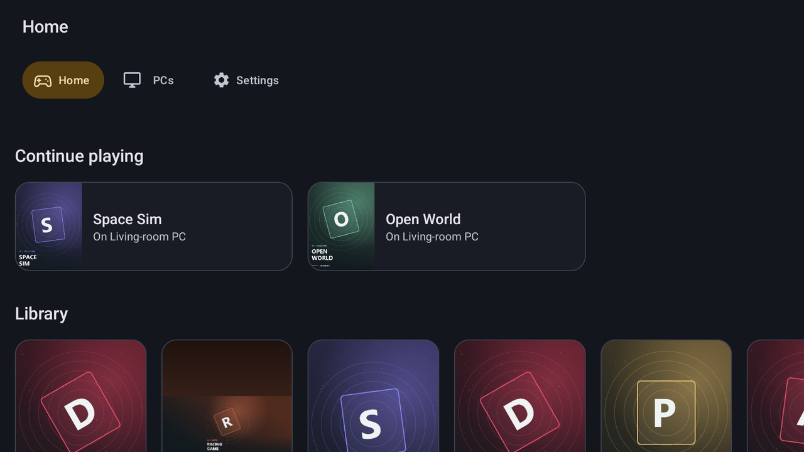
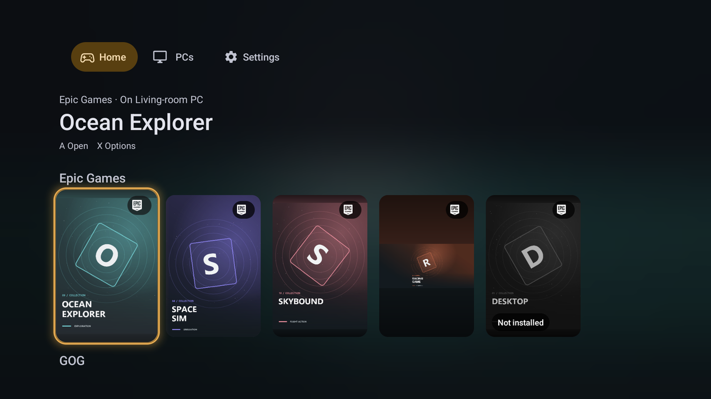
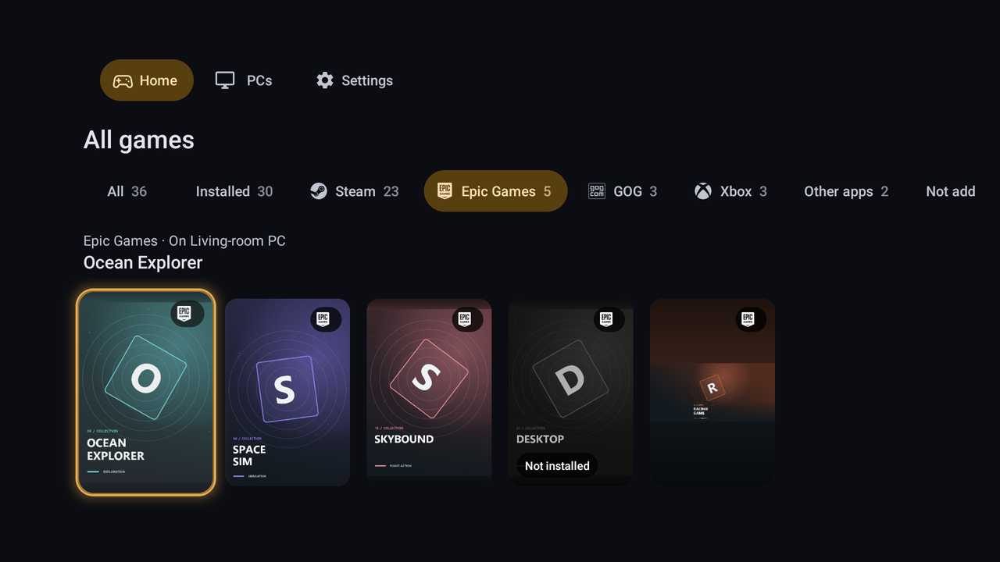
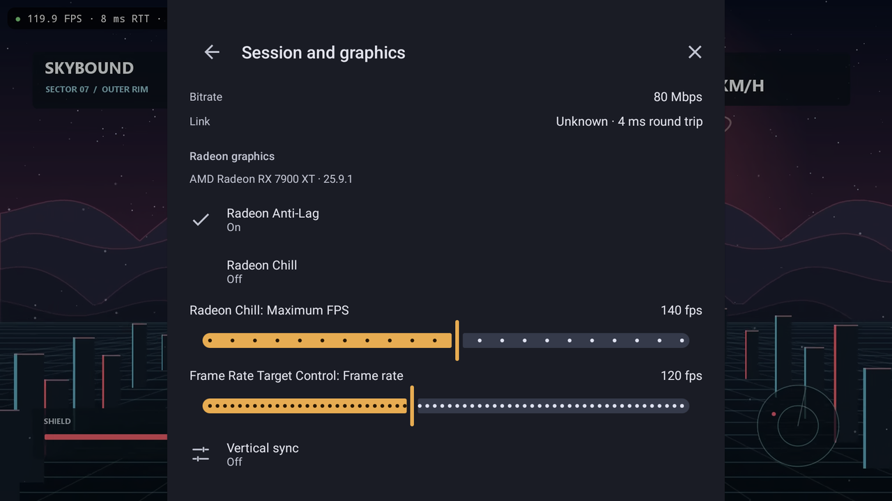

  

<h1 align="center">Nightjar 4.0</h1>

<h3 align="center">Turn your PC into a console. Play it on every screen you own.</h3>

Nightjar streams your PC games to Android phones, handhelds, tablets and TVs, and to Windows and Linux PCs, all on one Rust streaming engine. Your games from Steam, Epic Games, GOG, EA app, Ubisoft Connect, Battle.net and Xbox come together in one console library, and on a Retroid Pocket 6 over Wi-Fi a frame reaches the screen about 7 ms after your PC draws it. Nightjar works with Rubylight, Sunshine, Apollo, Vibepollo, NVIDIA GameStream and every other Moonlight-compatible host.

<b>Free and open source. No ads, no accounts, no analytics.</b>

  

  <a href="https://github.com/RamazanKara/nightjar/releases/latest/download/nightjar.apk"><b>Android</b></a> ·
  <a href="#android-tv-and-fire-tv"><b>Android TV and Fire TV</b></a> ·
  <a href="https://github.com/RamazanKara/nightjar/releases/latest"><b>Windows</b></a> ·
  <a href="https://github.com/RamazanKara/nightjar/releases/latest"><b>Linux</b></a>

  
  
  

<!-- showcase -->

  

  
  

## New in 4.0

<table>
<tr>
<td width="50%" valign="top"><b>Dolby Vision, HDR10+ and HLG.</b> Beside HDR10, each where your screen shows it; HDR10+ and HLG also through Vulkan, and HLG on PyroWave.</td>
<td width="50%" valign="top"><b>Your PC's clipboard, files and folders.</b> Copied text both ways, images, file transfer, the folders your PC shares and USB devices handed to the PC.</td>
</tr>
<tr>
<td valign="top"><b>Couch co-op.</b> Join a free player slot in a PC's split-screen co-op game from your phone, TV or laptop.</td>
<td valign="top"><b>A keyboard that knows when to show.</b> It opens for a text field in the stream, fits it and closes after.</td>
</tr>
<tr>
<td valign="top"><b>A new on-screen controller.</b> The Modern style: two face buttons at once, sticks that follow your thumb, and an editor right in the stream.</td>
<td valign="top"><b>A microphone for voice chat.</b> Echo cancellation, noise suppression, gain, and a one-tap mute button.</td>
</tr>
<tr>
<td valign="top"><b>Sound for your receiver.</b> Audio passthrough sends Dolby Digital, Dolby Digital Plus or PCM to a soundbar, receiver or TV.</td>
<td valign="top"><b>Windows and Linux, all the way.</b> The desktop client has Home, the overlay modes, quick resume, co-op and the sharing features too.</td>
</tr>
</table>

Plus QR pairing, a choice of error correction, Recover interrupted streams on by default, simpler settings and steadier TVs. See the [release notes](https://github.com/RamazanKara/nightjar/releases).

## Your whole library, from every store

With [Rubylight 3.0](https://github.com/RamazanKara/Rubylight) on your PC, Nightjar opens on Home, and Home is your entire collection. Rubylight finds the games you installed from Steam, Epic Games, GOG, EA app, Ubisoft Connect, Battle.net and the Xbox app, and Nightjar lays them out like a console.

- **One library across all your PCs.** Favourites first, then Continue playing, then everything else. A game on two PCs is one card, and covers stay on your device, so your library is there even while a PC sleeps.
- **A shelf for every store.** On the big screen, Home becomes rows of posters under a large hero of the focused game: Recently played, one row per store with its badge on every poster, and Other apps.
- **Games you haven't added yet.** A row shows the games your PC found in its stores but never added. Pick one and your PC adds it.
- **A page for every game.** Its store, whether it is running, installed or in HDR, the PC it runs on and the exact stream settings it will use, then Play or Resume.
- **Wake PC and play.** A sleeping PC's games stay on Home, marked "PC asleep". Pick one and Nightjar wakes the PC, waits for it and starts the game.

<!-- showcase -->

  
  

## Everything it does

The full list, with links to every guide, is in [docs/features.md](docs/features.md).

- **Library:** Home with favourites and Continue playing, a shelf per store on a TV, All games, a page per game, Wake PC and play, a confirm before a running game closes, Join co-op, and launching from the Android TV home screen, Beacon, ES-DE, Daijisho, Pegasus or a frontend's command line.
- **Pairing and PCs:** discovery, manual addresses and Wake-on-LAN; PIN, one-time PIN and QR pairing; per-device permissions; settings per PC and per game, profiles by network and a mobile data cap; Remote Monitor and Input-only; a PIN lock.
- **Picture:** H.264, HEVC and AV1 with decoder tuning per chip; HDR10, HDR10+, HLG and Dolby Vision; 10-bit SDR and full-colour 4:4:4 on Android and the desktop, wherever the decoder handles them; PyroWave on the GPU; FSR and Snapdragon GSR upscaling; Render through Vulkan; a virtual display at your device's resolution; adaptive refresh, VRR and phase-lock timing; beam racing on the desktop; rotation, picture-in-picture and external displays.
- **Quality and network:** Device controls bitrate up to 2000 Mbps, automatic resolution and frame rate, mid-stream bitrate and frame rate changes, a choice of error correction, Recover interrupted streams, riding out network drops of up to 60 seconds, Wi-Fi and link speed hints for the PC, and a guide to play away from home over Tailscale.
- **Sound:** stereo, 5.1 and 7.1 with low-latency AAudio, audio passthrough, and a microphone with echo cancellation, noise suppression, gain and a mute button.
- **Controls:** up to 16 controllers with per-model mapping and extra buttons for the touchpad click, Share and paddles; DualSense over USB with adaptive triggers and haptics; Xbox and Switch Pro USB drivers; Classic and Modern on-screen controllers; per-game touch controls; trackpad, direct and multi-touch modes and a local cursor with the PC's cursor shapes; a full PC keyboard; a keyboard that follows text fields; mouse, pen and keyboard shortcuts.
- **Sharing:** clipboard sync, clipboard images, files, shared folders and USB devices.
- **Diagnostics:** an overlay in Compact, Statistics and Debug with your PC's CPU and GPU readings, Why did my stream stutter?, an input latency test, a decoder benchmark without a PC, frame timings as CSV, a connection test and problem reports that stay on your device.
- **Look and feel:** controller and remote first, status in words and shapes as well as colour, settings that open on what most people change with search and presets, interface size, high contrast, reduced motion, three themes, 15 languages and offline help.

## Your PC's controls, in the stream menu

Press Back while you play. **Session and graphics** has Resume, Disconnect, End session and Close game, the facts of your connection (Wi-Fi generation, band, speed and round trip), and a **Radeon panel** for your PC's AMD driver features such as Anti-Lag and Radeon Chill. Every change goes back exactly as it was when the session ends. [Home and the session menu](docs/console.md).

<!-- showcase -->

  

## Fast where you feel it

- **About 7 ms from PC to screen** on a Retroid Pocket 6 over Wi-Fi: the median picture age of HEVC 1080p60 at 40 Mbps, measured on 2026-10-23 ([runs](https://github.com/RamazanKara/Rubylight/blob/main/rust/PERFORMANCE.md#october-23-rust-engine-against-the-c-engine-on-android-b8)).
- **Decoders tuned per chip.** Low-latency settings for Snapdragon, MediaTek, Tegra, Exynos, Google Tensor and Amlogic decoders ([decoder flags](docs/decoder-flags.md)), and decode times from real devices in the [device results](docs/devices.md#devices).
- **Frames timed to your display.** Pacing follows Android's adaptive refresh and the game's own frame rate, and Nightjar tells your PC how long frames wait for your screen so they arrive just in time.
- **A stream made for your link.** Nightjar tells your PC your wired link speed, or that you are on Wi-Fi, and how much video it lost each second, so the PC paces the stream and its error correction for your connection.

## One engine, every screen

Phones, foldables, handhelds, tablets, Android TV and Fire TV run the same Rust streaming engine as the Windows and Linux client. Home, your PCs, your settings, the session menu and the Radeon panel come with you to every one of them. The desktop client brings hardware decoding, HDR10, 10-bit SDR, full-chroma 4:4:4 on the hardware decoder, VRR pacing, controller-first navigation, GPU PyroWave decoding and beam racing, and brings its own FFmpeg, so the Linux build runs across distributions, from Ubuntu to Arch. [Android and desktop](docs/CLIENT-PARITY.md) · [Desktop client](protocol/desktop/README.md).

<!-- showcase -->

  

## Works with your host

Nightjar reads what each PC's host can do and shows exactly the features it offers, so every PC's settings fit it. [Rubylight 3.0](https://github.com/RamazanKara/Rubylight), the host built for Radeon, brings out everything on this page: the store library, the Radeon panel, live GPU statistics, every HDR format, full-colour 4:4:4, PyroWave, sharing, co-op and Wi-Fi pacing from the first frame. Every other Moonlight-compatible host gets the full stream, controls and diagnostics, plus the extras it offers, such as virtual displays and one-time PIN pairing on Apollo and Vibepollo, and host statistics on Vibepollo. The [host feature matrix](docs/PARITY-MATRIX.md) lists every feature for every host.

## Get started

1. Run a streaming host on your PC, such as [Rubylight](https://github.com/RamazanKara/Rubylight), [Apollo](https://github.com/ClassicOldSong/Apollo), [Sunshine](https://github.com/LizardByte/Sunshine) or [Vibepollo](https://github.com/Nonary/Vibepollo), and add your games.
2. Install Nightjar from the [latest release](https://github.com/RamazanKara/nightjar/releases/latest):
   - **Android** (5.0 and newer): [download the APK](https://github.com/RamazanKara/nightjar/releases/latest/download/nightjar.apk), open it and allow the install. Nightjar tells you when an update is out. To have [Obtainium](https://github.com/ImranR98/Obtainium) keep it current, add `https://github.com/RamazanKara/nightjar` there. PyroWave runs on 64-bit Android 10 and newer with a Vulkan 1.3 GPU ([video requirements](docs/video-and-latency.md#codecs)).
   - **Windows**: download `nightjar-desktop-<version>-windows-x86_64.zip`, unzip it and run `nightjar.exe`.
   - **Linux**: download `nightjar-desktop-<version>-linux-x86_64.tar.gz`, unpack it and run `./nightjar`.
3. Pick your PC on the network and enter the PIN Nightjar shows in your host's web UI. With Rubylight, you can instead tap **Scan QR code** in Add PC and scan the code on its Devices page.
4. If your host has per-device permissions, allow your device to list, view and launch apps and the input types you use. Then pick a game. With a Rubylight 3.0 host, Nightjar opens on [Home](docs/console.md); turn on Host control for your device to close games and change Radeon settings. [Pairing and permissions](docs/pairing.md).

### Android TV and Fire TV

Install AFTVnews' [Downloader](https://www.aftvnews.com/downloader/) from your TV's app store, enter the code **`3815143`** in its URL field and install the APK it downloads, or type the link `https://github.com/RamazanKara/nightjar/releases/latest/download/nightjar.apk`. Both always fetch the latest release. Allow Downloader to install apps when your TV asks.

### Coming from Moonlight?

Nightjar installs beside it, so you can try it without giving anything up: pair it once with your host and your games are there. Bring your on-screen keyboard layouts and Custom Keys files with you ([import](docs/controls.md#per-game-controls)), and point your launcher at Nightjar with **PC settings → Add games to a launcher**.

Coming from Rubylight Android? Nightjar is the same app under its new name. It installs over Rubylight Android 0.5.0 and keeps your PCs, pairings and settings.

## Built with its players

Nightjar moves at the speed of its players. PIN lock ([#35](https://github.com/RamazanKara/nightjar/issues/35)), the overlay in any corner ([#34](https://github.com/RamazanKara/nightjar/issues/34)) and waking a PC from Home ([#31](https://github.com/RamazanKara/nightjar/issues/31)) were asked for and released on the same day. 10-bit SDR ([#28](https://github.com/RamazanKara/nightjar/issues/28)), automatic bitrate limits ([#20](https://github.com/RamazanKara/nightjar/issues/20)), Vulkan rendering for frame generation ([#17](https://github.com/RamazanKara/nightjar/issues/17)), full chroma on AMD ([#16](https://github.com/RamazanKara/nightjar/issues/16)) and Beacon support ([#8](https://github.com/RamazanKara/nightjar/issues/8)) followed within days.

**[Ask for a feature](https://github.com/RamazanKara/nightjar/issues/new/choose)**, and add your device to the [device results](https://ramazankara.github.io/nightjar/devices.html) with the built-in benchmark.

## Docs

[Start here](docs/index.md) · [Everything Nightjar does](docs/features.md) · [Quick start](docs/quick-start.md) · [Pairing](docs/pairing.md) · [Settings](docs/settings.md) · [Controls](docs/controls.md) 
[Home and session menu](docs/console.md) · [Clipboard, files and USB](docs/sharing.md) · [Android and desktop](docs/CLIENT-PARITY.md) · [Desktop client](protocol/desktop/README.md) · [Beam racing](docs/beam-racing.md) · [Video & latency](docs/video-and-latency.md) · [Troubleshooting](docs/TROUBLESHOOTING.md) · [Building](docs/building.md) · [Frontends](docs/FRONTENDS.md) · [Translations](docs/TRANSLATIONS.md) · [FAQ](docs/faq.md) · [Privacy](docs/PRIVACY.md)

[GPL-3.0](LICENSE.txt) · [Credits and third-party notices](docs/index.md#license-and-credits)
