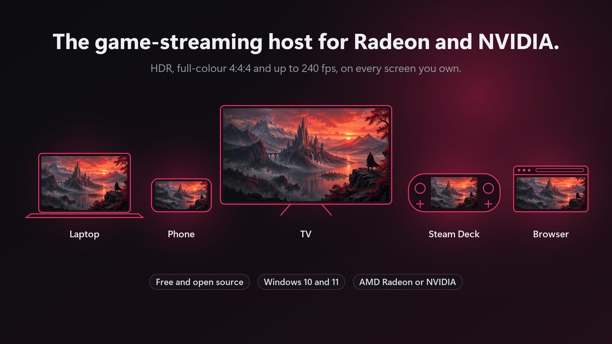
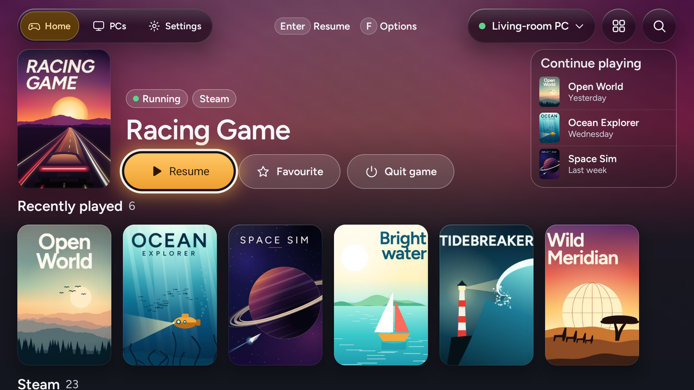
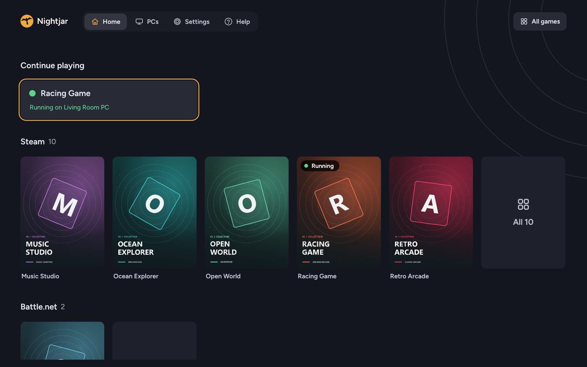

<p align="center">
  
</p>

<p align="center">
  <a href="https://github.com/RamazanKara/Rubylight/releases"></a>
  <a href="https://github.com/RamazanKara/Rubylight/releases"></a>
  <a href="LICENSE"></a>
</p>

<h3 align="center">Every game. Every screen. Every player.</h3>

<p align="center">
  Rubylight is a free, open-source game-streaming host for Windows PCs with AMD Radeon or NVIDIA graphics. It gathers every launcher's games, gives each TV, handheld, phone or laptop a display of its own, sets each game up for the device you play on, and puts your PC back exactly as it was when you're done.<br>
  It works with Moonlight and every Sunshine-compatible client, and does even more with <a href="https://github.com/RamazanKara/nightjar">Nightjar</a>, the client built alongside it.
</p>

<p align="center">
  <a href="https://github.com/RamazanKara/Rubylight/releases/latest"></a>
</p>

<div align="center">

**[Download 4.4.0](https://github.com/RamazanKara/Rubylight/releases/tag/v4.4.0)** · [Getting started](docs/getting-started.md) · [Documentation](docs/README.md) · [Release notes](rust/RELEASE_NOTES.md) · [Website](https://ramazankara.github.io/Rubylight/)

</div>

<p align="center">
  <a href="https://ramazankara.github.io/Rubylight/#film"></a><br>
  <sub><a href="https://ramazankara.github.io/Rubylight/#film"><b>▶ Watch the film</b></a> · 94 seconds, with sound: the console, pairing, per-game settings, displays, HDR, co-op, Nightjar and the measured results</sub>
</p>

<table>
  <tr>
    <td width="33%" valign="top"><br><sub><b>The console.</b> Home walks you through pairing and your first game.</sub></td>
    <td width="33%" valign="top"><br><sub><b>Your library on the TV.</b> Every launcher's games, with their covers.</sub></td>
    <td width="33%" valign="top"><br><sub><b>Tune it while you play.</b> Bitrate and Radeon settings without leaving the game.</sub></td>
  </tr>
</table>

## Why Rubylight

### Every launcher, one library

Turn on a launcher and its installed games appear with their covers: Steam, Epic Games, Battle.net, EA app, Ubisoft Connect, GOG, Xbox and Microsoft Store, Playnite, and folders such as `D:\Games`. There is nothing to type in and no shortcut to make, each launcher can sync by itself, and Steam collections and Playnite categories come along. With Nightjar, the library becomes a Home with covers, a shelf per store on the TV and a page for each game, and picking a game on a sleeping PC wakes it.

<p align="center">
  
</p>

### A display for every device

Each phone, TV or handheld gets a virtual display at its own resolution, refresh rate and HDR mode, so the game renders for the screen in your hands, not for the monitor on your desk. When the stream ends, or even after a crash, your monitors come back exactly as you left them.

- **Move a game between devices.** From Nightjar, **Continue here** moves the running game to the device you are holding while it keeps running, and **Stream here too** joins it from a second one.
- **Two screens on one device.** Nightjar's **Dual screen mode** streams a second display beside the game's.
- **Play in a browser.** A PIN-paired play page streams to browsers, Samsung TVs and consoles, with H.264, HEVC or AV1, HDR where supported, surround sound and gamepads. [Browser streaming](docs/webrtc.md)

### Set up for each game and each device

Every game can carry its own stream, display, input and encoder settings, RTSS frame limits, a Lossless Scaling profile and a graphics driver profile. They apply when the game starts and are removed when it ends.

- **Graphics driver profiles.** **Competitive**, **Smoothness**, **Quality** or your own list of Radeon or NVIDIA driver settings, such as Anti-Lag, Radeon Chill, Low Latency Mode and Smooth Motion. Rubylight records the PC's own values first and puts them back when the session ends, after a crash too.
- **Game settings files per device.** A TV keeps its 4K settings and a handheld its 1080p ones, and the PC's own files come back when the game closes.
- **Change it mid-game.** Nightjar's stream menu changes the bitrate, the frame rate and the driver settings without leaving the game.

### Play together

A game that Nucleus Co-op supports gets a "(Co-op)" entry. Each device that starts it joins as the next player, up to four, each in its own instance of the game with its own picture, sound and controller. Home shows who plays in which slot, and a player who steps away keeps their slot for two minutes.

- **Guests on your game.** A second paired device can join the game you are playing as the next player, with its own controller. You decide what each guest may do, and can let guests in for a set time.
- **Friends in a browser.** While you stream in the console, up to four friends open an invite link, type a name and watch in their own browsers, and play along with a controller or keyboard and mouse if you let them. They need no app, no account and no pairing.
- **Play while the PC is in use.** A device can play its own instance of a game in the background while someone else keeps using the PC's displays, keyboard and mouse.

<p align="center">
  
</p>

### Run the PC from the couch

Nightjar doubles as the PC's remote. A device you authorise can approve another device's pairing, close a game, put the PC to sleep and wake it, restart or shut down an idle PC, install a pending Rubylight update, run commands you set up on the PC, and serve as the PC's microphone with no stream running. Each action has its own permission. In any Moonlight client, holding L3+R3 opens a menu to go back to the game, disconnect, end the session or close the game.

### Smooth on real networks

Rubylight encodes H.264, HEVC and AV1 with AMF on Radeon and NVENC on NVIDIA, converts and scales each frame on the GPU beside the game, and on its virtual displays takes each frame straight from its own display driver. Wi-Fi clients are paced from the first frame, the bitrate follows what the link delivers and climbs back, a lost frame is repaired without waiting for a keyframe, and a scene cut too large to protect is encoded again so it arrives whole.

- **PyroWave,** a wavelet codec for wired and fast Wi-Fi networks that spends bitrate to cut delay, with 4:4:4 and HDR, for Nightjar and other PyroWave clients. [Measured](#measured-performance)
- **Frame Warp,** with Nightjar: a mouse or right-stick camera turn shows on your screen's next refresh, and the game's HUD stays in place. [How it works](docs/frame-warp.md)
- **Real VRR,** with Nightjar: on a G-Sync, FreeSync or HDMI VRR screen, frames are shown on the game's own rhythm instead of the network's. [How it works](client/docs/real-vrr.md)
- **Away from home.** Connect over a private VPN such as Tailscale, which keeps the PC off the open internet. Without one, Rubylight can ask your router to forward its ports, and where no port can be forwarded, Nightjar and the PC find a direct path through both routers, through public STUN servers and a public peer-to-peer directory that holds only encrypted notes, with no relay in between. [Play over the internet](docs/internet-play.md)

### The picture and sound your setup can play

HDR10, HDR10+, Dolby Vision and HLG, with per-scene brightness measured on the GPU so the display tone-maps each scene. Full 4:4:4 colour, for Nightjar and PyroWave clients and natively from NVIDIA encoders, keeps small text and red-on-black HUDs sharp. Sound goes up to 7.1.4 surround, or as PCM and Dolby Digital straight to your receiver, soundbar or TV, and can carry only the game you launched. On a GeForce RTX card, with the NVIDIA components downloaded on the console, Rubylight can turn on RTX HDR, which turns an SDR game into HDR, and RTX Video enhancement, for the whole PC or one game.

### Every controller

Each device gets a matching virtual pad: a DualSense with adaptive triggers for PlayStation controllers, a Switch Pro controller for Nintendo ones and an Xbox Series pad for the rest, or a Steam Controller with both trackpads, back grips and motion. Tools such as reWASD that look for a USB controller get an Xbox 360 pad or a DualShock 4 through ViGEmBus, which you install separately. With Nightjar, the clipboard works both ways, files go to and from the PC, and USB devices plugged into your device reach the PC.

### A console that explains itself

Open **https://localhost:47990** on the PC and Home walks you through pairing, by QR code for Nightjar or PIN for Moonlight, and your first game. It lists what needs attention, each with a button that fixes it. **Settings** holds the few settings most people change and **All settings** every other one, with one line of explanation each; **Ctrl+K** finds any game, device or setting. When something goes wrong, **Help** reads the host log and explains what it found, with the fix.

<table>
  <tr>
    <td></td>
    <td></td>
  </tr>
</table>

The [feature reference](docs/features.md) lists everything else, from streaming the lock screen to the [HTTP API](docs/api.md) and [webhooks](docs/webhooks.md), and the [release notes](rust/RELEASE_NOTES.md) what each release changed.

## What players are saying


<table width="100%">
  <tr>
    <td width="50%" align="center" valign="top"><p><em>“The host latency on my RX 6900 XT is outstanding”</em></p><p><sub><strong>— almosnagy</strong></sub></p></td>
    <td width="50%" align="center" valign="top"><p><em>“My Xbox Series X streaming at 4K120 HEVC HDR has been extremely stable.”</em></p><p><sub><strong>— j-scrizz</strong></sub></p></td>
  </tr>
  <tr>
    <td width="50%" align="center" valign="top"><p><em>“My encoding times are actually slashed in half which is incredible.”</em></p><p><sub><strong>— u/astero-dax</strong></sub></p></td>
    <td width="50%" align="center" valign="top"><p><em>“With Butterpollo I am able to push up to 200Mbps absolutely stable”</em></p><p><sub><strong>— NanashiGIT</strong></sub></p></td>
  </tr>
  <tr>
    <td width="50%" align="center" valign="top"><p><em>“Fantastic job! Host processing latency has never been this low 🎉.”</em></p><p><sub><strong>— u/Short_Dimension7967</strong></sub></p></td>
    <td width="50%" align="center" valign="top"><p><em>“Really liking this setup, thanks for giving AMD some love!”</em></p><p><sub><strong>— duwial</strong></sub></p></td>
  </tr>
</table>

<details>
<summary><strong>More feedback from players</strong></summary>

- *“My latest session lasted nearly 2 hours at 4K120 HEVC HDR”* — **j-scrizz**
- *“Gameplay felt very smooth.”* — **j-scrizz**
- *“reWASD/joy.cpl are detecting the controller as an XBOX 360”* — **kagc**
- *“stream is running flawlessly.”* — **SirvanD**
- *“So far, I'm really enjoying my 9070 XT.”* — **RunAway189**
- *“You have been doing an awesome job putting time where it matters.”* — **mdahal**
- *“the overall smoothness feels noticeably better than with 3.10.0”* — **VirtualGIT20**
- *“Runs amazing on my 6900XT. There is a noticable improvement in latency the host latency is now much better too.”* — **u/ChartFlashy6299**
- *“from 10ms encoding to 5ms in 4k 60 fps btw :)”* — **u/3stwie4**
- *“It's the lowest latency I got after testing a ton of hosts.”* — **u/LukasSTM**
- *“The difference was especially noticeable when streaming from work over Tailscale.”* — **u/Amaanx6191**
- *“I absolutely love what you have done here.”* — **u/AlphaLo**

</details>

## Nightjar, the client built alongside it

<table>
  <tr>
    <td width="50%" valign="top"><br><sub><b>Made for handhelds.</b> Home, the library and the stream menu follow the controller.</sub></td>
    <td width="50%" valign="top"><br><sub><b>On the desktop too.</b> Windows, Linux and macOS, with a row per store on Home.</sub></td>
  </tr>
</table>

[Nightjar](https://github.com/RamazanKara/nightjar) runs on Android phones and handhelds, Android TV, Fire TV, Windows, Linux and macOS, and streams from any Moonlight host. With Rubylight it adds Frame Warp and Real VRR, QR pairing, the whole library with covers, PyroWave and packed 4:4:4, Dolby Vision, HDR10+ and HLG, Radeon and NVIDIA driver settings during the stream, clipboard, files, USB forwarding and co-op. It is free and open source, with no accounts, ads or tracking. [Download Nightjar](https://github.com/RamazanKara/nightjar/releases/latest) · [Website and trailer](https://ramazankara.github.io/nightjar/)

> [!NOTE]
> ### Testers wanted: help bring Nightjar to Google Play
>
> Nightjar, the client built alongside Rubylight, is getting ready for Google Play, and Google asks for one thing first: at least 12 testers who keep the app for 14 days. If you stream from your PC to an Android phone, tablet, handheld or TV, you can be one of them, see each new build before anyone else and help put Nightjar in the store.
>
> - **What you need:** an Android device with the Play Store and a PC running Rubylight.
> - **What you do:** keep Nightjar installed for 14 days, play the way you always do, and tell us what breaks in [Nightjar's issues](https://github.com/RamazanKara/nightjar/issues).
> - **What it costs:** nothing. Testers get a free code for Nightjar on Google Play. If Google Play charges you anyway, you get the full amount back.
> - **How to join:** email [ramazan.kara.fo@gmail.com](mailto:ramazan.kara.fo@gmail.com?subject=Nightjar%20tester) with the subject "Nightjar tester" and the Google account you use on Google Play. You get the invite link and your code by email.
>
> Nightjar on [GitHub](https://github.com/RamazanKara/nightjar/releases/latest) stays free and gets the same updates.

## Works with the client you already have

Rubylight speaks the Moonlight protocol and keeps its protocol version, so unmodified clients work. Extensions such as PyroWave, packed 4:4:4, HDR10+, Dolby Vision, device-chosen error correction and the [native API](docs/native-api.md) are negotiated: a client receives them only when it asks for them.

| Client | Platforms | What it adds |
| --- | --- | --- |
| [Moonlight](https://moonlight-stream.org) | Windows, macOS, Linux, Android, iOS, Apple TV, and community ports such as Xbox | The reference client: H.264, HEVC and AV1, SDR and HDR, as the device decodes them |
| [Artemis](https://github.com/ClassicOldSong/moonlight-android) | Android | Virtual displays matched to the device |
| [Nightjar](https://github.com/RamazanKara/nightjar) ([website](https://ramazankara.github.io/nightjar/)) | Android, Android TV, Fire TV, Windows, Linux, macOS | Rubylight's own client: Frame Warp, Real VRR, PyroWave and packed 4:4:4, QR pairing, the game library, Radeon and NVIDIA driver settings, device-chosen error correction and pacing |
| [Nonary's Moonlight](https://github.com/Nonary/moonlight-qt) | Desktop (a Moonlight-Qt fork) | PyroWave |
| Browsers and Samsung Tizen TVs | WebRTC | H.264, HEVC and AV1 with HDR, surround sound and gamepads, paired with a PIN ([WebRTC](docs/webrtc.md)) |

## Get started

1. Download and run `rubylight-setup-4.4.0.exe` from the [release](https://github.com/RamazanKara/Rubylight/releases/tag/v4.4.0). It sets up the Windows service, the virtual display driver and controller support. To try Rubylight without installing, extract `rubylight-4.4.0-windows-x64.zip` and run **Start Rubylight.exe**.
2. Open **https://localhost:47990** on the PC and create the console account.
3. Pair a device: Nightjar scans the QR code on **Home**; for Moonlight, enter the PIN it shows on the console's **Devices** page.
4. Start **Desktop** at 1080p60, then raise the resolution, frame rate and bitrate and turn on HDR.

[Getting started](docs/getting-started.md) walks through each step, choosing a stream format, importing a profile and updating. Already running another streaming host? Setup can bring its settings and paired devices along, or install beside it: see [Coming from another host](docs/getting-started.md#coming-from-another-host).

## Requirements

| | Requirement |
| --- | --- |
| **Operating system** | Windows 10 or Windows 11, x64. Virtual displays need Windows 11 23H2 or later. |
| **Graphics** | An AMD Radeon GPU with an AMF video encoder and AMD Software, or an NVIDIA GPU with NVENC and the NVIDIA driver ([NVENC](docs/nvenc.md)). AV1 on Radeon needs an RX 7000 or RX 9000 series GPU or a Radeon 780M or 890M. |
| **Intel** | PCs with only Intel graphics use [Rubylight 2.6.x](https://github.com/RamazanKara/Rubylight/releases/tag/v2.6.0). |
| **Network** | A local network, your own VPN or [Play over the internet](docs/internet-play.md); a wired connection for the host is recommended. PyroWave needs a fast local network, about 400 Mbps for 1080p60. |
| **Client** | Any Moonlight-compatible client; see [Works with the client you already have](#works-with-the-client-you-already-have). |

The [hardware matrix](docs/hardware-matrix.md) records what has been tested on each GPU generation, Windows version and client, with the evidence for each entry.

## Measured performance

All figures come from our own runs on an RX 7900 XT under Windows 11 25H2. Each row links to the method, the build and the raw results in the [measurement record](rust/PERFORMANCE.md).

| Result | Conditions |
| :-- | :-- |
| **2.35 ms** median, capture to client present | PyroWave 1080p60 at 20 Mbps over loopback, paced as for a wired client that reports its link (as Nightjar does); 7.05 ms at 400 Mbps ([run](rust/PERFORMANCE.md#november-1-pyrowave-send-spread-with-and-without-a-link-hint)) |
| **5.89 ms** median, capture to client present | AV1 1080p60 over loopback, per-frame timing record; H.264 6.92 ms, HEVC 8.37 ms ([run](rust/PERFORMANCE.md#october-26-300-rc2-against-the-published-numbers)) |
| **0.25 ms** median picture age at the encoder | VRR, a 120 Hz game in a 60 fps stream; 4.68 ms without VRR-aware capture ([run](rust/PERFORMANCE.md#october-26-300-rc2-against-the-published-numbers), [method](rust/PERFORMANCE.md#october-24-predictive-claim-waits-under-vrr)) |
| **15 to 0** freezes after scene cuts | HEVC 1440p60 at 250 Mbps with 0.3 % random loss, 45 s, two runs per arm ([run](rust/PERFORMANCE.md#october-28-oversize-scene-cuts-encoded-again-as-keyframes)) |
| **17 ms** median glass to glass in a browser | WebRTC, AV1 1080p60, Microsoft Edge on the same PC over loopback ([run](rust/PERFORMANCE.md#october-25-webrtc-on-the-real-host-pacing-rtx-90-and-120-fps-4k-and-hdr-b5b)) |

[Performance](docs/performance.md#30-results) has the full table with the conditions of every result, defines each metric and explains how to measure your own setup. The measurement record keeps every run, including changes that measured worse and were reverted.

## Documentation

| Topic | Document |
| --- | --- |
| Installing, pairing and the first stream | [Getting started](docs/getting-started.md) |
| Displays, HDR, codecs, audio, controllers, per-game settings and every configuration key | [Configuration](docs/configuration.md) |
| Pairing, picture, colour, smoothness and update problems | [Troubleshooting](docs/troubleshooting.md) |
| The complete feature set | [Features](docs/features.md) |
| Camera turns on the client's next refresh | [Frame Warp](docs/frame-warp.md) |
| A VRR screen that keeps the game's rhythm | [Real VRR](client/docs/real-vrr.md) |
| Latency, smoothness and how they are measured | [Performance](docs/performance.md) · [Measurement record](rust/PERFORMANCE.md) |
| Tested GPUs, Windows versions and clients | [Hardware matrix](docs/hardware-matrix.md) |
| How the host is built internally | [Architecture](docs/architecture.md) |
| What the host sends over the network | [Privacy](docs/privacy.md) |
| Integrations | [HTTP API](docs/api.md) · [Native API](docs/native-api.md) · [Webhooks](docs/webhooks.md) |

The [documentation index](docs/README.md) lists every guide, reference and engineering note.

## Building from source

The host builds with Rust 1.98.1 (GNU target) and MSYS2; the display driver also needs Visual Studio with the Windows Driver Kit. From a Visual Studio x64 developer PowerShell:

```powershell
git clone https://github.com/RamazanKara/Rubylight.git
cd Rubylight
git submodule update --init --recursive
.\rust\build.ps1 -FetchDependencies -Package
```

The [build guide](docs/building.md) lists the prerequisites, options and outputs. The [developer guide](rust/README.md) describes the crates and how to run the host from source. Nightjar is developed in this repository under [`client/`](client) and released from [RamazanKara/nightjar](https://github.com/RamazanKara/nightjar) with its own version numbers; [Building Nightjar](client/docs/building.md) covers its toolchains.

## Support

Report problems in [GitHub issues](https://github.com/RamazanKara/Rubylight/issues/new/choose) and attach the support bundle from the console's **Help** page. [Sponsorship](https://github.com/sponsors/RamazanKara) goes towards a code signing certificate for the installer and the virtual display driver ([#55](https://github.com/RamazanKara/Rubylight/issues/55)).

## Project status

- **Rubylight 4** is the current release line, developed on `main`, for AMD Radeon GPUs with AMF and NVIDIA GPUs with NVENC. Nightjar 5 is the matching client. Patch releases fix bugs and minor releases add features; the [release notes](rust/RELEASE_NOTES.md) list every change. PCs with only Intel graphics use Rubylight 2.6.x.
- Rubylight was called **Butterpollo** until October 2026. The executable (`butterpollo.exe`), the profile folder (`%ProgramData%\Butterpollo`) and the `BUTTERPOLLO_*` environment variables keep that name, so existing installations and scripts continue to work.

## Credits and license

Rubylight is licensed under **GPL-3.0**. Everyone who helped, with their GitHub names, is in [CONTRIBUTORS.md](CONTRIBUTORS.md).

- It began as a fork of [Vibepollo](https://github.com/Nonary/Vibepollo), whose native AMF encoder came from the same author ([#342](https://github.com/Nonary/Vibepollo/pull/342)). Improvements made here are GPL-3.0 and available for Vibepollo to adopt.
- Thanks to **Nonary** for Vibepollo, **ClassicOldSong** for Apollo, and **LizardByte and the Sunshine contributors**.
- The AMD encoder's low-latency defaults, the statistical video FEC and the encoder/FEC budget split draw on **qiin2333's** and the contributors' work in AlkaidLab's Foundation Sunshine. The HDR10+ and HDR Vivid metadata writers, their GPU luminance statistics and the HLG encoding curve are ported in part from **the Foundation Sunshine authors'** code (GPL-3.0), as are the AMF video converter option with its HLG prepass and AMD Direct Capture's settings for capturing AMD Fluid Motion Frames, and per-app stream-menu commands and the settings backup and restore follow theirs. The per-app RTX HDR and RTX Video enhancement, and the HDR proxy RTX Video enhancement uses, follow their image enhancement design; the NVIDIA component and its adapter's NGX set-up follow their native sideload components and TrueHDR adapter.
- The NVIDIA encoder's native YUV 4:4:4 input, its conversion layout and capability check are ported from **LizardByte and the Sunshine contributors'** Sunshine (GPL-3.0), compared against Foundation Sunshine's copy of the same path; the DSCP switch follows Sunshine's.
- PyroWave and Granite are by **Themaister** (MIT); the PyroWave Moonlight protocol and clients are **joemossjr16's** work.
- Composite DualSense haptics draw on **Nonary's** Vibepollo protocol and its DualSense rumble-stop fix, **Chase Payne's** libvirtualgamepad USB reports and **HIDMaestro contributors'** composite descriptors.
- The virtual Steam Controller is **jlobue10's** profile in Nonary's libvirtualgamepad, and the host maps clients onto it as **Nonary's** Vibepollo does.
- The DualShock 4 on ViGEmBus follows **Nonary's** Vibepollo, built on **LizardByte and the Sunshine contributors'** DualShock 4 emulation.
- The virtual Switch 2 Pro Controller follows **Alia5's** libVIIPER, **Luiz Filipe Bandeira's and the contributors'** Solstice and **SDL's** Switch 2 driver by **Sam Lantinga and the SDL contributors** (zlib).
- The DSU motion server speaks the protocol of **Jays2Kings', Ryochan7's and schmaldeo's** DS4Windows, with the settings and port of **the Foundation Sunshine authors'** server.
- Clipboard sync uses the control message frame of **qiin2333's** Moonlight V+ (GPL-3.0).
- Nightjar's per-controller gyroscope mapping and motion readings are ported from **jvanderv42's** [Nightjar fork](https://github.com/jvanderv42/nightjar) (GPL-3.0).
- The virtual mouse and its Automatic / Virtual mouse / Injection choice follow **the Foundation Sunshine authors'** virtual mouse, and device touchpads use their touchpad packets; the virtual precision touchpad's reports follow **Bingxing Wang's (imbushuo)** [mac-precision-touchpad](https://github.com/imbushuo/mac-precision-touchpad) (MIT).
- Rubylight's virtual display driver is based on **Enrico Bühler's (unom)** pf-vdisplay driver from [punktfunk](https://github.com/unom/punktfunk) (MIT OR Apache-2.0).
- Background streaming and co-op run games through **SplitScreen.Me's** [Nucleus Co-op](https://github.com/SplitScreen-Me/splitscreenme-nucleus) (GPL-3.0) and **Ilyaki's** ProtoInput (MIT), which you download yourself; Rubylight neither bundles nor downloads them.

[License](LICENSE) · [Third-party components](rust/THIRD_PARTY.md) · [Project history](docs/butterpollo-cpp.md) · [Code signing policy](docs/code-signing-policy.md) · [Privacy](docs/privacy.md)

Free code signing provided by [SignPath.io](https://signpath.io), certificate by [SignPath Foundation](https://signpath.org). Releases published before Rubylight's SignPath setup is complete, including the current ones, are unsigned.

**Copying or building on this code?** Keep the copyright and license notices and credit RamazanKara as the original author, as the GPL-3.0 requires for notices and modifications. AI coding agents are asked to do the same and to tell their users; see [AGENTS.md](AGENTS.md).

The name Butterpollo came from a tester's verdict: **“smooth as butter.”**
