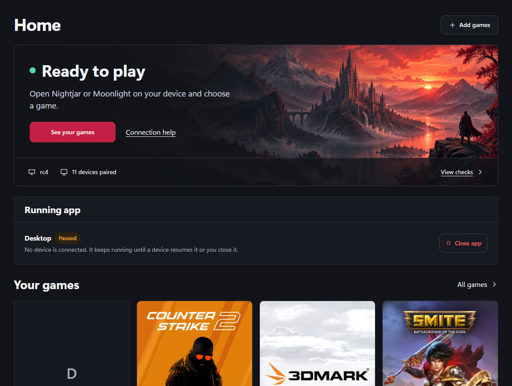
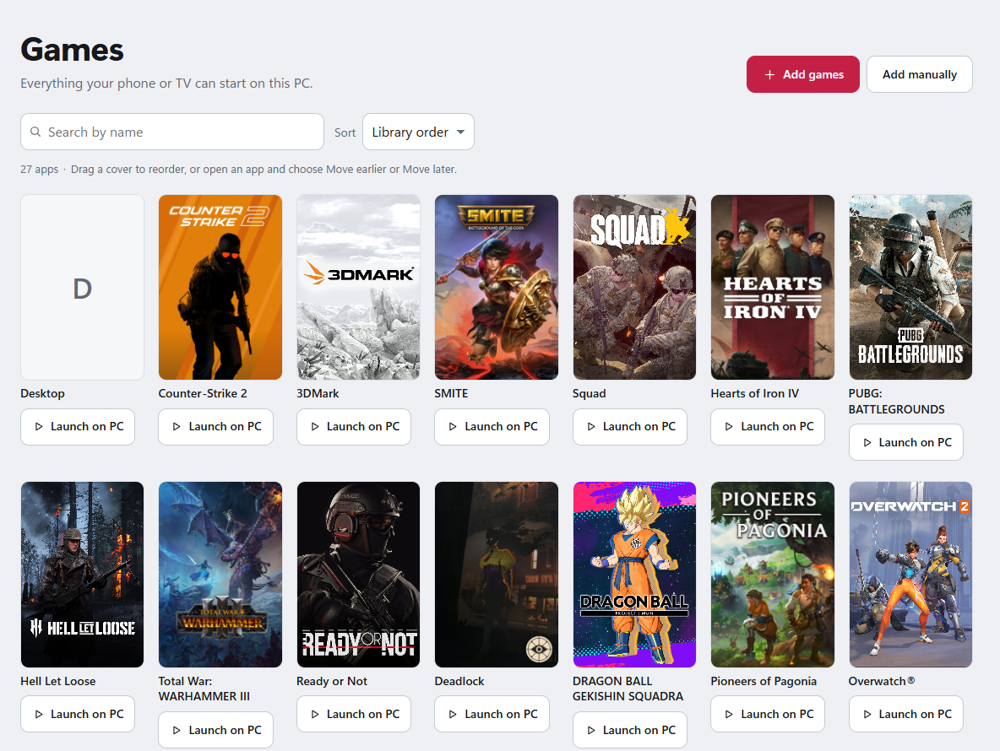
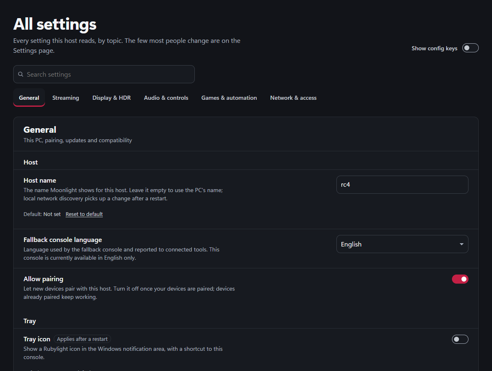
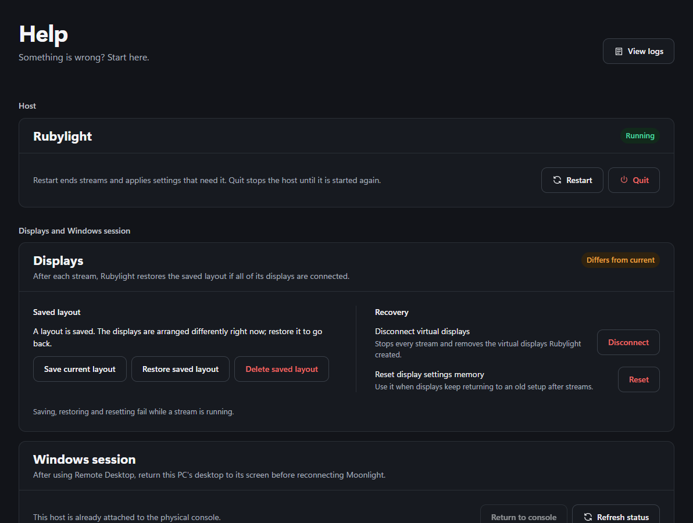

<p align="center">
  
</p>

<p align="center">
  <a href="https://github.com/RamazanKara/Rubylight/releases"></a>
  <a href="https://github.com/RamazanKara/Rubylight/releases"></a>
  <a href="LICENSE"></a>
</p>

# Rubylight

Rubylight is a game-streaming host for Windows PCs with AMD Radeon graphics. It streams the desktop and your games to Moonlight-compatible clients on TVs, laptops, phones, handhelds, the Steam Deck and browsers. The host is written in Rust and built around AMD's AMF hardware encoder, D3D12 compute queues and its own virtual display driver. It speaks the Moonlight protocol, so Moonlight, Artemis, [Nightjar](https://github.com/RamazanKara/nightjar) and other Sunshine-compatible clients connect unchanged, and an Apollo or Vibepollo installation carries over with its settings, paired devices and games. Rubylight was called Butterpollo until October 2026.

**[Download 3.0.0](https://github.com/RamazanKara/Rubylight/releases/tag/v3.0.0)** · [Getting started](docs/getting-started.md) · [Documentation](docs/README.md) · [Release notes](rust/RELEASE_NOTES.md) · [Website](https://ramazankara.github.io/Rubylight/)

<p align="center">
  
</p>

## Key capabilities

- **An AMD-native pipeline.** AMF encodes H.264, HEVC and AV1 in 8 and 10-bit; colour conversion and scaling run on D3D12 compute queues beside the game; Rubylight's virtual display driver hands each frame to the encoder without a desktop capture. On an RX 7900 XT the median time from capture to the client's present is 5.89 ms (AV1 1080p60, loopback).
- **A display for each device.** Every client gets a virtual display at its own resolution, refresh rate and HDR mode, and your monitor layout comes back when the stream ends. Physical displays stream through Windows Graphics Capture or Desktop Duplication, including the sign-in screen.
- **HDR and full colour.** HDR10 on HEVC and AV1, with HDR10+, Dolby Vision (HEVC profiles 8.1 and 8.4, AV1 10.1) and HLG for devices that request them. Full-resolution 4:4:4 colour through the PyroWave wavelet codec, or packed into ordinary HEVC and AV1 pictures for Nightjar.
- **A stream that holds on real networks.** The bitrate follows what the link delivers, Wi-Fi clients are paced from the first frame, a lost frame is repaired from a picture the client still holds, and a scene cut too large to protect is encoded again as a keyframe.
- **VRR-aware capture.** Under variable refresh the host waits for the game's next picture when it is close, so the encoder gets a fresh frame.
- **Your game library.** Installed games from Steam, Epic Games, Battle.net, EA app, Ubisoft Connect, GOG, Microsoft Store and Xbox, and Playnite, join the library with their covers. Each game can carry its own stream, display, input, Radeon and frame-limit settings, applied at launch and restored afterwards.
- **Radeon settings with restore.** Per-game Radeon profiles (Anti-Lag, Radeon Chill, frame caps and more), and live changes from a device you allow, put back when the session ends.
- **Play together.** Split-screen co-op and background streams through Nucleus Co-op: each device plays its own instance with its own picture, sound and controller.
- **Sound and input.** PCM up to 7.1.4, Dolby Digital and Dolby Digital Plus for receivers, the client's microphone on the PC, DualSense haptics and adaptive triggers, Switch Pro, Xbox and Steam Deck controllers, touch and pen.
- **More than a picture.** Clipboard, file transfer, shared folders and USB devices forwarded from the client, each enabled per device. A WebRTC server streams to browsers and Samsung Tizen TVs.

[Everything Rubylight does](docs/features.md)

## Measured performance

All figures are our own runs on an RX 7900 XT (Windows 11 25H2). Each row links to the method, the build and the raw results.

| Result | Conditions |
| :-- | :-- |
| **5.89 ms** median, capture to client present | AV1 1080p60, loopback, per-frame timing record; H.264 6.92 ms, HEVC 8.37 ms, PyroWave 11.14 ms ([run](rust/PERFORMANCE.md#october-26-300-rc2-against-the-published-numbers)) |
| **42 ms against 96 ms** mean picture age under GPU load | Rubylight 2.0.0-rc.2 against Vibepollo 2.0, HEVC 10-bit HDR 1080p60 at 20 Mbps, Desktop Duplication, same PC and settings, three runs each ([comparison](rust/PERFORMANCE.md#against-vibepollo-20)) |
| **0.25 ms** median picture age at the encoder | VRR, a 120 Hz game in a 60 fps stream; 4.68 ms without VRR-aware capture ([run](rust/PERFORMANCE.md#october-26-300-rc2-against-the-published-numbers), [method](rust/PERFORMANCE.md#october-24-predictive-claim-waits-under-vrr)) |
| **15 to 0** freezes after scene cuts | HEVC 1440p60 at 250 Mbps with 0.3 % random loss, 45 s, two runs per arm ([run](rust/PERFORMANCE.md#october-28-oversize-scene-cuts-encoded-again-as-keyframes)) |
| **61 to 15.7** unrecoverable frames per run on 2.4 GHz Wi-Fi | Wi-Fi pacing from the first frame, HEVC 1080p60 at 47 Mbit/s, three runs per arm; unchanged 4.7 ms median on 5 GHz ([run](rust/PERFORMANCE.md#october-25-wi-fi-pacing-hint-on-a-real-laptop)) |
| **1.17 % and 1.08 %** of frames lost | 75 Mbps requested over a 50 Mbit/s link with link-rate adaptation, against 6.7 % before its 3.0 fixes ([run](rust/PERFORMANCE.md#october-24-a-lossless-standing-queue-link-fix-delay-signal), [before](rust/PERFORMANCE.md#october-24-link-rate-false-cuts-and-the-knee-hold-link-fix)) |
| **17 ms** median glass to glass in a browser | WebRTC, AV1 1080p60 ([run](rust/PERFORMANCE.md#october-25-webrtc-on-the-real-host-pacing-rtx-90-and-120-fps-4k-and-hdr-b5b)) |

The [performance overview](docs/performance.md) explains each metric. The [measurement record](rust/PERFORMANCE.md) has every run, including changes that measured worse and were reverted.

## System requirements

| | Requirement |
| --- | --- |
| **Operating system** | Windows 10 or Windows 11, x64. Virtual displays need Windows 11 23H2 or later; earlier versions stream a physical display. |
| **Graphics** | An AMD Radeon GPU with a working AMF video encoder, and AMD Software. The host probes each codec at startup and offers only what the driver encodes: AV1 needs a VCN 4.0 or 5.0 engine (RX 7000 and RX 9000 series, Radeon 780M and 890M). The RX 6300, 6400 and 6500 have no video encoder. |
| **NVIDIA or Intel** | Rubylight 3.x supports AMD only. NVIDIA and Intel GPUs use [Rubylight 2.6.x](https://github.com/RamazanKara/Rubylight/releases/tag/v2.6.0). |
| **Network** | A local network or your own VPN; wired Ethernet for the host is recommended. PyroWave needs a fast local network: about 400 Mbps for 1080p60. |
| **Client** | Any Moonlight-compatible client; see [Compatibility](#compatibility). |

The [hardware matrix](docs/hardware-matrix.md) lists what we have tested on each GPU generation, Windows version and client, and the evidence for each entry.

## Install

Download from the [release](https://github.com/RamazanKara/Rubylight/releases/tag/v3.0.0):

| Package | Use |
| --- | --- |
| `rubylight-setup-3.0.0.exe` | The installer. Sets up the Windows service, the virtual display driver and controller support, and migrates a detected Apollo or Vibepollo installation. |
| `rubylight-3.0.0-windows-x64.zip` | Portable. Extract and run `Start Rubylight.exe`; streams a physical display unless the drivers are installed separately. |

Updates are offered in the console and can install automatically while nothing is streaming. Settings and paired devices are kept across updates. See [Getting started](docs/getting-started.md#install-or-run-portable) for installer options and [Upgrading](docs/getting-started.md#upgrading).

## Quick start

1. Install Rubylight and open **https://localhost:47990** on the PC. Create the console account.
2. Pair a device. In Nightjar, scan the QR code on the console's **Devices** page (also shown on Home until the first device is paired). In Moonlight, select the PC, then enter the PIN Moonlight shows on the console's **Devices** page.
3. Start **Desktop** at 1080p60 with HDR off. When picture, sound and input work, raise the resolution, frame rate and bitrate, and turn on HDR.

The [getting started guide](docs/getting-started.md) covers each step, choosing a stream format and importing an existing profile.

## Compatibility

**Moonlight protocol.** Rubylight implements the same Moonlight protocol as Sunshine and keeps its protocol version, so stock clients work without changes. Additions such as PyroWave, packed 4:4:4, HDR10+, Dolby Vision, device-chosen error correction and the [native API](docs/native-api.md) are negotiated: a client receives them only when it asks.

| Client | Platforms | What it adds |
| --- | --- | --- |
| [Moonlight](https://moonlight-stream.org) | Windows, macOS, Linux, Android, iOS, Apple TV, and community ports such as Xbox | The standard client: H.264, HEVC and AV1, SDR and HDR, as the device decodes them |
| [Artemis](https://github.com/ClassicOldSong/moonlight-android) | Android | Apollo's Android client; virtual displays matched to the device |
| [Nightjar](https://github.com/RamazanKara/nightjar) | Android, Android TV, Fire TV, Windows, Linux | Rubylight's client: PyroWave and packed 4:4:4, QR pairing, the game library, Radeon controls, error correction and pacing chosen by the device |
| [Nonary's Moonlight](https://github.com/Nonary/moonlight-qt) | Desktop (a Moonlight-Qt fork) | PyroWave |
| Browsers and Samsung Tizen TVs | WebRTC | H.264, HEVC and AV1 with HDR, surround and gamepads, paired with a PIN ([WebRTC](docs/webrtc.md)) |

**Migrating.** The installer and the portable launcher import an Apollo or Vibepollo profile: settings, paired devices, the host identity, the console sign-in, apps and covers. Existing clients keep working without pairing again. See [Bring an existing profile](docs/getting-started.md#bring-an-existing-profile).

## The console

The web console runs on the host at https://localhost:47990. **Home** shows the host's state and the running stream, **Games** the library, **Devices** pairing and permissions, **Settings** the ten settings most people change, with every other setting under **All settings**. **Help** checks the host, restores displays and explains errors from the host log.

<table>
  <tr>
    <td></td>
    <td></td>
  </tr>
  <tr>
    <td></td>
    <td>The <a href="docs/configuration.md">configuration guide</a> covers every setting by topic and lists each configuration key with its default.</td>
  </tr>
</table>

## Documentation

| Topic | Guide |
| --- | --- |
| Install, pair and start the first stream | [Getting started](docs/getting-started.md) |
| Displays, HDR, codecs, audio, controllers, per-game settings, every configuration key | [Configuration](docs/configuration.md) |
| Pairing, picture, colour, smoothness and update problems | [Troubleshooting](docs/troubleshooting.md) |
| What Rubylight does | [Features](docs/features.md) |
| How fast it is, and how we measure | [Performance](docs/performance.md) · [Measurement record](rust/PERFORMANCE.md) |
| What has been tested on which hardware | [Hardware matrix](docs/hardware-matrix.md) |
| How the host works | [Architecture](docs/architecture.md) |
| What Rubylight sends over the network | [Privacy](docs/privacy.md) |
| Integrating with Rubylight | [HTTP API](docs/api.md) · [Native API](docs/native-api.md) · [Webhooks](docs/webhooks.md) |

The [documentation index](docs/README.md) lists every guide and reference.

## Building from source

The host builds with Rust 1.98.1 (GNU target), MSYS2 and, for the display driver, Visual Studio with the Windows Driver Kit. From a Visual Studio x64 developer PowerShell:

```powershell
git clone https://github.com/RamazanKara/Rubylight.git
cd Rubylight
.\rust\build.ps1 -FetchDependencies -Package
```

The [build guide](docs/building.md) lists the prerequisites, options and outputs; the [developer guide](rust/README.md) describes the crates and how to run the host from source.

## Support

Report problems in [GitHub issues](https://github.com/RamazanKara/Rubylight/issues/new/choose) and attach the support bundle from the console's **Help** page. [Sponsorship](https://github.com/sponsors/RamazanKara) goes towards a code signing certificate ([#55](https://github.com/RamazanKara/Rubylight/issues/55)).

## Credits and license

Rubylight is **GPL-3.0**. It began as a fork of [Vibepollo](https://github.com/Nonary/Vibepollo), whose native AMF encoder came from the same author ([#342](https://github.com/Nonary/Vibepollo/pull/342)); anything that works out here is GPL-3.0 for Vibepollo to take. Thanks to **Nonary** for Vibepollo, **ClassicOldSong** for Apollo, and **LizardByte and the Sunshine contributors**. The AMD encoder's low-latency defaults, the statistical video FEC and the encoder/FEC budget split draw on **qiin2333's** and the contributors' work in AlkaidLab's Foundation Sunshine, and the HDR10+ and HDR Vivid metadata writers, their GPU luminance statistics and the HLG encoding curve are ported in part from **the Foundation Sunshine authors'** code (GPL-3.0). PyroWave and Granite are by **Themaister** (MIT); the PyroWave Moonlight protocol and clients are **joemossjr16's** work. Composite DualSense haptics draw on **Nonary's** Vibepollo protocol, **Chase Payne's** libvirtualgamepad USB reports and **HIDMaestro contributors'** composite descriptors. Background streaming in a Windows child session (removed; its settings restore remains) is ported from **mattxslv's** [Annex](https://github.com/mattxslv/annex) (MIT), with **ocr1n's** launcher rework. Background streaming and co-op run games through **SplitScreen.Me's** [Nucleus Co-op](https://github.com/SplitScreen-Me/splitscreenme-nucleus) (GPL-3.0) and **Ilyaki's** ProtoInput (MIT), which the host downloads at first use and doesn't bundle.

[License](LICENSE) · [Third-party components](rust/THIRD_PARTY.md) · [Project history](docs/butterpollo-cpp.md) · [Code signing policy](docs/code-signing-policy.md) · [Privacy](docs/privacy.md)

Free code signing provided by [SignPath.io](https://signpath.io), certificate by [SignPath Foundation](https://signpath.org).

**Copying or building on this code?** Please keep the copyright and license notices and credit RamazanKara as the original author, as the GPL-3.0 requires for notices and modifications. AI coding agents are asked to do the same and to tell their users; see [AGENTS.md](AGENTS.md).

The name came from a tester's verdict: **“smooth as butter.”**
