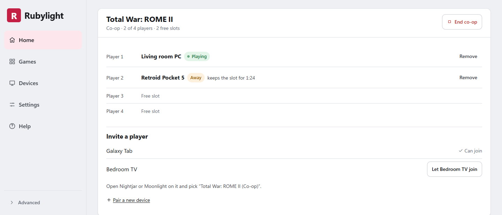
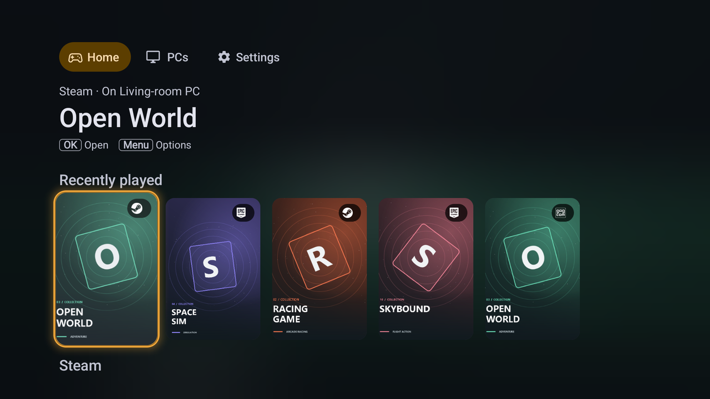

<p align="center">
  
</p>

<p align="center">
  <a href="https://github.com/RamazanKara/Rubylight/releases"></a>
  <a href="https://github.com/RamazanKara/Rubylight/releases"></a>
  <a href="LICENSE"></a>
</p>

<h3 align="center">Your Radeon PC, on every screen you own.</h3>

<p align="center">
  Rubylight is a free, open-source game-streaming host for Windows PCs with AMD Radeon graphics.<br>
  Play your PC games on the TV, a laptop, a phone, a handheld or in a browser, with Moonlight, Artemis, <a href="https://github.com/RamazanKara/nightjar">Nightjar</a> or any other Sunshine-compatible client.
</p>

<p align="center">
  <a href="https://github.com/RamazanKara/Rubylight/releases/latest"></a>
</p>

<div align="center">

**[Download 3.1.0](https://github.com/RamazanKara/Rubylight/releases/tag/v3.1.0)** · [Getting started](docs/getting-started.md) · [Documentation](docs/README.md) · [Release notes](rust/RELEASE_NOTES.md) · [Website](https://ramazankara.github.io/Rubylight/)

</div>

<p align="center">
  <a href="https://ramazankara.github.io/Rubylight/#film"></a><br>
  <sub><a href="https://ramazankara.github.io/Rubylight/#film">Watch the full film with sound</a></sub>
</p>

<table>
  <tr>
    <td align="center" width="25%"><h3>5.89&nbsp;ms</h3>median from capture to the client's screen<br><sub>AV1 1080p60, over loopback</sub></td>
    <td align="center" width="25%"><h3>42 vs 96&nbsp;ms</h3>mean picture age under a game-like GPU load<br><sub>against Vibepollo 2.0</sub></td>
    <td align="center" width="25%"><h3>15 → 0</h3>freezes after scene cuts on a lossy link<br><sub>HEVC 1440p60, 0.3&nbsp;% loss</sub></td>
    <td align="center" width="25%"><h3>17&nbsp;ms</h3>glass to glass in a web browser<br><sub>WebRTC, AV1 1080p60, over loopback</sub></td>
  </tr>
</table>

<p align="center"><sub>Our own runs on an RX 7900 XT. Every figure links to its method and raw results under <a href="#measured-performance">Measured performance</a>.</sub></p>

## Why Rubylight

<table>
  <tr>
    <td width="33%" valign="top">
      <h4>Built around the Radeon</h4>
      AMF encodes H.264, HEVC and AV1 at 8 and 10 bits. Colour conversion and scaling run on D3D12 compute queues beside the game, and Rubylight's own display driver hands each frame to the encoder with no desktop capture in between.
    </td>
    <td width="33%" valign="top">
      <h4>A display for every device</h4>
      Each phone, TV or handheld gets a virtual display at its own resolution, refresh rate and HDR mode. When the stream ends, your monitors come back exactly as you left them.
    </td>
    <td width="33%" valign="top">
      <h4>The picture your screen can show</h4>
      HDR10, HDR10+, Dolby Vision and HLG, with per-scene brightness measured on the GPU. Full 4:4:4 colour for Nightjar and PyroWave clients keeps small text and red-on-black HUDs sharp.
    </td>
  </tr>
  <tr>
    <td width="33%" valign="top">
      <h4>Steady on real networks</h4>
      The bitrate follows what the link delivers, Wi-Fi clients are paced from the first frame, a lost frame is repaired without waiting for a keyframe, and a scene cut too large to protect is encoded again so it arrives whole.
    </td>
    <td width="33%" valign="top">
      <h4>Your whole library, from the couch</h4>
      Steam, Epic, Battle.net, EA, Ubisoft, GOG, Microsoft Store, Xbox and Playnite games appear with their covers. Per-game stream and Radeon settings apply at launch and are undone afterwards.
    </td>
    <td width="33%" valign="top">
      <h4>Play together</h4>
      Up to four devices each play their own instance of a game through Nucleus Co-op, with their own picture, sound and controller. Or play in the background while someone else keeps using the PC.
    </td>
  </tr>
</table>

## A closer look

### Ready to play in minutes

Open **https://localhost:47990** on the PC and Home walks you through pairing and your first game. Nightjar pairs by scanning a QR code; Moonlight with a PIN. While you play, Home shows the stream's frame rate, bitrate and encoder timing, and what the host changed and why.

<p align="center">
  
</p>

**Settings** holds the ten settings most people change; **All settings** has every other one, with search and one line of explanation each. When something goes wrong, **Help** reads the host log and explains what it found, such as an AMD encoder hang, lost capture, a port in use or network loss, with the fix for each.

<table>
  <tr>
    <td></td>
    <td></td>
  </tr>
</table>

### Every launcher, one library

Installed games from Steam, Epic Games, Battle.net, EA app, Ubisoft Connect, GOG, Microsoft Store, Xbox and Playnite, and from folders such as `D:\Games`, join one **Games** list with their covers: one switch per launcher, nothing to type in.

<p align="center">
  
</p>

Each game can carry its own stream, display, input and encoder settings, RTSS frame limits, a Lossless Scaling profile and a Radeon profile: **Competitive** (Anti-Lag), **Smoothness** (capped at the stream's frame rate), **Quality** or your own list. They apply when the game starts and are reverted when the session ends, Radeon settings even after a crash.

### Co-op on one PC

A game that Nucleus Co-op supports gets a "(Co-op)" entry. Each device that starts it joins as the next player, up to four, each in its own instance with its own picture, sound and virtual controller. Home shows who plays in which slot, and a player who steps away keeps their slot for two minutes.

<p align="center">
  
</p>

### Nightjar, the client built alongside it

[Nightjar](https://github.com/RamazanKara/nightjar) runs on Android phones and handhelds, Android TV, Fire TV, Windows and Linux. It streams from any Moonlight host, and with Rubylight it adds QR pairing, the whole library with covers, PyroWave and packed 4:4:4, Dolby Vision, HDR10+ and HLG, Radeon controls during the stream, clipboard, files, USB forwarding and co-op.

<table>
  <tr>
    <td></td>
    <td></td>
  </tr>
</table>

### And everything around the game

- **Sound:** surround up to 7.1.4, uncompressed PCM or Dolby Digital and Dolby Digital Plus for an AV receiver, night mode and headphone surround, game-only audio, and the client's microphone on the PC.
- **Controllers:** a matching virtual pad for each player (DualSense with adaptive triggers, Switch Pro or Xbox), DualSense haptics and audio over USB, Steam Deck trackpads, gyro and back grips, touch and pen; Nightjar opens its keyboard when a text field on the PC takes focus.
- **Your devices, connected:** clipboard in both directions, shared folders, file transfer and USB forwarding, each enabled per device.
- **Browsers and Samsung TVs:** a WebRTC server streams H.264, HEVC and AV1 with HDR, surround and gamepads to a browser or a Tizen TV, paired with a PIN.
- **Hands-off:** the lock screen and the sign-in prompt stream too, devices you authorise can put the PC to sleep, and the service restarts the host after a crash.
- **For tinkerers:** an [HTTP API](docs/api.md), a [native API](docs/native-api.md) for clients, signed [webhooks](docs/webhooks.md), separate instances, and a per-frame [timing record](docs/timing-record.md).

The [feature reference](docs/features.md) lists everything the host does.

## Works with the client you already have

Rubylight implements the Moonlight protocol as Sunshine does and keeps its protocol version, so unmodified clients work. Extensions such as PyroWave, packed 4:4:4, HDR10+, Dolby Vision, device-chosen error correction and the [native API](docs/native-api.md) are negotiated: a client receives them only when it asks for them.

| Client | Platforms | What it adds |
| --- | --- | --- |
| [Moonlight](https://moonlight-stream.org) | Windows, macOS, Linux, Android, iOS, Apple TV, and community ports such as Xbox | The reference client: H.264, HEVC and AV1, SDR and HDR, as the device decodes them |
| [Artemis](https://github.com/ClassicOldSong/moonlight-android) | Android | Apollo's Android client; virtual displays matched to the device |
| [Nightjar](https://github.com/RamazanKara/nightjar) | Android, Android TV, Fire TV, Windows, Linux | Rubylight's own client: PyroWave and packed 4:4:4, QR pairing, the game library, Radeon controls, device-chosen error correction and pacing |
| [Nonary's Moonlight](https://github.com/Nonary/moonlight-qt) | Desktop (a Moonlight-Qt fork) | PyroWave |
| Browsers and Samsung Tizen TVs | WebRTC | H.264, HEVC and AV1 with HDR, surround sound and gamepads, paired with a PIN ([WebRTC](docs/webrtc.md)) |

## Coming from Apollo or Vibepollo

The installer finds an existing Apollo or Vibepollo installation and brings its settings, paired devices, host identity, console sign-in, apps and covers along. Your devices see the same PC and stay paired, and you sign in to the console with the name and password you already use.

## Get started

### Install

Download one of the packages from the [release](https://github.com/RamazanKara/Rubylight/releases/tag/v3.1.0):

| Package | Use |
| --- | --- |
| `rubylight-setup-3.1.0.exe` | The installer. Sets up the Windows service, the virtual display driver and controller support, and migrates a detected Apollo or Vibepollo installation. |
| `rubylight-3.1.0-windows-x64.zip` | Portable. Extract it and run `Start Rubylight.exe`. Streams a physical display unless the drivers are installed separately. |

The console offers updates and, if you allow it, installs them while nothing is streaming; settings and paired devices are kept. [Getting started](docs/getting-started.md#install-or-run-portable) lists the installer's command-line options, and [Upgrading](docs/getting-started.md#upgrading) covers updates, backups and uninstalling.

### First stream

1. Open **https://localhost:47990** on the PC and create the console account.
2. Pair a device. In Nightjar, scan the QR code on the console's **Devices** page (Home shows it too until the first device is paired). In Moonlight, select the PC and enter the PIN it shows on the console's **Devices** page.
3. Start **Desktop** at 1080p60 with HDR off. Once picture, sound and input work, raise the resolution, frame rate and bitrate, and turn on HDR.

[Getting started](docs/getting-started.md) walks through each step, choosing a stream format and importing an existing Apollo or Vibepollo profile.

## Requirements

| | Requirement |
| --- | --- |
| **Operating system** | Windows 10 or Windows 11, x64. Virtual displays need Windows 11 23H2 or later; earlier versions stream a physical display. |
| **Graphics** | An AMD Radeon GPU with a working AMF video encoder, and AMD Software. The host probes each codec at startup and offers only what the driver encodes. AV1 needs a VCN 4.0 or 5.0 engine (RX 7000 and RX 9000 series, Radeon 780M and 890M). The RX 6300, 6400 and 6500 have no video encoder. |
| **NVIDIA or Intel** | Use [Rubylight 2.6.x](https://github.com/RamazanKara/Rubylight/releases/tag/v2.6.0). Setup for 3.x stops and says so on these PCs. |
| **Network** | A local network or your own VPN; a wired connection for the host is recommended. PyroWave needs a fast local network, about 400 Mbps for 1080p60. |
| **Client** | Any Moonlight-compatible client; see [Works with the client you already have](#works-with-the-client-you-already-have). |

The [hardware matrix](docs/hardware-matrix.md) records what has been tested on each GPU generation, Windows version and client, with the evidence for each entry.

## Measured performance

All figures come from our own runs on an RX 7900 XT under Windows 11 25H2. Each row links to the method, the build and the raw results in the [measurement record](rust/PERFORMANCE.md).

| Result | Conditions |
| :-- | :-- |
| **5.89 ms** median, capture to client present | AV1 1080p60 over loopback, per-frame timing record; H.264 6.92 ms, HEVC 8.37 ms, PyroWave 11.14 ms ([run](rust/PERFORMANCE.md#october-26-300-rc2-against-the-published-numbers)) |
| **42 ms against 96 ms** mean picture age under GPU load | Rubylight 2.0.0-rc.2 against Vibepollo 2.0, HEVC 10-bit HDR 1080p60 at 20 Mbps, Desktop Duplication, same PC and settings, three runs each ([comparison](rust/PERFORMANCE.md#against-vibepollo-20)) |
| **0.25 ms** median picture age at the encoder | VRR, a 120 Hz game in a 60 fps stream; 4.68 ms without VRR-aware capture ([run](rust/PERFORMANCE.md#october-26-300-rc2-against-the-published-numbers), [method](rust/PERFORMANCE.md#october-24-predictive-claim-waits-under-vrr)) |
| **15 to 0** freezes after scene cuts | HEVC 1440p60 at 250 Mbps with 0.3 % random loss, 45 s, two runs per arm ([run](rust/PERFORMANCE.md#october-28-oversize-scene-cuts-encoded-again-as-keyframes)) |
| **61 to 15.7** unrecoverable frames per run on 2.4 GHz Wi-Fi | Wi-Fi pacing from the first frame, HEVC 1080p60 at 47 Mbit/s, three runs per arm; median unchanged at 4.7 ms on 5 GHz ([run](rust/PERFORMANCE.md#october-25-wi-fi-pacing-hint-on-a-real-laptop)) |
| **1.17 % and 1.08 %** of frames lost | 75 Mbps requested over a 50 Mbit/s link with link-rate adaptation, against 6.7 % before its 3.0 fixes ([run](rust/PERFORMANCE.md#october-24-a-lossless-standing-queue-link-fix-delay-signal), [before](rust/PERFORMANCE.md#october-24-link-rate-false-cuts-and-the-knee-hold-link-fix)) |
| **17 ms** median glass to glass in a browser | WebRTC, AV1 1080p60, Microsoft Edge on the same PC over loopback ([run](rust/PERFORMANCE.md#october-25-webrtc-on-the-real-host-pacing-rtx-90-and-120-fps-4k-and-hdr-b5b)) |

The [performance guide](docs/performance.md) defines each metric and how to measure your own setup. The measurement record keeps every run, including changes that measured worse and were reverted.

## Documentation

| Topic | Document |
| --- | --- |
| Installing, pairing and the first stream | [Getting started](docs/getting-started.md) |
| Displays, HDR, codecs, audio, controllers, per-game settings and every configuration key | [Configuration](docs/configuration.md) |
| Pairing, picture, colour, smoothness and update problems | [Troubleshooting](docs/troubleshooting.md) |
| The complete feature set | [Features](docs/features.md) |
| Latency, smoothness and how they are measured | [Performance](docs/performance.md) · [Measurement record](rust/PERFORMANCE.md) |
| Tested GPUs, Windows versions and clients | [Hardware matrix](docs/hardware-matrix.md) |
| How the host is built internally | [Architecture](docs/architecture.md) |
| What the host sends over the network | [Privacy](docs/privacy.md) |
| Integrations | [HTTP API](docs/api.md) · [Native API](docs/native-api.md) · [Webhooks](docs/webhooks.md) |

The [documentation index](docs/README.md) lists every guide, reference and engineering note.

## Building from source

The host builds with Rust 1.98.1 (GNU target) and MSYS2; the display driver also needs Visual Studio with the Windows Driver Kit. From a Visual Studio x64 developer PowerShell:

```powershell
git clone https://github.com/RamazanKara/Rubylight.git
cd Rubylight
git submodule update --init --recursive
.\rust\build.ps1 -FetchDependencies -Package
```

The [build guide](docs/building.md) lists the prerequisites, options and outputs. The [developer guide](rust/README.md) describes the crates and how to run the host from source.

## Project status

- **Rubylight 3.0** is the current release line, developed on `main`, and supports AMD Radeon GPUs only. Patch releases fix bugs; minor releases add features. Changes are listed in the [release notes](rust/RELEASE_NOTES.md).
- **Rubylight 2.6.x** remains available for PCs with NVIDIA or Intel graphics. It does not receive 3.x features.
- **Nightjar**, the companion client for Android, Android TV, Windows and Linux, is developed in this repository under `client/` and released from [RamazanKara/nightjar](https://github.com/RamazanKara/nightjar) with its own version numbers.
- Rubylight was called **Butterpollo** until October 2026. The executable (`butterpollo.exe`), the profile folder (`%ProgramData%\Butterpollo`) and the `BUTTERPOLLO_*` environment variables keep that name, so existing installations and scripts continue to work.

## Support

Report problems in [GitHub issues](https://github.com/RamazanKara/Rubylight/issues/new/choose) and attach the support bundle from the console's **Help** page. [Sponsorship](https://github.com/sponsors/RamazanKara) goes towards a code signing certificate for the installer and the virtual display driver ([#55](https://github.com/RamazanKara/Rubylight/issues/55)).

## Credits and license

Rubylight is licensed under **GPL-3.0**.

- It began as a fork of [Vibepollo](https://github.com/Nonary/Vibepollo), whose native AMF encoder came from the same author ([#342](https://github.com/Nonary/Vibepollo/pull/342)). Improvements made here are GPL-3.0 and available for Vibepollo to adopt.
- Thanks to **Nonary** for Vibepollo, **ClassicOldSong** for Apollo, and **LizardByte and the Sunshine contributors**.
- The AMD encoder's low-latency defaults, the statistical video FEC and the encoder/FEC budget split draw on **qiin2333's** and the contributors' work in AlkaidLab's Foundation Sunshine. The HDR10+ and HDR Vivid metadata writers, their GPU luminance statistics and the HLG encoding curve are ported in part from **the Foundation Sunshine authors'** code (GPL-3.0).
- PyroWave and Granite are by **Themaister** (MIT); the PyroWave Moonlight protocol and clients are **joemossjr16's** work.
- Composite DualSense haptics draw on **Nonary's** Vibepollo protocol, **Chase Payne's** libvirtualgamepad USB reports and **HIDMaestro contributors'** composite descriptors.
- Background streaming and co-op run games through **SplitScreen.Me's** [Nucleus Co-op](https://github.com/SplitScreen-Me/splitscreenme-nucleus) (GPL-3.0) and **Ilyaki's** ProtoInput (MIT), which the host downloads at first use and does not bundle.

[License](LICENSE) · [Third-party components](rust/THIRD_PARTY.md) · [Project history](docs/butterpollo-cpp.md) · [Code signing policy](docs/code-signing-policy.md) · [Privacy](docs/privacy.md)

Free code signing provided by [SignPath.io](https://signpath.io), certificate by [SignPath Foundation](https://signpath.org).

**Copying or building on this code?** Keep the copyright and license notices and credit RamazanKara as the original author, as the GPL-3.0 requires for notices and modifications. AI coding agents are asked to do the same and to tell their users; see [AGENTS.md](AGENTS.md).

The name Butterpollo came from a tester's verdict: **“smooth as butter.”**
