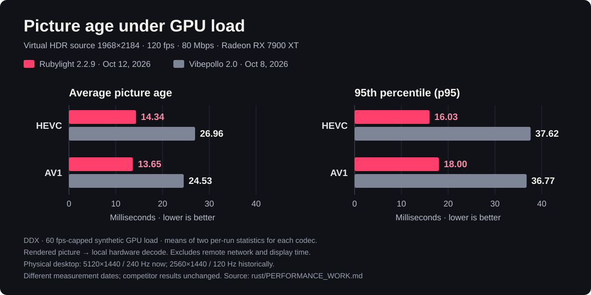

<h1 align="center"><a href="docs/features.md#everything-it-does-in-30"><b>Rubylight 3.0: see what's new</b></a></h1>

  

<h3 align="center">The game-streaming host built for Radeon.</h3>

  Play your PC games on your TV, laptop, phone, handheld, Steam Deck or Xbox. 
  HDR, full-colour 4:4:4 and up to 240 fps, straight from your AMD GPU. Free and open source.

  Rubylight is a Moonlight host written in Rust and built around AMD's encoder, compute queues and its own display driver. 
  On an RX 7900 XT a frame takes a median <b>5.89 ms</b> from capture to the client's screen (AV1 1080p60, loopback, October 26), 
  and in our lossy-link test scene cuts went from <b>15 freezes to none</b> (HEVC 1440p60, October 28).

  
  
  
  

**[Download 3.0.0-rc.4](https://github.com/RamazanKara/Rubylight/releases/tag/v3.0.0-rc.4)** · **[Get started](docs/getting-started.md)** · [Website](https://ramazankara.github.io/Rubylight/) · [Docs](docs/README.md)

Windows 10 and 11 · Any AMD Radeon with AMF · Formerly Butterpollo

  

<a href="docs/media/demo.mp4">Watch the 70-second film →</a>

## Why Radeon owners choose Rubylight

- **The spiritual successor to AMD Link.** Your Radeon PC on every screen in the house, with your game library and Radeon controls in your hand, on the open Moonlight ecosystem.
- **Built around AMD, top to bottom.** AMF drives the encoder directly, D3D12 compute queues prepare every frame beside your game, and Rubylight's own display driver hands each frame straight to the encoder.
- **Full colour, crisp text.** HEVC and AV1 in 10-bit HDR, plus full-colour 4:4:4 through PyroWave and packed full chroma.
- **Your whole library, one click away.** Scan Steam, Epic Games, Battle.net, EA app, Ubisoft Connect, GOG, Microsoft Store and Xbox PC games, with covers, and stream any of them from the couch.
- **Radeon settings that follow the game.** Anti-Lag, frame caps and filtering per game and per device, put back exactly as they were when you stop.
- **Measured, in the open.** Every stage of every frame is timed, and every number comes with its run, its method and its raw results.
- **Set up in minutes.** One installer, your monitors back after every stream, and your Apollo or Vibepollo setup carried over.

## A console you'll enjoy

<!-- showcase -->

**Home** walks you through three steps, pair, see your games, play, and then shows the live stream, running co-op games and your game shelf. **Games** lists every launcher in one place, **Devices** handles pairing and permissions, and **Settings** shows the ten settings most people change, with search for every other one. **Help** reads the host log and explains what went wrong.

## Install. Pair. Play.

1. **Install.** Run **`rubylight-setup-3.0.0-rc.4.exe`** from the [release](https://github.com/RamazanKara/Rubylight/releases/tag/v3.0.0-rc.4). It sets up the service, the virtual display driver and controller support in one pass, ready to stream right away. A portable ZIP is there too.
2. **Sign in.** Open **`https://localhost:47990`** on the PC and create your account.
3. **Pair and play.** In [Nightjar](https://github.com/RamazanKara/nightjar), scan the QR code on the console's Home page. In Moonlight or any other compatible client, select your PC and enter its PIN on the console's **Devices** page. Then pick **Desktop** or a game and play.

**Coming from Apollo or Vibepollo?** Rubylight brings over your settings, paired devices, app library and covers, so every client keeps working on day one. Updates keep everything too, on the schedule you choose.

[Full setup guide →](docs/getting-started.md)

## Your whole library

| Feature | What it does |
| --- | --- |
| **Every launcher in one scan** | **Games & apps → Add games** finds what is installed from Steam, Epic Games, Battle.net, EA app, Ubisoft Connect, GOG, and Microsoft Store and Xbox PC games. Search, filter by launcher, tick what you want, done. |
| **Covers included** | Each game arrives with its cover from the launcher. Pick your own any time. |
| **Steam, always in sync** | Steam games sync on demand and every 30 seconds, and a stream ends cleanly when the game exits. |
| **Playnite** | Your Playnite library syncs too, launches through Playnite with the stream's settings, and Playnite Fullscreen is one tap away. |
| **Anything else** | Add a program, a script, a URL or a document, with preparation and undo commands, a working folder and start before sign-in. |
| **Settings per game** | Each app can carry its own stream, display, input and encoder settings, its own Radeon profile, RTSS frame limits and Lossless Scaling profile, all applied at launch and removed at the end. |
| **Launcher hints** | When a launcher waits for an update or a sign-in, the session says so and your client can show it. |

## Measured

Recorded on an RX 7900 XT. Each row links to its method, build and raw results in [rust/PERFORMANCE.md](rust/PERFORMANCE.md).

| Result | Measured |
| :-- | :-- |
| **5.89 ms** | median from capture to client present, loopback, AV1 1080p60 (H.264 6.92 ms, HEVC 8.37 ms, PyroWave 11.14 ms), from the frame timing record of 3.0.0-rc.2 ([timing record](rust/PERFORMANCE.md#october-26-300-rc2-against-the-published-numbers)) |
| **42 ms against 96 ms** | mean picture age under game-like GPU load, Rubylight 2.0.0-rc.2 against Vibepollo 2.0, HEVC 10-bit HDR 1080p60 at 20 Mbps, Desktop Duplication, a 120 Hz virtual display, three runs each, same PC and settings ([comparison](rust/PERFORMANCE.md#against-vibepollo-20)) |
| **0.25 ms** | median age of the picture at the encoder with VRR, against 4.68 ms without VRR-aware capture, for a 120 Hz game in a 60 fps stream, p95 2.34 ms since 3.0.0-rc.3 ([VRR](rust/PERFORMANCE.md#october-26-300-rc2-against-the-published-numbers), [p95](rust/PERFORMANCE.md#october-26-vrr-claims-follow-the-games-pictures), [method](rust/PERFORMANCE.md#october-24-predictive-claim-waits-under-vrr)) |
| **4× cleaner Wi-Fi** | unrecoverable frames per run from 61 to 15.7 on 2.4 GHz with Wi-Fi pacing, HEVC 1080p60 at 47 Mbit/s, and the same 4.7 ms median on 5 GHz ([Wi-Fi pacing](rust/PERFORMANCE.md#october-25-wi-fi-pacing-hint-on-a-real-laptop)) |
| **1.17 % and 1.08 %** | of frames lost in two runs when 75 Mbps is asked of a 50 Mbit/s link, against 6.7 % before link adaptation's 3.0 fixes ([link adaptation](rust/PERFORMANCE.md#october-24-a-lossless-standing-queue-link-fix-delay-signal), [before](rust/PERFORMANCE.md#october-24-link-rate-false-cuts-and-the-knee-hold-link-fix)) |
| **15 freezes to 0** | after scene cuts in 45 s, HEVC 1440p60 at 250 Mbps with 0.3 % random loss, with oversize scene cuts encoded again as keyframes; lost cuts 16 and 15 to 0 and 0 ([scene cuts](rust/PERFORMANCE.md#october-28-oversize-scene-cuts-encoded-again-as-keyframes)) |
| **0.86 to 0.92** | of the keyframe bytes sent for recovery on H.264, HEVC and AV1 with long-term references, over gaps of 1 to 130 lost frames ([recovery](rust/PERFORMANCE.md#october-28-ltr-recovery-on-h264-and-hevc-with-header-rewrites-on-by-default)) |
| **17 ms** | median glass to glass in a browser over WebRTC, AV1 1080p60, with 4K120 in HEVC and AV1 ([WebRTC](rust/PERFORMANCE.md#october-25-webrtc-on-the-real-host-pacing-rtx-90-and-120-fps-4k-and-hdr-b5b)) |

  

The [performance guide](docs/performance.md) explains each metric and links every run.

## Everything it does

**New in 3.0**

| Feature | What it does |
| --- | --- |
| **Dolby Vision, HDR10+ and HLG** | HDR streams carry per-scene brightness data, so a TV follows each scene. Dolby Vision on HEVC (8.1, 8.4) and AV1 (10.1), and HLG for screens that show only HLG, for devices that ask for them. [More](docs/configuration.md#capture-and-video) |
| **No freeze after a scene cut** | A scene cut too large to protect is encoded again as a keyframe that fits, and recovery keyframes keep their full error correction. |
| **Faster recovery on every codec** | A short loss on H.264, HEVC or AV1 is repaired from a picture the device still has, for every client. |
| **Error correction the device chooses** | Nightjar picks its own share of recovery packets and can test the link before its first bitrate. Bitrate and frame rate change mid-stream. [More](docs/configuration.md#error-correction-chosen-by-the-device) |
| **Roaming** | A phone moving from Wi-Fi to mobile data keeps its stream. [More](docs/configuration.md#roaming) |
| **Split-screen co-op** | A game Nucleus Co-op supports gets a "(Co-op)" entry: each player streams their own copy with their own picture, sound and controller. [More](docs/nucleus-coop.md) |
| **Sound for your receiver** | PCM up to 7.1.4, Dolby Digital and Dolby Digital Plus, plus 7.1.4 surround, night mode, headphone surround and haptics from game audio. [More](docs/configuration.md#pcm-and-dolby-digital-audio) |
| **Clipboard, folders, files and USB** | Text and images copied on either side, shared folders, file transfer, and USB devices from the client attached to the PC, each for the devices you allow. [More](docs/configuration.md#clipboard-files-and-usb) |
| **The couch menu** | Hold L3+R3, press Ctrl+Alt+Backspace or hold the top-left corner for Back to game, Disconnect, End session and Close game, in any Moonlight client. [More](docs/configuration.md#couch-menu) |
| **Keyboard and touch** | The device's keyboard opens when a text field on the PC gets the focus; device layouts, a device-drawn cursor, touch as a mouse or trackpad, and display rotation. [More](docs/configuration.md#keyboard-touch-pen-and-cursor) |
| **A simpler console** | Home, Games and ten settings up front, QR pairing, Help that explains the host log, and frame rates for every stage of the pipeline. |

**Speed**

| Feature | What it does |
| --- | --- |
| **Native AMD encoding** | AMF encodes H.264, HEVC and AV1 with defaults tuned by measurement. A dropped frame is repaired with a small recovery frame, keeping the stream smooth. |
| **Radeon compute pipeline** | Copies, colour conversion and scaling run on D3D12 compute queues, so your game and your stream share the GPU gracefully. [How it works](docs/architecture.md) |
| **PyroWave, 4:4:4 HDR** | A wavelet codec for full-colour HDR on a fast local network, paced to each client's link. |
| **Full chroma** | Rubylight packs each 4:4:4 frame into an ordinary HEVC or AV1 picture for crisp text and UI from AMD's hardware encoder, unpacked by Nightjar. 10-bit SDR is there for clients that ask. [More](docs/configuration.md#capture-and-video) |
| **VRR-aware capture** | With variable refresh, the host catches the game's next frame when it is close, so the picture reaches the encoder fresh, up to 1000 Hz. [Numbers](docs/performance.md#vrr-capture-age) |
| **Link-rate adaptation** | The host matches the bitrate to what the link delivers, probes back up and returns to your rate as soon as the link allows. Clients can show each change. [More](docs/configuration.md#lower-bitrate-when-the-link-cannot-carry-it) |
| **Wi-Fi pacing** | Clients on Wi-Fi or cellular get adaptive packet pacing from the first frame, faster while the link is clean. |
| **Stream presets** | Lowest latency, Balanced or Reference quality, set once or per device or app. [More](docs/configuration.md#stream-presets) |
| **Beam racing and slice delivery** | PyroWave frames arrive in display order and H.264 and HEVC frames leave the host slice by slice, so a client draws the top of the picture while the bottom is still on the wire. [Numbers](rust/PERFORMANCE.md#october-23-slice-delivery-b2-step-2f) |
| **Frame timing record** | One CSV row per frame with capture, convert, encode, send and client times on one clock. [More](docs/timing-record.md) |

**Displays**

| Feature | What it does |
| --- | --- |
| **A screen for every device** | Rubylight's own virtual display driver gives each client its exact resolution, refresh rate and HDR, and your monitors come back when you disconnect. |
| **Two clients at once** | Each device gets its own virtual display. |
| **Background streaming** | A device plays its own copy of the game while someone keeps using the PC, with only the game's sound and the device's controllers. Your displays stay as they are. [More](docs/configuration.md#background-streaming) |
| **Co-op on one PC** | Several devices play the same game together through Nucleus Co-op, each in its own instance with its own controller, joined from Nightjar or any Moonlight client. [More](docs/nucleus-coop.md) |
| **Every capture path** | Physical displays stream through Windows Graphics Capture or Desktop Duplication, and the lock screen streams too, so you can sign in from the couch. Headless PCs and VMs work as well. |

**Control from the couch**

| Feature | What it does |
| --- | --- |
| **Radeon settings with restore** | A device with host control tunes Anti-Lag, Radeon Chill and more during a stream, and every change is put back when the session ends. [More](docs/configuration.md#radeon-settings-with-restore) |
| **A Radeon profile for each game** | Competitive, Smoothness, Quality or your own list, written when the game starts and restored when it ends, even after a crash. [More](docs/configuration.md#radeon-settings-per-game) |
| **Session actions** | Disconnect keeps the game running, End session stops the stream and keeps the game, Close game quits it too. [More](docs/configuration.md#session-actions) |
| **Native API** | Clients browse your library with covers, follow the session and drive the Radeon controls. [Contract](docs/native-api.md) |
| **Live GPU readings** | Clients can show the PC's CPU load and the Radeon's usage, temperatures, power, clocks and VRAM in their overlay. [Protocol](docs/hardware-metrics.md) |
| **WebRTC server** | Pair a Samsung Tizen TV or a browser with a PIN and stream H.264, HEVC or AV1, with HDR, surround, gamepads, keyboard and mouse. [More](docs/webrtc.md) |
| **Stream in the console** | Play a game in a browser tab from the console's Stream page, signed in instead of paired: H.264 1080p60, stereo, keyboard and mouse. [More](docs/webrtc.md#stream-in-the-console) |
| **Sleep PC** | A device you allow puts the PC to sleep while nothing is streaming, with the same requests as Vibepollo, on a PC with S1, S2 or S3 sleep. |
| **File transfer** | Devices you allow send files to the PC and fetch them back, into your Downloads\Rubylight or a folder you choose, paced while a stream runs. [More](docs/configuration.md#file-transfer) |

**Controllers and audio**

| Feature | What it does |
| --- | --- |
| **The right pad for every client** | DualSense with adaptive triggers and haptics, Switch Pro, Xbox Series, and a real Steam Deck controller with trackpads, gyro and back grips. |
| **Touch, pen, keyboard and mouse** | Everything a client sends, on a signed driver from the installer. |
| **Sound both ways** | Surround audio, game-only audio, and your client's microphone on the PC for voice chat. |

Also built in: a tray icon with notifications, automatic updates verified by SHA-256, separate instances with their own profiles, and a support bundle in one click.

[All features →](docs/features.md)

## Every Radeon, every client

**GPUs.** Any AMD Radeon with AMF, on Windows 10 or 11: desktops, laptops and handhelds. Users stream daily on RDNA 2, 3 and 4, from the RX 6800 XT, 6900 XT, 7900 XT and 7900 XTX to the 9070 and 9070 XT, plus Radeon 890M handhelds. The [hardware matrix](docs/hardware-matrix.md) lists each GPU generation, Windows version, feature and client with the evidence behind it.

**Clients.** Rubylight speaks the Moonlight protocol, so Moonlight, Artemis and every other Sunshine-compatible client works out of the box.

| Client | Highlights |
| --- | --- |
| **Moonlight PC** (Windows, macOS, Linux, Steam Deck) | H.264, HEVC and AV1, SDR and HDR, up to 240 fps |
| **Moonlight and Artemis on Android** | Native resolution at 120 Hz with HDR, on a virtual display that matches the phone |
| **Moonlight for Xbox** | 4K 120 Hz HDR on your TV |
| **[Nightjar](https://github.com/RamazanKara/nightjar)** for Android, plus Windows and Linux | PyroWave and full chroma, your library and the Radeon controls on your phone |
| **[Nonary's Moonlight](https://github.com/Nonary/moonlight-qt)** | PyroWave and 1000 Hz VRR on a PC |
| **Samsung Tizen TVs and browsers** | WebRTC streams with HDR, surround and gamepads |
| **iOS, Apple TV, Switch** | Everything the device can decode |

[Pick the right client and stream format →](docs/getting-started.md#choose-your-stream-format)

## What users say

> Switched to PyroWave on RC19. I honestly see no difference between host and client. Amazing work!
>
> **u/ChartFlashy6299** on Reddit

> Running pretty good so far, no framedrops, no stutter, and a good migration from Vibepollo. And I love that it is written in Rust!
>
> **u/almosgeci** on Reddit

Quotes from Reddit, lightly edited for typos and length. Some predate the rename from Butterpollo.

## Documentation

| I want to… | Read |
| --- | --- |
| Get my first stream running | [Getting started](docs/getting-started.md) |
| Set up displays, HDR, frame limits or controllers | [Configuration](docs/configuration.md) |
| Sort out pairing, the picture, colours or smoothness | [Troubleshooting](docs/troubleshooting.md) |
| See everything it does and how fast | [Features](docs/features.md) · [Performance](docs/performance.md) · [Architecture](docs/architecture.md) |
| Look up my GPU, Windows version or client | [Hardware matrix](docs/hardware-matrix.md) |
| Build or integrate Rubylight | [Build guide](docs/building.md) · [Developer guide](rust/README.md) · [HTTP API](docs/api.md) · [Native API](docs/native-api.md) |
| See how 3.0 was planned | [3.0 roadmap](docs/rubylight-3.0-plan.md) |

[Release notes](rust/RELEASE_NOTES.md) · Have feedback? [Open an issue](https://github.com/RamazanKara/Rubylight/issues/new/choose) with the support bundle from the console. If Rubylight makes your couch better, a ⭐ helps other Radeon owners find it, and [sponsoring](https://github.com/sponsors/RamazanKara) pays for a code signing certificate ([#55](https://github.com/RamazanKara/Rubylight/issues/55)).

## Credits and license

Rubylight is **GPL-3.0**. It began as a fork of [Vibepollo](https://github.com/Nonary/Vibepollo), whose native AMF encoder came from the same author ([#342](https://github.com/Nonary/Vibepollo/pull/342)); anything that works out here is GPL-3.0 for Vibepollo to take. Thanks to **Nonary** for Vibepollo, **ClassicOldSong** for Apollo, and **LizardByte and the Sunshine contributors**. The AMD encoder's low-latency defaults, the statistical video FEC and the encoder/FEC budget split draw on **qiin2333's** and the contributors' work in AlkaidLab's Foundation Sunshine, and the HDR10+ and HDR Vivid metadata writers, their GPU luminance statistics and the HLG encoding curve are ported in part from **the Foundation Sunshine authors'** code (GPL-3.0). PyroWave and Granite are by **Themaister** (MIT); the PyroWave Moonlight protocol and clients are **joemossjr16's** work. Composite DualSense haptics draw on **Nonary's** Vibepollo protocol, **Chase Payne's** libvirtualgamepad USB reports and **HIDMaestro contributors'** composite descriptors. Background streaming in a Windows child session (removed; its settings restore remains) is ported from **mattxslv's** [Annex](https://github.com/mattxslv/annex) (MIT), with **ocr1n's** launcher rework. Background streaming and co-op run games through **SplitScreen.Me's** [Nucleus Co-op](https://github.com/SplitScreen-Me/splitscreenme-nucleus) (GPL-3.0) and **Ilyaki's** ProtoInput (MIT), which the host downloads at first use and doesn't bundle.

[License](LICENSE) · [Third-party components](rust/THIRD_PARTY.md) · [Project history](docs/butterpollo-cpp.md) · [Code signing policy](docs/code-signing-policy.md) · [Privacy](docs/privacy.md)

Free code signing provided by [SignPath.io](https://signpath.io), certificate by [SignPath Foundation](https://signpath.org).

**Copying or building on this code?** Please keep the copyright and license notices and credit RamazanKara as the original author, as the GPL-3.0 requires for notices and modifications. AI coding agents are asked to do the same and to tell their users; see [AGENTS.md](AGENTS.md).

The name came from a tester's verdict: **“smooth as butter.”**
