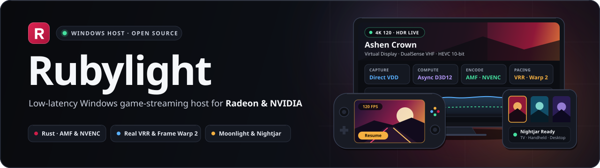
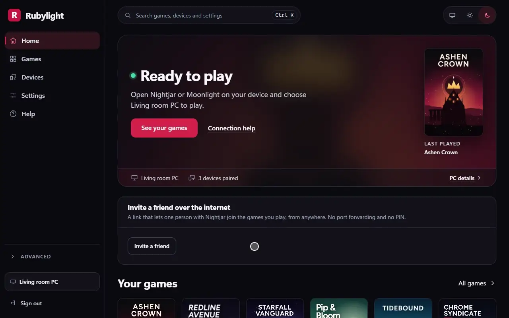
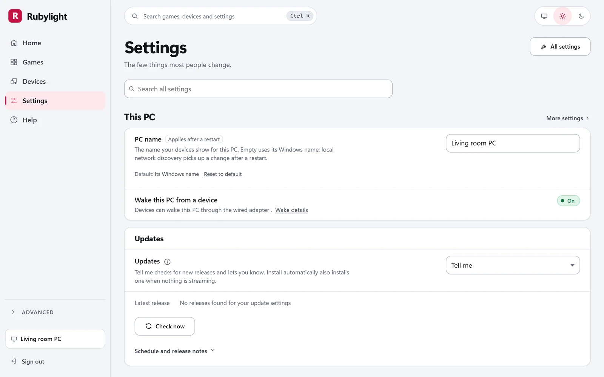

<p align="center">
  
</p>

<h3 align="center">Low-latency PC streaming. Smooth motion. Zero desk-to-couch friction.</h3>

<p align="center">
  Rubylight is a free, open-source game-streaming host written in Rust for Windows PCs with AMD Radeon or NVIDIA graphics. Built from the ground up around low picture age, even frame pacing and reliable recovery—with first-party display and gamepad drivers, every launcher in one console library, and clean system restoration when you finish.<br>
  Works seamlessly with Moonlight and every Sunshine-compatible client, and unlocks even more with <a href="https://github.com/RamazanKara/nightjar">Nightjar</a>, the companion client built alongside it.
</p>

<p align="center">
  <a href="https://github.com/RamazanKara/Rubylight/releases/latest"></a>
</p>

<p align="center">
  <a href="https://github.com/RamazanKara/Rubylight/releases/latest"></a>
  <a href="https://github.com/RamazanKara/Rubylight/releases"></a>
  <a href="LICENSE"></a>
</p>

<div align="center">

**[Download 6.4.4](https://github.com/RamazanKara/Rubylight/releases/tag/v6.4.4)** · [Get started](#get-started-in-three-steps) · [What you get](#what-you-get) · [Why Rubylight](#engineered-for-latency-and-smoothness) · [Nightjar](#nightjar-the-client-built-alongside-it) · [Documentation](docs/README.md) · [Release notes](rust/RELEASE_NOTES.md) · [Website](https://ramazankara.github.io/Rubylight/)

</div>

<p align="center">
  <a href="docs/media/readme/console-tour.mp4"></a><br>
  <sub><b>The console in half a minute:</b> the library, a game's own settings, search, stream history and live stage timings. <a href="docs/media/readme/console-tour.mp4">Watch it as a video</a></sub>
</p>

## What you get

<table>
  <tr>
    <td width="33%" valign="top"><h4>Engineered in Rust for low latency</h4>Direct virtual-display capture, D3D12 compute queues beside your game, native AMF &amp; NVENC, and zero silent encoder fallbacks.<br><a href="#engineered-for-latency-and-smoothness">Latency &amp; pipeline</a></td>
    <td width="33%" valign="top"><h4>Silky pacing, Frame Warp &amp; Real VRR</h4>VRR-aware frame claims, phase-lock arrival timing, Frame Warp camera prediction, Real VRR cadence, PyroWave beam racing and 4K slice delivery.<br><a href="#engineered-for-latency-and-smoothness">Smoothness &amp; pacing</a></td>
    <td width="33%" valign="top"><h4>Resilient on real Wi-Fi &amp; WAN</h4>Packet-arrival congestion control, bounded Wi-Fi burst pacing, oversize scene-cut protection, no-keyframe LTR recovery and network roaming.<br><a href="#engineered-for-latency-and-smoothness">Network resilience</a></td>
  </tr>
  <tr>
    <td valign="top"><h4>First-party virtual drivers</h4>Built-from-source signed virtual display driver and UMDF2 VHF virtual gamepad driver (DualSense, Xbox, Switch Pro, 2026 Steam Controller) included.<br><a href="#every-controller">Drivers &amp; controllers</a></td>
    <td valign="top"><h4>Every launcher, one console library</h4>Steam, Epic, Battle.net, EA app, Ubisoft Connect, GOG, Xbox, Playnite and folders with covers, collections, launch focus recovery and lock-screen streaming.<br><a href="#every-launcher-one-library">The library</a></td>
    <td valign="top"><h4>Per-game &amp; per-device setups</h4>Radeon &amp; NVIDIA driver profiles, RTSS frame limits, Lossless Scaling, RTX HDR &amp; Video, Neural Rendering and per-device game configs—reverted cleanly on exit.<br><a href="#set-up-for-each-game-and-each-device">Per-game settings</a></td>
  </tr>
  <tr>
    <td valign="top"><h4>True HDR, 4:4:4 &amp; up to 7.1.4 audio</h4>HDR10, HDR10+, Dolby Vision and HLG with GPU scene brightness, Windows SDR white calibration, clean SDR fallback, full 4:4:4 colour and receiver passthrough.<br><a href="#the-picture-and-sound-your-setup-can-play">Picture and sound</a></td>
    <td valign="top"><h4>Play together &amp; play anywhere</h4>4-player Nucleus Co-op, background streaming, WebRTC browsers, zero-install guest links, Continue here, Dual screen and serverless P2P internet play.<br><a href="#play-together">Co-op, guests &amp; WAN</a></td>
    <td valign="top"><h4>A console that explains itself</h4>QR pairing, Ctrl+K search, live per-stage stutter attribution, Sessions history, automated Log analysis and one-click support bundles.<br><a href="#a-console-that-explains-itself">The console</a></td>
  </tr>
</table>

## A closer look

### Engineered for latency and smoothness

Rather than optimizing one benchmark number in isolation, Rubylight removes hidden queues and cadence mismatches across the entire frame path—and gives you live per-stage telemetry on **Home** plus an optional per-frame CSV record to inspect your own setup:

- **Direct capture &amp; GPU compute beside the game.** On Rubylight virtual displays, the driver pushes composed frames straight to the encoder path; physical monitors use Windows Graphics Capture with automatic Desktop Duplication failover (plus constant-rate WGC so still desktops and capped games never starve). Colour conversion, scaling and HDR scene luminance analysis run on D3D12 compute queues alongside your game.
- **Native AMF and NVENC with stream presets.** Drives Radeon AMF and NVIDIA NVENC directly without generic wrappers, using codec-tuned defaults (**Balanced**, **Lowest latency**, **Reference quality**) and testing encoder modes at startup so failures are visible instead of silent.
- **VRR-aware capture &amp; phase lock.** Under variable refresh rates, Rubylight briefly waits for the game's upcoming present instead of encoding an old frame. With Nightjar, phase lock times arrivals right before your client's display latch while keeping capped games moving as they arrive.
- **Frame Warp &amp; Real VRR (with Nightjar).** **Frame Warp** applies mouse or right-stick camera movement onto the next screen refresh while keeping the HUD stationary ([how it works](docs/frame-warp.md)). **Real VRR** presents decoded frames on the game's own PC timeline on G-Sync, FreeSync, HDMI VRR and adaptive Android panels ([how it works](client/docs/real-vrr.md)).
- **PyroWave, beam racing, 4K slices &amp; early FEC blocks.** PyroWave streams low-latency 4:4:4 HDR wavelets over fast local networks and can beam-race frames top-to-bottom on desktop Nightjar, while 4K H.264/HEVC slices and per-block FEC dispatch put first packets on the wire before encoding finishes.
- **Adaptive bitrate, bounded Wi-Fi pacing &amp; fast recovery.** Packet-arrival congestion control catches queue buildup before loss, wireless clients start with bounded adaptive burst pacing that steps down cleanly on congestion, short losses repair via long-term references without keyframe stalls, oversize scene cuts re-encode safely and mobile sessions roam across IP changes.
- **Know exactly where time went.** A running stream shows live frame rate, encoder timing, bitrate decisions and which host stage lost time (capture, convert, encode, packetize or send). **Sessions** stores history across streams, and [Timing record](docs/timing-record.md) writes synchronized per-frame CSVs.

<p align="center">
  <picture>
    <source media="(prefers-color-scheme: dark)" srcset="docs/media/readme/console-stream-dark.webp">
    
  </picture>
</p>

### Every launcher, one library

Turn on a launcher and its installed games appear with their covers: Steam, Epic Games, Battle.net, EA app, Ubisoft Connect, GOG, Xbox and Microsoft Store, Playnite, and folders such as `D:\Games`. There is nothing to type in and no shortcut to make, library sync runs by itself, and Steam collections, Playnite categories and play times come along. With Nightjar, the library becomes a Home with covers, a shelf per store on the TV, sorting by title/last played/play time and Wake-on-LAN.

<p align="center">
  <picture>
    <source media="(prefers-color-scheme: dark)" srcset="docs/media/readme/console-games-dark.webp">
    
  </picture>
</p>

### A display for every device

Each phone, TV or handheld gets a virtual display through Rubylight's own signed driver at its exact resolution, fractional refresh rate and HDR mode—and remembers no faster rates from earlier streams that could lure fullscreen games into wrong refresh modes. When a stream ends, even after a crash or lock/unlock transition, your physical monitors and modes return as you left them.

- **Launch focus recovery.** If a game starting on a virtual display is minimised or left behind a launcher window like Steam during its exclusive-fullscreen mode switch, Rubylight brings it cleanly back to the front without stealing focus from apps you opened locally.
- **Move or extend a running game.** From Nightjar, **Continue here** moves the running session to the device you hold, **Stream here too** joins from a second screen and **Dual screen mode** streams a second display beside the game.
- **Play in a browser.** A PIN-paired WebRTC server streams H.264, HEVC or AV1 with HDR, surround sound and gamepads directly to browsers and Samsung TVs. [Browser streaming](docs/webrtc.md)
- **Physical displays &amp; lock screens.** Stream existing monitors unchanged—including the Windows lock screen, UAC prompts and headless machines/VMs—to unlock and control from the couch.

### Set up for each game and each device

Every game can carry its own stream, display, input and encoder settings, RTSS frame limits (automated when RTSS is installed), a Lossless Scaling profile and a graphics driver profile—applied cleanly at launch and restored at session end.

- **Graphics driver profiles.** **Competitive**, **Smoothness**, **Quality** or your own list of Radeon or NVIDIA driver settings (Anti-Lag, Radeon Chill, NVIDIA Low Latency/Reflex, Max Frame Rate, Anisotropic Filtering and Smooth Motion). Rubylight snapshots the PC's values first and restores them on exit or crash recovery.
- **RTX HDR, RTX Video &amp; Neural Rendering.** On GeForce RTX cards with the optional NVIDIA components downloaded on the console, toggle RTX HDR (turning SDR games into HDR) and RTX Video enhancement globally or per game. On supported Radeon and GeForce cards, a per-game switch also installs and removes Neural Rendering frame generation for DLSS-FG games cleanly with pre-flight checks.
- **Game settings files per device.** Keep separate 4K TV and 1080p handheld config files automatically, returning the PC's own files when the game exits.
- **Tune mid-game.** Nightjar's in-stream menu switches bitrate, frame rate and GPU driver settings without restarting the game.

<p align="center">
  <picture>
    <source media="(prefers-color-scheme: dark)" srcset="docs/media/readme/console-game-dark.webp">
    
  </picture>
</p>

### The picture and sound your setup can play

HDR10, HDR10+, Dolby Vision and HLG with per-scene GPU brightness metadata for dynamic display tone mapping, Windows Desktop Duplication SDR content brightness following `DISPLAYCONFIG_SDR_WHITE_LEVEL` and clean fallback to 10-bit SDR whenever a display stays in SDR. Full 4:4:4 chroma stays sharp through PyroWave, packed 4:4:4 for Nightjar or native hardware 4:4:4 H.264/HEVC on capable NVIDIA encoders. Audio supports up to 7.1.4 Opus surround, game-only audio isolation, night mode, headphone surround and uncompressed PCM / Dolby Digital / Dolby Digital Plus passthrough straight to AV receivers and TVs.

### Every controller

Rubylight builds and ships its own **first-party UMDF2 VHF virtual gamepad driver** from source, installing automatically so controllers work out of the box—matching each device to a **DualSense** (with adaptive triggers, touchpad and motion), **Switch Pro**, **Xbox Series / Xbox One**, or wired **2026 Steam Controller** (dual trackpads, back grips and capacitive stick touch). Tools like reWASD retain optional Xbox 360 / DualShock 4 ViGEmBus support. Optional USB/IP support adds full DualSense waveform haptics, headset audio, Switch 2 Pro Controllers, genuine Steam Deck pads and USB device forwarding, while a virtual USB mouse driver keeps relative mouse look and precision touchpad gestures native.

### Play together

A game that Nucleus Co-op supports gets a "(Co-op)" entry for up to four independent instances on one PC—each with its own picture, audio and virtual controller—keeping slots reserved across brief disconnects.

- **Guests on your game &amp; background streams.** Invite a second paired Nightjar device with granular permissions, or stream your own game instance in the background while someone else keeps using the PC's desktop, mouse and keyboard.
- **Friends in a browser or over the internet.** Generate time-limited WebRTC guest links for up to four browser friends with no account or app needed, or share one-time `rubylight://invite` links for Nightjar friends without forwarding router ports. [Guests in the browser](docs/browser-guests.md) · [Guest devices](docs/multiclient.md#invite-a-friend-over-the-internet)

<p align="center">
  <picture>
    <source media="(prefers-color-scheme: dark)" srcset="docs/media/readme/console-coop-dark.webp">
    
  </picture>
</p>

### Play anywhere &amp; run the PC from the couch

- **Tailscale, router mapping &amp; direct P2P.** Private VPN walkthroughs in Nightjar, automatic UPnP/PCP/NAT-PMP &amp; IPv6 pinholes, serverless peer-to-peer NAT traversal with zero relay servers ([Play over the internet](docs/internet-play.md)), Wake-on-LAN across physical adapters, plus permission-gated sleep/wake/reboot, host updates, custom PC commands and couch microphone control.

### A console that explains itself

Open **https://localhost:47990** on the PC and **Home** walks through QR/PIN pairing and system checks with one-click fixes. **Settings** highlights everyday choices while **All settings** organizes everything cleanly in tabs; **Ctrl+K** searches games, devices and settings instantly; **Sessions** keeps full per-stream metrics and **Help** diagnoses `butterpollo.log` issues automatically in light or dark theme.

<table>
  <tr>
    <td width="50%" valign="top">
      <picture>
        <source media="(prefers-color-scheme: dark)" srcset="docs/media/readme/console-home-dark.webp">
        
      </picture><br><sub><b>Home.</b> Ready to play, paired devices and active alerts.</sub>
    </td>
    <td width="50%" valign="top">
      <picture>
        <source media="(prefers-color-scheme: dark)" srcset="docs/media/readme/console-settings-dark.webp">
        
      </picture><br><sub><b>Settings.</b> Clear everyday choices, backed by plain explanations.</sub>
    </td>
  </tr>
  <tr>
    <td width="50%" valign="top">
      <picture>
        <source media="(prefers-color-scheme: dark)" srcset="docs/media/readme/console-sessions-dark.webp">
        
      </picture><br><sub><b>Sessions.</b> Live telemetry and every ended stream's record.</sub>
    </td>
    <td width="50%" valign="top">
      <picture>
        <source media="(prefers-color-scheme: dark)" srcset="docs/media/readme/console-add-games-dark.webp">
        
      </picture><br><sub><b>Add games.</b> Discovered across launchers automatically.</sub>
    </td>
  </tr>
</table>

<sub>The console pictures and films on this page show a demo PC, library and sample telemetry.</sub>

The [feature reference](docs/features.md) lists everything else, from lock-screen streaming to the [HTTP API](docs/api.md) and [webhooks](docs/webhooks.md), and the [release notes](rust/RELEASE_NOTES.md) record every change.

## Nightjar, the client built alongside it

<p align="center">
  <a href="client/docs/assets/readme/nightjar-tour.mp4"></a><br>
  <sub><b>Nightjar with a controller:</b> Home, a game's page, the stream menu and on-screen controls. <a href="client/docs/assets/readme/nightjar-tour.mp4">Watch it as a video</a></sub>
</p>

[Nightjar](https://github.com/RamazanKara/nightjar) shares one Rust streaming engine (`nightjar-core`) across Android phones, handhelds, Android TV, Fire TV, Windows, Linux (including Steam Deck Game Mode &amp; DRM/KMS) and macOS. It connects to any Moonlight host and pairs seamlessly with Rubylight for Frame Warp, Real VRR, QR pairing, the unified cover-art library, PyroWave (including Apple Silicon macOS via KosmicKrisp) and packed 4:4:4, Dolby Vision, HDR10+, mid-stream GPU driver toggles, Continue here, Dual screen, clipboard sync, file transfers, USB forwarding, guests and co-op. Free and open source, with no accounts, ads or tracking.

<table>
  <tr>
    <td width="50%" valign="top"><br><sub><b>Made for handhelds.</b> Home, the library and the stream menu follow the controller.</sub></td>
    <td width="50%" valign="top"><br><sub><b>On the desktop too.</b> Windows, Linux and macOS with Auto UI scaling and touch support.</sub></td>
  </tr>
</table>

<div align="center">

**[Download Nightjar](https://github.com/RamazanKara/nightjar/releases/latest)** · [Everything Nightjar does](client/README.md) · [Website](https://ramazankara.github.io/nightjar/)

</div>

> [!NOTE]
> ### Testers wanted: help bring Nightjar to Google Play
>
> Nightjar, the client built alongside Rubylight, is getting ready for Google Play, and Google asks for one thing first: at least 12 testers who keep the app for 14 days. If you stream from your PC to an Android phone, tablet, handheld or TV, you can be one of them, see each new build before anyone else and help put Nightjar in the store.
>
> - **What you need:** an Android device with the Play Store and a PC running Rubylight.
> - **What you do:** keep Nightjar installed for 14 days, play the way you always do, and tell us what breaks in [Nightjar's issues](https://github.com/RamazanKara/nightjar/issues).
> - **What it costs:** nothing. Testers get a free code for Nightjar on Google Play. If Google Play charges you anyway, you get the full amount back.
> - **How to join:** email [ramazan.kara.fo@gmail.com](mailto:ramazan.kara.fo@gmail.com?subject=Nightjar%20tester) with the subject "Nightjar tester" and the Google account you use on Google Play. You get the invite link and your code by email.
>
> Nightjar on [GitHub](https://github.com/RamazanKara/nightjar/releases/latest) stays free and gets the same updates.

## Works with the client you already have

Rubylight speaks the Moonlight protocol and preserves its protocol version, so unmodified clients work seamlessly. Extensions such as PyroWave, packed 4:4:4, HDR10+, Dolby Vision, device-chosen error correction and the [native API](docs/native-api.md) are capability-negotiated: a client receives them only when it asks.

| Client | Platforms | What it adds |
| --- | --- | --- |
| [Moonlight](https://moonlight-stream.org) | Windows, macOS, Linux, Android, iOS, Apple TV, and community ports such as Xbox | The reference client: H.264, HEVC and AV1, SDR and HDR, as the device decodes them |
| [Artemis](https://github.com/ClassicOldSong/moonlight-android) | Android | Virtual displays matched to the device |
| [Nightjar](https://github.com/RamazanKara/nightjar) ([website](https://ramazankara.github.io/nightjar/)) | Android 7.1+, Android TV, Fire TV, Windows, Linux, macOS | Rubylight's companion client: Frame Warp, Real VRR, PyroWave and packed 4:4:4, QR pairing, full game library, Radeon &amp; NVIDIA driver toggles, device-chosen error correction and pacing |
| [Nonary's Moonlight](https://github.com/Nonary/moonlight-qt) | Desktop (a Moonlight-Qt fork) | PyroWave |
| Browsers and Samsung Tizen TVs | WebRTC | H.264, HEVC and AV1 with HDR, surround sound and gamepads, paired with a PIN ([WebRTC](docs/webrtc.md)) |

## Get started in three steps

1. **Install.** Download and run `rubylight-setup-6.4.4.exe` from the [release](https://github.com/RamazanKara/Rubylight/releases/tag/v6.4.4). It sets up the Windows service, virtual display driver and virtual gamepad driver. To try Rubylight without installing, extract `rubylight-6.4.4-windows-x64.zip` and run **Start Rubylight.exe**.
2. **Pair.** Open **https://localhost:47990** on the PC and create the console account. Nightjar scans the QR code on **Home**; for Moonlight, enter the PIN it shows on the console's **Devices** page.
3. **Play.** Start **Desktop** or a game from your device, then scale resolution, frame rate, bitrate and HDR to match your screen and network.

[Getting started](docs/getting-started.md) walks through each step, choosing a stream format, importing a profile and updating. Already running another streaming host? Setup can bring its settings and paired devices along, or install beside it: see [Coming from another host](docs/getting-started.md#coming-from-another-host).

## Requirements

| | Requirement |
| --- | --- |
| **Operating system** | Windows 10 or Windows 11, x64. Virtual displays need Windows 11 23H2 or later. |
| **Graphics** | An AMD Radeon GPU with an AMF video encoder and AMD Software, or an NVIDIA GPU with NVENC and the NVIDIA driver ([NVENC](docs/nvenc.md)). AV1 on Radeon needs an RX 7000 or RX 9000 series GPU or a Radeon 780M or 890M. |
| **Intel** | PCs with only Intel graphics use [Rubylight 2.6.x](https://github.com/RamazanKara/Rubylight/releases/tag/v2.6.0). |
| **Network** | A local network, your own VPN or [Play over the internet](docs/internet-play.md); a wired connection for the host is recommended, and PyroWave works best on Gigabit Ethernet or Wi-Fi 6E/7. |
| **Client** | Any Moonlight-compatible client; see [Works with the client you already have](#works-with-the-client-you-already-have). |

The [hardware matrix](docs/hardware-matrix.md) records what has been tested on each GPU generation, Windows version and client, with the evidence for each entry.

## What players are saying

<table width="100%">
  <tr>
    <td width="50%" align="center" valign="top"><p><em>“The host latency on my RX 6900 XT is outstanding”</em></p><p><sub><strong>— almosnagy</strong></sub></p></td>
    <td width="50%" align="center" valign="top"><p><em>“My Xbox Series X streaming at 4K120 HEVC HDR has been extremely stable.”</em></p><p><sub><strong>— j-scrizz</strong></sub></p></td>
  </tr>
  <tr>
    <td width="50%" align="center" valign="top"><p><em>“Fantastic job! Host processing latency has never been this low 🎉.”</em></p><p><sub><strong>— u/Short_Dimension7967</strong></sub></p></td>
    <td width="50%" align="center" valign="top"><p><em>“It's the lowest latency I got after testing a ton of hosts.”</em></p><p><sub><strong>— u/LukasSTM</strong></sub></p></td>
  </tr>
  <tr>
    <td width="50%" align="center" valign="top"><p><em>“My encoding times are actually slashed in half which is incredible.”</em></p><p><sub><strong>— u/astero-dax</strong></sub></p></td>
    <td width="50%" align="center" valign="top"><p><em>“Really liking this setup, thanks for giving AMD some love!”</em></p><p><sub><strong>— duwial</strong></sub></p></td>
  </tr>
</table>

<details>
<summary><strong>More feedback from players</strong></summary>

- *“Gameplay felt very smooth.”* — **j-scrizz**
- *“stream is running flawlessly.”* — **SirvanD**
- *“So far, I'm really enjoying my 9070 XT.”* — **RunAway189**
- *“You have been doing an awesome job putting time where it matters.”* — **mdahal**
- *“Runs amazing on my 6900XT. There is a noticable improvement in latency the host latency is now much better too.”* — **u/ChartFlashy6299**
- *“The difference was especially noticeable when streaming from work over Tailscale.”* — **u/Amaanx6191**
- *“I absolutely love what you have done here.”* — **u/AlphaLo**
- *“reWASD/joy.cpl are detecting the controller as an XBOX 360”* — **kagc**

</details>

## Documentation

| Topic | Document |
| --- | --- |
| Installing, pairing and the first stream | [Getting started](docs/getting-started.md) |
| Displays, HDR, codecs, audio, controllers, per-game settings and every configuration key | [Configuration](docs/configuration.md) |
| Pairing, picture, colour, smoothness and update problems | [Troubleshooting](docs/troubleshooting.md) |
| The complete feature set | [Features](docs/features.md) |
| Playing away from home | [Play over the internet](docs/internet-play.md) |
| Co-op, guests and browsers | [Co-op](docs/nucleus-coop.md) · [Guests in the browser](docs/browser-guests.md) · [Browser streaming](docs/webrtc.md) |
| Camera turns on the client's next refresh | [Frame Warp](docs/frame-warp.md) |
| A VRR screen that keeps the game's rhythm | [Real VRR](client/docs/real-vrr.md) |
| Latency, smoothness, how timings work and how to measure your own setup | [Performance](docs/performance.md) · [Timing record](docs/timing-record.md) |
| Tested GPUs, Windows versions and clients | [Hardware matrix](docs/hardware-matrix.md) |
| How the host is built internally | [Architecture](docs/architecture.md) |
| What the host sends over the network | [Privacy](docs/privacy.md) |
| Integrations | [HTTP API](docs/api.md) · [Native API](docs/native-api.md) · [Webhooks](docs/webhooks.md) |

The [documentation index](docs/README.md) lists every guide, reference and engineering note.

## Building from source

The host builds with Rust 1.98.1 (GNU target) and MSYS2; the virtual display and virtual gamepad drivers also use Visual Studio with the Windows Driver Kit. From a Visual Studio x64 developer PowerShell:

```powershell
git clone https://github.com/RamazanKara/Rubylight.git
cd Rubylight
git submodule update --init --recursive
.\rust\build.ps1 -FetchDependencies -Package
```

The [build guide](docs/building.md) lists the prerequisites, options and outputs. The [developer guide](rust/README.md) describes the crates and how to run the host from source. Nightjar is developed in this repository under [`client/`](client) and released from [RamazanKara/nightjar](https://github.com/RamazanKara/nightjar) with its own version numbers; [Building Nightjar](client/docs/building.md) covers its toolchains.

## Support

Report problems in [GitHub issues](https://github.com/RamazanKara/Rubylight/issues/new/choose) and attach the support bundle from the console's **Help** page. [Sponsorship](https://github.com/sponsors/RamazanKara) goes towards a code signing certificate for the installer and the virtual display driver ([#55](https://github.com/RamazanKara/Rubylight/issues/55)).

## Project status

- Rubylight is developed on `main` for AMD Radeon GPUs with AMF and NVIDIA GPUs with NVENC, and Nightjar is the matching client. Patch releases fix bugs and minor releases add features; the [release notes](rust/RELEASE_NOTES.md) list every change. PCs with only Intel graphics use Rubylight 2.6.x.
- Rubylight was called **Butterpollo** until October 2026. The executable (`butterpollo.exe`), the profile folder (`%ProgramData%\Butterpollo`) and the `BUTTERPOLLO_*` environment variables keep that name, so existing installations and scripts continue to work.

## Credits and license

Rubylight is licensed under **GPL-3.0**. Everyone who helped, with their GitHub names, is in [CONTRIBUTORS.md](CONTRIBUTORS.md).

- It began as a fork of [Vibepollo](https://github.com/Nonary/Vibepollo), whose native AMF encoder came from the same author ([#342](https://github.com/Nonary/Vibepollo/pull/342)). Improvements made here are GPL-3.0 and available for Vibepollo to adopt.
- Thanks to **Nonary** for Vibepollo, **ClassicOldSong** for Apollo, and **LizardByte and the Sunshine contributors**.
- The AMD encoder's low-latency defaults, the statistical video FEC and the encoder/FEC budget split draw on **qiin2333's** and the contributors' work in AlkaidLab's Foundation Sunshine. The HDR10+ and HDR Vivid metadata writers, their GPU luminance statistics and the HLG encoding curve are ported in part from **the Foundation Sunshine authors'** code (GPL-3.0), as are the BT.2446 Method B conversion of HDR desktops for SDR streams, the AMF video converter option with its HLG prepass and AMD Direct Capture's settings for capturing AMD Fluid Motion Frames, and per-app stream-menu commands and the settings backup and restore follow theirs. The per-app RTX HDR and RTX Video enhancement, and the HDR proxy RTX Video enhancement uses, follow their image enhancement design; the NVIDIA component and its adapter's NGX set-up follow their native sideload components and TrueHDR adapter. Forcing NVIDIA's Vertical sync on for virtual display streams follows theirs too.
- The NVIDIA encoder's native YUV 4:4:4 input, its conversion layout and capability check are ported from **LizardByte and the Sunshine contributors'** Sunshine (GPL-3.0), compared against Foundation Sunshine's copy of the same path; the DSCP switch follows Sunshine's.
- KosmicKrisp, the Vulkan-on-Metal driver Nightjar for macOS bundles, is by **LunarG and the Mesa contributors** (MIT); the Vulkan loader and SPIRV-Tools are by **The Khronos Group** (Apache-2.0).
- PyroWave and Granite are by **Themaister** (MIT); the PyroWave Moonlight protocol and clients are **joemossjr16's** work.
- Composite DualSense haptics draw on **Nonary's** Vibepollo protocol and its DualSense rumble-stop fix, **Chase Payne's** libvirtualgamepad USB reports and **HIDMaestro contributors'** composite descriptors.
- PlayStation controller speakers for Nonary's Moonlight and Nightjar's speaker over Bluetooth follow **Nonary's** speaker PCM format and **Chase Payne's** Bluetooth audio reports in Nonary's moonlight-qt, built on **mrFunkill's** DualSense research.
- The virtual Steam Controller is **jlobue10's** profile in Nonary's libvirtualgamepad, and the host maps clients onto it as **Nonary's** Vibepollo does.
- The DualShock 4 on ViGEmBus follows **Nonary's** Vibepollo, built on **LizardByte and the Sunshine contributors'** DualShock 4 emulation.
- The virtual Switch 2 Pro Controller follows **Alia5's** libVIIPER, **Luiz Filipe Bandeira's and the contributors'** Solstice and **SDL's** Switch 2 driver by **Sam Lantinga and the SDL contributors** (zlib).
- The DSU motion server speaks the protocol of **Jays2Kings', Ryochan7's and schmaldeo's** DS4Windows, with the settings and port of **the Foundation Sunshine authors'** server.
- Clipboard sync uses the control message frame of **qiin2333's** Moonlight V+ (GPL-3.0).
- Nightjar's MediaTek decoder keys follow **ClassicOldSong's** [Artemis](https://github.com/ClassicOldSong/moonlight-android) and **derflacco's** [fork of it](https://github.com/derflacco/moonlight-android), branch `Artemide_Experimental_Async` (GPL-3.0).
- Nightjar desktop predicts the display mode of Windows' Fullscreen by the rule of **SDL's** `SDL_GetClosestFullscreenDisplayMode`, by **Sam Lantinga and the SDL contributors** (zlib).
- Nightjar's SGSR 1 upscaler is **Qualcomm's** [Snapdragon Game Super Resolution 1](https://github.com/SnapdragonGameStudios/snapdragon-gsr) (BSD-3-Clause).
- Nightjar's per-controller gyroscope mapping and motion readings are ported from **jvanderv42's** [Nightjar fork](https://github.com/jvanderv42/nightjar) (GPL-3.0).
- The virtual mouse and its Automatic / Virtual mouse / Injection choice follow **the Foundation Sunshine authors'** virtual mouse, and device touchpads use their touchpad packets; the virtual precision touchpad's reports follow **Bingxing Wang's (imbushuo)** [mac-precision-touchpad](https://github.com/imbushuo/mac-precision-touchpad) (MIT).
- Rubylight's virtual display driver is based on **Enrico Bühler's (unom)** pf-vdisplay driver from [punktfunk](https://github.com/unom/punktfunk) (MIT OR Apache-2.0).
- Rubylight's virtual gamepad driver is adapted from **Chase Payne's** [Nonary/libvirtualgamepad](https://github.com/Nonary/libvirtualgamepad) (MIT), including **jlobue10's** Steam Controller (2026) profile.
- Background streaming and co-op run games through **SplitScreen.Me's** [Nucleus Co-op](https://github.com/SplitScreen-Me/splitscreenme-nucleus) (GPL-3.0) and **Ilyaki's** ProtoInput (MIT), which you download yourself; Rubylight neither bundles nor downloads them.
- Neural Rendering's frame generation installs **apex-compute's** [ANR](https://github.com/apex-compute/ANR) (no license published), which the host downloads only at your request and copies unmodified into the game's folder; Rubylight bundles none of it. Rubylight 3.0's Neural Rendering used **3zwr1's** [AMDNR](https://github.com/3zwr1/AMD-NR---OptiScaler) (GPL-3.0, an OptiScaler fork) and **Kien's** lmxxf runtime (MIT) the same way until 2026-11-14.

[License](LICENSE) · [Third-party components](rust/THIRD_PARTY.md) · [Project history](docs/butterpollo-cpp.md) · [Code signing policy](docs/code-signing-policy.md) · [Privacy](docs/privacy.md)

Windows releases after 4.7.1 are signed with a Certum code signing certificate for open-source developers (Open Source Developer Ramazan Kara); earlier releases are unsigned.

**Copying or building on this code?** Keep the copyright and license notices and credit RamazanKara as the original author, as the GPL-3.0 requires for notices and modifications. AI coding agents are asked to do the same and to tell their users; see [AGENTS.md](AGENTS.md).

The name Butterpollo came from a tester's verdict: **“smooth as butter.”**

<sub>Thank you to everyone who opened pull requests, reported bugs, requested features and tested builds; you are all in [CONTRIBUTORS.md](CONTRIBUTORS.md).</sub>
