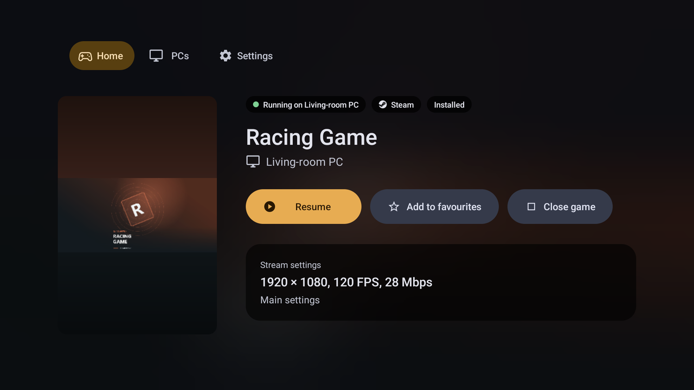

  

<h3 align="center">Turn your PC into a console. Play it on every screen you own.</h3>

Nightjar streams your PC games to Android phones, handhelds, tablets and TVs, and to Windows and Linux PCs. Your games from Steam, Epic Games, GOG, EA app, Ubisoft Connect, Battle.net and Xbox come together in one console library, and a Rust streaming engine puts each frame on a handheld's screen about 7 ms after your PC draws it. Nightjar works with Rubylight, Sunshine, Apollo, Vibepollo, NVIDIA GameStream and every other Moonlight-compatible host.

<b>Free and open source. No ads, no accounts, no analytics.</b>

  

  <a href="https://github.com/RamazanKara/nightjar/releases/latest/download/nightjar.apk"><b>Android</b></a> ·
  <a href="#android-tv-and-fire-tv"><b>Android TV and Fire TV</b></a> ·
  <a href="https://github.com/RamazanKara/nightjar/releases/latest"><b>Windows</b></a> ·
  <a href="https://github.com/RamazanKara/nightjar/releases/latest"><b>Linux</b></a>

  
  
  

  

  
  

## Why players pick Nightjar

<table>
<tr>
<td width="50%" valign="top"><b>Every store, one library.</b> Steam, Epic Games, GOG, EA app, Ubisoft Connect, Battle.net and Xbox games from all your PCs, with covers, favourites and Continue playing.</td>
<td width="50%" valign="top"><b>A real console interface.</b> Shelves, posters and a big hero for the focused game, built for a controller or a TV remote first.</td>
</tr>
<tr>
<td valign="top"><b>Near-zero decoding.</b> About half a millisecond per 1080p frame on a Snapdragon 8 Elite, and about 7 ms from PC to screen on a handheld over Wi-Fi.</td>
<td valign="top"><b>One engine, every screen.</b> Android, Android TV, Fire TV, Windows and Linux, all on the same Rust streaming engine.</td>
</tr>
<tr>
<td valign="top"><b>Radeon in your hand.</b> Switch on Anti-Lag or Radeon Chill from the stream menu, and watch your PC's GPU temperature, power and clocks live.</td>
<td valign="top"><b>A picture with nothing held back.</b> HDR10, 10-bit SDR, full-colour 4:4:4, PyroWave on the GPU, and FSR or Snapdragon GSR upscaling.</td>
</tr>
<tr>
<td valign="top"><b>Wake and play.</b> Your sleeping PC's games stay on Home. Pick one and Nightjar wakes the PC and starts the game.</td>
<td valign="top"><b>Built with its players.</b> Ask for a feature and watch it ship: some requests were released the same day they were asked.</td>
</tr>
</table>

## Your whole library, from every store

With [Rubylight 3.0](https://github.com/RamazanKara/Rubylight) on your PC, Nightjar opens on Home, and Home is your entire collection. Rubylight finds the games you installed from Steam, Epic Games, GOG, EA app, Ubisoft Connect, Battle.net and the Xbox app, and Nightjar lays them out like a console.

- **One library across all your PCs.** Favourites first, then Continue playing, then everything else. A game on two PCs is one card, and covers stay on your device, so your library is there even while a PC sleeps.
- **A shelf for every store.** On the big screen, Home becomes rows of posters under a large hero of the focused game: Recently played, one row per store with its badge on every poster, and Other apps.
- **Games you haven't added yet.** A row shows the games your PC found in its stores but never added. Pick one and your PC adds it.
- **All games.** Your whole collection in one poster grid, filtered by store, by installed, or by not added yet.
- **A page for every game.** Its store, whether it is running, installed or in HDR, the PC it runs on and the exact stream settings it will use, then Play or Resume.
- **Wake PC and play.** A sleeping PC's games stay on Home, marked "PC asleep". Pick one and Nightjar wakes the PC, waits for it and starts the game. A game on several PCs asks which one to use.
- **Everywhere you launch from.** The games you play appear on your Android TV home screen, and you can add them to Beacon, ES-DE, Daijisho or Pegasus ([launchers](docs/FRONTENDS.md)), or put a shortcut on your phone's home screen.

  
  

  

## Made for the couch

- **Controller and remote first.** Every screen works with a gamepad, a TV remote, touch, a mouse or a keyboard, and the button hints follow whatever you last touched: A and X on a gamepad, OK and Menu on a remote.
- **Your PCs at a glance.** Each PC is a tile that shows the cover of the game it is running and whether it is awake.
- **The TV console on any device.** One setting puts the TV layout on your handheld or tablet, full screen.
- **Settings you can find.** A rail of sections, search across every setting, Native and Battery saver presets, settings per PC, and per-game Competitive, Smoothness and Quality presets.
- **PIN lock** for the app, every stream or the PCs you pick, typed with a TV remote, a gamepad, number keys or touch.
- Interface size, high contrast and reduced motion, in 15 languages.

## Your PC's controls, in the stream menu

Press Back while you play. **Session and graphics** has Resume, Disconnect, End session and Close game, the facts of your connection (Wi-Fi generation, band, speed and round trip), and a **Radeon panel** for your PC's AMD driver features such as Anti-Lag and Radeon Chill. Every change goes back exactly as it was when the session ends. [Home and the session menu](docs/console.md).

  

## Fast where you feel it

- **Near-zero decoding.** A Snapdragon 8 Elite turns each 1080p frame into a picture in about half a millisecond: 0.39 ms for AV1 and 0.55 ms for HEVC on a Galaxy S25 Ultra, measured with Nightjar's built-in decoder benchmark ([device results](docs/devices.md#devices)).
- **About 7 ms from PC to screen** on a Retroid Pocket 6 over Wi-Fi ([runs](https://github.com/RamazanKara/Rubylight/blob/main/rust/PERFORMANCE.md#october-23-rust-engine-against-the-c-engine-on-android-b8)).
- **Decoders tuned per chip.** Low-latency settings for Snapdragon, MediaTek, Tegra, Exynos, Google Pixel and Amlogic decoders ([decoder flags](docs/decoder-flags.md)).
- **Frames timed to your display.** Pacing follows Android's adaptive refresh and the game's own frame rate, and Nightjar tells your PC how long frames wait for your screen so they arrive just in time.
- **A stream made for your link.** Nightjar tells your PC your wired link speed, or that you are on Wi-Fi, so the PC paces the stream for your connection from the very first frame.
- **Beam racing on the desktop.** A PyroWave picture is decoded in slices while the rest of it is still arriving, and the top is drawn before the bottom has left the network.
- **Low-latency audio** through AAudio, in stereo, 5.1 and 7.1.

## A picture with nothing held back

- **1080p at 120 fps in 10-bit HDR** with full colour detail, without a dropped frame on a Retroid Pocket 6.
- **HDR10** on AV1 and HEVC, **10-bit SDR** that smooths out banding on any screen, and **full-colour 4:4:4** for sharp coloured text, from your device's own hardware decoder.
- **PyroWave on the GPU.** The low-latency wavelet codec decodes through Vulkan on Android and on the GPU on Windows and Linux, in full-colour 4:4:4 and HDR. On Snapdragon you can load a newer Adreno driver for it.
- **Upscaling on your device** with FSR 1 or Snapdragon GSR: send fewer pixels, see a sharp picture.
- **Automatic bitrate** up to 2000 Mbps follows loss, jitter and your decoder's headroom, and **automatic quality** changes resolution and frame rate mid-stream for smooth motion, sharp detail or longer battery life. Both watch your device's temperature.
- **Render through Vulkan**, so frame-generation overlays can hook the video.

## One engine, every screen

Phones, foldables, handhelds, tablets, Android TV and Fire TV run the same Rust streaming engine as the Windows and Linux client. Home, your PCs, your settings, the session menu and the Radeon panel come with you to every one of them. The desktop client brings hardware decoding, VRR pacing, controller-first navigation, GPU PyroWave decoding and beam racing, and brings its own FFmpeg, so the Linux build runs across distributions, from Ubuntu to Arch. [Desktop client](protocol/desktop/README.md).

  

## Every way to play

- **A full PC keyboard over the stream** with Esc, F1 to F12, arrows and sticky Ctrl, Alt, Win and Shift, driven by touch, a controller or a TV remote.
- **DualSense over USB** with rumble, Edge paddles, adaptive triggers, the lightbar, waveform haptics, and its speaker, headset and microphone.
- **Built-in Xbox and Switch Pro USB drivers**, per-controller button and stick mappings, and controllers that keep their identity across reconnects.
- **Per-game touch controls** with keys, buttons, sticks, triggers and a D-pad, shared as files, with Artemis keyboard layouts and Custom Keys imported in one step ([controls](docs/controls.md)).
- **Touch that feels like a laptop**: a trackpad with acceleration and glide, a cursor drawn on your device, pen, mouse and keyboard, and three- and four-finger shortcuts.
- **Voice chat** from your phone's microphone to the PC, muted from the stream menu.

  

## See everything

A one-line overlay in any corner shows frame rate, round trip, loss and a health dot. Statistics and Debug views break the delay into stages and add your PC's CPU and GPU usage, temperatures, power, clocks and VRAM. **Why did my stream stutter?** names the likely cause, whether network, decoder, PC, display or heat, and can run a reversible bitrate test. A built-in test measures input-to-screen latency, a decoder benchmark runs without any PC, and frame timings export as CSV.

## Your PC, your way

Give the stream its own virtual display at your device's exact resolution, and choose whether your monitors stay on, switch off or sit beside it. Watch a PC without taking over its input with Remote Monitor, or drive it without video with Input-only. Copy text both ways, run your PC's commands, pair with a one-time PIN and open your host's web UI from the app.

## Anywhere, and always yours

- **Play away from home** with a built-in guide that sets up a private Tailscale connection and tests your PC from wherever you are.
- **Network profiles** that pick stream settings for each network, a mobile data cap, and streams that ride out network drops of up to 60 seconds.
- Picture-in-picture, and video on an external display with your phone as the touchpad.
- System, Dark and OLED black themes, built-in help that works offline, and problem reports that stay on your device until you share them.

## Works with your host

Nightjar reads what each PC's host can do and shows exactly the features it offers, so every PC's settings fit it. [Rubylight 3.0](https://github.com/RamazanKara/Rubylight), the host built for Radeon, brings out everything on this page: the store library, the Radeon panel, live GPU statistics, full-colour 4:4:4, PyroWave and Wi-Fi pacing from the first frame. Every other Moonlight-compatible host gets the full stream, controls and diagnostics, plus the extras it offers, such as virtual displays and one-time PIN pairing on Apollo and Vibepollo, and host statistics on Vibepollo. The [host feature matrix](docs/PARITY-MATRIX.md) lists every feature for every host.

## Built with its players

Nightjar moves at the speed of its players. PIN lock ([#35](https://github.com/RamazanKara/nightjar/issues/35)), the overlay in any corner ([#34](https://github.com/RamazanKara/nightjar/issues/34)) and waking a PC from Home ([#31](https://github.com/RamazanKara/nightjar/issues/31)) were asked for and released on the same day. 10-bit SDR ([#28](https://github.com/RamazanKara/nightjar/issues/28)), automatic bitrate limits ([#20](https://github.com/RamazanKara/nightjar/issues/20)), Vulkan rendering for frame generation ([#17](https://github.com/RamazanKara/nightjar/issues/17)), full chroma on AMD ([#16](https://github.com/RamazanKara/nightjar/issues/16)) and Beacon support ([#8](https://github.com/RamazanKara/nightjar/issues/8)) followed within days.

**[Ask for a feature](https://github.com/RamazanKara/nightjar/issues/new/choose)**, and add your device to the [device results](https://ramazankara.github.io/nightjar/devices.html) with the built-in benchmark.

## Get started

1. Run a streaming host on your PC, such as [Rubylight](https://github.com/RamazanKara/Rubylight), [Apollo](https://github.com/ClassicOldSong/Apollo), [Sunshine](https://github.com/LizardByte/Sunshine) or [Vibepollo](https://github.com/Nonary/Vibepollo), and add your games.
2. Install Nightjar:
   - **Android** (5.0 and newer): [download the APK](https://github.com/RamazanKara/nightjar/releases/latest/download/nightjar.apk), open it and allow the install. Nightjar tells you when an update is out. PyroWave runs on 64-bit Android 10 and newer with a Vulkan 1.3 GPU ([video requirements](docs/video-and-latency.md#codecs)).
   - **Windows**: download `nightjar-desktop-<version>-windows-x86_64.zip` from the [latest release](https://github.com/RamazanKara/nightjar/releases/latest), unzip it and run `nightjar.exe`.
   - **Linux**: download `nightjar-desktop-<version>-linux-x86_64.tar.gz` from the [latest release](https://github.com/RamazanKara/nightjar/releases/latest), unpack it and run `./nightjar`.
3. Pick your PC on the network and enter the PIN Nightjar shows in your host's web UI.
4. If your host has per-device permissions, allow your device to list, view and launch apps and the input types you use. Then pick a game. With a Rubylight 3.0 host, Nightjar opens on [Home](docs/console.md); turn on Host control for your device to close games and change Radeon settings. [Pairing and permissions](docs/pairing.md).

### Android TV and Fire TV

Install AFTVnews' [Downloader](https://www.aftvnews.com/downloader/) from your TV's app store, enter the code **`3815143`** in its URL field and install the APK it downloads, or type the link `https://github.com/RamazanKara/nightjar/releases/latest/download/nightjar.apk`. Both always fetch the latest release. Allow Downloader to install apps when your TV asks.

### Coming from Moonlight or Artemis?

Nightjar installs beside them, so you can try it without giving anything up: pair it once with your host and your games are there. Bring your Artemis keyboard layouts and Custom Keys with you, and point your launcher at Nightjar with **PC settings → Add games to a launcher**.

Coming from Rubylight Android? Nightjar is the same app under its new name. It installs over Rubylight Android 0.5.0 and keeps your PCs, pairings and settings.

## Docs

[Start here](docs/index.md) · [Quick start](docs/quick-start.md) · [Pairing](docs/pairing.md) · [Settings](docs/settings.md) · [Controls](docs/controls.md) 
[Home and session menu](docs/console.md) · [Desktop client](protocol/desktop/README.md) · [Beam racing](docs/beam-racing.md) · [Video & latency](docs/video-and-latency.md) · [Troubleshooting](docs/TROUBLESHOOTING.md) · [Building](docs/building.md) · [Frontends](docs/FRONTENDS.md) · [Translations](docs/TRANSLATIONS.md) · [FAQ](docs/faq.md)

[GPL-3.0](LICENSE.txt) · [Credits and third-party notices](docs/index.md#license-and-credits)
