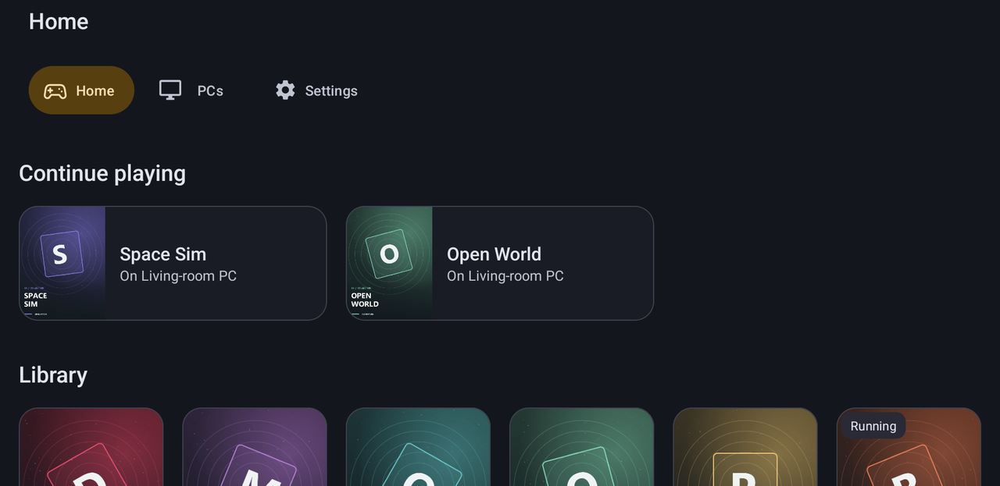
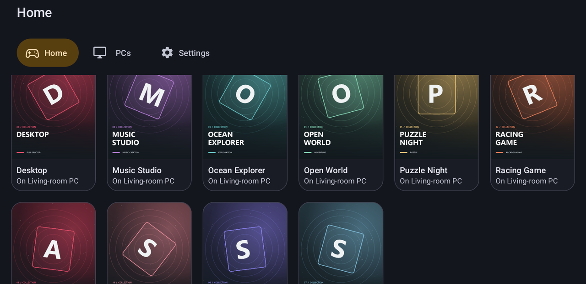
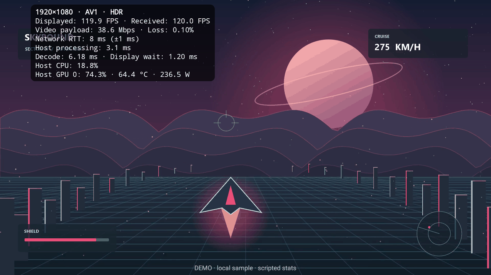
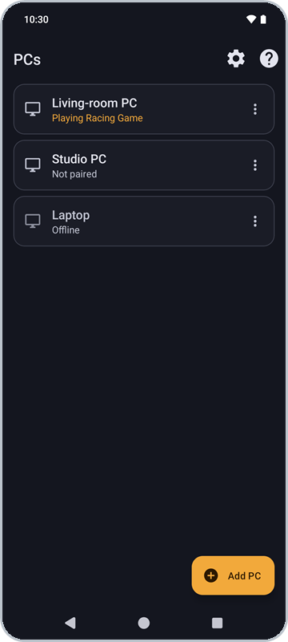
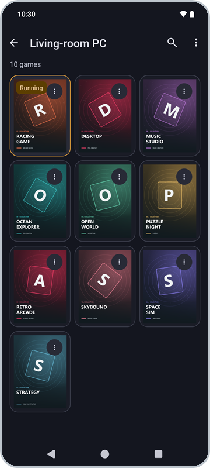
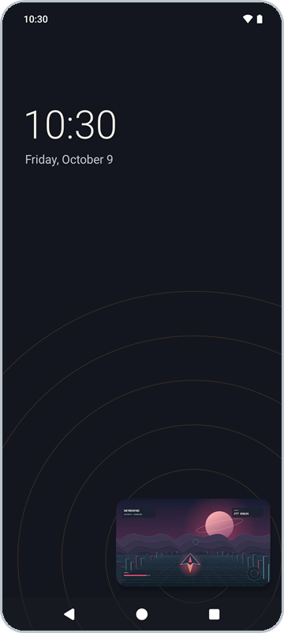
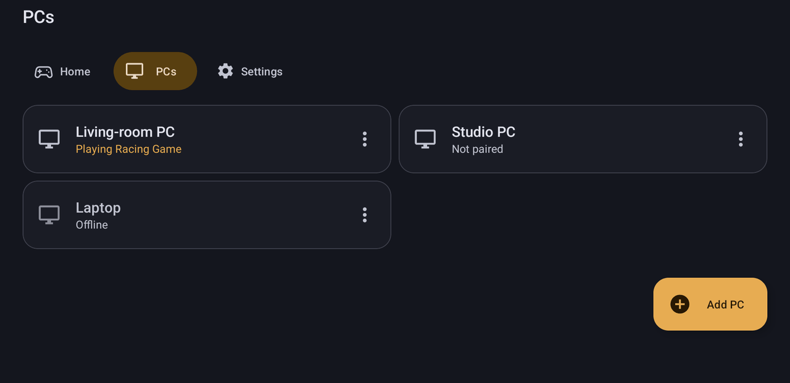
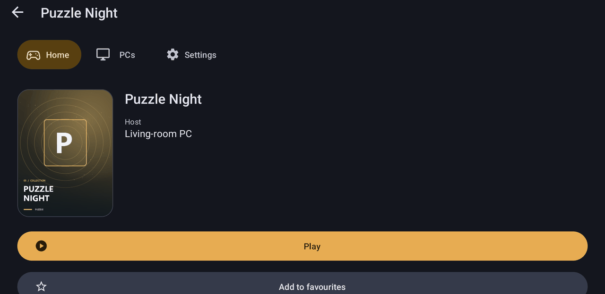
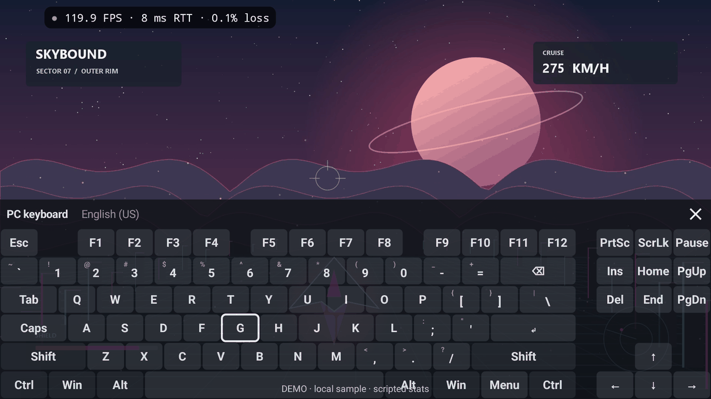
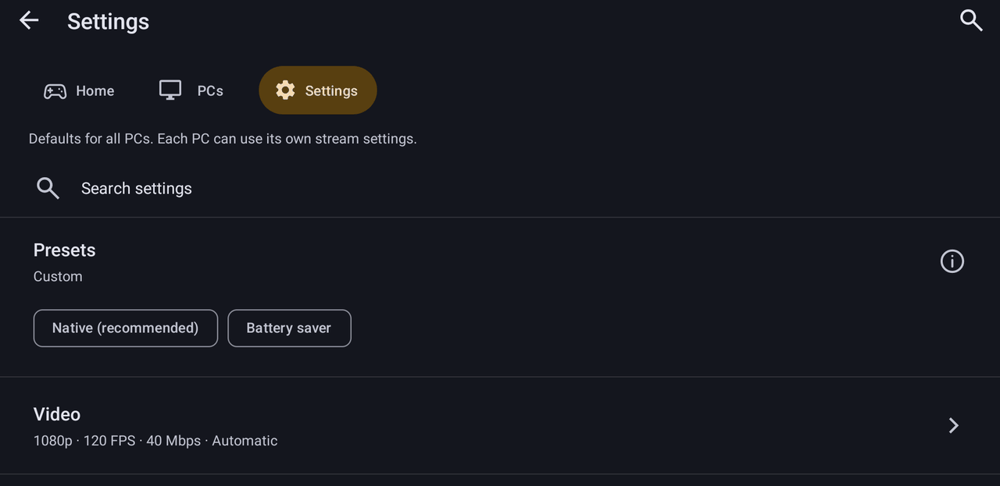

  

Nightjar streams your PC games and desktop to your Android phone, tablet or TV, and, with the Desktop client (Experimental), to Windows and Linux PCs, with as little delay as your network allows. It works with Sunshine, Apollo, Vibepollo, Rubylight, NVIDIA GameStream and other Moonlight-compatible hosts, and it adjusts itself to whichever one you run. With a Rubylight 3.0 host it adds a console with your library, a session menu and Radeon controls.

  

<a href="https://ramazankara.github.io/nightjar/#demo">Watch the 69-second tour: PCs and library, PC settings for your host, stream menu, host statistics, PyroWave, adaptive refresh, upscaling, the Snapdragon GPU driver, DualSense and picture-in-picture →</a>

  

  
  

  
  

  
  
  
  

## Why Nightjar

**A console on your phone.** With a Rubylight 3.0 host, Nightjar opens on Home: favourites first, what is running, your library across every paired PC with covers, and your PCs. A game's page shows where it runs and which stream settings it will use, then Play or Resume. While you stream, the stream menu has a Session and graphics page: Resume, Disconnect, End session and Close game, the connection facts, and a Radeon panel for the host's AMD driver features such as Anti-Lag and Radeon Chill. The host puts every setting back when the session ends. [Home and the session menu](docs/console.md).

  
  

**A PC keyboard that fits any input.** A full on-screen keyboard has Esc, Tab, F1 to F12, arrows and sticky Ctrl, Alt, Win and Shift. It works with touch, a controller or a TV remote, so you can type on the PC from the couch.

  

**A Rust streaming engine.** The streaming engine is written in Rust and is the default on Android, with the classic engine one switch away. On a Retroid Pocket 6 it matched the classic engine's end-to-end time, 6.92 ms against 7.04 ms at the median.

**Desktop client for Windows and Linux (Experimental).** The same engine runs on the desktop with hardware decoding, VRR pacing, audio, keyboard, mouse and controllers, an egui interface and GPU PyroWave decoding. [Desktop client](protocol/desktop/README.md) · [Downloads](https://github.com/RamazanKara/nightjar/releases).

**Beam-raced PyroWave (opt-in, Nightjar desktop).** Switch it on and the desktop client decodes a PyroWave picture in slices while the rest of it is still arriving, and draws the top before the bottom has left the network. [Beam racing](docs/beam-racing.md).

**It learns your host.** Every host supports a different set of extras. Nightjar reads what yours reports and only shows the options that work there, with a short reason when something needs a host setting or an update.

  

**Quality that adjusts itself.** Automatic bitrate follows packet loss, network jitter and how much headroom your phone's decoder has left, up to 2000 Mbps where the host allows it. Automatic quality also changes resolution and frame rate mid-stream, with three goals to pick from: keep motion smooth, keep detail sharp, or save battery. Both watch your phone's temperature and back off before it starts throttling. When a Rubylight host lowers the bitrate to fit your network, the overlay says so.

**It works hard on latency.** Decoders get per-chip low-latency tuning, frames are paced to your display, including Android's adaptive refresh on newer phones, and stereo audio uses low-latency AAudio. On Rubylight, Nightjar tells the host how long frames wait for your screen so it can time them to arrive just in time.

**PyroWave, upscaling and your own GPU driver.** Nightjar decodes PyroWave on the GPU through Vulkan, including full-colour 4:4:4. Any SDR stream can be sent at a lower resolution and upscaled on the phone with FSR 1 or Snapdragon GSR. On Snapdragon phones you can load a newer Adreno Vulkan driver for PyroWave.

**You can see everything.** A one-line overlay shows frame rate, network round trip, loss and a health dot. Statistics and Debug views break the delay into stages, and with Rubylight host telemetry turned on they add the PC's CPU usage and AMD GPU usage, temperatures, power, clocks and VRAM. "Why did my stream stutter?" points at the likely cause, whether that's the network, the decoder, the host, the display or heat, and can run a reversible bitrate test. A built-in test measures input-to-screen latency, a decoder benchmark runs without any host, and frame timings export as CSV.

**Talk and play.** With Rubylight, send your phone's microphone to the PC for voice chat and mute it from the stream menu. Over USB, a DualSense gets rumble and Edge paddles, adaptive triggers, the lightbar, waveform haptics and the controller's speaker, headset and microphone where the host supports them. Controllers keep their identity across reconnects (Rubylight), and Xbox USB controllers work through a built-in driver.

**Your PC, your way.** With Rubylight, pick per PC whether the stream gets its own virtual display at your phone's resolution, and whether your monitors stay on, switch off or sit beside it. Watch a PC without taking over its input with Remote Monitor, or control it without video with Input-only. Copy text in both directions, run the host's commands, pair with a one-time PIN and open your host's web UI from the app.

**Play away from home.** A built-in guide sets up a private Tailscale connection and tests the paired PC from wherever you are. On Rubylight it also shows whether the connection runs direct or through a relay.

**Your library in your launcher.** Export games to Beacon, ES-DE, Daijisho or Pegasus from **PC settings → Add games to a launcher**. Nightjar remembers successful export folders for each PC and launcher, so **Update games** refreshes entries in place. ES-DE can also receive its system configuration and cached covers. [Launcher setup](docs/FRONTENDS.md).

Some features need a Rubylight host, such as the console, microphone, telemetry, monitor control, Input-only, PIN pairing and PyroWave. [The parity matrix](docs/PARITY-MATRIX.md) lists what each host supports.

## Measured

All of these are our own runs on an RX 7900 XT host, with the method and raw results in [Rubylight's PERFORMANCE.md](https://github.com/RamazanKara/Rubylight/blob/main/rust/PERFORMANCE.md) and in [PyroWave decode](docs/pyrowave-decode.md).

| Result | Measured |
| :-- | :-- |
| **6.92 ms** | median end to end, HEVC 1080p60 at 40 Mbps on a Retroid Pocket 6 with the Rust engine, against 7.04 ms for the classic engine ([run](https://github.com/RamazanKara/Rubylight/blob/main/rust/PERFORMANCE.md#october-23-rust-engine-against-the-c-engine-on-android-b8)) |
| **20.5 to 8.8 ms** | median receive to present on one PC, loopback, PyroWave 4:2:0 1080p60 133 Mbps, on the desktop client when decoding moves from the CPU to the GPU ([decode runs](docs/pyrowave-decode.md)) |
| **1.4 ms sooner** | at the picture's middle row with beam racing on, loopback on one PC, PyroWave 1080p60 4:2:0 at 399 Mbps on the Nightjar desktop client ([gate](https://github.com/RamazanKara/Rubylight/blob/main/rust/PERFORMANCE.md#october-24-beam-raced-pyrowave-gate-b10-step-4-opt-in-missed-its-default-on-gate)) |
| **1.2 to 1.4 ms sooner** | with Rubylight's slice delivery over Wi-Fi 6E to a laptop running the desktop client, 4K60 HEVC ([runs](https://github.com/RamazanKara/Rubylight/blob/main/rust/PERFORMANCE.md#october-23-slice-delivery-b2-step-2f)) |

## Everything else

- AV1, HEVC and H.264 with HDR10, and 4:4:4 where the host offers it
- Early decode (experimental) on the desktop client: PyroWave blocks are decoded while the frame is still arriving ([early decode](docs/early-decode.md))
- Touch, trackpad, mouse, pen and keyboard, with editable keyboard shortcuts and per-game touch controls (keys, gamepad buttons, sticks, triggers, D-pad) you can export, share and import from Artemis ([controls](docs/controls.md))
- Touch modes: natural trackpad with adjustable acceleration, glide and active area, a Local cursor drawn on the phone, or Touch off for controller play; configurable three- and four-finger tap shortcuts
- Video scaling (Fit, Fill, Stretch, 1:1), picture position, custom stream resolutions, and portrait or rotate-with-device streams
- Named stream profiles picked by network, per-game stream settings and a mobile data bitrate cap
- Per-controller button and stick/trigger mappings, a controller test page, an opt-in physical Back shortcut for handhelds such as AYN Thor, rumble off, keyboard Back or Right Alt as the Windows key, and an opt-in Switch Pro USB driver
- Quick resume, quit the game when you leave, and opt-in tolerance for network drops of up to 60 seconds
- Wi-Fi details and stutter-rhythm detection in the stream doctor, and shareable device results ([devices](docs/devices.md))
- Desktop tools: a compact keyboard and trackpad panel with key banks and shortcuts, pinch zoom, and video on an external display with the phone as a touchpad
- Settings per PC, Native and Battery saver presets, Wake-on-LAN and automatic discovery
- Phones, foldables, tablets, Android TV and Fire TV with D-pad navigation, plus picture-in-picture; TV remote Back and Menu open stream controls, and D-pad/Select send arrow keys/Enter to the PC ([controls](docs/controls.md#tv-and-fire-tv-remotes))
- Optional OLED black appearance for app screens, menus and dialogs, even with a light system theme
- Built-in help that works offline, and problem reports that stay on your phone until you share them
- In 15 languages; native speakers can [help translate](docs/TRANSLATIONS.md#help-translate)
- No ads, no analytics, no accounts

See the [host feature matrix](docs/PARITY-MATRIX.md) for exactly what each host provides.

## Quick start

Requires **Android 5.0 or newer**. PyroWave needs Android 10+, a 64-bit device and a Vulkan 1.3 GPU; see [video requirements](docs/video-and-latency.md#codecs). The desktop client for Windows and Linux is Experimental; see its [README](protocol/desktop/README.md) and the [downloads](https://github.com/RamazanKara/nightjar/releases).

1. Start a streaming host on your PC, such as [Apollo](https://github.com/ClassicOldSong/Apollo), [Rubylight](https://github.com/RamazanKara/Rubylight), [Sunshine](https://github.com/LizardByte/Sunshine) or [Vibepollo](https://github.com/Nonary/Vibepollo), and add your games.
2. [Download the APK](https://github.com/RamazanKara/nightjar/releases/latest), open it and allow installation from your browser or file manager when prompted.
3. Select your PC on the same network and enter the PIN shown on your phone in your host's settings or web UI.
4. If your host has per-device permissions, enable your device and allow application listing, viewing, launching and the input types you use. Open your library and tap a game. With a Rubylight 3.0 host, Nightjar opens on [Home](docs/console.md) and you can turn on Host control for the device to close games and change Radeon settings. See [pairing and permissions](docs/pairing.md).

Coming from Rubylight Android? Nightjar is the same app under a new name. It installs over Rubylight Android 0.5.0 and keeps your PCs, pairings and settings.

## Docs

[Start here](docs/index.md) · [Quick start](docs/quick-start.md) · [Pairing](docs/pairing.md) · [Settings](docs/settings.md) · [Controls](docs/controls.md) 
[Home and session menu](docs/console.md) · [Beam racing](docs/beam-racing.md) · [Desktop client](protocol/desktop/README.md) · [Video & latency](docs/video-and-latency.md) · [Troubleshooting](docs/TROUBLESHOOTING.md) · [Building](docs/building.md) · [Frontends](docs/FRONTENDS.md) · [Translations](docs/TRANSLATIONS.md) · [FAQ](docs/faq.md)

[GPL-3.0](LICENSE.txt) · [Credits and third-party notices](docs/index.md#license-and-credits)
