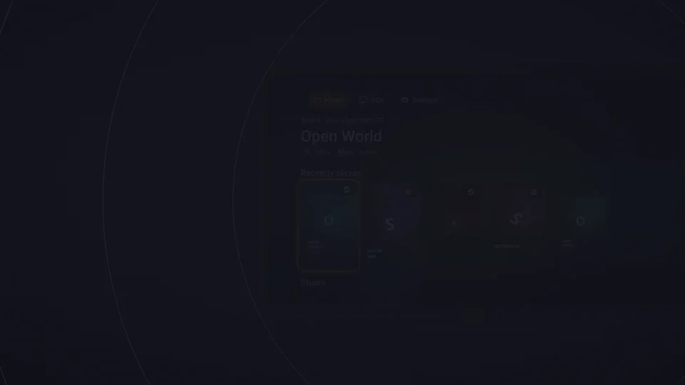
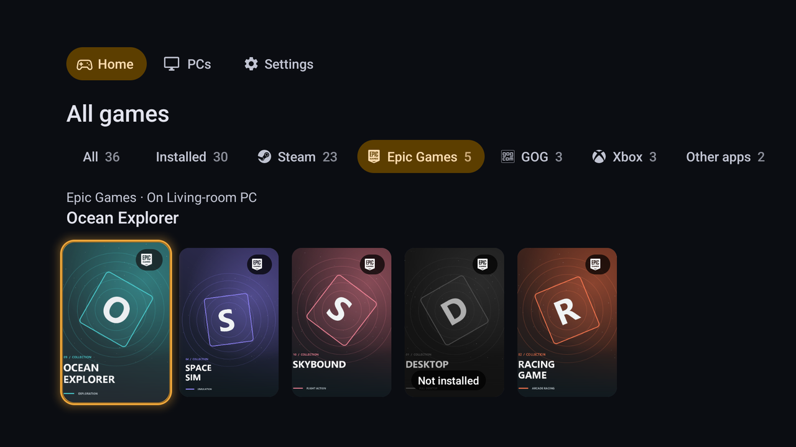
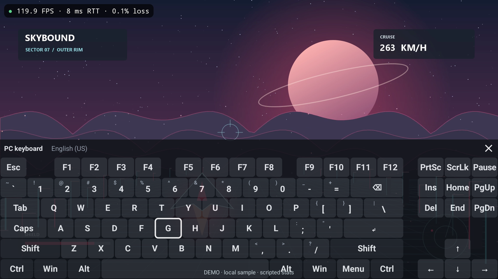

  

<h3 align="center">Your PC games, on every screen you own.</h3>

  Stream your PC to a phone, handheld, TV or laptop with the picture, sound and controls of playing at your desk. 
  Free and open source. No accounts, no ads, no tracking.

  
  
  

  

  <b>Android</b> · <b>Android TV</b> · <b>Fire TV</b> · <b>Windows</b> · <b>Linux</b> 
  Works with Sunshine, Apollo, Vibepollo, Rubylight, NVIDIA GameStream and every other Moonlight-compatible host.

   
  <a href="https://ramazankara.github.io/nightjar/assets/trailer-16x9.mp4"><b>▶ Watch the full trailer</b></a>

# Nightjar

Nightjar streams games from your PC to Android phones, tablets and handhelds, Android TV and Fire TV, Windows and Linux. It speaks the Moonlight protocol, so it works with the host you already run, and it is built to make the stream feel local: hardware decoding tuned for each chip, frame pacing that follows your display, and recovery that keeps you in the game when the network hiccups.

<table>
<tr>
<td width="50%" valign="top">

### Feels local
**7 ms** median picture age, from the PC's capture to the frame on a Retroid Pocket 6 over Wi-Fi, and about **120 fps** on the same handheld ([our measurements](#measured-performance)). Low-latency settings per decoder family, adaptive refresh and VRR, and phase-locked frame timing with hosts that support it.

</td>
<td width="50%" valign="top">

### One library for every PC
Home gathers the games of every paired PC, with cover art, **Continue playing** and a page for each game; on a TV, each store gets its own shelf. Pick a game on a sleeping PC and Nightjar wakes the PC and starts it. Home needs a host with the native library API (Rubylight 3.0); other PCs open their app grid.

</td>
</tr>
<tr>
<td valign="top">

### Works with your host
Every Moonlight-compatible host gets the complete stream: hardware decoding, HDR10, surround sound, every controller, touch, mouse and keyboard, recovery and diagnostics. Nightjar turns on more from the capabilities each PC's host reports, never from the host's name: with a Rubylight 3.0 PC, that includes Home, sharing, USB forwarding, co-op, Dolby Vision and 7.1.4.

</td>
<td valign="top">

### Private by design
No accounts, advertising or analytics, and nothing sent to its developers. Video, audio, input, clipboard and files travel only between your device and your PC. Licensed under the GPL-3.0 and developed in the open.

</td>
</tr>
</table>

## A look around

<table>
<tr>
<td width="50%" valign="top">
   
  <b>A page for every game.</b> Its store, the PC it runs on, whether it is running, and the exact settings the stream will use.
</td>
<td width="50%" valign="top">
   
  <b>Every store in one place.</b> Steam, Epic Games, GOG, EA app, Ubisoft Connect, Battle.net and Xbox, filtered with one press.
</td>
</tr>
<tr>
<td valign="top">
   
  <b>See every millisecond.</b> The performance overlay shows the network and decoding, and the PC's CPU and GPU readings from a host that sends them.
</td>
<td valign="top">
   
  <b>Tune it while you play.</b> With a Rubylight 3.0 PC, change the bitrate, frame rate and the PC's Radeon graphics settings without leaving the game.
</td>
</tr>
<tr>
<td valign="top">
   
  <b>A real PC keyboard.</b> Esc, F1 to F12, arrows and sticky modifiers, by touch, controller or TV remote.
</td>
<td valign="top">
   
  <b>On the desktop too.</b> The same engine and settings on Windows and Linux, with VRR and beam racing.
</td>
</tr>
</table>

Screenshots and the trailer use Nightjar's offline demo with a sample library and an original test animation; the performance numbers shown in them are illustrations. Measured results are [below](#measured-performance). Home, store shelves and game pages need a host with the native library API (Rubylight 3.0).

## Everything in the box

- **Picture.** H.264, HEVC and AV1 on the hardware decoder, tuned for [each decoder family](docs/decoder-flags.md). HDR10 with any HDR-capable host; HDR10+, HLG and Dolby Vision where the PC, decoder and display support them. 10-bit SDR, full-chroma 4:4:4, and the PyroWave codec decoded on the GPU. Upscaling with FSR 1, Snapdragon GSR or, on Windows, the graphics card's video upscaler.
- **Timing.** Follows the display's refresh rate, including Android's adaptive refresh and VRR on the desktop. Hosts that support it receive phase-lock reports, so frames arrive just before the display needs them. The desktop client can also [beam race](docs/beam-racing.md).
- **Network.** **Device controls bitrate** adapts to loss, round-trip variation and decode headroom. Bitrate and frame rate can change during a stream, and error correction can follow measured loss, with hosts that accept it. **Recover interrupted streams**, on by default, returns to the running game after a transient failure, and **Ride out network drops** holds a stream through up to 60 seconds of silence.
- **Sound.** Stereo, 5.1, 7.1 and 7.1.4. Passthrough of PCM, Dolby Digital or Dolby Digital Plus to a receiver, soundbar or TV. A microphone with echo cancellation on every platform, plus noise suppression, gain and one-tap mute on Android.
- **Controls.** Up to 16 controllers with mapping per model. Direct USB drivers for DualSense (adaptive triggers, lightbar and haptics), Xbox and Switch Pro controllers. Trackpad, direct, multi-touch and local-cursor touch modes, native pen input, on-screen controls on Android, and a soft keyboard that opens when a text field on the PC takes focus.
- **Library.** With a Rubylight 3.0 PC, Home merges every paired PC's games, with a shelf per store on a TV, a page per game and Wake-on-LAN. Games from any host launch from Android TV's home screen, Beacon, ES-DE, Daijisho, Pegasus and the desktop command line.
- **Sharing.** With a Rubylight 3.0 PC: clipboard sync in both directions, clipboard images, file transfer, the PC's shared folders, and USB devices forwarded to the PC.
- **Co-op.** Take a free player slot in a Rubylight 3.0 PC's split-screen co-op session, or go back to your own seat.
- **Diagnostics.** A performance overlay in three levels of detail, a [stream health](docs/stream-health.md) report that explains stutter, an input latency test, a decoder benchmark that runs without a PC, frame timings as CSV, a connection test and redacted problem reports.
- **Comfort.** Every screen works with a controller or a TV remote as well as touch, mouse and keyboard. Layered settings with search and presets, high contrast, reduced motion, screen reader support, and 15 languages on Android.

The [feature overview](docs/features.md) lists everything, with a link to each guide.

## Measured performance

Our own measurements, against a Rubylight PC with a Radeon RX 7900 XT:

| Device and link | Stream | Result |
| --- | --- | --- |
| Retroid Pocket 6, Wi-Fi | HEVC 1080p60, 40 Mbps | 7 ms median picture age, from the PC's capture timestamp to the frame rendered on the device, with either streaming engine (6.92 and 7.04 ms; clock join error about ±0.5 ms; [method and runs](https://github.com/RamazanKara/Rubylight/blob/main/rust/PERFORMANCE.md#october-23-rust-engine-against-the-c-engine-on-android-b8)) |
| Retroid Pocket 6, Wi-Fi | HEVC 1080p120, 28 Mbps | About 120 fps ([4.0.0 release notes](https://github.com/RamazanKara/nightjar/releases/tag/v4.0.0)) |
| Retroid Pocket 6, Wi-Fi | PyroWave 1080p120, default bitrate | 119.6 to 120 fps, about 1.7 ms per frame for the decode steps ([4.0.0 release notes](https://github.com/RamazanKara/nightjar/releases/tag/v4.0.0)) |

Decoder benchmark results for other devices are in [device results](docs/devices.md#devices); the built-in benchmark measures yours.

## Install

Download from the [latest release](https://github.com/RamazanKara/nightjar/releases/latest). Every release publishes the SHA-256 of each file in `SHA256SUMS-<version>.txt`.

| Platform | Package | How to install |
| --- | --- | --- |
| Android phones, tablets and handhelds | [`nightjar.apk`](https://github.com/RamazanKara/nightjar/releases/latest/download/nightjar.apk) | Open the APK and allow installation from the app that opened it. To receive updates through [Obtainium](https://github.com/ImranR98/Obtainium), add `https://github.com/RamazanKara/nightjar`. |
| Android TV and Fire TV | The same APK | Install AFTVnews' [Downloader](https://www.aftvnews.com/downloader/) from the TV's app store, enter the code **`3815143`** and install the APK it downloads. The code always points to the latest release. |
| Windows 10 and 11 | `nightjar-desktop-<version>-windows-x86_64-setup.exe` | Run the installer. It installs for the current user without administrator rights and updates in place, keeping settings and paired PCs. The `.zip` contains the same files and runs without installation. |
| Debian, Ubuntu | `nightjar-desktop-<version>-linux-x86_64.deb` | `sudo apt install ./nightjar-desktop-<version>-linux-x86_64.deb` |
| Fedora | `nightjar-desktop-<version>-linux-x86_64.rpm` | `sudo dnf install ./nightjar-desktop-<version>-linux-x86_64.rpm` |
| Other Linux distributions | `.AppImage` or `.tar.gz` | Make the AppImage executable and run it, or unpack the archive and run `./nightjar`. |

Release APKs are signed with the Nightjar release key (certificate SHA-256 `312ed322c7c29d1aec4fae4a3979ebcb557af44d821d7f4746c0968548eb630b`), so every later release installs over the previous one. Outside Google Play, the Android app checks GitHub for new releases and asks before installing one; the Windows app reports a new release once per launch. The desktop packages are not code-signed.

Nightjar has its own application ID and pairs separately, so it installs beside Moonlight and other clients without affecting them. [Installing the desktop client](protocol/desktop/README.md#installing) covers removal and the location of settings.

## Getting started

1. Install a Moonlight-compatible host on the PC, such as [Sunshine](https://github.com/LizardByte/Sunshine), [Apollo](https://github.com/ClassicOldSong/Apollo), [Vibepollo](https://github.com/Nonary/Vibepollo) or [Rubylight](https://github.com/RamazanKara/Rubylight).
2. Open Nightjar on the same network. It lists the PCs it finds; otherwise choose **Add PC** and enter the PC's address.
3. Select the PC and enter the PIN that Nightjar shows in the host's web UI. With a Rubylight PC you can instead choose **Scan QR code** and scan the code on its **Devices** page.
4. If the host grants permissions per device, allow this device to list, view and launch apps, and the input types you use.
5. Pick a game and play.

The [quick start](docs/quick-start.md) and [pairing guide](docs/pairing.md) cover each step, including one-time PINs and Wake-on-LAN. To play outside your home network, see [Play away from home](docs/remote-setup.md).

## Host compatibility

Discovery, PIN pairing, Wake-on-LAN, the app library, H.264, HEVC and AV1, HDR10, surround sound, all input types, stream recovery and diagnostics work with every Moonlight-compatible host. Further features depend on what the host reports:

| Host capability | Provided by | What Nightjar adds |
| --- | --- | --- |
| Sunshine protocol extensions | Sunshine and hosts built on it | DualSense adaptive triggers and lightbar, controller motion and touchpads, native touch and pen |
| Device permissions and virtual displays | Apollo, Vibepollo, Rubylight | One-time PIN pairing, per-device permissions, a virtual display at the device's resolution, fractional refresh rates, clipboard transfer and server commands |
| Rubylight native API and stream extensions | Rubylight 3.0 | Home with games from every store, the Session and graphics menu with Radeon settings, QR pairing, clipboard sync, files, shared folders and USB forwarding, co-op sessions, HDR10+, HLG and Dolby Vision, 7.1.4 and audio passthrough, bitrate and frame-rate changes during a stream, host hardware readings |

The **Error correction** setting and host-side automatic bitrate also work with Sunshine-based PCs that support them, and PyroWave works with any host that offers it. When a PC's host lacks a feature, Nightjar hides it or names the host setting or permission it requires. [Host feature support](docs/PARITY-MATRIX.md) lists every capability and the hosts known to provide it.

## Requirements

| Platform | Requirement |
| --- | --- |
| Android, Android TV, Fire TV | Android 5.0 or newer. PyroWave needs 64-bit Android 10 or newer with Vulkan 1.3. Audio passthrough needs Android 10 or newer; 7.1.4 needs Android 12L or newer and a 12-channel output. |
| Windows | Windows 10 or 11, x86-64. HDR needs an HDR display with HDR turned on in Windows. PyroWave GPU decoding needs Vulkan 1.3. |
| Linux | x86-64 with glibc 2.35 or newer: Ubuntu 22.04, Debian 12, Fedora 36 or later. Hardware decoding through VA-API, V4L2 M2M or NVDEC. |
| PC | A Moonlight-compatible host. The host's own requirements apply. |

## Documentation

The [documentation index](docs/index.md) lists every page. The most used:

| Topic | Pages |
| --- | --- |
| Setup | [Quick start](docs/quick-start.md), [pairing and permissions](docs/pairing.md), [play away from home](docs/remote-setup.md) |
| Daily use | [Home and the session menu](docs/console.md), [controls](docs/controls.md), [clipboard, files and USB devices](docs/sharing.md) |
| Tuning | [Video and latency](docs/video-and-latency.md), [recovery and automatic quality](docs/recovery-and-quality.md), [settings reference](docs/settings.md) |
| Problems | [Troubleshooting](docs/TROUBLESHOOTING.md), [stream health](docs/stream-health.md), [FAQ](docs/faq.md) |
| Desktop | [Nightjar for Windows and Linux](protocol/desktop/README.md), [Android and desktop compared](docs/CLIENT-PARITY.md) |

## Building from source

The Android app builds with Gradle and JDK 21; its native code needs the Android NDK and Rust. The streaming engine and the desktop client are a Cargo workspace under [`protocol/`](protocol), shared by both apps.

- [Building Nightjar](docs/building.md): toolchains, tests, signing, the release workflow and the documentation checks.
- [Building the desktop client](protocol/desktop/README.md#building): Windows and Linux builds and packaging.

## Contributing

Report bugs and request features in the [issue tracker](https://github.com/RamazanKara/nightjar/issues/new/choose). [Device results](docs/devices.md) explains how to submit your device's benchmark, and [translations](docs/TRANSLATIONS.md#help-translate) explains how to correct or add a language. The Android app ships in 15 languages; the desktop app in English and German.

## Privacy

Video, audio, input, clipboard contents and files travel only between your device and your PC. Nightjar contacts GitHub to check for updates and Moonlight's STUN server (`stun.moonlight-stream.org`) to learn the network's public address, so it can tell whether the PC is reachable from outside. On Android it also uses Moonlight's connection-test server (`android.conntest.moonlight-stream.org`) to diagnose connection failures. Problem reports stay on the device until you share them. The [privacy policy](docs/PRIVACY.md) has the details.

## License and credits

Nightjar is licensed under the [GNU General Public License v3.0](LICENSE.txt).

Nightjar is a fork of [Moonlight Android](https://github.com/moonlight-stream/moonlight-android) by Cameron Gutman, Diego Waxemberg, Aaron Neyer, Andrew Hennessy and contributors, and was previously published as Butterpollo and as Rubylight Android ([rename history](docs/RENAME.md)). It incorporates work from these GPL-3.0 projects:

- [moonlight-common-c](https://github.com/moonlight-stream/moonlight-common-c), the classic streaming engine, and [moonlight-qt](https://github.com/moonlight-stream/moonlight-qt) by Cameron Gutman and contributors, for the desktop client's keyboard and controller tables, decoder setup and default bitrate curve
- [Artemis Android](https://github.com/ClassicOldSong/moonlight-android) by ClassicOldSong, for Apollo extension behavior and decoder setup
- [Moonlight V+](https://github.com/qiin2333/moonlight-vplus) by qiin2333, for soft-keyboard, decoder and controller handling, and [Moonlight V+ PC](https://github.com/qiin2333/moonlight-qt), for the desktop client's D3D11 draw pass, AI enhancement, touchpad input, Linux USB forwarding, crash dumps and update check
- [Moonlight X](https://github.com/MoreOrLessSoftware/moonlight-android/tree/mlsoft-x) by MoreOrLessSoftware, for Exynos and Tensor decoder settings and the Vulkan renderer
- [moonlight-noir](https://github.com/derflacco/moonlight-android) by derflacco, for decoder low-latency settings
- Nonary's moonlight-qt fork, the reference for the desktop client's VRR pacing and D3D11VA rendering
- [Nonary/moonlight-common-c](https://github.com/Nonary/moonlight-common-c), for the DualSense waveform protocol

The bundled third-party components (PyroWave, Granite, volk, libadrenotools, AMD FSR 1, Qualcomm SGSR 1, SDL, FFmpeg, the Figtree font and others) keep their own licenses. [License and credits](docs/index.md#license-and-credits) names each contribution and the notices to retain when redistributing.
