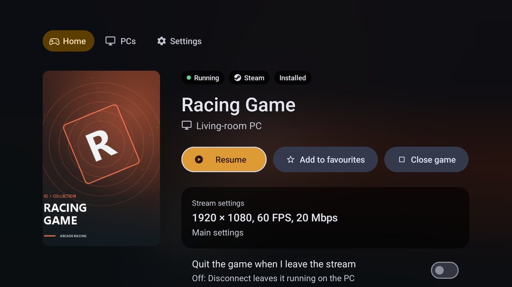
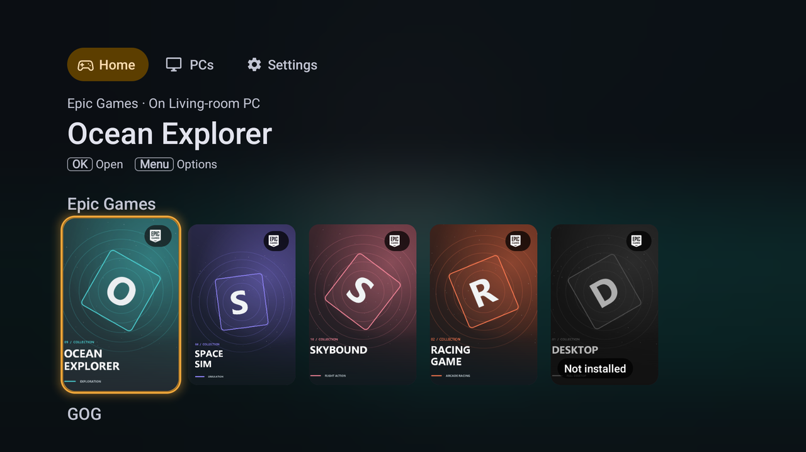
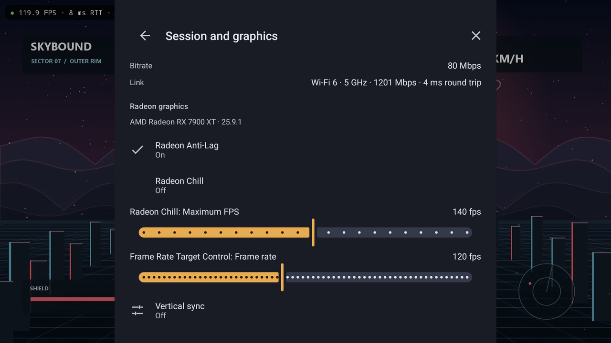

# Home and the session menu

[Documentation](index.md)

Home, game pages and the in-stream **Session and graphics** menu use a host's native library and session API, which [Rubylight](https://github.com/RamazanKara/Rubylight) 3.0 provides. With other Moonlight-compatible hosts, including earlier Rubylight versions, Nightjar shows the classic PC list and app grid. This page applies to Android and to Nightjar for Windows and Linux unless a section names one of them.

## Home

Nightjar opens on Home when a paired PC supports the native API. Home has four parts:

- **Favourites.** Games you starred, at the top. Long-press a game card (with a D-pad or controller, hold Select) and choose **Add to favourites**, or use the star on the game's page. Favourites belong to one PC, so the same title on two PCs is two entries. A favourite whose PC is offline stays on Home with its saved cover.
- **Continue playing.** Games that are running or suspended, marked **Running** or **Suspended**.
- **Library.** The games of every paired PC, with cover art. A game installed on several PCs appears once, marked with the number of PCs.
- **PCs.** Each PC with its number of games. An offline PC keeps the games it last reported and says it is offline. The three dots on a card open the PC's options.

To start on the PC list instead, turn off **Open on Home**. The bar under the top bar switches between **Home**, **PCs** and **Settings** at any time; Home appears in it as soon as a PC has a library. A PC paired from the PC list that supports the native API opens on Home; other PCs open their app grid.

## A game's page

Select a game to see the PC it runs on and the settings the stream will use (resolution, frame rate, bitrate, and the profile layer that set each), then choose **Play** or **Resume**. If another game is running on that PC, the page says that playing this game will close it. **Close game** appears when the PC grants this device **Host control**; otherwise the page offers **Quit game**.

Starting a game while another is running closes the running game only after you confirm a prompt that names both games. A cancelled prompt or a remembered launch never closes a game. When the host asks for confirmation before closing a game, Nightjar shows that question to you and starts the new game once you confirm.

When the host lists a game as not installed, **Play** is unavailable and the page says so, for example "Not installed on Living-room PC". A game the host cannot start says "Living-room PC can't start this game".

On a TV the page keeps the backdrop that Home showed for the game. A row of chips above the title shows the state (**Running** or **Suspended**), the store (Steam, Epic, GOG, Microsoft), whether the game is installed, and HDR support. A screen reader reads the row as one item.

  

## On a TV

Home and the PC list have dedicated TV layouts, chosen by Android's television mode. **Interface layout** in the settings selects the TV layout on other devices too.

- **Library rows.** Recently played, one row per store, Other apps (games no store owns), and On your PCs, not added (games the host found in a store but has not added). A row shows up to 20 games; a longer row ends in an **All N games** tile that opens All games with that row's filter.
- **Cards.** Each card shows a store chip. A game that is not installed is dimmed and says so. Selecting a game marked Not added asks the host to add it, when this device may launch games and the host supports it; otherwise the card says **Add it on the PC**.
- **All games.** Every game of the paired PCs in a poster grid, filtered by All, Installed, each store in the library, Other apps or Not added. Focus stays on the same card when the library refreshes.
- **PCs.** Large tiles, three to a row, inside the TV's safe area. A PC with a running game shows that game's cover behind its name. Each state has a word and a symbol as well as a color. **Add PC** sits below the tiles.
- **Settings.** The sections form a rail on the left. Right moves into a section, Left returns to the rail, and Back returns to the rail before leaving Settings.

  

## Join co-op

A host with co-op sessions (Rubylight 3.0) can run a game as a [Nucleus Co-op](https://github.com/SplitScreen-Me/splitscreenme-nucleus) split-screen session with one stream per player. Start the game's "(Co-op)" entry from the library on one device; the other players join from theirs:

- **Android:** **Join co-op** in the PC's options lists the PC's co-op sessions with their status, free slots and your own seat. Select a free slot to join, or your seat to return to it, and the stream starts.
- **Windows and Linux:** the PC's details page lists the same sessions and joins a slot.

The device needs the **Can join co-op games** permission in the host's web UI. A refused request shows the host's reason.

## Session and graphics

Open the stream menu during a stream and choose **Session and graphics**:

- **Session.** **Resume**, **Disconnect**, **End session**, and **Close game** with Host control (otherwise **Quit game**).
- **Connection.** The host, codec, resolution, frame rate and bitrate, and your link: Wi-Fi generation, band and speed, Ethernet or mobile data, with the round-trip time.
- **Radeon graphics.** The AMD driver features the host exposes, such as Anti-Lag and Radeon Chill.

The menu queries the host only while it is open, and the Radeon state at most once a second, never on the video, audio or input paths.

  

### Radeon panel

Each setting shows the state the host reports:

| State | What you see |
| --- | --- |
| Configurable | A switch, slider or choice you can change |
| Read only | The value, which cannot be changed |
| Needs setup in AMD Software | The value and the one-time step needed on the PC |
| Not supported | A note that the GPU or driver does not support it |
| Temporarily unavailable | The reason; Nightjar asks again |

You can change a setting when the host marks it configurable, the device has **Host control**, and you own the running session. Grant Host control to the device in the host's web UI. After a change, the panel shows the value the host reads back. Changes made during a stream are reverted when the session ends (End session, Close game, an expired grace period, unpairing or host shutdown), and the panel notes this next to the setting; **Disconnect** keeps the change until you resume or end the session. Settings this version of Nightjar does not recognize are still listed, drawn from their type. If the driver refuses a change, the reason appears next to the setting.

## Navigation

### The shell bar

**Home**, **PCs** and **Settings** sit in one bar under the top app bar, with the current one highlighted. On a TV the bar and the screens stay inside the safe area.

- The first screen is Home when **Open on Home** is on and a library exists, otherwise PCs. Back from either of the other two returns to the first screen; Back there leaves the app.
- Switching does not stack screens. A game's page belongs to Home and stays underneath when you open PCs or Settings from it; Back from PCs then returns to Home, not to the game page, and **Home** in the bar closes the game page.
- Settings opened from a menu or with **Ctrl+,** closes on Back.
- Help is under **Settings → App → Help**, on **F1**, and in the pairing guide.

### PC options on Android

The three dots at the end of a PC card open its options, as do a long press, a right-click, **Menu**, **Shift+F10** and a controller's **X**. In a PC's library, **X** opens the selected game's options. With a D-pad, press Right on a card to reach its three dots, then Center.

The options depend on the PC's state: **Open library** or **Pair**, **Resume** and **Quit** (a game is running), **Pair with one-time PIN** (hosts that offer it), **Wake PC** (offline, with a known MAC address), **Join co-op**, **Shared folders** and **Files** (hosts that offer them; see [sharing](sharing.md)), **PC settings**, **Rename**, **Unpair** (paired and online) or **Pairing help** (not paired), and **Remove PC**.

- **Rename** sets a name on this device only, used in the library, during streams, in shortcuts and in the TV channel. An empty field restores the PC's own name. Names are limited to 40 characters.
- **Unpair** asks the PC to forget this device and clears the library saved from it; the PC stays in the list as not paired.
- **Remove PC** deletes the PC, its settings, saved library, covers, hidden games and name from this device. The PC still lists this device until you unpair it.
- A failed pairing, unpair or wake explains why, and offers **Try again** where a retry can help.

The same **Rename**, **Unpair** and **Remove PC** actions are in the PC's settings page.

### PC options on Windows and Linux

The header lists **Home**, **PCs** and **Settings**; **Home** appears when a PC has a library. Back from PCs or Settings returns to Home, or to PCs when Home is off. **Start** on a controller opens Settings from a library or game page, and Back returns to that page. Settings has the sections **Video**, **Display & image**, **Controls**, **Audio**, **Streaming**, **App** and **Advanced**, with a chip for each at the top.

A PC's options open with **F2** (the controller's West button), **Shift+F10**, a right-click or the three dots on its card: **Open library** or **Pair**, **Resume** and **Quit running app**, **Pair with one-time PIN**, **Wake up**, **PC settings**, **Rename**, **Unpair** or **Pairing help**, **Check again** and **Remove PC**. **Ctrl+N** adds a PC by address. Rename, Unpair and Remove behave as on Android; Unpair needs the PC online, and this device keeps its pairing until the PC confirms.

## Accessibility on Android

Three settings under **Settings → App → Accessibility** apply to every screen of the app. They are global, and never scale or recolor the stream itself.

- **Interface size.** 85, 100, 115, 130 or 150 percent. The app's screens scale while touch targets stay at least 48 dp; the system font size applies on top.
- **High contrast.** Black surfaces, outlines on cards, and a thick amber focus ring on every control. Body and secondary text reach a contrast ratio of at least 7:1, focus rings at least 3:1.
- **Reduce motion.** **Follow system**, **Reduce** or **Full**. Follow system reduces motion when Android's animation scale is 0. Reduce replaces the TV focus zoom with a still ring and removes sliding transitions.

Every focusable element shows a visible ring when focused with a D-pad or controller, and the app supports TalkBack.

## Accessibility on Windows and Linux

Four settings under **Settings → App** change how Nightjar looks. They are global.

- **Language.** **System default**, **English** or **Deutsch**. System default uses the operating system's first language that Nightjar supports, otherwise English. Brand names, error text from the host or network, the upscaler names, the performance overlay and log lines stay in English.
- **UI zoom.** 85, 100, 115, 130 or 150 percent for the launcher, the stream menu and the overlay. **Ctrl+=** and **Ctrl+-** change it; **Ctrl+0** resets it to 100. At 150 percent a 1280×720 window still shows every control.
- **High contrast.** Black surfaces, white text, outlines on every control and a thicker focus ring. Body text reaches at least 7:1 and the focus ring at least 3:1; the normal theme meets WCAG AA (4.5:1) for text.
- **Reduce motion.** **Follow system**, **Reduce** or **Full motion**. Follow system reads Windows' **Show animations in Windows** setting; Linux has no equivalent, so there it leaves motion on.

Screen readers read the interface through UI Automation on Windows and AT-SPI on Linux.
