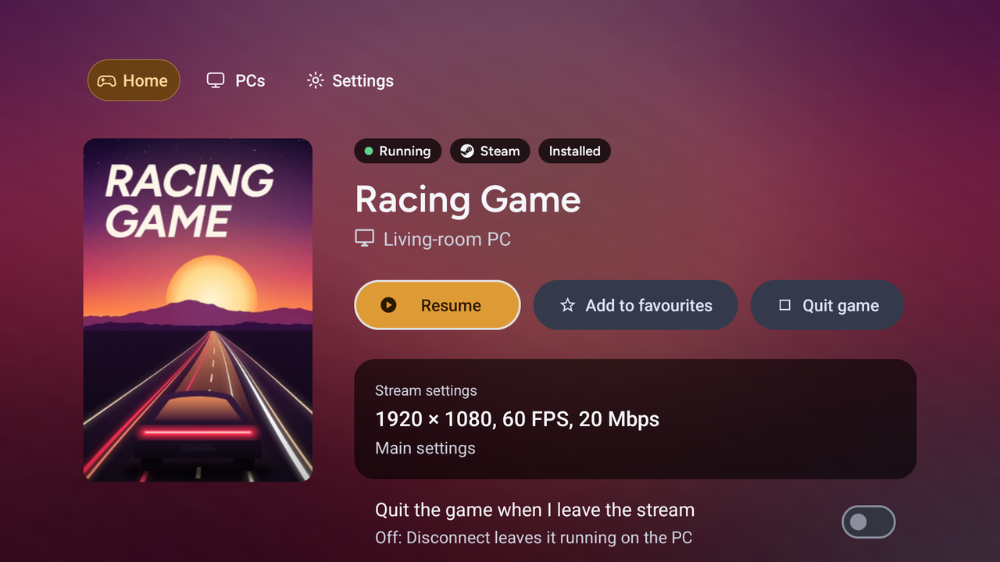
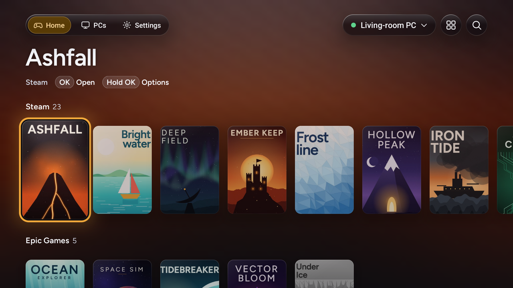
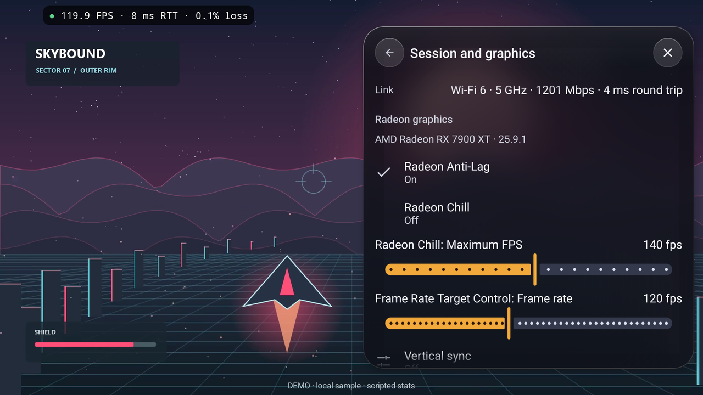

# Home and the session menu

[Documentation](index.md)

Home, store shelves, game pages and the in-stream **Session and graphics** page use a host's native library and session API, which [Rubylight](https://github.com/RamazanKara/Rubylight) 3.0 provides. Home also shows the app lists of paired PCs without that API (Sunshine, Apollo, Vibepollo and other hosts), once they have sent one; those PCs still open on the PC list and their classic app grid. This page applies to Android and to Nightjar for Windows and Linux unless a section names one of them.

## Home

Nightjar opens on Home when a paired PC supports the native API. Home has four parts:

- **Favourites.** Games you starred, at the top. Open a game card's options (long-press it, or press **Y** or **X** on a controller, **F** or **Menu** on a keyboard) and choose **Add to favourites**, or use the star on the game's page. Favourites belong to one PC, so the same title on two PCs is two entries. A favourite whose PC is offline stays on Home with its saved cover.
- **Continue playing.** Games that are running or suspended, marked **Running** or **Suspended**.
- **Library.** The games of every paired PC, with cover art. A game installed on several PCs appears once, marked with the number of PCs.
- **PCs.** Each PC with its number of games. An offline PC keeps the games it last reported, says it is offline and offers **Wake**; a PC that does not answer within 10 seconds counts as offline. The three dots on a card open the PC's options.

**Settings → App → When Nightjar opens** starts on **Home** by default; **Show my PCs** starts on the PC list, and **Continue my last game** or **A chosen game** starts that game after a 3-second countdown; see the [settings reference](settings.md#app). The bar under the top bar switches between **Home**, **PCs** and **Settings** at any time, and **L1** and **R1** on a controller step through them; Home appears in it as soon as a PC has a library. A PC paired from the PC list that supports the native API opens on Home; other PCs open their app grid.

### View

**View** on Home sets how the library is laid out, on Android and on Windows and Linux:

- **Layout.** **Grid**, **Rows**, or **List**: a line per game with a small cover, its store and, from a Rubylight PC that sends it, when you last played it.
- **Group by.** **Store** (a row per store), **Type** (games apart from other apps such as launchers and the desktop), **Collection** (below) or **None** (one library).
- **Card size.** Small, medium or large.

Phones, tablets and TVs keep their usual look until you change it.

**Collections.** When a PC names collections (Steam collections, Playnite categories; Rubylight 3.7 or newer), **Group by** offers **Collection**: a row per collection by name, a game in several in each, then **No collection**. All games has a chip for each. Nothing needs setting up on the PC, and with no collections the option does not appear.

**Hiding a game.** Open a game card's options (on Windows and Linux, right-click it or press **F2**) and choose **Hide game**. It leaves Home, All games and the PC's list on this device only; the PC and your other devices keep it. A running game stays under Continue playing. All games has a **Hidden** chip once a game is hidden, where the same menu has **Show game**.

## A game's page

Select a game to see the PC it runs on and the settings the stream will use (resolution, frame rate, bitrate, and the profile layer that set each), then choose **Play** or **Resume**. If another game is running on that PC, the page says that playing this game will close it. **Quit game** closes it: through the host when the PC grants this device **Host control**, otherwise the classic way.

Starting a game while another is running closes the running game only after you confirm a prompt that names both games. A cancelled prompt or a remembered launch never closes a game. When the host asks for confirmation before closing a game, Nightjar shows that question to you and starts the new game once you confirm.

Selecting a game another device is playing shows "<game> is playing on <device>" on hosts that offer it, with **Continue here** focused, **Stream here too** and **Cancel**. **Continue here** asks for the PIN first where the PIN lock covers streams on this PC, then ends the other device's stream, leaves the game running and resumes it here; that device shows "Now playing on <device>" ("another device" when it may not read the PC's device list) with **Continue here** and **OK**, and doesn't reconnect by itself. Under the PIN lock Android's stream screen shows only **OK**: select the game again to take it back. If the move fails Nightjar says so and the game keeps running; if the new stream never comes, within 15 s (up to 60 s while its launch is pending), the game goes back to the first device, whose open prompt changes to "The game came back to this device" with **Resume** and **OK**. **Resume** asks for the PIN where the PIN lock covers streams on this PC. That device has 60 s to come back before a game set to close on disconnect closes. **Stream here too** starts a second stream beside the first. Other hosts, and a PC that doesn't answer within 1.5 s, start the stream without asking. So do autostart, the command line and Android's home-screen shortcuts, which start a stream beside the first as they always did. A device that only streamed beside the game reads that the game did not move, and is offered **Stream here too**.

**Play together.** On a PC whose host offers guests (`session.guests`, provided by Rubylight), **Stream here too** reads **Join**. What it does follows the PC's setting for joining a running game: by default this device streams beside the game with its own permissions, as **Stream here too** does elsewhere; with guests turned on it joins as a guest of the device playing, with the same picture and sound and its own controller on the PC. If the PC asks the player first, that device shows "<device> wants to join your game" with **Let in** and **Deny**; Nightjar waits up to 120 seconds for the answer, and a refusal shows the host's reason. The device playing manages its guests from **Guests** in the stream menu: what each may do (**View only**, **Controller**, or **Controller, keyboard and mouse**), **Give keyboard** and **Take back keyboard**, **Kick** and **Block**. The PC's side is in Rubylight's [Guests from other devices](https://github.com/RamazanKara/Rubylight/blob/main/docs/multiclient.md).

When the host lists a game as not installed, **Play** is unavailable and the page says so, for example "Not installed on Living-room PC". A game the host cannot start says "Living-room PC can't start this game".

On a TV the page keeps the backdrop that Home showed for the game. A row of chips above the title shows the state (**Running** or **Suspended**), the store (Steam, Epic, GOG, Microsoft), whether the game is installed, and HDR support. A screen reader reads the row as one item.

  

## On a TV

Home and the PC list have dedicated TV layouts, chosen by Android's television mode. **Interface layout** in the settings selects the TV layout on other devices too.

- **Library rows.** Recently played, one row per store, Other apps (games no store owns), and On your PCs, not added (games the host found in a store but has not added). A row shows up to 20 games; a longer row ends in an **All N games** tile that opens All games with that row's filter.
- **Cards.** Each card shows a store chip. A game that is not installed is dimmed and says so. Selecting a game marked Not added asks the host to add it, when this device may launch games and the host supports it; otherwise the card says **Add it on the PC**.
- **All games.** Every game of the paired PCs in a poster grid, filtered by All, Installed, each store in the library, Other apps or Not added. Focus stays on the same card when the library refreshes.
- **PCs.** Large tiles, three to a row, inside the TV's safe area. A PC with a running game shows that game's cover behind its name. Each state has a word and a symbol as well as a color. **Add PC** sits below the tiles.
- **Settings.** The sections form a rail on the left. Right moves into a section, Left returns to the rail, and Back returns to the rail before leaving Settings.

  

## On Windows and Linux

- **Library rows.** Under Favourites, Continue playing and Recently played, Home shows one row per store in the library (Steam, Epic Games, GOG, EA app, Ubisoft Connect, Battle.net, Xbox), the largest first, then **Other apps** for the apps no store owns, then the PCs. Installed games come first in a row. A row is as wide as the window; when it holds more games than fit, its last tile reads **All N** and opens All games with that store's filter. A library without stores is one **Library** row, and a library from a single store is that store's row; either is shown whole, with no **All N** tile.
- **All games.** Opens from **All games** at the right of Home's top bar, shown once any PC has a game, or from a row's **All N** tile. Every game of the paired PCs as covers, by title, under filter chips: **All**, **Installed** (when some game is not installed), one chip per store, and **Other apps** (beside stores). Each chip shows how many games it holds. A game that is not installed is dimmed and says **Not installed**; its page says **Not installed on** the PC and offers no Play until the PC installs it (a running game still resumes). The first game has focus when the page opens, Up reaches the chips, and Back returns to Home.
- **Menus.** A game's or PC's menu opens by its card; see [PC and game menus on Windows and Linux](#pc-and-game-menus-on-windows-and-linux).
- **Starting a stream.** **Play** fills the window with the game's cover, the PC and the current step until the stream takes over; **Cancel** stops the start. A start that fails turns into a card beside the cover with the reason, **Try again**, **Stream settings** (the stream's resolution, frame rate and bitrate; it opens Settings) and **Test the network**, which asks Moonlight's port-test server whether a firewall blocks the streaming ports and shows the answer in place. **Back** closes the card. See [troubleshooting](TROUBLESHOOTING.md#nightjar-for-windows-and-linux).

## Join co-op

A host with co-op sessions (Rubylight 3.0) can run a game as a [Nucleus Co-op](https://github.com/SplitScreen-Me/splitscreenme-nucleus) split-screen session with one stream per player. Start the game's "(Co-op)" entry from the library on one device; the other players join from theirs:

- **Android:** **Join co-op** in the PC's options lists the PC's co-op sessions with their status, free slots and your own seat. Select a free slot to join, or your seat to return to it, and the stream starts.
- **Windows and Linux:** the PC's details page lists the same sessions and joins a slot.

The device needs the **Can join co-op games** permission in the host's web UI. A refused request shows the host's reason.

## Session and graphics

Open the stream menu during a stream and choose **Session and graphics**:

- **Session.** **Resume**, **Disconnect**, **End session** and **Quit game** (through the host with Host control).
- **Connection.** The host, codec, resolution, frame rate and bitrate, and your link: Wi-Fi generation, band and speed, Ethernet or mobile data, with the round-trip time.
- **Radeon graphics.** The AMD driver features the host exposes, such as Anti-Lag and Radeon Chill.

The menu queries the host only while it is open, and the Radeon state at most once a second, never on the video, audio or input paths.

  

### Radeon panel

Each setting shows the state the host reports:

| State | What you see |
| --- | --- |
| Configurable | A switch, slider or choice you can change |
| Read only | The value, which cannot be changed |
| Needs setup in AMD Software | The value and the one-time step needed on the PC |
| Not supported | A note that the GPU or driver does not support it |
| Temporarily unavailable | The reason; Nightjar asks again |

You can change a setting when the host marks it configurable, the device has **Host control**, and you own the running session. Grant Host control to the device in the host's web UI. After a change, the panel shows the value the host reads back. Changes made during a stream are reverted when the session ends (End session, Quit game, an expired grace period, unpairing or host shutdown), and the panel notes this next to the setting; **Disconnect** keeps the change until you resume or end the session. Settings this version of Nightjar does not recognize are still listed, drawn from their type. If the driver refuses a change, the reason appears next to the setting.

## Navigation

### The shell bar

**Home**, **PCs** and **Settings** sit in one bar under the top app bar, with the current one highlighted. On a TV the bar and the screens stay inside the safe area.

- The first screen is Home when **When Nightjar opens** is on **Home** and a library exists, otherwise PCs. Back from either of the other two returns to the first screen; Back there leaves the app.
- Switching does not stack screens. A game's page belongs to Home and stays underneath when you open PCs or Settings from it; Back from PCs then returns to Home, not to the game page, and **Home** in the bar closes the game page.
- Settings opened from a menu or with **Ctrl+,** closes on Back.
- Help is under **Settings → App → Help**, on **F1**, and in the pairing guide. On Windows and Linux, **Help** is in the bar right after Settings, and opens on **F1** or **?** from any page.

### PC options on Android

The three dots at the end of a PC card open its options, as do a long press, a right-click, **Menu**, **Shift+F10** and a controller's **X** or **Y**. On a game card, **X**, **Y** or **F** on a keyboard open the game's options instead of starting it. With a D-pad, press Right on a card to reach its three dots, then Center.

The options depend on the PC's state and what its host offers this device:

| Option | When it appears |
| --- | --- |
| **Open library**, **Resume**, **Quit** | Paired and online; Resume and Quit while a game runs |
| **Join co-op** | The host runs [co-op sessions](#join-co-op) |
| **Microphone only** | [Below](#microphone-only); the host lets this device start apps |
| **Shared folders**, **Files** | The host offers them; see [sharing](sharing.md) |
| **Pair**, **Pair with one-time PIN** | Not paired; one-time PIN on hosts that offer it |
| **Wake up** | Offline, with a MAC address learned while paired or added under [Other wake addresses](pairing.md#wake-a-sleeping-pc) |
| **Sleep PC**, **Restart PC**, **Shut down PC** | [Below](#the-pcs-power-and-host-updates); dimmed with the reason where the host does not allow it for this device |
| **Update the PC's streaming app** | The host has an update and lets this device install it |
| **Pair another device** | Hosts with [approval from a paired device](pairing.md#approve-from-a-paired-device); dimmed without the permission |
| **PC settings**, **Rename**, **Connection address** | Always; Connection address when the PC has more than one address or a pinned one |
| **Unpair** or **Pairing help** | Paired and online, or not paired |
| **Remove PC** | Always, last and apart |

- **Rename** sets a name on this device only, used in the library, during streams, in shortcuts and in the TV channel. An empty field restores the PC's own name. Names are limited to 40 characters.
- **Connection address** pins the PC to one address: a pinned address stays when the PC is found again on the network, and **Automatic** brings back the usual choice.
- **Unpair** asks the PC to forget this device and clears the library saved from it; the PC stays in the list as not paired.
- **Remove PC** deletes the PC, its settings, saved library, covers, hidden games and name from this device. The PC still lists this device until you unpair it.
- A failed pairing, unpair or wake explains why, and offers **Try again** where a retry can help.

The same **Rename**, **Unpair** and **Remove PC** actions are in the PC's settings page.

### The PC's power and host updates

On a host that offers them and allows them for this device, the PC's options can put the PC to sleep, restart it or shut it down, on Android and on Windows and Linux. Each asks first; before a shutdown Nightjar warns when the PC may not wake from off, and when Windows refuses it shows Windows' reason.

**Update the PC's streaming app** installs the host's update and waits until the PC is back on the new version. It says when the update waits for another device's stream to end, and shows the PC's reason when it fails. While an automatic update on the PC waits for the PC to be idle, the entry stays in the menu.

### Microphone only

**Microphone only** sends this device's microphone to the PC with no picture, for voice chat while the game plays elsewhere. On Android it keeps running with the screen off or another app open, with a notification and its **Stop**, and a phone call pauses it until the call ends. On Windows and Linux it runs in a small window with **Mute** and **Stop** and leaves the mouse and keyboard to you. It needs a host that offers it (Rubylight 3.4 or newer) and permission to start apps on the PC.

### PC and game menus on Windows and Linux

The header lists **Home**, **PCs**, **Settings** and **Help**; **Home** appears when a PC has a library. Back from PCs or Settings returns to Home, or to PCs when Home is off. **Start** on a controller, or **Settings** in the header, opens Settings over a library, game or PC page, and Back returns to that page. **Home** and **PCs** leave the page; while a file transfer runs there they ask first, as leaving cancels it. Settings has the sections **Video**, **Display & image**, **Controls**, **Audio**, **Streaming**, **App**, **Advanced** and **Debug**, listed on the left (chips on a narrow window); see the [settings reference](settings.md#nightjar-for-windows-and-linux).

With two or more paired PCs, the PC button at the top opens a list of them; with one it opens that PC's options. **B** on Home offers to close Nightjar, with **Cancel** selected, and to shut down, restart or put to sleep the computer Nightjar runs on, whichever it supports (no Sleep on a Modern Standby PC), each after a confirmation.

PCs and games have a menu that opens by the card, never covering the window or dimming the page:

- **⋮** on the card opens it under the dots. A cover shows its ⋮ while the pointer is on it or it has focus.
- A **right-click** opens it at the pointer.
- **F2**, **F**, **Shift+F10** or a controller's **Y** or **X** (North or West button) open it beside the focused card.

The menu stays inside the window, flipping above or to the left where it would not fit. The item that selecting the card does is marked **Enter**. **Escape** (the controller's **B**) closes it and gives focus back to the card, and a click outside closes it too.

A PC's menu: **Open library** or **Pair**, **Resume** and **Quit running app**, **Pair with one-time PIN**, **Wake up**, **Sleep PC**, **Restart PC**, **Shut down PC**, **Update the PC's host**, **Pair another device**, **Files**, **Microphone only**, **PC settings**, **Rename**, **View details**, **Pairing help**, **Check again**, then **Unpair** and **Remove PC** last, under a divider, in red. Each appears under the same conditions as on Android. **Join co-op** and **Shared folders** are on the PC's details page. **Ctrl+N** on the PCs page adds a PC by address. Rename, Unpair and Remove behave as on Android; Unpair needs the PC online, and this device keeps its pairing until the PC confirms.

A game's menu on Home and All games: **Game details**, **Add to favourites** or **Remove from favourites** (**Delete** on a favourite), **Hide game** or **Show game**, **Game settings** and **Open library**. **Game settings** needs the PC's app list, so it appears once that list has loaded. A favourite whose PC is away with no saved library still has its menu. On a PC's library page: **Play** or **Resume**, and **Game settings**.

## Accessibility on Android

**Settings → App → Theme** picks **System**, **Dark** or **OLED black**. The settings under **Settings → App → Accessibility** apply to every screen of the app. They are global, and never scale or recolor the stream itself.

- **Text and button size.** 85, 100, 115, 130 or 150 percent. The app's screens scale while touch targets stay at least 48 dp; the system font size applies on top.
- **Interface layout.** **Automatic**, **TV** or **Handheld**: TV gives a handheld docked to a TV the TV layouts; Handheld gives a TV the touch layouts.
- **High contrast.** Black surfaces, outlines on cards, and a thick amber focus ring on every control. Body and secondary text reach a contrast ratio of at least 7:1, focus rings at least 3:1.
- **Reduce motion.** **Follow system**, **Reduce** or **Full**. Follow system reduces motion when Android's animation scale is 0. Reduce replaces the TV focus zoom with a still ring and removes sliding transitions.

Every focusable element shows a visible ring when focused with a D-pad or controller, and the app supports TalkBack.

## Accessibility on Windows and Linux

Four settings under **Settings → App** change how Nightjar looks. They are global.

- **Language.** **System default** or one of the 15 languages Nightjar ships, the same as on Android ([translations](TRANSLATIONS.md)). System default uses the operating system's first language that Nightjar supports, otherwise English. Japanese, Korean, Chinese, Cyrillic, Polish, Turkish and Vietnamese text uses the system's own font. Brand names, error text from the host or network, the upscaler names, the performance overlay and log lines stay in English.
- **UI zoom.** 85, 100, 115, 130 or 150 percent for the launcher, the stream menu and the overlay. **Ctrl+=** and **Ctrl+-** change it; **Ctrl+0** resets it to 100. At 150 percent a 1280×720 window still shows every control.
- **High contrast.** Black surfaces, white text, outlines on every control and a thicker focus ring. Body text reaches at least 7:1 and the focus ring at least 3:1; the normal theme meets WCAG AA (4.5:1) for text.
- **Reduce motion.** **Follow system**, **Reduce** or **Full motion**. Follow system reads Windows' **Show animations in Windows** setting or macOS's **Reduce motion**; Linux has no equivalent, so there it leaves motion on.

Screen readers read the interface through UI Automation on Windows and AT-SPI on Linux.
