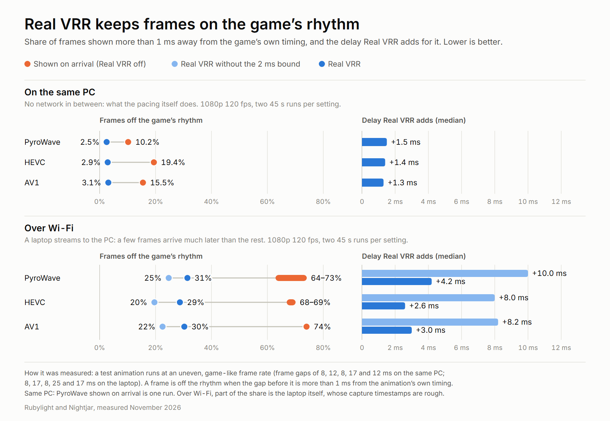

# Measurements

[Nightjar docs](index.md) › [Engineering notes](index.md#engineering-notes) · [Real VRR](real-vrr.md) · [Video and latency](video-and-latency.md)

The guides say what each feature does and what it costs; this note keeps the measurements behind
them, with their conditions. Each records the build and the devices it was taken on, so a later
build can differ. Measurements of the host and of both together are in Rubylight's
[measurement record](https://github.com/RamazanKara/Rubylight/blob/main/rust/PERFORMANCE.md).

## Real VRR

  <picture>
    <source media="(prefers-color-scheme: dark)" srcset="assets/real-vrr/chart-dark.png">
    
  </picture>

A test animation runs at an uneven, game-like frame rate and is streamed at 1080p and 120 fps. A
frame is counted as off the rhythm when the gap before it is more than 1 ms away from the
animation's own timing, measured at the moment Nightjar presents it, which is when a VRR screen
shows it. Each figure is two 45-second runs.

**On the same PC** (no network in between, frame gaps of 8, 12, 8, 17 and 12 ms):

| Frames more than 1 ms off the game's rhythm | Shown on arrival | Real VRR | Delay Real VRR adds (median) |
|---|---|---|---|
| PyroWave | 10.2% (one run) | 2.5% | 1.5 ms |
| HEVC | 19.4% | 2.9% | 1.4 ms |
| AV1 | 15.5% | 3.1% | 1.3 ms |

The result is steadier than the PC's own capture timestamps, which vary by a millisecond or two. On
a 240 Hz monitor with VRR turned on, Real VRR added the same 1.3 to 1.4 ms. (That run cannot judge
the rhythm: the test animation and Nightjar share one screen there, and Nightjar's own presents set
when that screen refreshes.)

**Over Wi-Fi** (a laptop streams to the PC, frame gaps of 8, 17, 8, 25 and 17 ms):

| Frames off the rhythm, delay added | Shown on arrival | Real VRR without the 2 ms bound | Real VRR |
|---|---|---|---|
| PyroWave | 64 to 73% | 25%, 10.0 ms | 31%, 4.2 ms |
| HEVC | 68 to 69% | 20%, 8.0 ms | 29%, 2.6 ms |
| AV1 | 74% | 22%, 8.2 ms | 30%, 3.0 ms |

Part of the share left over Wi-Fi is the test laptop itself, whose capture timestamps are rough.

The Real VRR column is the rule before this one, a fixed bound of 2 ms above the typical frame.
With the delay following the link, the same recordings replayed through Nightjar's clock and
judged against the frames' own timestamps (which leaves the laptop's capture out):

| Frame gaps more than 1 ms off their timestamps, mean delay | 2 ms bound | Follows the link |
|---|---|---|
| Wi-Fi recordings above (24 runs) | 19.0%, 2.0 ms | 10.6%, 3.5 ms |
| Laptop to the PC's 240 Hz VRR monitor, HEVC (16 runs) | 12.5%, 1.9 ms | 9.6%, 2.6 ms |
| Same PC | 1.0 ms | 0.9 ms, the same rhythm |

On the 240 Hz monitor the replay matched the share each run showed on screen within a point. A
fixed bound with the same delay leaves 10.8% there and about 12% in the Wi-Fi recordings. For
PyroWave on that monitor both rules showed the same share (10.7 and 10.9%).
The method, the raw figures and the replays behind the 2 ms bound are in
[PyroWave decoding: Real VRR](pyrowave-decode.md#real-vrr-measured-cadence-and-a-link-with-a-long-tail).

**Whole frames on Windows** (a laptop streams HEVC over Wi-Fi to the PC's 240 Hz VRR monitor, whose
drawing position is recorded every 40 µs for 12 seconds of each 35-second run):

| Test animation | Frames torn: off | On | From frame ready to whole on screen, median / 19 of 20: off | On |
|---|---|---|---|---|
| Uneven, frame gaps of 8 to 25 ms | 34.3% | 0.2% | 2.3 / 9.6 ms | 1.4 / 8.2 ms |
| 120 fps | 1.9% | 0.0% | 0.5 / 2.0 ms | 0.5 / 1.9 ms |
| About 72 fps | 24.7% | 0.2% | 1.4 / 6.6 ms | 1.6 / 7.4 ms |
| About 57 fps | 38.2% | 3.5% | 2.5 / 9.5 ms | 1.9 / 9.2 ms |

A frame counts as torn when it was presented while the screen was drawing. Each figure is one run,
and the share with the setting off varies from run to run (2 to 26% in three 120 fps runs). About
a third of the frames waited, 1.7 to 2.0 ms each (3% of them at 120 fps). A whole frame is on
screen no later for it, because a torn frame is whole only on the screen's next refresh. What the
wait gives up is the part of a torn frame that would have appeared up to one refresh sooner.
[Details](../protocol/desktop/README.md).

The delay: about 1.3 to 1.5 ms on a clean link and 2.6 to 3.5 ms over Wi-Fi in the runs above (19
of 20 frames within 5.6 to 7.1 ms). Over Wi-Fi about 10% of frame gaps stayed more than 1 ms off
their timestamps.

**Below the screen's range.** On a 240 Hz monitor whose range ends at 80 Hz, 23 to 39% of frames
arrived while the driver repeated a picture, with test animations of 54 to 85 fps. Nightjar
repeating the picture itself on Windows, timed from the frame rate and the screen's scan line,
brought a 60 fps animation to 16% and changed nothing for a 40 fps and an uneven one, and the
frames that then waited for a refresh to end were shown 1.1 to 1.5 ms late, so it is not on.

## PyroWave records decoded while they arrive

Measured on a Retroid Pocket 6 (1080p60, 400 Mbps, Lowest latency pacing, 50 s per arm in the order off, on, on, off): the median from the frame's last packet to its completed decode went from 3.5 and 3.8 ms to 3.0 ms (p95 from 6.0 to 3.4 ms), and the native submit per frame from 1.8 to 0.8 ms. The median picture age went from 29.2 and 30.2 ms to 28.2 and 28.8 ms (p95 from 33.6 and 35.8 ms to 33.0 and 33.2 ms). Every frame arrived early, and no frame was pushed whole.

## A PyroWave decoder slower than the stream

On a Radeon 780M laptop with a stream its decoder could not keep up with (7168x4032 at 120 fps), the median delay from the PC's frame to the present fell from 88 to 90 ms to 34 ms. Skipped frames count as **Decoder drops**.

## Balanced on the next free refresh

In the Android app, from a host that takes phase-lock reports and a stream within 2 % of the
panel's rate, **Balanced** gives each frame the next free refresh: 0.10 % of display intervals off
expected at 120 fps on a 120 Hz screen, against 7.73 % without it, for about one refresh more delay
than **Lowest latency** (25 against 17 ms receive to present, medians).

## A Shield's display queue

On an NVIDIA Shield the display's own queue held one buffer too many, and input-to-output time rose
by 10 to 12 ms for 45 seconds with nothing behind the held output. A stream a little faster than
the panel filled the display's queue at 45-50 ppm, about 0.05 ms a second, on the Shield captures.
Replayed with a frame of room per drop, which the replay assumes and cannot show, input-to-output above 2 ms lasted 12 to 18 seconds instead of 130, with the drop at about 3.4 ms instead of 8.7, and steady parts dropped nothing.

## PC's frame times on a fixed-refresh panel

Measured on a Retroid Pocket 6 (120 Hz panel), median time from receipt to SurfaceFlinger's present time, two 60-second runs per arm:

| Stream | Off | On | Display jitter p99, off / on |
| --- | --- | --- | --- |
| 90 fps | 17.22 ms | 17.97 ms | 11.2 / 9.2 ms |
| 60 fps | 20.03 ms | 17.97 ms | 8.7 / 8.6 ms |

Present times come from `dumpsys SurfaceFlinger --latency`, not from the moment the client hands a frame over: a frame released at once waits in SurfaceFlinger's queue, while a frame released with a due time does not, so hand-over times would make the scheduler appear about 15 ms later than it is. Absolute values varied between sessions, so compare arms within one session.

## Two Debug settings after the input hand-off

Measured on a Retroid Pocket 6 (120 Hz panel, HEVC 1080p60 20 Mbps, Smoothest pacing, Direct submit and Prioritize stream traffic on, 90 s per leg, order off, on, on, off), receive to release from Nightjar's latency CSV. **Speed up frame hand-off** and **Decoder priority for receiving** were each compared with the other off. The load legs ran 8 busy shell loops on the device; 10 s into each leg the script checked that the loops were running and that the device's CPUs were at least 95 % busy (each check read 100 %, `tools/hw/settings_ab.py`). The hand-off's idle legs came from an earlier build of the same branch, so compare off with on within a row, not idle with load; the priority setting was measured again idle and with a second block of four load legs on a later build of the branch (after the two-thread hint, before the review fixes).

| Setting | Load | Off p50 / p95 ms (each leg) | On p50 / p95 ms (each leg) | Catch-up drops |
| --- | --- | --- | --- | --- |
| Speed up frame hand-off | idle | 2.47 / 4.67, 2.58 / 4.51 | 2.47 / 4.52, 2.54 / 4.60 | Off 0, 0; On 0, 0 |
| Speed up frame hand-off | 8 loops, CPUs ≥ 95 % busy | 1.37 / 3.20, 1.41 / 3.65 | 1.39 / 3.54, 1.39 / 3.28 | Off 0, 0; On 2, 0 |
| Decoder priority for receiving | idle | 2.46 / 4.63, 2.50 / 4.51 | 2.58 / 4.46, 2.61 / 4.63 | Off 0, 0; On 0, 0 |
| Decoder priority for receiving | 8 loops, CPUs ≥ 95 % busy | 1.39 / 3.61, 1.39 / 3.68, 1.33 / 3.27, 1.38 / 3.61 | 1.39 / 3.39, 1.38 / 3.29, 1.37 / 3.34, 1.37 / 3.50 | Off 3, 1, 1, 1; On 0, 2, 1, 0 |

With 8 loops, Decoder priority for receiving had a p95 receive-to-release of 3.29 to 3.50 ms (mean 3.38) against 3.27 to 3.68 ms Off (mean 3.54) over four legs each, with the median unchanged at about 1.38 ms: lower on average, but one Off leg (3.27 ms) beat every On leg. Idle, the arms overlapped (p95 4.46 to 4.63 ms both). Speed up frame hand-off moved neither the median nor the p95 beyond the spread between legs of one arm, idle or under load. Catch-up drops stayed at three or fewer per 90-second leg; with Decoder priority for receiving there were 6 over the four Off load legs and 3 over the four On legs. The hand-off worker (InputSubmit) was handed only one or two units per stream, the start of the stream, so the second submit thread the hint setting adds was in the session but did almost no work; a decoder that stalls would exercise it, and this one never did.

## Speed up frame hand-off at the app's defaults

Measured on 2026-11-26 with a debug build of main (`88fe00458e`): HEVC 1080p60 at 20 Mbps from an isolated test host on this PC over Wi-Fi, Lowest latency pacing, Decoder priority for receiving, Direct submit and Prioritize stream traffic on (the defaults), 90 s per leg in the order off, on, on, off (`tools/hw/settings_ab.py run --setting submit --defaults`). Receive to release from Nightjar's latency CSV after the first 5 s.

| Device | Load | Off p50 / p95 ms (each leg) | On p50 / p95 ms (each leg) |
| --- | --- | --- | --- |
| Retroid Pocket 6 (120 Hz panel) | idle | 6.21 / 8.39, 6.21 / 9.04 | 6.32 / 8.69, 6.28 / 8.60 |
| Retroid Pocket 6 | 8 busy loops, CPUs 100 % busy | 4.67 / 6.84, 4.69 / 6.94 | 5.43 / 9.60, 4.76 / 7.21 |
| TCL Smart TV Pro (MediaTek MT9689, Android 14, 60 Hz) | idle | 16.77 / 25.56, 16.46 / 23.62 | 15.83 / 19.26, 15.59 / 19.75 |

On the TCL both legs with it on beat both legs without it: about 1 ms off the median and 4 to 6 ms off the 95th percentile, with the decoder's own input to output unchanged (8.04 to 8.16 ms median), so the gain is in the threads that feed and release frames. On the Retroid the arms overlapped idle and under load, apart from one loaded leg with it on (p95 9.60 ms). It is on by default since. One Retroid leg (idle, off) received only 46 frames a second from the host; its median matched the other legs. With the CPUs loaded, the Retroid released frames about 1.5 ms sooner and decoded in 0.9 instead of 1.64 ms (median input to output), whatever the setting: its clocks stay higher under load.

## Keep TV video smooth at the app's defaults

Measured on 2026-11-26 as the section above (same build, defaults and order off, on, on, off, 90 s per leg, Speed up frame hand-off off in both arms), with the setting's dot redrawn ten times a second in the On legs (`settings_ab.py run --setting tv --defaults`). Receive to release from Nightjar's latency CSV after the first 5 s; frames a second as received over the leg.

| Device | Off p50 / p95 ms (each leg) | On p50 / p95 ms (each leg) | Gaps over 25 ms, off / on | Frames a second, off / on |
| --- | --- | --- | --- | --- |
| TCL Smart TV Pro (MediaTek MT9689, Android 14, 60 Hz) | 17.46 / 28.21, 17.10 / 26.57 | 16.18 / 21.53, 16.08 / 20.92 | 353, 292 / 197, 175 | 58.7, 58.6 / 59.8, 59.9 |
| Retroid Pocket 6 (120 Hz panel) | 6.42 / 9.31, 6.43 / 9.22 | 6.19 / 10.14, 6.05 / 9.82 | 155, 128 / 50, 50 | 59.3, 58.0 / 60.0, 59.8 |

On the TCL both legs with the dot beat both legs without it: 1.0 to 1.4 ms off the median, 5 to 7 ms off the 95th percentile, fewer gaps between released frames and nearly every frame received, with the decoder's own input to output 0.2 ms longer (8.28 to 8.35 against 8.10 to 8.15 ms median). On the Retroid the median was 0.3 ms lower and the 95th percentile 0.6 to 0.9 ms higher. Neither device reports when SurfaceFlinger shows a frame here, so the dot's own composition cost is not in these numbers. A first set of TCL legs ran while a Gradle build loaded this PC (41 to 58 frames a second received in both arms) and was set aside; it pointed the same way.

## Zero-dot `SurfaceControl` keepalive at 1 Hz

Measured on 2026-11-26 on the same two devices (`checkbox_submit_hint` on, Lowest latency pacing, HEVC 20 Mbps over Wi-Fi, 60 s per leg, metrics after 10 s warmup) comparing off against a `1×1` transparent child `SurfaceControl` (`PixelFormat.RGBA_8888`, `PorterDuff.Mode.CLEAR`, `NightjarCompositorKeepalive`) ticked off the UI thread at `1000 ms` (1 Hz) or `100 ms` (10 Hz).

- **TCL Smart TV Pro (MediaTek MT9689, Android 14, 60 Hz panel, `resolution_follows_screen` negotiated `3840x2160` 60 fps)**:
  - Off (`tv=false`, `baseline-off-r1`): `0.0%` `rendered` callbacks (`1077` `render_unobserved`, `0` `rendered`), `r2r p50 / p95 = 13.96 / 18.39 ms`, `669` release gaps `> 25 ms`. (A second baseline leg and `view_black` control leg were interrupted when remote Back input stopped launch before RTSP.)
  - `sc_clear @ 1000 ms` (`sc-clear-1000ms-r1`): **`97.72%` `rendered`** (`1798` `rendered`, `42` `render_unobserved`, `0` low-callback seconds), `NightjarCompositorKeepalive` `1×1` layer present in `dumpsys SurfaceFlinger`, `0` `Plane[0]: hide!!!!` during the stream (`1` on stream stop), `0` `osdDisplayWorkThread` jank warnings, `r2r p50 / p95 = 15.45 / 18.77 ms`, `output_to_render p50 / p95 = 27.42 / 30.91 ms`, `render_ns` inter-frame gap `p50 / p95 / max = 16.67 / 50.02 / 66.70 ms`.
  - `sc_clear @ 100 ms` (`sc-clear-100ms-r1`): **`96.27%` `rendered`** (`1471` `rendered`, `57` `render_unobserved`, `0` low-callback seconds), `0` `osdDisplayWorkThread` jank warnings, `r2r p50 / p95 = 12.10 / 18.23 ms`, `output_to_render p50 / p95 = 23.29 / 33.18 ms`, `render_ns` inter-frame gap `p50 / p95 / max = 16.70 / 50.05 / 233.35 ms`.
- **Retroid Pocket 6 (1080p, 120 Hz panel, alternating `off, on, off, on`)**:
  - Off: `100.0%` `rendered` both legs; `r2r p50 / p95 = 3.83 / 5.58 ms` and `3.64 / 6.33 ms`; `output_to_render p50 / p95 = 0.09 / 0.17 ms` and `0.12 / 0.53 ms`.
  - `sc_clear @ 1000 ms`: `100.0%` `rendered` both legs; `NightjarCompositorKeepalive` layer attached cleanly with 0 errors; `r2r p50 / p95 = 3.64 / 7.25 ms` and `3.07 / 6.28 ms`; `output_to_render p50 / p95 = 0.15 / 0.37 ms` and `0.13 / 0.32 ms` (zero measurable display overhead; host WGC desktop capture rate varied between arms, ~26–31 fps in `off` vs ~57–58 fps in `on`).
- **Retroid Pocket 6 Phase 2 default-off `CompositorWatch` check (2 × 60 s, `tv=false`, `submit=true`)**: `100.0%` `rendered` both legs (`3171` and `2808` post-warmup frames), `r2r p50 / p95 = 4.40 / 6.22 ms` and `4.03 / 6.13 ms`, `ren_gap p50 / p95 / max = 16.68 / 19.99 / 28.15 ms` and `17.96 / 23.74 / 53.32 ms`, with `0` `CompositorWatch` triggers and no `NightjarCompositorKeepalive` layer (remaining 100% dormant even when leg 2 hit 100 upstream `release_ns` gaps over 25 ms). Phase 2 default-off E2E on TCL Smart TV Pro was not run because the TV was in active media playback.

