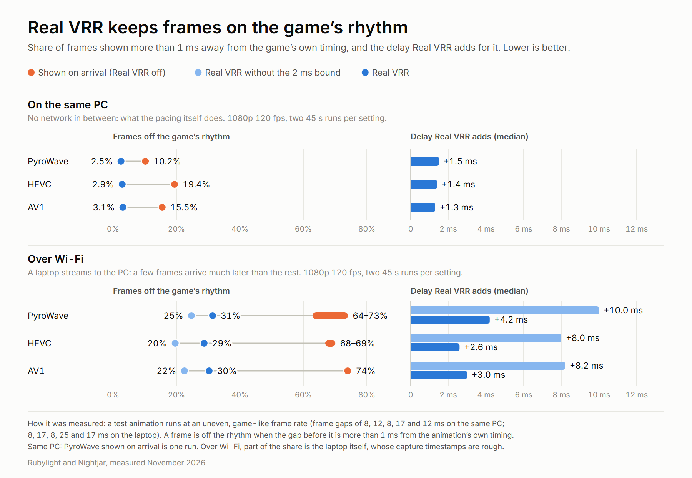

# Real VRR

  <picture>
    <source media="(prefers-color-scheme: dark)" srcset="assets/real-vrr/chart-dark.png">
    
  </picture>

With **Variable refresh rate** on, the screen refreshes whenever Nightjar shows a frame. Shown the
moment each one is decoded, frames reach the screen in the network's rhythm, not the game's: a game
running a steady 90 fps can arrive 8, 14, 9 and 13 ms apart, because packets never arrive perfectly
evenly. **Real VRR** shows each frame at the moment the game presented it on the PC, plus a short,
steady delay, so the screen refreshes in step with the game.

- **97% of frames on the game's rhythm**, instead of 81 to 90% shown on arrival, for 1.3 to 1.5 ms
  of delay on a clean link (PyroWave, HEVC and AV1 alike).
- **Built for Wi-Fi too.** The delay follows the connection: it covers the frames that arrive
  together, a frame much later than the rest is shown when it is ready, and the frames behind a
  late one keep the game's spacing. Over Wi-Fi about 10% of frame gaps are off their timestamps
  for 2.6 to 3.5 ms of delay, against two thirds shown on arrival.
- **On by default** whenever Variable refresh rate is on.

## Turning it on or off

Real VRR is in **Settings → Display & image**, among the refresh rate settings (under **More
settings**), on Android and the desktop. It shows while **Variable refresh rate** is on and is on
by default. Settings saved before it became the default have it turned on once; if you turn it off
afterwards, it stays off. Turn it off for the lowest latency, when you would rather see each frame
the moment it is decoded.

What it needs:

- **Windows and Linux:** a display with G-Sync, FreeSync or HDMI VRR turned on, so that Variable
  refresh rate applies. If the display turns out not to refresh when a frame is presented, Nightjar
  waits for the refresh instead, as without VRR, and the overlay says so.
- **Android:** Variable refresh rate, which needs Android 16 or newer on a screen with adaptive
  refresh (ARR).
- **macOS:** not on by default. Nightjar's log names the refresh range the screen reports (ProMotion and
  Adaptive-Sync screens have one). On such a screen the environment variable `NIGHTJAR_MAC_VRR=1`
  turns Real VRR on, which has not been measured: if you try it, tell us what you see.
- **A PC:** any Moonlight-compatible host sends a timestamp with every frame, and Real VRR follows
  it. Rubylight stamps each frame with the moment the game presented it; other hosts' stamps follow
  the game as closely as their capture does.

On Android with Variable refresh rate off, the matching setting is **Show frames at the PC's
frame times** (off by default): it shows each frame on the refresh nearest its time on the PC. See
[refresh rate and VRR](video-and-latency.md#refresh-rate-and-vrr).

## Tear-free VRR on Windows

A VRR screen starts drawing a frame the moment it is presented and needs one refresh to draw it
(4.2 ms at 240 Hz). A frame presented while the screen is still drawing the last one is torn: the
part of the screen not yet drawn shows the new frame, the rest shows it only on the next refresh.
That happens when two frames arrive close together, and often below the screen's range, where the
graphics driver repeats the last frame by itself.

**Tear-free VRR** is in the same place as Real VRR, shows while **Variable refresh rate** is on,
and is on by default. Before each frame Nightjar reads where the screen is in its drawing. A frame
that arrives while the screen is drawing waits for it to finish, at most one refresh, and is then
shown whole. Turn it off to show every frame at once, with tearing. It works with Real VRR on or
off. Linux and Android compose whole frames by themselves.

## How it works

**On the PC.** For a VRR stream to a virtual display, Rubylight runs that display at 1000 Hz
(unless its **Virtual display refresh** is Off), so each frame is captured the moment the game
draws it rather than on the next refresh of a 120 Hz display. With automatic capture it uses
Windows Graphics Capture and
stamps each frame with the moment the game called present, which it reads from DXGI's event
trace; where that trace is not available, it uses the time Windows composed the frame. That stamp
is the frame's RTP timestamp, so nothing in the stream changes for other clients.

**In Nightjar.** For every frame, Nightjar compares when the frame was ready to show with its time
on the PC. It needs no shared clock: the offset between the two clocks is the same for every frame,
so it cancels out, and slow drift is followed as it goes. How late the last 128 frames were sets the
delay, and each frame is shown at its PC time plus that delay. It works like a jitter buffer that is
measured in milliseconds instead of frames.

Three rules size that delay:

- **It covers the frames that arrive together, not the stragglers.** Sorted by lateness, most frames
  lie within a millisecond or two of each other and a few trail far behind. The delay stops at that
  knee: where waiting 2 ms longer would bring in fewer than 7% of the frames (and never past the
  97th percentile), plus 0.5 ms for the present call itself. Jitter without a tail is covered
  whole; behind a long tail the delay stays near the typical frame, and a frame later than the
  delay is shown when it is ready.
- **A late frame takes the ones behind it along.** Late frames come in bursts: in the Wi-Fi
  recordings the frame after a late one was late 33 to 43% of the time, against 11 to 17% of all
  frames. A frame later than the delay raises the delay to its own lateness at once, at most 6 ms
  above the typical frame, and the delay falls back with a time constant of 0.1 s. One gap is
  longer; the frames behind it keep the game's spacing instead of each jumping on its own.
- **The screen's limit is respected.** Two frames are never shown closer together than the
  display's fastest refresh, and a frame is pushed back by at most one refresh for it.

**Below the screen's range.** A VRR screen waits only so long for a frame: the longest interval
of its range. Then the graphics driver shows the old picture again (low frame rate compensation),
which takes as long as a refresh at the screen's top rate, and a frame that arrives meanwhile tears
or waits. Nightjar leaves those repeats to the driver and the compositor. Timing them itself on
Windows was built and measured, and is not on: see [Limits](#limits).

On the desktop, the overlay's **Pacing** line reads **VRR, PC frame times**, with the average hold,
and how many frames came later than the delay. On Android the decoder line of a PyroWave stream ends in **PC frame times**.

## Measured

A test animation runs at an uneven, game-like frame rate and is streamed at 1080p and 120 fps. A
frame is counted as off the rhythm when the gap before it is more than 1 ms away from the
animation's own timing, measured at the moment Nightjar presents it, which is when a VRR screen
shows it. Each figure is two 45-second runs.

**On the same PC** (no network in between, frame gaps of 8, 12, 8, 17 and 12 ms):

| Frames more than 1 ms off the game's rhythm | Shown on arrival | Real VRR | Delay Real VRR adds (median) |
|---|---|---|---|
| PyroWave | 10.2% (one run) | 2.5% | 1.5 ms |
| HEVC | 19.4% | 2.9% | 1.4 ms |
| AV1 | 15.5% | 3.1% | 1.3 ms |

The result is steadier than the PC's own capture timestamps, which vary by a millisecond or two. On
a 240 Hz monitor with VRR turned on, Real VRR added the same 1.3 to 1.4 ms. (That run cannot judge
the rhythm: the test animation and Nightjar share one screen there, and Nightjar's own presents set
when that screen refreshes.)

**Over Wi-Fi** (a laptop streams to the PC, frame gaps of 8, 17, 8, 25 and 17 ms):

| Frames off the rhythm, delay added | Shown on arrival | Real VRR without the 2 ms bound | Real VRR |
|---|---|---|---|
| PyroWave | 64 to 73% | 25%, 10.0 ms | 31%, 4.2 ms |
| HEVC | 68 to 69% | 20%, 8.0 ms | 29%, 2.6 ms |
| AV1 | 74% | 22%, 8.2 ms | 30%, 3.0 ms |

Part of the share left over Wi-Fi is the test laptop itself, whose capture timestamps are rough.

The Real VRR column is the rule before this one, a fixed bound of 2 ms above the typical frame.
With the delay following the link, the same recordings replayed through Nightjar's clock and
judged against the frames' own timestamps (which leaves the laptop's capture out):

| Frame gaps more than 1 ms off their timestamps, mean delay | 2 ms bound | Follows the link |
|---|---|---|
| Wi-Fi recordings above (24 runs) | 19.0%, 2.0 ms | 10.6%, 3.5 ms |
| Laptop to the PC's 240 Hz VRR monitor, HEVC (16 runs) | 12.5%, 1.9 ms | 9.6%, 2.6 ms |
| Same PC | 1.0 ms | 0.9 ms, the same rhythm |

On the 240 Hz monitor the replay matched the share each run showed on screen within a point. A
fixed bound with the same delay leaves 10.8% there and about 12% in the Wi-Fi recordings. For
PyroWave on that monitor both rules showed the same share (10.7 and 10.9%).
The method, the raw figures and the replays behind the 2 ms bound are in
[PyroWave decoding: Real VRR](pyrowave-decode.md#real-vrr-measured-cadence-and-a-link-with-a-long-tail).

**Tear-free VRR** (a laptop streams HEVC over Wi-Fi to the PC's 240 Hz VRR monitor, whose
drawing position is recorded every 40 µs for 12 seconds of each 35-second run):

| Test animation | Frames torn: off | On | From frame ready to whole on screen, median / 19 of 20: off | On |
|---|---|---|---|---|
| Uneven, frame gaps of 8 to 25 ms | 34.3% | 0.2% | 2.3 / 9.6 ms | 1.4 / 8.2 ms |
| 120 fps | 1.9% | 0.0% | 0.5 / 2.0 ms | 0.5 / 1.9 ms |
| About 72 fps | 24.7% | 0.2% | 1.4 / 6.6 ms | 1.6 / 7.4 ms |
| About 57 fps | 38.2% | 3.5% | 2.5 / 9.5 ms | 1.9 / 9.2 ms |

A frame counts as torn when it was presented while the screen was drawing. Each figure is one run,
and the share with the setting off varies from run to run (2 to 26% in three 120 fps runs). About
a third of the frames waited, 1.7 to 2.0 ms each (3% of them at 120 fps). A whole frame is on
screen no later for it, because a torn frame is whole only on the screen's next refresh. What the
wait gives up is the part of a torn frame that would have appeared up to one refresh sooner.
[Details](../protocol/desktop/README.md).

## Limits

- **It adds delay:** about 1.3 to 1.5 ms on a clean link and 2.6 to 3.5 ms over Wi-Fi in the runs
  above (19 of 20 frames within 5.6 to 7.1 ms). That is the price of the steady rhythm; turn Real VRR off if you would rather have each
  frame the moment it is decoded.
- **Over Wi-Fi some frames stay off the rhythm.** A frame later than the delay is shown when it is
  ready, and one more than 6 ms later than the typical frame raises the delay no further: about
  10% of frame gaps stayed more than 1 ms off their timestamps in the runs above.
- **Below the screen's range the graphics driver repeats pictures,** and a frame that arrives
  during such a refresh waits for it to end with Tear-free VRR, or tears without it. On a 240 Hz
  monitor whose range ends at 80 Hz, 23 to 39% of frames arrived that way, with test animations of
  54 to 85 fps. Nightjar repeating the picture itself on Windows,
  timed from the frame rate and the screen's scan line, brought a 60 fps animation to 16% and
  changed nothing for a 40 fps and an uneven one, and the frames that then waited for a refresh
  to end were shown 1.1 to 1.5 ms late. It is therefore not on
  ([details](../protocol/desktop/README.md)).
- **Frames are shown on arrival** on Windows when **Sharper colored text** streams packed full
  chroma, which it does when the codec's own 4:4:4 is not available on the device or the PC.
- **PyroWave on Android** follows Real VRR on a screen with adaptive refresh. It has not been
  measured on such a screen.
- The rhythm can only be as even as the PC's timestamps. With Rubylight and automatic capture they
  are the game's own present times; a capture method other than Windows Graphics Capture stamps the
  time each frame was captured.
