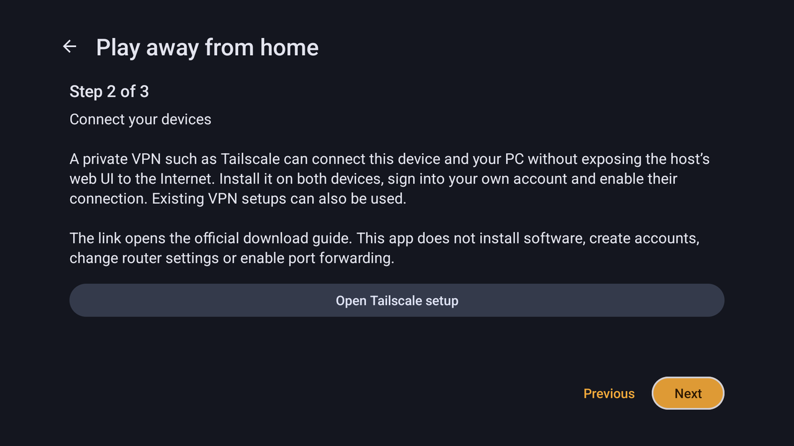

# Play away from home

[Documentation](index.md) · [Pairing](pairing.md) · [Troubleshooting](TROUBLESHOOTING.md)

Nightjar streams from outside the home network over a private VPN such as Tailscale, which connects this device and the PC without exposing the host to the Internet. Nightjar does not install software, change router settings, open public ports or create accounts. The guide works with any paired Moonlight-compatible host.

## Set up on Android

Long-press a saved PC, choose **PC settings…**, then **Play away from home**. The guide has three steps:

1. **Prepare at home.** Pair on the home network, check that a normal stream works, and keep the PC awake. Waking a sleeping PC from outside usually needs the router or another always-on device on the home network; the guide does not set up remote Wake-on-LAN.
2. **Connect your devices.** **Open Tailscale setup** opens the official installation guide. Install Tailscale on the PC and on this device, sign in to your own account on both, and enable the connection. An existing VPN works as well. If Nightjar does not find the PC on the VPN, save its VPN address with **Add address**.
3. **Test this PC.** Switch this device to another network, such as mobile data, and run the test. It sends five small HTTPS requests that verify the paired PC's certificate. It does not start a game or a stream, measure bandwidth or change the host, and leaving the screen cancels it.

  

## Test from Windows and Linux

In the PC's details, **Play away from home → Remote access → Test this PC** runs the same five-request check of the paired PC. The Tailscale setup steps are the same as above.

## Reading the result

A successful test confirms that the paired host is reachable from the current network and presents its paired identity. The response time includes the host's request processing, and a failed request is not a measure of video packet loss. The streaming ports and sustained bandwidth are only exercised by a real stream, and a test run from inside the home network cannot show whether remote access works.

Hosts that support it (Rubylight 3.0) also report the current Tailscale route to this device: **direct**, **DERP relay**, **peer relay** or **unknown**. The report covers only the requesting device's active route and contains no addresses, other peers, names, keys or account details. A relayed route works but can add delay; compare with a direct route where one is possible. Other VPNs, subnet routers, idle peers and hosts without the report show **unknown** rather than a guess. The guide never sends traffic to force a direct route.
