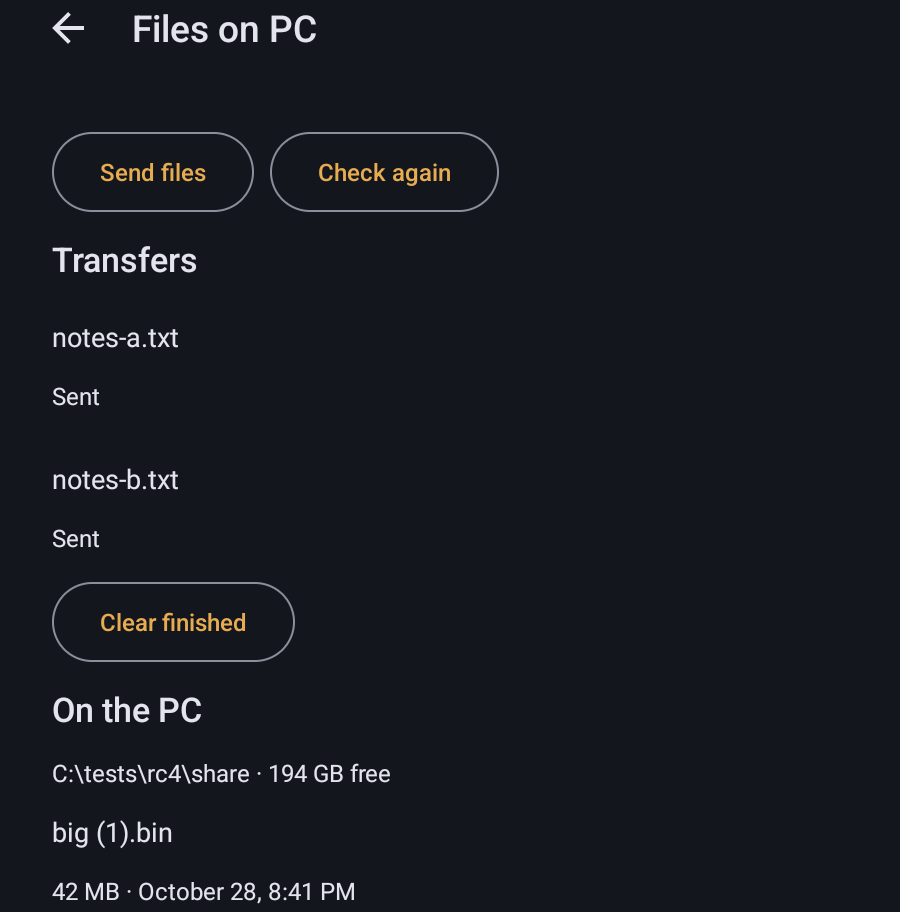

# Clipboard, files, folders and USB devices

[Documentation](index.md) · [All defaults](settings.md) · [Host feature support](PARITY-MATRIX.md)

A PC whose host supports sharing ([Rubylight](https://github.com/RamazanKara/Rubylight) 3.0) can exchange more than the stream with this device: its clipboard, a file-transfer folder, the folders it shares, and USB devices plugged into this device. Each feature needs the host to offer it and to allow it for this device on the **Devices** page of its web UI. When a permission or setting is missing, Nightjar names what to change on the PC. Hosts without these features keep the classic clipboard transfer in the stream menu where they offer it.

Everything on this page applies to Android and to Nightjar for Windows and Linux; differences are noted.

## Clipboard

### Clipboard sync

**Settings → Controls → Clipboard sync** (off by default) shares copied text both ways while you stream, without opening the stream menu: text copied on this device goes on the PC's clipboard, and text copied on the PC comes here.

- The PC must offer clipboard sync and let this device read and write its clipboard. If it doesn't, the stream says so once.
- Android lets an app read the clipboard only while it is in front, so a copy made in another app goes to the PC once you are back in the stream.
- It carries text. A copy too large for the sync, or an image copied on the PC, names the stream menu entry that carries it.
- On Android it needs the **New streaming engine** (on by default).

### Text and images from the stream menu

The stream menu's **Host** section moves the clipboard by hand, when the PC allows it:

| Entry | What it does |
| --- | --- |
| Send clipboard to host | Puts the text on this device's clipboard on the PC's. |
| Copy host clipboard | Copies the PC's text here. |
| Send clipboard image to host | Sends a copied image to the PC (desktop: **Send image to PC**). |
| Copy host clipboard image | Copies the image on the PC's clipboard here (desktop: **Copy PC image here**). |

Images travel as PNG and use the same clipboard permissions as text. An image too large for this device or for the PC says which side refused it, and an image that can't be read is refused with a message rather than sent.

## Files

**Files** sends files to the PC and downloads files from its file-transfer folder.

- **Android:** open it from a PC's options (long-press the PC, or its three dots), from Home, or from the stream menu's **Host** section. From the stream menu it opens its own screen; the game keeps running on the PC. You can also share files to **Send to PC** from another app.
- **Windows and Linux:** **Files** is on the PC's options. Downloads land in your Downloads folder.

The page shows the PC's folder with its free space and a list of transfers. Each transfer shows its progress and can be cancelled or retried; cancelling ends it at once, even when the PC has stopped answering. **Clear finished** removes completed transfers from the list.

  

 A refusal says what to change: **Upload files** or **Download files** for this device on the web UI's Devices page, or a file larger than the PC allows.

A download never overwrites a file: an existing name, or another download's unfinished `.part` file, stops it with an error. A download that exceeds the size the PC listed also stops, and an unfinished file that cannot be deleted is named. On Android, transfers continue through changes of theme, font size or language.

## Shared folders

A PC can share folders with a device. **Shared folders** opens them:

- **Android:** in a PC's options. Browse the folders, download files to Downloads and upload files where the PC grants writing.
- **Windows and Linux:** on the PC's details page. Downloads go into a folder you choose, and with a write grant you can upload a file. Each transfer shows its progress and each refusal its reason.

A PC that shares no folders, or a host without shared folders, says so and points to the web UI. A folder Windows does not let the host read says so and points to that folder's permissions on the PC.

## USB devices

USB forwarding hands a USB device plugged into this device, such as a drawing tablet or a security key, to the PC until you detach or unplug it or the stream ends.

- **Android:** turn on **Settings → Controls → Forward USB devices** (off by default, under the USB controllers group). It needs the New streaming engine. During a stream, the menu's **Host** section then shows **USB devices**.
- **Windows and Linux:** **USB devices** is in the stream controls when the PC offers it. On Windows, Nightjar reaches a device only through the WinUSB driver, so the list names the driver of any device that uses another one instead of offering it; install WinUSB for that device (for example with Zadig) to forward it.

The entry appears only when the PC offers USB forwarding and allows it for this device; otherwise the stream controls say why. Hubs, and controllers that Nightjar's own USB drivers already use, are not listed. A device that can't be attached names the reason: no permission, USB forwarding off on the PC, the PC's limit of attached devices, its USB driver, a timeout or a device that stopped answering.

## Privacy

Clipboard text, images, files and USB traffic go only between this device and the PC you stream from, over the paired connection. See [privacy](PRIVACY.md).
