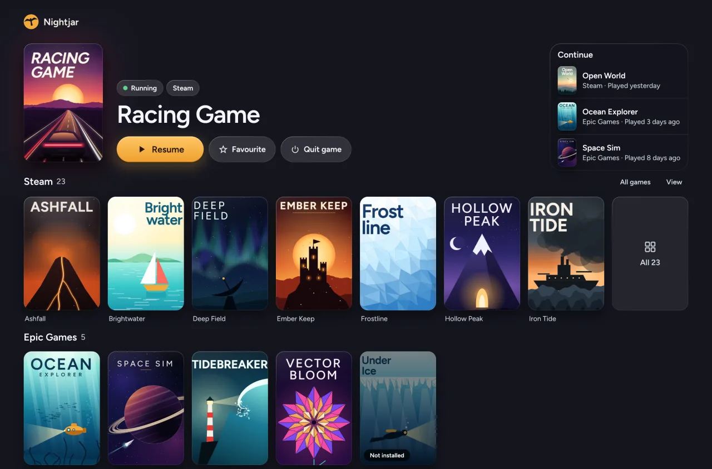
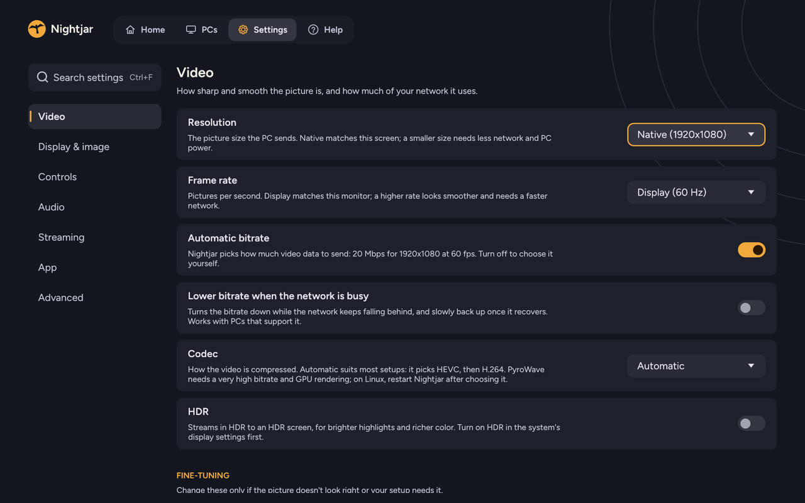
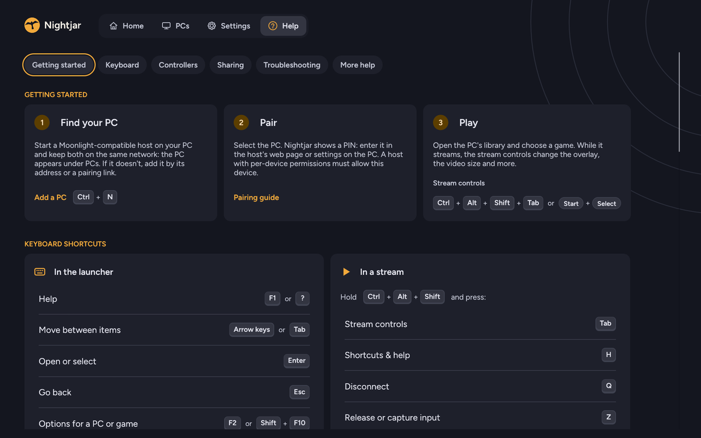

# Nightjar for macOS, Windows and Linux

Nightjar for macOS, Windows and Linux is the desktop edition of Nightjar: a Moonlight-protocol game-streaming client built on the same Rust engine (`nightjar-core`) as the Android app. It works with Sunshine, Apollo, Vibepollo, Rubylight and other Moonlight-compatible hosts; features beyond the standard protocol follow the capabilities each host reports.

The first half of this page covers installing and using the client; the second half covers building, packaging and the design. [Android and desktop](../../docs/CLIENT-PARITY.md) compares the two clients feature by feature.

## macOS

The Mac port shares the Rust launcher, pairing, library, audio and input code with the other desktop clients. FFmpeg
VideoToolbox decodes standard video. SDL Metal imports NV12 and P010 Core Video surfaces, with a
mapped-plane fallback. The client probes HEVC and AV1 with fixtures before offering those formats.



### Install

Each release has `nightjar-desktop-<version>-macos-arm64.zip` for Apple Silicon and
`nightjar-desktop-<version>-macos-x86_64.zip` for Intel Macs, both for macOS 13 or later. Unpack the
ZIP and move `Nightjar.app` to Applications.

The app has an ad-hoc signature and is not notarized by Apple, so macOS asks once before the first
start. On macOS 15 or later, open Nightjar, close the warning with **Done**, then choose **Open Anyway**
under **System Settings → Privacy & Security** and confirm. On macOS 13 and 14, Control-click the app,
choose **Open** and confirm. Alternatively, clear the download's quarantine flag in Terminal:

```sh
xattr -dr com.apple.quarantine /Applications/Nightjar.app
```

A newer version installs the same way: replace the app in Applications. Settings and paired PCs stay
in `~/Library/Application Support/Nightjar/`.

### Build and run

Install the Xcode Command Line Tools, Rust 1.95 or newer and Python 3.9 or newer. To run against Homebrew libraries,
start from the repository root.

```sh
brew install pkg-config sdl3 ffmpeg opus
cd protocol
cargo run --locked -p nightjar-desktop
```

To build a Finder application, start from the repository root.

```sh
brew install cmake meson ninja pkg-config nasm
python3 protocol/desktop/package-macos.py
open protocol/target/release/Nightjar.app
```

The packager builds checksum-pinned SDL, Opus, dav1d and a decode-only FFmpeg, embeds their dylibs and
licenses, and verifies an ad-hoc signature. The first build downloads the sources. Later builds reuse
the Cargo target directory. The default deployment target is macOS 13.0 on the architecture of the
build Mac. Set `MACOSX_DEPLOYMENT_TARGET` to choose a newer minimum. The bundle can be moved to
Applications and carries its own media libraries. The release downloads are built the same way by
the release workflow, on an Apple Silicon and an Intel runner.

### Build for an Intel Mac

An Intel Mac running macOS Ventura 13 or later uses the `x86_64` build. On an Apple Silicon build
Mac with Rust installed through rustup, add the Intel target first. NASM enables the optimized
Intel code in FFmpeg and dav1d.

```sh
rustup target add x86_64-apple-darwin
python3 protocol/desktop/package-macos.py --arch x86_64 --zip
```

The packager writes `Nightjar-<version>-macos-x86_64.zip` under
`protocol/target/x86_64-apple-darwin/release/`. It checks the executable and every bundled dylib
for the requested architecture and minimum OS. Copy the ZIP to the Intel Mac, double-click it and
move `Nightjar.app` to Applications. The receiving Mac needs only the app. Pair it as a new device
on the streaming host.

### Connect to a PC

Allow Local Network access when macOS asks. Select a discovered PC or use **Add PC** with its LAN
address. Enter the displayed PIN on the host. If the library loads but launching returns HTTP 401,
open the host's device permissions and enable **Launch applications** for the paired Mac. Nightjar stores the pairing identity and settings in
`~/Library/Application Support/Nightjar/`. Microphone forwarding requires microphone access.
**Control + Option + Shift + Tab** opens the stream menu. **Control + Option + Shift + Q** leaves it.

FSR1, SGSR1, planar conversion, packed full chroma and PyroWave's Rust decoder use Metal fragment
shaders. PyroWave defaults to the CPU decoder on macOS. Its upstream Vulkan SDK backend is available
on Windows and Linux. HDR requires an HDR display and a compatible host. Live streaming has been
verified on Apple Silicon. The Metal and VideoToolbox
checks passed on Apple Silicon and on an Intel MacBook Pro with a Radeon Pro 560 running Ventura
13.7.8. The Intel Mac decoded HEVC Main and Main10. Its hardware probe declined AV1. Live HDR and
physical controllers still need hardware verification.
The launcher opens Core Audio when a stream starts, so pairing and browsing work while an audio device is unavailable.

### Verify on a Mac

Run these checks from `protocol/` with the development libraries installed. The macOS CI builds on
Apple Silicon and Intel, runs the headless suites and checks the relocated bundle's signature,
version and dylib references. The opt-in hardware check needs a Metal-capable display and a
VideoToolbox HEVC Main10 decoder. It compares pixels from native NV12 and P010 imports with their
mapped planes, then exercises FSR1, SGSR1, PyroWave and packed chroma.

```sh
cargo test --locked -p nightjar-desktop -p nightjar-core -p nightjar-policy
cargo test --locked --manifest-path core/Cargo.toml
cargo test --locked -p nightjar-desktop --features demo-library --test macos_video -- --ignored --nocapture
python3 desktop/tests/verify_macos_bundle.py target/release/Nightjar.app
```

The last command uses a previously packaged release app. When checking an Intel cross-build on
Apple Silicon, add `--arch x86_64 --inspect-only` and supply the Intel app path. Run the same
check on the Intel Mac without `--inspect-only` to exercise native launch.

To update the Metal shaders after changing their SPIR-V inputs, run `python3 desktop/src/metal/generate.py /path/to/spirv-cross` from
`protocol/` with SPIRV-Cross tag `vulkan-sdk-1.4.321.0`. Commit the regenerated `.metal` files
alongside their inputs and run the hardware check.

## Installing

Every release carries these files. The installer and the packages contain the same build as the archives. The Windows and Linux release packages are unsigned; the macOS app has an ad-hoc signature and is not notarized, so macOS asks once before the first start ([Install](#install)).

| File | Install | Uninstall |
| --- | --- | --- |
| `nightjar-desktop-<version>-windows-x86_64-setup.exe` | Run it. It installs for the current user, without an administrator prompt, into `%LOCALAPPDATA%\Programs\Nightjar`, with a Start menu shortcut, an optional desktop shortcut and an entry in Apps & features. A newer setup updates in place and closes a running Nightjar first. | **Apps & features → Nightjar → Uninstall** removes the program folder, the shortcuts and the entry. |
| `nightjar-desktop-<version>-windows-x86_64.zip` | Unzip it anywhere and run `nightjar.exe`. | Delete the folder. |
| `nightjar-desktop-<version>-windows-arm64-setup.exe`, `…-windows-arm64.zip` | The same for ARM64 Windows (Snapdragon X and other Windows on Arm PCs), built natively for it. On such a PC the ARM64 setup replaces an x86_64 install in place, and an installed x86_64 Nightjar updates to it. | As above. |
| `nightjar-desktop-<version>-linux-x86_64.deb` | `sudo apt install ./nightjar-desktop-<version>-linux-x86_64.deb` (Debian 12, Ubuntu 22.04 and later) | `sudo apt remove nightjar` |
| `nightjar-desktop-<version>-linux-x86_64.rpm` | `sudo dnf install ./nightjar-desktop-<version>-linux-x86_64.rpm` (Fedora 36 and later) | `sudo dnf remove nightjar` |
| `nightjar-desktop-<version>-x86_64.flatpak` | `flatpak install --user nightjar-desktop-<version>-x86_64.flatpak` (the runtime comes from Flathub); to update, the same with `--reinstall`. For the Steam Deck, see [Steam Deck and Linux handhelds](../../docs/steam-deck.md). | `flatpak uninstall io.github.ramazankara.nightjar` |
| `nightjar-desktop-<version>-x86_64.AppImage` | Make it executable (`chmod +x`) and run it; nothing is installed. Without FUSE, run it with `--appimage-extract-and-run`. | Delete the file. |
| `nightjar-desktop-<version>-linux-x86_64.tar.gz` | Unpack it and run `./nightjar`. `share/` holds the desktop entry and icons, laid out as under `/usr/share`. | Delete the folder. |
| `nightjar-desktop-<version>-macos-arm64.zip`, `…-macos-x86_64.zip` | Unpack it and move `Nightjar.app` to Applications; `arm64` is for Apple Silicon, `x86_64` for Intel Macs (macOS 13 and later). The app is not notarized: [allow it once](#install) on first start. | Move `Nightjar.app` to the Trash. |

The `.deb` and `.rpm` install the program in `/opt/nightjar`, `nightjar` in `/usr/bin`, and the desktop entry `io.github.ramazankara.nightjar.desktop`, the hicolor icons and the AppStream metadata in `/usr/share`. They require glibc 2.35 or newer, libopus, libva, libudev, and the ALSA, libX11 and libXext libraries without which SDL3 cannot start, and recommend the libraries SDL3 and PyroWave load at run time (Wayland, PulseAudio, PipeWire, Vulkan, a VA-API driver). The AppImage also carries libopus, plus libva, libva-drm and libdrm as fallbacks: its `AppRun` uses them only where the system has none, so an installed libva still finds the system's VA-API drivers (without one, decoding falls back to software, with a notice). ALSA and X11 come from the system.

Every Linux package also comes for ARM handhelds and boards, with `aarch64` in place of `x86_64` in its name.

Settings, paired PCs, controller layouts, app lists, cover art, logs, screenshots and exported statistics are stored in `%APPDATA%\Nightjar\config` on Windows, `~/.config/nightjar` on Linux or `~/Library/Application Support/Nightjar` on macOS, outside every install folder. Updates never touch them, and uninstalling keeps them, except that the Windows uninstaller offers **Remove them too** (off unless ticked; `unins000.exe /VERYSILENT /REMOVESETTINGS` does the same silently). That option removes everything except the `screenshots` and `statistics` folders. On Linux, delete `~/.config/nightjar` by hand.

`nightjar --version` prints the version and exits without opening a window; on Windows it prints into the Command Prompt or PowerShell window it was started from.

## Using Nightjar

1. Start Nightjar on the same network as the PC. PCs found on the network appear automatically; otherwise choose **Add PC** and enter the address (`host`, `host:port` or an IPv6 address), or paste the pairing link from a Rubylight PC's QR code to add and pair it in one step.
2. Select the PC, choose **Pair** and enter the PIN that Nightjar shows in the host's web UI.
3. Choose a game. **Ctrl+Alt+Shift+Tab**, or **Start+Back** on a controller, opens the stream menu; **Ctrl+Alt+Shift+Q**, or **Start+Select+LB+RB**, leaves the stream.

<table>
<tr>
<td width="50%" valign="top"><br><sub><b>Settings you can find.</b> Sections on the left, a search that works with a controller, and every setting in plain words with a Reset beside each change.</sub></td>
<td width="50%" valign="top"><br><sub><b>Help built in.</b> F1 opens getting started, every keyboard shortcut, your controller's buttons and fixes for common problems.</sub></td>
</tr>
</table>

| Topic | Reference |
| --- | --- |
| Every setting, with defaults | [Settings: Nightjar for Windows and Linux](../../docs/settings.md#nightjar-for-windows-and-linux) |
| Keyboard shortcuts and controllers | [Controls: Nightjar for Windows and Linux](../../docs/controls.md#nightjar-for-windows-and-linux) |
| Problems and their fixes | [Troubleshooting: Nightjar for Windows and Linux](../../docs/TROUBLESHOOTING.md#nightjar-for-windows-and-linux) |
| Clipboard, files, shared folders and USB devices | [Sharing](../../docs/sharing.md) |
| Home, game pages and the session menu | [Home and the stream menu](../../docs/console.md) |

**Files.** The log is `logs/nightjar.log` in the settings folder, with the previous run in `nightjar.prev.log`; **Settings → App → Logs → Open logs folder** opens it. Every line is redacted with the Android app's problem-report rules: saved PC names and addresses, other IP and MAC addresses, URLs, UUIDs, keys and PINs become marks such as `[PC]` or `[address]`, so the log can be attached to an issue as it is. On Windows, a crash also writes a minidump (threads, stacks and modules, no memory contents) to the logs folder. **F12** saves a screenshot to `screenshots/` (or `NIGHTJAR_SCREENSHOT_DIR`), and **Export statistics (last hour)** in the stream menu writes to `statistics/`.

**Starting from a game frontend** (ES-DE, Pegasus, Playnite and similar):

```text
nightjar --host <name|uuid> [--app <name|uuid>] [--quit-on-exit]
```

The PC must be saved and paired. Names match the PC's own name or the name given in Nightjar, ignoring case. Without `--app`, the PC's app list opens. The app the PC is running is resumed; a different running app is an error unless the host asks its user itself. `--quit-on-exit` closes Nightjar when the stream ends. Exit codes: 0 for a normal end or a cancelled start, 1 for an unknown, ambiguous or unreachable PC or app or a stream that cannot start (the reason goes to stderr and the log, never to a message box that could hide behind the frontend), and 64 for an invalid command line. `--help` and an invalid command line print the usage; a Windows release build, which has no console, also shows it in a dialog, except for command lines with `--host`.

## What works

Everything below works on Windows and Linux unless a platform is named; the [macOS](#macos) section lists what differs on a Mac.

**PCs and pairing**

- Discovery over mDNS (`_nvstream._tcp`) and manual addresses, including IPv6. Online state, pairing state and the running app are polled every 4 s, and addresses are merged by the host's unique ID.
- PIN pairing, with the PIN in large type; one-time PIN pairing (PIN and passphrase) on hosts that report device permissions; QR pairing links, also opened from a browser or the host console through the `rubylight:` scheme. A paired device with the permission approves a new one from **Pair another device**. The host certificate is pinned.
- Wake-on-LAN sends a magic packet for every MAC address the PC reports (from serverinfo, and its other adapters from a native `GET /wake`) to ports 7, 9, 47009 and the Moonlight ports, at every address the PC was known by, 255.255.255.255, each local adapter's subnet broadcast, the PC's own subnet broadcasts and `ff02::1`. **Waking <PC>…** resends every 8 s until the PC answers, for up to 90 s, or until cancelled.
- In the PC's options, where the host offers it and allows it for this device: Sleep PC, Restart PC, Shut down PC and updating the PC's host.
- The PC's web UI opens from its details, and **Remote access → Test this PC** checks that the paired PC answers over HTTPS from the current network.

**Library**

- Library with cached cover art; launch, resume, quit, and quit-and-start another app. Remote Monitor and Input-only entries start in their role where the host publishes them.
- Home and the game page on hosts with the native API (Rubylight 3.0): games to continue, the library of all PCs merged by title, the PCs and what each knows, recently played games, and a page per game with Play or Resume, the stream settings that will apply, game settings and Close game. The last library of each PC is kept, so Home works while a PC is away. Home can group by collection, and a game can be hidden on this device.
- While a stream connects, the whole window shows the game's cover, the PC and the current step, with **Cancel**. A start that fails turns into a card that says why, with **Try again**, **Stream settings** and **Test the network**, which asks Moonlight's port-test server whether a firewall blocks the streaming ports.
- **Continue here** moves a game another device is playing to this one; **Stream here too** streams beside it.
- **When Nightjar opens** shows Home (the default) or the PCs, continues the last game or starts a chosen game, and **Start Nightjar when I sign in** starts it with the desktop session (also in the Flatpak).
- **Co-op sessions** join or start a Nucleus Co-op session on hosts that offer it, and **Microphone only** sends just this device's microphone.
- The session and graphics page in the stream menu (Rubylight 3.0): Resume, Disconnect, End session and Close game with confirmation, the connection facts, and the Radeon panel.
- **Quick resume**, per-game quit on leave, and **Input-only on any PC**.

**Picture**

- H.264, HEVC and AV1 with hardware decoding: D3D11VA on Windows (HEVC 4:4:4 too, through Moonlight's FFmpeg patch in `ffmpeg-patches/windows/`, which FFmpeg 9 lacks); on Linux VA-API, then Vulkan video, then V4L2 M2M (ARM handhelds and boards; 10-bit HEVC where the driver offers P010, through `ffmpeg-patches/`, tested with a fake decoder by `test-v4l2-p010.sh`), then NVDEC. Before a stream, each format is decoded once on the hardware decoder, and only what decodes is offered to the PC; a decoder that gives up mid-stream hands over to the next, with a notice.
- PyroWave decodes on the GPU or the CPU, with a bandwidth test and a frame-pace calibration per network, and skips to the newest frame when the decoder falls behind.
- HDR: HDR10 and HLG, plus Dolby Vision profiles 8.1 and 10.1 on Windows from hosts that send them. On Linux, HDR streams present as HDR10 PQ where the compositor offers it, else scRGB. **Less color banding** (10-bit SDR) and **Sharper colored text** (YUV 4:4:4, native or packed full chroma) where the host and decoder support them; Windows decodes HEVC 4:4:4 in hardware on GPUs whose decoder has it.
- Upscaling with bilinear, FSR 1, SGSR 1 or AI enhancement (the GPU vendor's video super resolution).
- Variable refresh rate with frames shown at the PC's frame times, frame pacing modes and V-Sync without VRR, fractional refresh rates, virtual displays and the PC's display arrangement.
- **Dual screen mode**: with a second monitor and a host that supports it, a second stream of the same game opens full screen on it.

**Sound**

- Opus in stereo, 5.1 and 7.1; 7.1.4 on Windows. Uncompressed PCM passthrough from hosts that offer it. Microphone with echo cancellation, noise suppression and automatic gain. The PC's night mode and headphone surround from the stream menu.

**Input**

- Keyboard with system-key capture (optionally only in full screen), captured and desktop-pointer mouse modes with a locally drawn cursor, high-resolution scrolling, native touch and pen, touchpad gestures.
- Controllers through SDL: rumble, trigger rumble, LEDs, motion, touchpad and battery; DualSense adaptive triggers, and USB DualSense audio and waveform haptics. Controller mouse mode, button mapping, stick dead zones, and saved keyboard shortcuts that import and export in the Android app's format. Stream hotkeys can be changed.

**Sharing**

- Clipboard sync, file transfer, shared folders and USB forwarding on hosts that offer them (see [sharing](../../docs/sharing.md)).

**Network and quality**

- Recovery of interrupted streams (up to five attempts within one minute), network interruption grace, client roaming, stream traffic priority. On Windows, video packets are received several at a time where the network adapter supports UDP receive coalescing.
- **Automatic bitrate**, **Lower bitrate when the network is busy** (with PyroWave's own controller), **Automatic quality** (resolution and frame rate), **Lower bitrate when frames are lost**, **Test the link before starting**, error correction choices, and the **Connection test** speed test in **Settings → Streaming**.

**Diagnostics and interface**

- Performance overlay in Compact, Statistics and Debug modes, with the host's CPU and GPU readings and pipeline frame rates where offered; the stream health report (**Why did my stream stutter?**) with the reversible bitrate trial; statistics export.
- 15 languages ([translations](../../docs/TRANSLATIONS.md#desktop)); settings search (Ctrl+F); UI zoom, high contrast, reduced motion, and screen readers through UI Automation on Windows and AT-SPI on Linux. PIN lock. On Windows and in the AppImage, an update check once per launch and a one-click update (a portable Windows copy links to the release page).
- Beam racing and early decode for PyroWave on wired links, off by default (see [beam racing](../../docs/beam-racing.md) and [early decode](../../docs/early-decode.md)).

### Differences from the Android app

Not available on the desktop:

- Settings presets.
- On-screen controls and the touch modes (trackpad, direct, multi-touch); the desktop sends native touch.
- A problem-report export; the logs folder serves that purpose.
- The latency benchmark, the decoder benchmark, and the network path and delay test of the connection test.
- HDR10+ and Dolby passthrough.

Platform limits:

- On Linux, 7.1.4 is unavailable (SDL opens at most eight channels) and Dolby Vision is not shown. Phase-lock frame timing needs X11 with the OpenGL renderer.
- On Linux, 8-bit 4:2:0 VA-API pictures reach the OpenGL renderer without crossing memory (DMA-BUF), and VA-API and Vulkan video pictures, packed full chroma included, are mapped into the GPU renderer's Vulkan images; NVDEC's are copied into them by CUDA. Other pictures on the OpenGL renderer, and any picture whose mapping fails (the log says why), go through memory.
- On Windows, D3D11VA's 4:4:4 surfaces (AYUV, Y410, Y416), which NVIDIA and Intel decoders make for HEVC 4:4:4, are copied on the GPU and drawn by the plane shader. AMD's decoders have no 4:4:4: the decoder check says so and the stream uses 4:2:0, while the software decoder draws 4:4:4. D3D11VA has no H.264 4:4:4. With **Sharper colored text** on **Automatic** and **Less color banding** on, HEVC 4:4:4 10-bit is asked for where the decoder check passes it and the PC encodes it. On Linux, Intel's VA-API decodes 4:4:4 on the GPU renderer, and NVDEC's 10-bit 4:4:4 (its samples in the high bits) is drawn by the plane shader too.

## Building

### Windows

The GNU toolchain (the default here, as for `nightjar-cli`), with SDL3, FFmpeg and Opus from MSYS2:

```powershell
C:\msys64\usr\bin\pacman.exe -S --needed mingw-w64-ucrt-x86_64-sdl3 mingw-w64-ucrt-x86_64-ffmpeg mingw-w64-ucrt-x86_64-opus mingw-w64-ucrt-x86_64-pkgconf
$env:PATH = "C:\msys64\ucrt64\bin;$env:USERPROFILE\.cargo\bin;" + $env:PATH
$env:LIBCLANG_PATH = "C:\msys64\ucrt64\bin"      # only if another LLVM is installed (bindgen takes the first libclang)
cargo run --release -p nightjar-desktop      # in protocol/
```

On an ARM64 PC, the same with MSYS2's CLANGARM64 environment (`mingw-w64-clang-aarch64-*` packages plus `-llvm-tools`, `C:\msys64\clangarm64\bin`: clang, LLVM's `windres` and libc++ instead of gcc and binutils) and Rust's `stable-aarch64-pc-windows-gnullvm` toolchain. There `build.rs` looks for FFmpeg in `C:\msys64\clangarm64`.

GNU rather than MSVC: the binary needs only the system UCRT (no Visual C++ runtime to redistribute), every native dependency comes from one package manager with matching import libraries, and the build matches `nightjar-cli`'s. The executable links four DLLs directly: `SDL3.dll`, `libopus-0.dll`, `avcodec-63.dll` and `avutil-61.dll` (FFmpeg 9; MSYS2's FFmpeg 8 has `avcodec-62.dll` and `avutil-60.dll`). MSYS2's FFmpeg pulls in every codec library it was built with (82 DLLs, 120 MB), so packages ship a decode-only FFmpeg build instead (see [Packaging for Windows](#packaging-for-windows)).

`NIGHTJAR_FFMPEG_DIR` points the build at another FFmpeg prefix (`include/`, `lib/`). On Windows the prefix also provides Opus; on Linux Opus comes from pkg-config. On Linux the executable then has the run path `$ORIGIN/lib` only, so `cargo run` and `cargo test` binaries need the prefix's `lib` on `LD_LIBRARY_PATH`.

### Linux

```sh
sudo apt install cmake ninja-build pkg-config libavcodec-dev libavutil-dev libopus-dev libva-dev nasm libdav1d-dev \
  libx11-dev libxext-dev libxrandr-dev libxcursor-dev libxi-dev libxss-dev libxfixes-dev libxtst-dev \
  libxkbcommon-dev libwayland-dev wayland-protocols libegl-dev libgl-dev libgles-dev libdrm-dev \
  libgbm-dev libpulse-dev libasound2-dev libpipewire-0.3-dev libudev-dev libdbus-1-dev libdecor-0-dev
git submodule update --init --depth 1 vendor/sdl3-src/SDL   # in protocol/, once
cargo run --release -p nightjar-desktop      # in protocol/
```

`sdl3-sys` builds SDL 3.4.20 from source and links it statically; the X11, Wayland, PulseAudio, PipeWire, ALSA and udev headers above decide which SDL backends are compiled in. The source is the `vendor/sdl3-src/SDL` submodule with a small patch that lets the PyroWave GPU decoder share the renderer's Vulkan device ([vendor/sdl3-src/README.md](../vendor/sdl3-src/README.md)).

### PyroWave

PyroWave GPU decoding (`pyrowave_decoder = Gpu`, the default; see [PyroWave decoding](../../docs/pyrowave-decode.md)) loads the PyroWave SDK library from beside the executable and needs a Vulkan 1.3 device on Linux. Build the library with `scripts/build-pyrowave-sdk.sh` (git, CMake 3.27 or newer, Ninja, a C++ compiler and `libvulkan-dev`; it needs the Rubylight host's checkout for its patches, see the script's header), then either set `NIGHTJAR_PYROWAVE_SDK` to that folder to run from `cargo`, or pass it to `package-linux.sh -s`, which checks it against `pyrowave-sdk.pin`. Without the library, PyroWave is not offered and the settings say why, until the decoder is switched to CPU; the client never switches to the CPU decoder by itself.

`nightjar --check-pyrowave <file>` (no window; the packaging scripts run it on the unpacked package) writes whether the SDK library loads (`load:`) and whether a decoder can be created on this PC's GPU (`probe:`), and exits with 0, 2 (loaded, no usable GPU) or 1 (did not load).

### Tests

The crate is a member of the `protocol/` workspace but not a default member, so `cargo test` there and `build-android.sh` cover only the engine. Test the desktop client with `cargo test -p nightjar-desktop` and `cargo clippy -p nightjar-desktop --all-targets`.

On Linux with a GPU that has Vulkan video, the ignored tests `cargo test -p nightjar-desktop -- --ignored --test-threads=1 stream::vulkan_tests_unix vulkan_video` decode the fixtures with Vulkan video on an offscreen "gpu" renderer and compare the presenter's pictures with software-decoded ones (Mesa's Intel driver needs `ANV_VIDEO_DECODE=1`).

### Packaging for Windows

`package-windows.ps1` builds the release executable and zips it into `dist/` with the DLLs it imports (found from the import tables, system libraries excluded), so it runs on a PC without MSYS2. With `-FfmpegDir <prefix>`, the executable is built against the decode-only FFmpeg that `ffmpeg-decode-only.sh <ffmpeg 9 source> <prefix>` builds in an MSYS2 UCRT64 shell (CLANGARM64 on an ARM64 PC, with FFmpeg's and dav1d's NEON code): libavcodec and libavutil with the H.264, HEVC and AV1 decoders, their D3D11VA paths and dav1d. The script fails if an import is satisfied neither by the zip nor by Windows itself (the Visual C++ runtime counts as missing), then starts the unpacked executable with only the Windows folders on `PATH`. `-Version` names the zip after a release version, as the release workflow does. The package is for the PC's own architecture (`-windows-x86_64` or `-windows-arm64`), and the script checks the executable's machine type against that name.

### Packaging for Linux

`package-linux.sh -f <FFmpeg prefix> [-s <PyroWave SDK>] [-v <version>]` builds the release binary against the decode-only FFmpeg that `ffmpeg-decode-only.sh <ffmpeg 9 source> <prefix>` builds on Linux: libavcodec and libavutil with the H.264, HEVC and AV1 decoders, their VA-API and NVDEC paths, the V4L2 M2M decoders and dav1d (needs `nasm`, `libdav1d-dev`, `libva-dev`, `libdrm-dev` and `libffmpeg-nvenc-dev`; where dav1d is older than 1.0 or the NVIDIA headers older than 11.1.5.3, as on Ubuntu 22.04, `ffmpeg-deps-linux.sh <prefix>` builds both at pinned versions, and `PKG_CONFIG_PATH=<prefix>/lib/pkgconfig` points the FFmpeg build at them). It ships `libavcodec`, `libavutil` and `libdav1d` in `lib/` beside the executable, with the run paths `$ORIGIN/lib` and `$ORIGIN`, so the system's FFmpeg (another version on a Steam Deck, or none) is never used. FFmpeg stays dynamically linked (LGPL); its license, source offer and dav1d's license are in `licenses-ffmpeg/` and `licenses-dav1d/`. libopus, libva and the desktop libraries come from the system; `LINUX-RUNTIME.txt` lists them, together with the libraries `lib/` needs. The script unpacks the archive and fails if `ldd` shows a libav* or libdav1d library from outside it, or a library that is not found.

### The Windows installer and the Linux packages

Both are built from the finished archives, so they carry exactly the same files (`packaging/`):

- `packaging/windows/build-installer.ps1 -Zip <the zip> [-Smoke]` compiles `packaging/windows/nightjar.iss` with Inno Setup 6 into the setup executable. Inno Setup provides a per-user install (`PrivilegesRequired=lowest`), the uninstaller, the Apps & features entry and in-place upgrades by a fixed AppId out of the box; NSIS would need all of that written by hand, and a Rust self-installer would mean maintaining an installer, an uninstaller and their registry entries. `-Smoke` installs silently, compares every file with the zip, checks the shortcuts and the uninstall entry, runs `nightjar.exe --version`, upgrades in place with a second run (a planted stale DLL must be removed, the settings must stay), runs what Update now runs (`/SILENT /NOCANCEL /RELAUNCH`: an install aborted at a locked file must put the old DLLs back, a held `Local\NightjarStream` must stop Setup with nothing changed, a launch during an install must exit with 75), uninstalls and fails on anything left behind. It then checks that a plain uninstall keeps the settings and that `/REMOVESETTINGS` removes them but keeps screenshots and statistics. On GitHub Actions it runs against the runner's `%APPDATA%\Nightjar`; anywhere else, a test build of the installer (`/DTestDataDir`) uses a temporary folder and the real one is never touched. It refuses to run where Nightjar or its shortcuts are already installed. The packages are not code-signed; `-SignCommand` is the hook for a signing command (see the script's header).
- `packaging/linux/build-packages.sh -n <nfpm> -a <appimagetool> -r <AppImage runtime> <the tar.gz>` builds the `.deb` and `.rpm` with nfpm (one description for both, no rpmbuild needed on the Ubuntu build machine) and the AppImage with appimagetool and a pinned type 2 runtime. Dependencies are read from the binaries: the `.deb` names the packages that own the linked libraries on the build machine and the newest `GLIBC_` symbol version; the `.rpm` requires the same libraries by soname. The script also writes `PKGBUILD` (Arch Linux) and `io.github.ramazankara.nightjar.yml` (Flatpak) from `packaging/linux/aur` and `packaging/linux/flatpak` with the archive's version and SHA-256; these recipes are kept in the repository and not published. `packaging/linux/flatpak/build-bundle.sh <the tar.gz>` builds the release's Flatpak bundle with flatpak-builder from that recipe, with the archive itself as its source.
- `packaging/make-icons.py` generates the icons (hicolor PNGs, `nightjar.ico`, the installer's side panel) from the store icon. `build.rs` embeds `nightjar.ico` in `nightjar.exe`; the Windows build needs `windres`, which MSYS2's UCRT64 binutils provide.

The release workflow pins nfpm, appimagetool, the AppImage runtime and Inno Setup by version and SHA-256. It builds on Ubuntu 22.04, the oldest Ubuntu LTS still in standard support, so the packages need only its glibc 2.35. It installs the `.deb` on that runner and in a clean Ubuntu 24.04, the `.rpm` in a clean Fedora container, and the AppImage in another Fedora container without libva and libdrm and in a clean Ubuntu 22.04 without libva (the AppImage catalog's test system), and runs the installer's `-Smoke` on its Windows runner. Because `--version` returns before SDL starts, it also checks that the `.deb` and `.rpm` declare the libraries SDL cannot start without and, with `packaging/linux/check-start.sh`, that each package and the AppImage open the launcher window under Xvfb in a clean container. The Flatpak bundle is installed in a clean, privileged Fedora container (`packaging/linux/flatpak/check-bundle.sh`): `--version`, every linked library resolved in the sandbox, the launcher window with its log in `~/.var/app`, a `--reinstall` that keeps the settings, and the gamescope socket permission. Both scripts install the Flathub runtime in three tries before they build or install.

## Design

### One window: SDL3, with egui drawn through SDL's renderer

The launcher and the stream share one SDL3 window and one `SDL_Renderer`. egui is used without eframe: SDL events become egui input (`src/gui.rs`), and egui's triangles are drawn with `SDL_RenderGeometryRaw`, so the performance overlay is painted over the video in the same frame and swap chain, and moving from the library to the stream creates no new window.

- SDL3 is the natural layer for a streaming client: gamepads (rumble, trigger rumble, LEDs, gyro, touchpads, battery), low-latency audio, relative mouse capture, keyboard grabbing for system keys, Wayland and X11, HiDPI and display modes. moonlight-qt uses SDL for the same reasons.
- SDL's renderer provides D3D11 on Windows (flip model, tearing presents, NV12 and P010 textures, and access to its `ID3D11Device`, which the decoder shares) and OpenGL or Vulkan on Linux.
- egui is immediate-mode and has keyboard focus navigation, so a controller drives the launcher (D-pad or stick moves focus, A selects, B goes back, Start opens settings) without a second navigation system. It scales with the display's content scale. Its AccessKit tree reaches UI Automation and AT-SPI through `src/a11y.rs`, built only while a screen reader asks for it.
- eframe (winit and wgpu) would add a second windowing stack beside SDL and an extra copy or interop step for decoded D3D11 surfaces. Slint and Qt would be heavier for the same result.

### Decoding and presentation

- **Video decoding.** FFmpeg's libavcodec through Rust bindings (`src/media.rs`), in low-delay mode. Packets reach FFmpeg in pooled, reused buffers: a fresh allocation per frame costs page faults once frames reach about 1 MiB on Windows (high bitrates, key frames). A launch with hardware decoding first decodes a small HEVC, HEVC Main10, AV1 and AV1 Main10 picture with the stream's decoder as required hardware (`src/stream/color_probe.rs`, once per decoder) and offers only what decodes, so the PC never streams a format FFmpeg would decode in software; H.264 is always offered. Should FFmpeg still take a hardware decoder to software mid-stream (any backend: no hardware format for the stream, or a picture in memory), the overlay names it, a notice says it, and the next backend of the order opens, or the software decoder, from a key frame. A frame that makes no picture once the decoder has made one, or a picture FFmpeg flags corrupt, asks for recovery. The launch asks for reference frame invalidation for HEVC and AV1 where the backend that decodes them takes it (D3D11VA, VA-API and software, as moonlight-qt; not H.264, Vulkan video, V4L2 or NVDEC), so a lost frame recovers with an invalidation instead of a key frame, and software decoding asks for a slice per decoding thread (up to 4).
- **Windows.** D3D11VA decodes on the renderer's own D3D11 device, made multithread-protected because the decoder thread and the renderer share the immediate context. A draw pass (`src/stream/direct.rs`) renders hardware-decoded pictures straight into SDL's back buffer. With decoder-texture binding (Intel GPUs by default; `NIGHTJAR_D3D11_BIND=1` or `0` overrides) it reads the picture from the decoder's texture array; otherwise it reads a GPU copy made under FFmpeg's device lock. Its tone map takes the content peak per frame from the Dolby Vision RPU, else HDR10+ metadata, else the picture itself, and HLG goes through BT.2100's inverse OETF and OOTF for the display's peak. `NIGHTJAR_D3D11_PASS=0` leaves drawing to SDL. 7.1.4 audio plays through WASAPI (`src/stream/wasapi.rs`), since SDL opens at most eight channels.
- **Linux.** The decoder tries VA-API, then FFmpeg's Vulkan video, then the V4L2 memory-to-memory decoders (ARM handhelds and boards, H.264 and HEVC), then NVDEC, the order moonlight-qt and Moonlight V+ use; each failure is logged before the next is tried. VA-API stays first on the GPU renderer too, its pictures mapped into the renderer's Vulkan images (the mapping and Vulkan video need FFmpeg 7.1, 8 or 9: libavutil 59.34 to 60.26, or 61; with another, the log says so and VA-API pictures go through memory); the Debug setting **Vulkan video first** or `NIGHTJAR_VULKAN_VIDEO_GPU_FIRST=1` puts Vulkan video first there. A VA driver that wraps another API is left out (moonlight-qt's vendor-string checks): nvidia-vaapi-driver, so NVIDIA decodes with Vulkan video, then NVDEC, and the VDPAU backend; `NIGHTJAR_FORCE_VAAPI=1` keeps it. The log names the VA driver, its profiles and largest picture (`vaapi:`), the renderer's Vulkan device, driver and video codecs (`vulkan:`), the order and why (`decoder order:`), and each probed format with the backend that decoded it (`decoder probe:`). The Flatpak unsets `LIBVA_DRIVER_NAME` and `LIBVA_DRIVERS_PATH`, which name host drivers the sandbox lacks. The V4L2 decoders hand their pictures back asynchronously: the decoder thread asks again every 250 µs, for up to half a frame, until the frame just sent comes out, and each picture keeps its own frame's times. Vulkan video (`src/vulkan_video.rs`) decodes on the GPU renderer's own Vulkan device, to which the SDL patch adds video decode queues: the presenter copies the picture's two planes on the GPU into its own images, ordered by the picture's timeline semaphore, and draws them with the plane shader, so range, matrix, 10-bit, HDR10 and HLG are drawn as for the other decoders and the picture never crosses the CPU. When VA-API cannot open a device (NVIDIA's driver) and the GPU has the Vulkan video extensions, the GPU renderer is chosen at start for it, unless every decoder setting, the hosts' and profiles' included, says Software (a stream that then decodes in hardware switches to it, as below). The GPU renderer's device gets the video extensions and decode queues only when a decoder setting allows hardware decoding and `NIGHTJAR_VULKAN_VIDEO` is not `0`, and FFmpeg submits to every queue under SDL's queue lock. The device is checked for the stream's profile and picture format before FFmpeg opens, and FFmpeg's frames are made in the two-plane format the presenter copies; packed 4:4:4 is left to the next decoder, and a stream FFmpeg still decodes in software is logged, named on the overlay and handed to the next decoder. With the OpenGL renderer on EGL (`SDL_HINT_VIDEO_FORCE_EGL` makes X11 use it too), an 8-bit 4:2:0 VA-API picture never crosses the CPU (`src/dmabuf.rs`): the decoder thread exports the surface as DMA-BUFs, one layer per plane, and the presenter binds an EGL image of each to the matching plane of SDL's NV12 texture, holding the picture until the next replaces it. VA-API opens there on the GPU the EGL display runs on (`EGL_EXT_device_query`, its render node), not on FFmpeg's default device, the first render node, which on a PC with two GPUs is often the integrated one whose tiled pictures the other GPU's EGL refuses; the log names the node and why, and a single GPU, or a display whose node EGL does not name, keeps the default device. On the GPU renderer, VA-API opens on the renderer's GPU and FFmpeg maps each picture into Vulkan images on the renderer's device (VA-API to DRM PRIME to Vulkan, after the decode has finished), which the presenter copies as it copies Vulkan video's, holding each until its copy is done; a device without the DMA-BUF import extensions, another GPU, a refused format modifier or `NIGHTJAR_VAAPI_VULKAN_MAP=0` keeps the path below, with the reason logged once. A stream whose pictures cannot be mapped, at its start or after an import fails on a picture, goes to Vulkan video on the renderer's device where that decodes it (from a key frame when it changes mid-stream), so no picture is read back; where it does not, or FFmpeg then takes it to software, VA-API keeps the stream through memory (`NIGHTJAR_UNMAPPED_VULKAN_VIDEO=0` keeps it there at once, and `NIGHTJAR_VAAPI_VULKAN_MAP=0` alone asks for memory). Otherwise (the GPU renderer without that mapping, 10-bit on the OpenGL renderer, packed formats, or a failed import, logged once) the decoder maps each picture for reading and the presenter uploads from that mapping without a second copy. On the GPU renderer, NVDEC pictures are copied by CUDA into Vulkan images of the renderer's device (`vulkan_video::CudaMap`, FFmpeg's CUDA to Vulkan transfer), which needs CUDA on the renderer's GPU (NVDEC on another GPU is refused up front, naming both); where the copy cannot be used, the log says why, a notice says the pictures go through memory, and they are copied out of CUDA memory. `NIGHTJAR_DMABUF=0` turns the import off for A/B measurements. Automatic **Renderer** starts on OpenGL for this unless a saved setting needs the GPU renderer, and a stream that needs it switches at its start: the GUI keeps no copy of its textures: egui sends the font atlas whole again, covers load again from the art cache and the launcher bakes its own again where they are next drawn, live glass is tried again, and the log says `renderer switched from "opengl" to "gpu" for <reason>`; a renderer that cannot be made leaves one of the old kind (from the GPU renderer, the GPU renderer without Vulkan video), the stream's check refuses it with the reason, and no later stream tries again until the Renderer setting changes. It never switches back by itself.
- **Pacing** (`src/stream/present.rs`), chosen at stream start:
  - **Real VRR** (with Variable refresh rate, on by default): `rubylight_protocol::present_clock::PresentClock` schedules each picture at the host's frame time (RTP timestamp) plus a steady delay derived from recent lateness, so the display refreshes at the game's cadence. Presents are immediate with tearing allowed (`DXGI_PRESENT_ALLOW_TEARING` on SDL's flip-model swap chain), and the UI thread sleeps to the scheduled time with a 1 ms timer. The launch asks the host for VRR handling when pacing by host times.
  - VRR with Real VRR off: each picture is presented as soon as it is decoded.
  - Without VRR: the selected frame pacing mode, V-Sync (the newest picture each refresh) or immediate. On Windows, a stream with no refreshes to spare at V-Sync with Lowest latency or Balanced (a frame no longer than about one refresh, so 120 fps on 120 Hz or 60 Hz) never waits behind the last picture, which would otherwise stand in a queue for good and hold the D3D11 lock against the decoder: `Present(1, DXGI_PRESENT_DO_NOT_WAIT)` tries for 5 ms, longer on a display where many are refused, then the next picture takes its place. A skipped picture is drawn after all if no next one comes, and four refused in a row make one present wait, to hold back a GPU that is behind. Such a stream reports its phase lock slack to the desktop's deadline instead of the refresh (`present::deadline_before_refresh`, 5 ms before it at 120 Hz, about 7 ms at 60 Hz), so a Rubylight host times pictures to make it, and the overlay's lead reads to that point; exclusive fullscreen, which nothing composes, keeps the refresh. Where 1.5% of pictures miss their refresh in two windows of 1024 in a row, once the stream has settled, each picture waits its turn again for a while. `NIGHTJAR_PRESENT_SKIP=0` turns all this off for A/B measurements; `NIGHTJAR_PRESENT_HOLD_US` sets the time it tries and `NIGHTJAR_PRESENT_DEADLINE_US` the deadline ([measurements](https://github.com/RamazanKara/Rubylight/blob/main/rust/PERFORMANCE.md#november-6-nightjar-desktop-at-the-displays-own-rate)).
- **VRR display check** (Windows). A VRR stream that presents with tearing in fullscreen runs the beam race's display check (the scan line around each present, `src/stream/race_probe.rs`). A display that keeps its own refresh switches the stream to the pacing it would have without VRR, and the overlay's Pacing line says "V-Sync: this display does not refresh on present". To be classed as fixed-refresh, the stream must run below about 70% of the display's rate, the calibration must show little blanking, and 60 presents must start no scan, or the restart check must fail or starve. A faster stream leaves a VRR display no idle time either, so a fixed-refresh display still tears there. Only presents to a focused fullscreen window count; entering fullscreen, regaining focus, or the stream slowing below 60% of the display's rate after a check at 70% or more measures again. `NIGHTJAR_VRR_CHECK=0` turns the check off. `NIGHTJAR_VRR_SYNC=present1|scan` selects alternative VRR present strategies for measurement (`present1` uses sync interval 1; `scan` waits out a scan in progress); neither became the default ([measurements](https://github.com/RamazanKara/Rubylight/blob/main/rust/PERFORMANCE.md#october-29-nightjar-desktop-on-a-vrr-panel-and-a-fixed-one)). Exclusive fullscreen with VRR requests the display's highest refresh rate at the stream's resolution, not the stream's rate.
- **Audio.** Opus multistream (libopus) into an SDL3 audio stream. The queue is capped at 40 ms plus one packet, dropping late packets rather than letting latency grow; when it runs dry, 10 ms of silence goes ahead of the next packet.

### Statistics

- Clock sync (0x5537) every 250 ms gives the host-to-client clock offset, so the overlay shows the latency from the PC's frame to the display. Host timing (0x5536) gives the host's present-to-send and encode times where the host offers them.
- The overlay's **Host processing** is the video frame header's per-frame time averaged over the frames received in the last two seconds, as Artemis and Moonlight show it. The host's present-to-send is a separate line, **Host incl. send** in Statistics and **Host to network** in Debug; the statistics CSV column `host_to_network_ms` (formerly `host_ms`) is that present-to-send time, not host processing.
- The overlay's **Render** is Nightjar's own work on a picture, from the first look at it to the present call: the upload or mapping, the draws, the overlay. The present call has its own line, **Present wait**: there the thread waits on the GPU, the driver, the refresh with V-Sync and the compositor (gamescope's Vulkan layer, for one), which is not Nightjar's drawing. Moonlight's rendering time includes that call.
- When the host announces link notices (0x5538), the client subscribes, and the overlay adds a **Notice** line, "Host lowered the bitrate to X Mbps: network", while the host holds the bitrate down for the network.
- When the host announces pipeline rates (0x553D), the client requests a report every second, and the overlay adds a **Host pipeline** line: the frames per second the host's display produced, captured, encoded, sent and repeated, with "-" for a stage the host cannot count.

### Logging

`src/logpipe.rs` diverts stderr into a pipe, so the stream threads pay no more than for `eprintln!`. A separate thread writes the file with UTC timestamps; the reader buffers up to 4 MB for it, and only a disk that stalls beyond that drops log lines (the log records how many) instead of stalling the stream. `src/logfile.rs` handles rotation (also at 4 MB), stamping and redaction (`nightjar-core`'s `report::redact`). Release builds on Windows have no console; elsewhere the console keeps the raw output.

### Diagnostic environment variables

| Variable | Effect |
| --- | --- |
| `NIGHTJAR_CONFIG_DIR`, `NIGHTJAR_SCREENSHOT_DIR` | Override the settings folder and the screenshot folder. |
| `NIGHTJAR_TIMING_CSV=<file or folder>` | Writes one row per displayed picture in the format of the Android app's `nightjar-latency.csv`: times in nanoseconds on the session clock, with the host's stamps from the extended 0x5536 report and the 0x5537 clock offset in the last nine columns. Rubylight's `rust/release/timing_report.py` joins it with the host's record (`BUTTERPOLLO_TIMING_RECORD`). A writer thread does the file work. |
| `NIGHTJAR_PACKET_TRACE=<prefix>` | Records each video and audio datagram's receive time, the receive thread's wait for it, its length, RTP sequence and timestamp (0 for encrypted video) in memory, and writes `<prefix>-video.csv`, `<prefix>-audio.csv` and `<prefix>-canary.csv` (a 1 ms sleeper's late wake-ups) when the stream ends. It distinguishes a network that delivers packets in bursts from a receive thread that woke late (`nightjar-core`'s `session/trace.rs`). |
| `NIGHTJAR_AUTOSTREAM=address[:port]` | Measurement only: starts one stream without the launcher and ends it after `NIGHTJAR_AUTOSTREAM_SECONDS` (default 60), with `NIGHTJAR_AUTOSTREAM_APP` (default "Desktop") and, for an unpaired PC, `NIGHTJAR_AUTOSTREAM_PIN` (default 1234, entered on the PC). `NIGHTJAR_AUTOSTREAM_START_SECONDS` sets the setup timeout including PIN entry (default 90). Exits with 0 after a full run and 2 otherwise. |
| `NIGHTJAR_BEAM_RACE`, `NIGHTJAR_EARLY_DECODE` | Turn on [beam racing](../../docs/beam-racing.md) and [early decode](../../docs/early-decode.md) for PyroWave, as the `beam_race` and `early_decode` settings keys do. |
| `NIGHTJAR_D3D11_PASS`, `NIGHTJAR_D3D11_BIND`, `NIGHTJAR_DMABUF`, `NIGHTJAR_VRR_CHECK`, `NIGHTJAR_VRR_SYNC` | A/B switches for the presentation paths described above. |
| `NIGHTJAR_AMD_LOW_LATENCY_DECODE` | Linux, on unless `0`: asks AMD's Mesa drivers for their low-latency video decode (`lowlatencydec` in `AMD_DEBUG` and `RADV_PERFTEST`), keeping the user's own flags; programs Nightjar starts get the original values (`src/amd_decode.rs`). |
| `NIGHTJAR_FORCE_VAAPI` | Linux: `1` keeps VA-API in the decoder order on a VA driver that wraps another API (nvidia-vaapi-driver, the VDPAU backend). |
| `NIGHTJAR_VULKAN_VIDEO` | Linux: `1` tries Vulkan video first and picks the GPU renderer for it, `0` leaves Vulkan video out, and the GPU renderer's device is made without its video extensions. |
| `NIGHTJAR_DESKTOP_RFI` | A/B switch, on unless `0`: reference frame invalidation. |
| `NIGHTJAR_VULKAN_VIDEO_GPU_FIRST`, `NIGHTJAR_DESKTOP_SLICES`, `NIGHTJAR_VULKAN_RFI` | A/B switches for the Debug settings Vulkan video first, Slices for software decoding and Vulkan video recovery (all off by default): `1` or `0` wins over the setting. |
| `NIGHTJAR_VAAPI_VULKAN_MAP` | Linux A/B switch, on unless `0`: on the GPU renderer, VA-API opens on the renderer's GPU (its DRM render node) and its pictures are mapped into Vulkan images on the renderer's device (DMA-BUF import, `VK_EXT_image_drm_format_modifier`) for the presenter's GPU copy, instead of being mapped to memory and uploaded. Why the mapping is not used is logged once. |
| `NIGHTJAR_PYROWAVE_SAMPLE_PLANES` | Linux A/B switch, on unless `0`: where PyroWave decodes on the renderer's Vulkan device, the presenter samples the decoder's planes in place, holding each plane set until the GPU finished the draws that read it, instead of copying them into its own textures first. Which path is used is logged once. |
| `NIGHTJAR_UNMAPPED_VULKAN_VIDEO` | Linux A/B switch, on unless `0`: on the GPU renderer, a VA-API stream whose pictures cannot be mapped into the renderer's Vulkan images (the reason is logged) is decoded with Vulkan video on the renderer's device instead, where that decodes the stream; `0` keeps VA-API with each picture mapped to memory and uploaded. `1` also takes `NIGHTJAR_VAAPI_VULKAN_MAP=0` for a refusal, for test runs. |
| `NIGHTJAR_GAMESCOPE_PQ` | Linux A/B switch, on unless `0`: under gamescope, an HDR stream presents as HDR10 PQ where the swapchain offers it, as on a desktop; `0` keeps scRGB first there. The `renderer "gpu": swapchain offers ...` line names the output. |
| `NIGHTJAR_DMABUF_CACHE` | Linux A/B switch, on unless `0`: VA-API pictures are imported once per decoder surface and the import is reused when the decoder hands the surface out again, without exporting it again: the OpenGL renderer's EGL images, and on the GPU renderer the Vulkan images of `NIGHTJAR_VAAPI_VULKAN_MAP` (4:2:0). A new surface pool drops them. Which path is used, and how many pictures came from the cache, is logged. |
| `NIGHTJAR_PQ_VIDEO_ONLY` | Linux A/B switch, on unless `0`: on an HDR10 (PQ) output, a frame of a stream has the plane pass write PQ straight into the swapchain image, without SDL's RGBA16F back buffer and its PQ pass; the overlay, a toast and the stream menu are drawn into it as PQ too. Which path is used is logged once, and so is a frame that was not only the picture. |
| `NIGHTJAR_WAYLAND_HDR_DESCRIPTION` | Linux A/B switch, on unless `0`: on a Wayland desktop (not gamescope, no `ENABLE_HDR_WSI` layer), the PQ renderer's HDR10 swapchain is made pass-through on Mesa's Vulkan driver and Nightjar describes the surface itself (color-management-v1): the compositor's preferred description where that is PQ BT.2020 or its gamma 2.2 BT.2020 blending space (see `NIGHTJAR_WAYLAND_GAMMA22_PRESENT`), else PQ BT.2020 at the output's reference white and peak, followed when the output changes. With the setting HDR brightness follows the desktop, PQ BT.2020 at the default 203-nit reference with the content's MaxCLL instead, changed in place. Off, or where the compositor or driver cannot, Mesa's description stays (PQ at the default 203-nit reference). The end-of-stream `scanout:` line says which. |
| `NIGHTJAR_WAYLAND_DMABUF_REALLOC` | Linux A/B switch, on unless `0`: on a Wayland desktop, the GPU renderer's swapchain is made again when an acquire returns `VK_SUBOPTIMAL_KHR` (Mesa's answer to dmabuf feedback asking for other modifiers, such as a scanout tranche): at most every 2 s and 10 times per renderer. The count is in the `scanout:` line. |
| `NIGHTJAR_WAYLAND_SCANOUT_PROBE` | Linux A/B switch, on unless `0`: a stream on Wayland reads the compositor's globals, its preferred colour description and the surface's dmabuf feedback, and logs at its end a `scanout:` line with them, the swapchain's format, tearing and what stood against direct scanout. |
| `NIGHTJAR_PQ_LAUNCHER_WHITE` | Linux A/B switch, on unless `0`: on a PQ renderer, the launcher draws its white at the reference white the surface's description declares (Mesa's 203 nits, or Nightjar's), which the compositor shows at its own SDR white; streams draw as before. |
| `NIGHTJAR_WAYLAND_VRR_TEARING` | Linux A/B switch, on unless `0`: with V-Sync off, a VRR stream on a Wayland desktop presents Immediate (the driver marks the surface's tearing hint async) instead of Mailbox, so a picture that comes during a scan out shows at once. V-Sync on keeps Mailbox. |
| `NIGHTJAR_WAYLAND_GAMMA22_PRESENT` | Linux A/B switch, on unless `0`: where the compositor's preferred description is its gamma 2.2 BT.2020 blending space (KWin 6.5 and later on an HDR output) and the HDR brightness is the PC's, Nightjar describes the surface with that description and the present pass draws in it (gamma 2.2 from the range's minimum to the output's peak, with half a 10-bit step of ordered dither), so the compositor has nothing to convert and can scan the surface out without plane colour pipelines. Off: PQ at the output's reference white and peak, which KWin converts each frame. The `scanout:` line names the description. |

All are off unless set, but for the A/B switches that say otherwise.

### Source layout

| File | Role |
| --- | --- |
| `src/main.rs` | SDL setup, the main loop, switching between launcher and stream, the overlay |
| `src/cli.rs` | `--host`, `--app` and `--quit-on-exit` for game frontends, and a pairing link as the only argument |
| `src/link_channel.rs` | Hands a pairing link to the open window (named pipe, Unix socket in `XDG_RUNTIME_DIR`) |
| `src/gui.rs`, `src/a11y.rs` | egui input from SDL events and painting with `SDL_RenderGeometryRaw`; screen reader access |
| `src/theme.rs` | Palette, Figtree type, the brand mark rasterized from its vector path |
| `src/ui.rs` | The launcher: screens, navigation and focus, the header |
| `src/ui/library.rs`, `src/ui/pages.rs`, `src/ui/settings.rs`, `src/ui/dialogs.rs` | PCs, Home, libraries and a game's page; a PC's pages, profiles, shortcuts and controllers; settings; dialogs, pairing and the waking card |
| `src/ui/launch_scene.rs`, `src/conn_test.rs` | The full-window connecting scene from Play until the stream takes the window; the card of a start that failed, with Try again, Stream settings and Test the network; the network test against Moonlight's port-test server |
| `src/ui/widgets.rs`, `src/ui/cards.rs`, `src/ui/files.rs` | Buttons, switches, rows and scroll areas; PC cards and covers; the shared folder browser |
| `src/console.rs` | What Home and the game page show, derived from what the PCs reported (no egui; unit-tested) |
| `src/hosts.rs`, `src/wol.rs` | Host list, mDNS discovery, serverinfo polling, pairing, app lists, cover art, the native library and session; Wake-on-LAN |
| `src/config.rs` | Settings, identity, paired hosts and saved libraries on disk |
| `src/pin_lock.rs` | The PIN lock, with the Android app's modes, grace time, backoff and hash format |
| `src/update_check.rs` | The update check and its notice (Windows, AppImage) |
| `src/self_update.rs` | Update now: which kind of copy this is, the checked download, the setup or AppImage hand-over |
| `src/update_net.rs` | The GET under both: WinHTTP on Windows, ureq elsewhere, redirects judged by `self_update.rs` |
| `src/crash_dump.rs` | Windows minidumps for unhandled crashes |
| `src/stream/mod.rs` | The running stream: its state, menu actions, clipboard and the end of the stream |
| `src/stream/render.rs`, `src/stream/notices.rs` | The picture loop (pump, pacing, present, beam race); notices and control events |
| `src/stream/negotiate.rs`, `src/stream/connect.rs` | What a launch asks for (mode, bitrate, codecs, color, HDR); the launch and session start |
| `src/stream/input.rs`, `src/stream/stats.rs` | Keyboard, mouse, touch and controller events; the overlay's statistics |
| `src/stream/pipeline.rs` | The session's decoder, audio renderer and listener |
| `src/stream/present.rs`, `src/stream/direct.rs`, `src/dmabuf.rs` | Video textures and pacing; the Windows draw pass; the Linux DMA-BUF import |
| `src/logfile.rs`, `src/logpipe.rs` | The persistent log file, and the diversion of stderr into it |
| `src/timing_csv.rs` | The client timing CSV |
| `src/gamepad.rs` | Controllers |
| `src/keymap.rs` | SDL scancodes to Windows virtual keys |
| `src/usb.rs`, `src/usb_linux.rs`, `src/usb_winusb.rs` | USB forwarding |
| `src/media.rs`, `src/media_shim.c` | FFmpeg and Opus |
| `src/linux_video.rs`, `src/vulkan_video.rs`, `src/amd_decode.rs` | Linux: the VA driver and the decoder order; Vulkan video, the VA-API mapping and the CUDA copy into Vulkan; Mesa's low-latency decode flags |
| `src/second_screen.rs` | Dual screen mode: the second stream's process |
| `src/open_play.rs`, `src/autostart.rs` | When Nightjar opens, and Start Nightjar when I sign in |
| `src/power.rs` | Shutting down, restarting or sleeping the computer Nightjar runs on, from Home's Close Nightjar question |

## Credits

Copyright (C) 2026 RamazanKara. GPL-3.0-only.

Nightjar's desktop client ports logic and approaches from:

- [moonlight-qt](https://github.com/moonlight-stream/moonlight-qt) (GPL-3.0, Cameron Gutman
  and contributors): the keyboard table (`keyboard.cpp`), controller mapping
  (`gamepad.cpp`), the special key combos, the FFmpeg decoder setup and the D3D11VA surface
  copy under the device lock (`ffmpeg.cpp`, `d3d11va.cpp`), FFmpeg's Vulkan video on the
  renderer's own Vulkan device (`plvk.cpp`, as Moonlight V+ ships it), and the default
  bitrate curve.
- [Moonlight V+ PC](https://github.com/qiin2333/moonlight-qt) (GPL-3.0, qiin2333 and
  contributors): the Windows D3D11 draw pass and its tone mapping (`d3d11va.cpp`), AI
  enhancement with the GPU vendors' video super resolution and AMF's HQ Scaler
  (`amfsession.cpp`), the Windows touchpad input (`wintouchpad.cpp`), Linux USB forwarding
  through usbip-host, controller glyphs and quit combos, stream menu controls, crash dumps
  (`main.cpp`), the update check (`autoupdatechecker.cpp`), and the VA-API DMA-BUF import as
  Moonlight V+ ships it.
- Nonary's (Chase Payne) moonlight-qt fork (GPL-3.0): the reference for VRR pacing,
  tearing presentation and D3D11VA rendering that this client's pacing and decoder path
  were checked against.
- [moonlight-common-c](https://github.com/moonlight-stream/moonlight-common-c) (GPL-3.0),
  through `nightjar-core`.

[Figtree](https://github.com/erikdkennedy/figtree) is under the SIL Open Font License 1.1
(`assets/Figtree-OFL.txt`).

[sonora](https://github.com/dignifiedquire/sonora), a Rust port of WebRTC's audio processing
(BSD-3-Clause; the WebRTC project authors, Arun Raghavan and contributors, and dignifiedquire),
runs the microphone's noise suppression and automatic gain (`src/stream/mic_dsp.rs`). Its notice,
`assets/NOTICE-SONORA.txt`, ships in every package.
