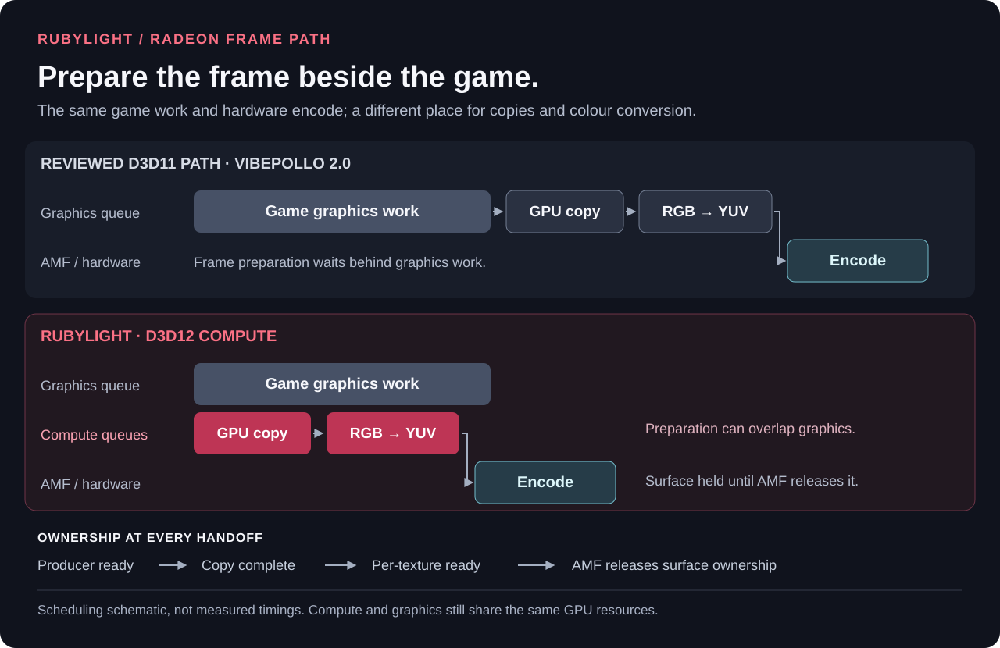

# How Rubylight works

[Docs](README.md) · [Configuration](configuration.md) · [Performance](performance.md) · [Developer guide](../rust/README.md)

Rubylight turns a Windows display into a Moonlight stream. Its Radeon path keeps captured pixels on the GPU, prepares them on D3D12 compute queues and passes them to AMD's native encoder. The host limits outstanding work so a busy encoder or network does not become a growing queue of old pictures.

This guide follows a frame from capture to delivery, then covers the process boundaries, colour paths and recovery that keep the stream running. [Performance](performance.md) separates measured host processing from the complete render-to-client journey.

## Written in Rust

The Windows host, Moonlight protocol implementation, native helpers, service and installer are written in Rust. The released executables do not link the old C++ host. The browser console uses Svelte; codec libraries, GPU SDKs and Windows drivers are external components.

| Component | Responsibility |
| --- | --- |
| [Core](../rust/core) | Pairing, encryption, RTSP/SDP, error correction, input parsing, permissions, configuration and durable state, and the encoder, pacing and display policies the host applies. Builds and is tested on any OS. |
| [Windows integration](../rust/windows) | Capture, colour conversion, native encoders, audio, input, displays, frame limiting and Windows service integration. |
| [Host](../rust/host) | HTTP/TLS, Moonlight endpoints, the console API, control and media transport, scheduling and session lifecycle. |
| [Setup](../rust/setup) | Installation, upgrades and package recovery. |
| [Web console](../rust/web) | Devices, games, settings, stream statistics, logs and maintenance. |
| [Vulkan layer](../rust/vulkan-layer) | Native HDR integration for Vulkan games. |

The earlier C++ host was removed after 2.0.0-rc.23; [that tag](https://github.com/RamazanKara/Rubylight/tree/2.0.0-rc.23) keeps its sources. The [Rust build](building.md) uses the workspace at the repository root.

## The Radeon frame path

For standard H.264, HEVC and AV1 streams on supported AMD GPUs:

| Stage | What happens | Source |
| --- | --- | --- |
| **Capture** | Every stream runs on a virtual display Rubylight created. Its display driver pushes each composed frame into textures shared with the host. Streams on the same virtual display share its one capture, and each converts and encodes it with its own settings. | [Capture backends](../rust/windows/src/capture.rs), [frame push](../rust/windows/src/capture/idd_push.rs) |
| **Take ownership** | The conversion reads the driver's texture in place; with `idd_push_zero_copy = false` a compute-queue copy first moves it into a texture the host owns. The capture frame stays alive until those reads finish. Consumers share the latest published frame. | [Frame publication](../rust/host/src/stream/capture.rs), [compute copies](../rust/windows/src/compute.rs) |
| **Prepare** | D3D12 compute converts RGB into the encoder's YUV format, including resizing and HDR conversion where required. | [Colour conversion](../rust/windows/src/compute.rs) |
| **Encode** | Native AMD AMF consumes the D3D12 surface and produces an H.264, HEVC or AV1 bitstream. | [AMF GPU integration](../rust/windows/src/amf/gpu.rs) |
| **Deliver** | The host packetizes encoded bytes, adds forward error correction and applies negotiated encryption, then sends them to Moonlight. | [Video sender](../rust/host/src/video_send.rs), [packet formats](../rust/core/src/packet.rs) |

The raw picture stays in GPU textures through preparation and encoding; compressed output returns to the CPU for transport. Moonlight receives, decodes and presents it on the client. Those client stages and network transit are separate from [host-processing time](performance.md#what-the-numbers-mean).

Before claiming another picture, the [stream loop](../rust/host/src/stream.rs) checks both the encoder and the conventional video sender. Native AMF learns its application backlog from completed pictures: a driver that drains each input can settle at one outstanding encode, while pre-analysis and drivers that retain inputs keep the depth they need. Startup permits four inputs without pre-analysis, or six with the configured one-frame lookahead; the existing eight-surface ownership cap and driver queue settings remain separate. If the driver's pre-analysis requirements cannot be read, the application keeps its previous limit of two.

After AMF demonstrates depth one, timed admission permits conversion of a second input near predicted output. A bounded startup drain probe lets a busy source demonstrate that depth without starving a driver that needs two inputs. The combined encoder/sender allowance stays at least two, so sending a packet can overlap the next encode. Larger AMF startup or lookahead requirements expand that combined allowance. Other encoders retain the existing two-picture budget; keyframes reserve additional sending capacity. Once work drains, the host takes the newest available picture. The [Radeon measurements and unresolved limits](../rust/PERFORMANCE_WORK.md#october-13-adaptive-amf-backlog-candidate) distinguish the saturated picture-age improvement from inconclusive normal-load tails.

The reviewed Sunshine-derived D3D11 path and Rubylight both use GPU textures and native AMF. Rubylight changes where frame preparation runs: compute work can overlap graphics work instead of joining the same graphics queue. The diagram illustrates scheduling; [measured timings](performance.md) come from separate fixtures. The reviewed baseline is Vibepollo 2.0.

Compute and graphics still share GPU resources. Copy/conversion efficiency helps the host's part of the frame journey; game rendering and desktop composition also determine when a fresh picture exists. [The saturation investigation](../rust/PERFORMANCE.md#saturation-diagnosis-and-queue-drain-rejection) records that distinction.

## Synchronization and ownership

The host's GPU work runs on D3D12 alone: one device per capture GPU, with compute queues for copies and conversion. No D3D11 device exists in the host process; a unit test rejects runtime code that names one, and debug builds log a `d3d11_audit` line at the end of every stream.

A captured texture can arrive before its producer has finished writing it. Every reader's queue waits on the GPU for the producer's fence: the display driver's written fence, or the fence of the host's own copy or upload. Resources rest in the COMMON state between command lists, so the driver's copy queue and the host's compute queues hand them over through fences alone. The captured frame stays alive until its last read has run. Each converted output texture has its own fence, so AMF's completion signal cannot release a different frame early.

Texture pools and native encoder queues are bounded. Texture ownership and per-frame HDR metadata survive until native codec references release them. A failure of the compute queue, AMF's D3D12 initialisation or the conversion is an error the stream recovers from or reports; there is no slower path to fall back to. The [compute implementation](../rust/windows/src/compute.rs) and [synchronization measurements](../rust/PERFORMANCE.md#october-4-capture-copies-and-conversion-beside-a-game) contain the details.

With `idd_push_zero_copy = false` the pool of copied capture textures holds at most eight. If consumers own them all, capture skips the copy instead of growing a queue; the driver keeps the newest picture, so the final update of a desktop that becomes static still arrives.

## Frames from Rubylight's display driver

Rubylight's virtual displays come from its own IddCx driver ([`rubylight-vdisplay`](../rust/drivers/rubylight-vdisplay)). For each monitor the driver drains the swap chain Windows composes into, which keeps the monitor live. When a stream captures that monitor, the host creates four shared textures, two shared fences and a one-page header on the capture GPU's D3D12 device and hands them to the driver ([the ring protocol](../rust/drivers/rubylight-vdisplay-proto/src/ring.rs)). A state word per texture in the header says who holds it, and only compare-and-swap changes it. Per frame the driver copies the surface into a texture the host is not reading (one the host freed and whose reads the *released* fence shows finished, or the oldest frame the host has not claimed), signals the *written* fence, records its present time and publishes it; with every texture held it drops the frame rather than wait, because Windows waits on the driver for the next frame. The host takes only the newest publish, so neither side builds a queue. The textures are D3D12 committed resources on the capture GPU's device, shared by NT handle; the driver opens them on its own D3D12 device and writes them on a copy queue. By default the compute conversion reads the texture in place: the compute queue waits for the written fence on the GPU and signals the released fence after the image's last read. With `idd_push_zero_copy = false` a compute queue of the host's waits for the written fence, copies the texture into a pool texture and signals the released fence after its copy. A driver without the fence ring, such as an update that runs only after Windows restarts, refuses streams: the console says to restart Windows.

The ring belongs to the monitor, not to the swap chain: when Windows replaces the swap chain (a GPU or colour-mode change), the new one continues the ring's frame sequence. The driver keeps the newest picture no ring holds and starts a new ring with it, so a reconnect to a still desktop, which Windows stops presenting, has a picture at once. A process registers one ring per monitor and clears only its own, so the host opens one capture per virtual display and fans its frames out to every stream on it. Each stream converts the shared frame to its own range: an SDR stream of an HDR display maps its scRGB to SDR white, and an HDR stream of an SDR display places its sRGB at SDR white in PQ. The display has one HDR state, which the first stream on it sets.

While Windows is locked, the stream's virtual display is set up, kept and restored from the lock screen's desktop, so you can stream the sign-in screen and unlock the PC remotely.

## Native HDR and full-resolution colour

The native HDR path captures FP16 scRGB, resizes in linear light and converts to ten-bit BT.2020/PQ. Shader math preserves absolute ST.2084 luminance. Windows HDR detection distinguishes an active HDR output from wide-gamut SDR colour management. [Independent decoding and reference-pixel checks](performance.md#hdr-and-pyrowave-validation) verify the tested pixel path.

Capture and HDR metadata share a cached description of the selected display. The cache checks the DXGI factory at most once per second and resolves the same output from a fresh factory when Windows invalidates it. Matching uses the display's owning adapter and monitor identity, independently of the encoder's GPU. An SDR/HDR colour-space change reopens the capture; a luminance-only change updates metadata without a capture restart. A missing output is never replaced by another monitor's description. This refresh is available in [2.2.17](../rust/RELEASE_NOTES.md#new-in-2217); live transition measurements remain pending.

HDR mastering and content-light metadata use each codec's bitstream units. Encoded metadata changes request a keyframe, retained until the encoder accepts input. AMF tracks accepted properties and retries transient metadata failures with bounded backoff. After initialization, an observed AMF output-range mismatch fails encoder creation; drivers with unavailable range properties retain the documented limited-range default.

**PyroWave provides full 10-bit HDR 4:4:4** through a separate encoder and a shared D3D12/Vulkan path. D3D12 compute writes its three planar textures, D3D12 resources that Vulkan imports; one shared D3D12 fence, a timeline semaphore on the Vulkan side, orders conversion and Vulkan access, and the encoded bitstream returns to the CPU. The [PyroWave integration](../rust/windows/src/pyrowave.rs) owns this handoff independently of AMF.

Full-resolution chroma gives each pixel its own colour samples. Use [Nightjar](https://github.com/RamazanKara/nightjar), an Android client with PyroWave support, or on a PC [Nonary's compatible Moonlight client](https://github.com/Nonary/moonlight-qt), over a fast local network; [client selection](getting-started.md#choose-your-stream-format) explains the options.

## Session, audio and input

Pairing, app discovery and launch requests enter through the [Moonlight HTTP endpoints](../rust/host/src/nvhttp.rs). An authorized launch lets the [RTSP server](../rust/host/src/rtsp_server.rs) negotiate stream settings; the [stream host](../rust/host/src/stream.rs) then manages display preparation, capture, encoding and media workers. The browser console has a separate [administration API](api.md).

Audio uses [WASAPI loopback capture and Opus encoding](../rust/windows/src/audio.rs) on its own worker. Client input follows the control path back to Windows. [Virtual controllers have a separate worker](../rust/windows/src/input/gamepad_thread.rs), so a blocking controller-driver call does not hold up keyboard, mouse or touch input. [Control messages](control-messages.md) and [microphone transport](microphone.md) describe Rubylight's client extensions.

## Recovery and updates

An encoder that returns no frame is recreated with the same encoder settings after 250 ms, then 500 ms, 1 s and 2 s; the session ends after 20 s without output. A session that hears nothing from its client for the ping timeout (10 s by default) ends as a disconnect does.

A GPU device loss triggers a broader rebuild: capture consumers first release their encoders, images and filters, then capture and encoding restart together. This has a separate [30-second recovery deadline](../rust/host/src/stream/device_recovery.rs); repeated failures do not extend it. If the GPU stays unavailable, the stream ends while the host console remains available.

Display recovery journals host-owned changes and preserves later user changes. Virtual-display startup uses a short guard for unexpectedly reactivated displays, ending after startup or an observed competing layout change.

Updates notify first. The installed service verifies the official installer, waits for an idle host (or, on **Install now**, ends the stream) and upgrades with package recovery for copying or startup failures. See [configuration](configuration.md) for the update controls and [getting started](getting-started.md) for installation and migration.
