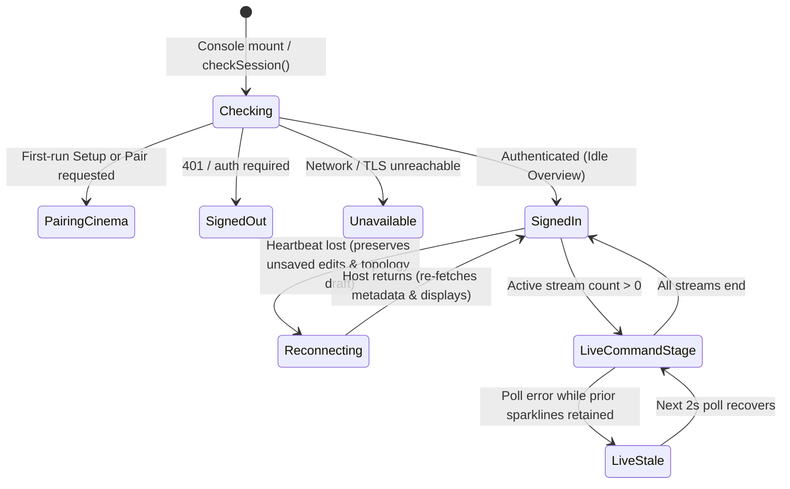

# Design 01: Rubylight 7.0 — Ground-Up Console-Quality Redesign (Wave 0)

Status: design specification (Phase 0). Rebased 2026-11-25 onto post-refactoring `origin/main` `955ef39598` (`v6.4.1`) and [`00-protocol-reservations.md`](00-protocol-reservations.md).

## 1. Summary & User Experience

Rubylight 7.0 replaces the legacy gray-panel host admin interface (`rust/web/DESIGN.md` 3.0) with a **ground-up, console-quality visual architecture ("Obsidian Studio")** across **every single user-facing host surface**: the Svelte Web Console (`rust/web/`), the Browser `/play` & `/guest` WebRTC apps (`rust/web/src/play/`, `rust/web/src/guest/`), the Host-Drawn Couch Menu (`rust/core/session/src/couch_menu_model/`, `rust/windows/graphics/src/compute_menu.rs`), the Windows Installer (`rust/setup/`, package `butterpollo-setup`), the Windows System Tray & Notifications (`rust/windows/io/src/tray.rs`, `rust/windows/io/src/tray/status.rs`), and the scriptless Rust HTML fallback console (`rust/host/web/src/console/`).

Designed from scratch as the flagship host sibling to Nightjar 7.0's Obsidian Cinema language (PlayStation 5 × Apple tvOS × SteamOS OLED × studio-hardware precision), Rubylight 7.0 requires **zero wire-protocol changes**, adds **zero latency to any streaming path**, and introduces **zero new host settings**.

### 1.1 Ground-Up 7.0 Visual Identity & Token Architecture (`rust/web/`)

Rubylight 7.0 is completely unshackled from the old `rust/web/DESIGN.md` gray-panel palette and layout. It rewrites `rust/web/DESIGN.md`, `rust/web/src/styles/tokens.css`, `rust/web/Tokens.test.mjs`, `rust/web/Design.browser.cjs`, and the `/design.html` component gallery (`rust/web/src/design/Gallery.svelte`) from the ground up:

- **Obsidian Studio (Dark) + Alabaster Mineral (Light) + System parity:**
  - **4-tier spatial surface grammar** (`--bg` stage, `--panel` deck, `--panel-raised` floating card/modal, `--sunken` recessed well) with crisp 1 px top-lit specular borders (`--line`, `--line-strong`) in dark mode instead of muddy shadows, and refined warm-neutral mineral planes in light mode:
    - **Dark / System-Dark:** `--bg: #090A0D`, `--panel: #111319`, `--panel-raised: #181B24`, `--sunken: #0E1015`, `--ink: #F5F7FA`, `--ink-2: #C8CEDB`, `--muted: #9AA3B5`, `--line: #232836`, `--line-strong: #363E52`, `--accent: #CE1E49` (`--accent-strong: #AB153B`, `--accent-ink: #FFFFFF`, `--accent-soft: #2F141E`, `--accent-text: #FF7596`), `--focus: #59B0FF`, `--ok` / `--live: #45E0A0` (`--ok-soft: #0F291E`), `--warn: #F5B041` (`--warn-soft: #2D200C`), `--danger: #FF7070` (`--danger-soft: #331416`).
    - **Light:** `--bg: #F3F4F7`, `--panel: #FFFFFF`, `--panel-raised: #FFFFFF`, `--sunken: #E8EBF0`, `--ink: #111318`, `--ink-2: #383E4A`, `--muted: #596170`, `--line: #D8DCE4`, `--line-strong: #AEB5C2`, `--accent: #C81942` (`--accent-strong: #A11033`, `--accent-ink: #FFFFFF`, `--accent-soft: #FDE7ED`, `--accent-text: #B5153B`), `--focus: #0E66D4`, `--ok` / `--live: #106E3A` (`--ok-soft: #E1F5EA`), `--warn: #8F5000` (`--warn-soft: #FDF0DB`), `--danger: #BD2428` (`--danger-soft: #FCE7E8`).
    - **Media stage (dark in both themes over game artwork & video):** `--media-bg: #0B0D12`, `--media-ink: #F5F7FA`, `--media-ink-2: #CBD2DE`, `--media-idle: #9BA4B5`, `--media-ok: #45E0A0`, `--media-warn: #F5B041`.
    - **Fixed BrandMark only:** `--brand: #C41242`, `--brand-ink: #FFFFFF` (reserved strictly for the app icon / `BrandMark`, never reused as an action fill).
  - Every text/surface pair is mathematically proven **`>= 4.5:1`** and every focus ring / UI control boundary **`>= 3.0:1`** in both Light and Dark themes (`Tokens.test.mjs`), with exact dark/system-dark identity.
- **Bespoke Typography & Tabular Telemetry:** Crisp studio display & UI scale (`--text-xs: 13px` through `--text-2xl: 40px` + `--text-hero: 48px` display telemetry, tight `-0.025em` display tracking, `--mono` tabular-num telemetry `.num` for ms, Mbps, Hz, and monitor coordinates) with zero external CDN requests.
- **Zero raw CSS literals outside `tokens.css`:** New static linter `rust/web/RawCssValues.test.mjs` rejects raw hex/rgb/oklch colors, raw shadows, raw radii, raw z-index, and raw durations across every `.css` and `.svelte` file outside `tokens.css`.
- **Clean Settings Home & Folded Advanced Groups:** Keeps `MAIN_BUDGET = 12` on `SettingsHome.svelte` across `pc`, `picture`, `sound`, and `games`, extracts `SettingsSectionBar.svelte` and tokenized status pills (`DisclosureMeta.svelte`: `N settings`, `M customized`, `K unsaved`) so grandfathered `Settings.svelte` shrinks below its ratchet ceiling while deep links (`?setting=<key>`, `#<anchor>`) and unsaved folds still auto-open cleanly.

### 1.2 Five Redesigned Console Flagship Experiences (`rust/web/`)

1. **Cinematic Live-Stream Command Stage (`Overview.svelte` & `Sessions.svelte`):**
   - Replaces the legacy fragmented hero + disconnected stream panel with a unified, full-bleed cover-lit **Live Command Stage** (`LiveCommandStage.svelte`) rendered consistently on both Home and Sessions whenever a stream is active:
     - **Cover-Lit Media Backdrop:** Full-bleed game artwork behind a luminance-clamped dark obsidian wash (`--media-bg`) with crisp game title, client device badge, resolution/refresh/HDR/codec pills, and plain-English capture backend ("Direct driver push", "Windows Graphics Capture", "Desktop Duplication").
     - **Live Pipeline Stage Timeline (`PipelineTimeline.svelte`):** Proportional horizontal stage meter displaying live per-stage milliseconds (`Capture → Convert → Encode → Pace/Send`) when telemetry is reported (cleanly collapsing optional segments when absent, never fabricating values).
     - **Real-Time Telemetry Sparklines (`TelemetrySparklines.svelte`):** Synchronized crisp SVG sparklines with tabular readouts for **Bitrate (Mbps)**, **Frame Time (p50 / p99 ms)**, and **Network Jitter / RTT (ms)**, reflowing cleanly into a 2-column grid at 390 px mobile width with zero horizontal overflow.
     - **Instant Session Controls (`>= 44×44 px`):** Calm, outcome-labelled action deck — **Stream details**, **Copy diagnostics**, **Disconnect** (confirmation dialog), and **Quit game** (sole danger control) — plus per-stream rows below when multiple concurrent/guest streams are active.
     - **Stream Doctor Health Banner:** Live status banner directly integrated into the stage header (`Healthy`, `Attention`, or `Action needed`) surfacing plain-English cause + one-click navigation/action slot ready for Wave 2 Item 11 (`stream.doctor_v2`).

2. **Display Map (`DisplayTopologyCanvas.svelte`), read-only in 7.0:**
   - **7.0 ships the map read-only: no drag arranging, no keyboard arranging and nothing saved from it.** Arranging displays stays in Windows' display settings, and the map says so under it. An arranging canvas (pointer drag with edge snapping, its keyboard and screen-reader form, and saving through the display arrangement code under its recovery journal) is not part of 7.0; it needs its own design and a hardware pass.
   - A spatial map of **physical monitors + Rubylight virtual displays (`rubylight-vdisplay`)** on Troubleshoot and in each device's Display overrides:
     - Draws each display to scale where Windows puts it, numbered, with a list beside it that carries **Resolution & Refresh (`3840×2160 · 120 Hz`)**, **DPI Scale (`150%`)**, the **HDR** badge, **Primary ★**, the **Virtual / Physical** tag, relative placement ("Left of ...") and the display a device streams.
     - The list is the accessible form; the drawing is `aria-hidden`. A host that reports no places gets a row of equal tiles and a note.
     - Reads `/api/display-devices` only. It calls no arrangement or config endpoint and never touches `RecoveryJournalV2` (`recovery-journal.json`).

3. **Cover-Lit Per-Game Studio (`Library.svelte`, `AppEditor.svelte`, `GameStudioHeader.svelte`, `OverrideCascadeCards.svelte`):**
   - Full-bleed cover-lit app header showcasing high-res box art, ambient color wash, launcher badge, quick **Edit cover**, **Launch / Test**, and effective stream profile badges.
   - **Visual Device-Override Cascade Cards (`OverrideCascadeCards.svelte`):** Replaces confusing nested dropdown tables with clear visual profile cards illustrating the exact 4-layer precedence chain **`App × Device → App → Device → Host`** across Resolution, Refresh, HDR, Bitrate, Encoder/Driver profile, and Virtual Display — showing which layer currently owns each setting (`Inherited from Host`, `From Device`, `App override`, `Custom for this device`) with a single-click **Reset to inherited** pill.

4. **Guided QR Onboarding & Pairing Cinema (`PairingCinema.svelte`, `QrPairing.svelte`, `Setup.svelte`):**
   - Transforms first-run setup and device pairing into a guided, calm studio cinema flow:
     - Step 1: High-contrast scannable **QR code** (calibrated for dark and light console themes with quiet-zone framing) paired side-by-side with a crisp 4-digit **PIN** entry slot.
     - Step 2: Live device arrival preview with clear **Permission Tier Cards** (Play & Control / Play Only / View Only).
     - Step 3: Instant connected confirmation showing the paired device card ready to stream — zero raw IP/port walls dumped on first-time users.

5. **Upgraded `Ctrl+K` / `⌘K` Command Palette (`QuickSwitcher.svelte` + `quick-switch-70.ts`):**
   - Studio spotlight dialog accessible from anywhere via `Ctrl+K` (`⌘K` on macOS) or the top navigation search pill:
     - Live grouped instant jump across **Apps** (with mini cover thumbnails), **Devices** (with live status dots), **Settings** (searchable by plain-English name, outcome, or config key), **Diagnostics** (Stream Doctor, Live Logs, Driver Health), and **Host Actions** (Pair a device, Stop streams, Restore displays, Restart host, Toggle Light/Dark theme).
     - Inline keyboard legend (`↑↓` move, `Enter` open/run, `Esc` close) with strict focus trapping and focus return to opener.

### 1.3 Browser `/play` & `/guest` Console-Quality Redesign (`rust/web/src/play/`, `rust/web/src/guest/`)

- **`/play` (`Play.svelte` + `PlayDock.svelte` + `PlayStatsCapsule.svelte` + `PlayGlyphBar.svelte`):**
  - Complete console-grade redesign sharing Rubylight 7.0 / Nightjar 7.0 obsidian cinema styling — zero legacy browser chrome clutter:
    - Sleek full-bleed **PIN Pairing Cinema** card on first visit and cover-lit **Console Library Grid** navigable by TV remote, gamepad, keyboard, or pointer.
    - **Floating Blur-Free Play Dock (`PlayDock.svelte`):** Completely hidden during active play; summoned by holding Select/Back, pressing `Esc`, or hovering the top handle. Uses solid/tinted `--media-bg` studio deck surfaces (**zero `backdrop-filter` blur over live `<video>`** to prevent WebRTC compositor stalls on TV/embedded browsers) with Full Screen, Audio/Mute, Picture/Codec switcher, Stats toggle, Disconnect, and Quit game controls.
    - **Crisp Live Stats Capsule (`PlayStatsCapsule.svelte`):** Compact tabular-num corner readout (FPS, Bitrate, RTT, Codec) using opaque/tinted media tokens, blur 0.
    - **Dynamic Input Glyph Bar (`PlayGlyphBar.svelte`):** Switches live on the latest `Gamepad` / `KeyboardEvent` / remote input (`A`/`Y` or Sony `×`/`△`, `Enter`/`F`, `OK`/`Hold OK`); shows **zero hints** when using touch or mouse.
- **`/guest` (`Guest.svelte` + `GuestJoinCard.svelte`):**
  - Frictionless **Guest Join Card** centered on an obsidian studio stage: instant nickname input, clear visual permission badge (`View Only`, `Controller`, `Controller + Keyboard & Mouse`), calm waiting-for-host state respecting `prefers-reduced-motion`, and an auto-hiding floating stream bar (Full Screen, Mute, Leave) with zero persistent chrome clutter over video.

### 1.4 Host-Drawn Couch Menu 7.0 Upgrade (`rust/core/session/src/couch_menu_model/` + `rust/windows/`)

- Ground-up visual redesign of the L3+R3 GPU/overlay-drawn Couch Menu for stock Moonlight clients:
  - Retires the legacy harsh 1-bit monochrome box (`PANEL [0x17,0x17,0x1c]` + magenta `[0xe0,0x11,0x5f]` solid border) in favor of **crisp 7.0 Studio Console Cards** (`theme_70.rs` + `widgets.rs` + upgraded `render.rs` & `layout.rs`):
    - Rounded obsidian studio container (`#0D0F14`) with inner elevated row cards (`#161922`), subtle hairline border (`#2B3140`), luminous ruby focus frame (`#CE1E49` with `#FFFFFF` crisp text at `5.38:1` contrast and smooth focus-highlight interpolation while open), clean typographic hierarchy (bold header strip with Rubylight badge, section labels, anti-aliased pre-baked alpha/SDF Latin-1 glyph atlas), and **visual inline sliders & pill toggles** for Radeon, Audio, Encoder Focus, and Sleep controls.
  - **Hard zero-latency-when-closed invariant:** `rust/windows/graphics/src/compute_menu.rs` records **zero** GPU passes, **zero** texture uploads, and **zero** shader dispatches whenever `overlay.is_none()`. Focus interpolation ticks ONLY while the menu is open and uploads only dirty frames into the existing 3-texture ring.

### 1.5 Windows Installer 7.0 (`rust/setup/`, package `butterpollo-setup`)

- Complete modern visual redesign matching Rubylight 7.0 tokens via the single canonical **`rust/setup/src/ui_theme.rs`** (created here in Wave 0 Item 01 and consumed/extended by Wave 4 Item 17; **zero `wizard_theme.rs`**):
  - Native Per-Monitor-V2 DPI-aware Win32 Common Controls 6 dialogs (zero WebView2 dependency), automatic dark titlebar via best-effort `DWMWA_USE_IMMERSIVE_DARK_MODE` (cleanly ignored on older Windows 10 builds), embedded Rubylight 7.0 ruby brand mark replacing generic `TD_SHIELD_ICON` on non-elevation dialogs, and outcome-first button copy ("Install Rubylight", "Keep existing host", "Cancel").
- **Instant QR Pairing Finish Screen (`rust/setup/src/finish_qr.rs`):**
  - On interactive install completion (skipped under `--quiet` / headless / CI modes), queries the freshly started local host pairing state and renders a crisp, scannable high-contrast **QR code + 4-digit pairing PIN** directly inside the final installer dialog alongside **Open Rubylight Console** and **Done**, allowing users to pair Nightjar on their phone or TV immediately after install. Degrades gracefully with a direct **Open Rubylight Console** action if service startup is deferred.

### 1.6 Windows System Tray & Notifications (`rust/windows/io/src/tray/status.rs`)

- Creates the single canonical **`rust/windows/io/src/tray/status.rs`** (extended in Wave 4 Item 17 with `rubylight-vgamepad` driver-repair UI):
  - Crisp 16 / 24 / 32 / 48 px DPI-aware Rubylight brand icons composited with exact 7.0 token status badges (`Idle` ruby `#C41242`, `Streaming` emerald `#45E0A0`, `Paused / Attention` amber `#F5B041`, `Error` coral `#FF7070`) framed by a 1 px contrast ring legible on both light and dark Windows 10/11 taskbars.
  - Clean status-first context menu (active game & client header line, **Open Rubylight**, **Pair a device**, **Enter PIN**, **Stop streams**, **Quit running game**, **Restore displays**, **Restart Rubylight**) and non-intrusive plain-English Windows toast notifications (`rust/windows/io/src/tray/notifications.rs`) matching 7.0 console copy.

### 1.7 Scriptless HTML Console Parity (`rust/host/web/src/console/`)

- Synchronizes `rust/host/web/src/console/style.css` 1:1 with the new Rubylight 7.0 `tokens.css` Light, Dark, and System palettes (verified automatically by `rust/host/web/src/console/theme.rs` unit test and `Tokens.test.mjs`), enforces `>= 44×44 px` hit targets, guarantees `0 px` horizontal overflow at 390 px, brings no-script live stream status in line with the 7.0 telemetry strip, and scrubs mod names (`Nucleus Co-op` / `ANR`) from `rust/host/web/src/console/settings.rs` (lines 264 and 306).

---

## 2. Protocol, Native API & Capability Contract

Per [`00-protocol-reservations.md`](00-protocol-reservations.md) §7, Wave 0 Item 01 requires **zero wire, protocol, or Native API changes**:

| Surface | Contract |
| --- | --- |
| `PROTOCOL_VERSION` | **Unchanged.** Stock Moonlight and older Nightjar builds negotiate and stream byte-for-byte identically. |
| Control-stream IDs (`client/protocol/core/src/ids.rs`) | **None added.** |
| `/serverinfo` & RTSP `DESCRIBE` / `ANNOUNCE` | **Unchanged.** |
| `rubylight_native_api::API_VERSION` | **Unchanged (`1`).** Zero new `/api/native/v1` routes or feature strings; existing `ErrorBody { error: ApiError { code, message, setting, retry_after_ms } }` envelope remains intact (extended optionally inside `ApiError` in Wave 4 Item 17). |
| Nightjar `HostCapabilities::Feature` | **Unchanged.** |
| Console HTTP API (`rust/host/web/src/web.rs`) | Reuses existing authenticated JSON endpoints (`/api/metadata`, `/api/rtsp/sessions`, `/api/session/status`, `/api/config`, `/api/apps`, `/api/clients`, `/api/power/status`, `/api/coop/sessions`, `/api/session/guests`, `/api/pair/pin`, `/api/pair/qr`). Optional telemetry fields (per-stage pipeline ms, `host_p99_ms`, jitter, Stream Doctor summary) degrade cleanly when omitted. |
| WebRTC `/play` & `/guest` signalling | **Unchanged.** Pure UI presentation & interaction upgrade over existing `PlayStream` and `GuestStream` protocols (`rust/web/src/lib/webrtc/`). |
| Cross-surface 7.0 token contract | `rust/web/src/styles/tokens.css` is the single source of truth for Rubylight host surfaces. `rust/host/web/src/console/style.css`, `rust/core/session/src/couch_menu_model/theme_70.rs`, `rust/windows/io/src/tray/status.rs`, and `rust/setup/src/ui_theme.rs` mirror its exact 7.0 hex values (asserted by `Tokens.test.mjs`, `RawCssValues.test.mjs`, and Rust unit tests in `console/theme.rs`, `couch_menu/theme_70.rs`, and `tray/status.rs`). |

---

## 3. Architecture & <=800-LOC Module Plan

All new modules comply with `tools/arch_check.py`: `<= 800` LOC ceiling and mandatory `//!` Rust module headers. Every path below carries `docs/code-map.md` for Phase 2 verification.

### 3.1 Grandfathered Files in `tools/size_ratchet.json` (STRICT CEILING PROTECTION)

| Existing File | `size_ratchet.json` Ceiling | Strategy to Avoid Growth |
| --- | ---: | --- |
| `rust/web/src/pages/Settings.svelte` | **1208** LOC | Extract sticky section jump bar into `SettingsSectionBar.svelte` (~170 LOC) and disclosure status pills into `DisclosureMeta.svelte` (~65 LOC). Net LOC decreases below 1100. |
| `rust/web/src/components/devices/DeviceEditor.svelte` | **950** LOC | Mount `DisplayTopologyCanvas.svelte` via a single component tag; swap raw CSS literals to tokens. Net LOC `<= 950`. |
| `rust/web/src/components/settings/SettingControl.svelte` | **865** LOC | Tokenize CSS literals only; 0 net LOC growth. |
| `rust/web/src/lib/api.ts` | **1653** LOC | Untouched; existing `StreamSession`, `HostMetadata`, `DisplayInfo`, and `App` types suffice. |
| `rust/web/src/lib/schema/basics.ts` | **1530** LOC | Untouched unless copy audit scrubs a string (0 net growth). |
| `rust/web/src/lib/schema/video.ts` | **1461** LOC | Untouched in Wave 0. |
| `rust/host/web/src/console/pages.rs` | **1141** LOC | Place no-script 7.0 live-telemetry strip renderer in new `rust/host/web/src/console/theme.rs` (~180 LOC); `pages.rs` stays `<= 1141`. |
| `rust/host/web/src/web.rs` | **1731** LOC | Untouched. |
| `rust/windows/display/src/display_arrangement.rs` | **2489** LOC | Untouched; topology canvas consumes existing layout JSON contract. |
| `rust/windows/io/src/tray.rs` | **827** LOC | Extract RGBA icon/badge compositing into canonical `rust/windows/io/src/tray/status.rs` (~170 LOC, extended in Wave 4 Item 17) and toast helpers into `rust/windows/io/src/tray/notifications.rs` (~120 LOC), shrinking `tray.rs` below 780 LOC. |
| `rust/setup/src/install.rs` | **2226** LOC | Delegate finish-screen QR prompt via a 4-line call to `finish_qr::show_if_interactive(...)`, offset by moving existing finish prompt strings into `finish_qr.rs`; net LOC `<= 2226`. |

### 3.2 Full Module Plan (Every New File `<= 800` LOC)

| Path | Status | Est. LOC | Ownership |
| --- | --- | ---: | --- |
| `rust/web/DESIGN.md` | Rewrite | ~180 | Ground-up Rubylight 7.0 Obsidian Studio visual spec (palette, surface tiers, typography, Live Stage, Topology, Per-Game Studio, `/play`, `/guest`, Couch Menu, Setup, Tray). |
| `rust/web/design.html` & `rust/web/src/design/Gallery.svelte` | Modify | ~320 | Upgraded 7.0 interactive component & token gallery showcasing Light/Dark/Media stages, Sparklines, Topology mini-preview, Override Cascade cards, and reduced-motion states. |
| `rust/web/src/styles/tokens.css` | Rewrite | ~240 | Brand-new 7.0 Obsidian Studio & Alabaster Mineral token architecture (Light, Dark, System-Dark, Media, typography, spacing, radii, shadows, motion). |
| `rust/web/src/styles/base.css` & `forms.css` | Modify | ~170 / ~180 | 7.0 spatial layout grammar, logical RTL properties (`padding-inline`/`margin-inline`), zero raw literals. |
| `rust/web/src/App.svelte` | Modify | ~670 | 7.0 Studio shell navigation rail + top command bar (`Ctrl+K` trigger pill, live session badge, theme switcher), zero raw CSS literals, 44×44 touch targets at 390 px. |
| `rust/web/Tokens.test.mjs` & `RawCssValues.test.mjs` | Modify / New | ~150 / ~140 | Proves every 7.0 text pair `>= 4.5:1`, UI/focus pair `>= 3.0:1`, dark === system-dark, reduced motion === `0ms`, and zero raw CSS values outside `tokens.css`. |
| `rust/web/Design.browser.cjs` | Modify | ~180 | Playwright verification of 7.0 gallery, 44×44 hit targets, 390 px no-overflow, keyboard navigation, focus restore, disabled wells, and reduced motion. |
| `rust/web/src/components/overview/LiveCommandStage.svelte` | New | ~260 | Full-bleed cover-lit Live-Stream Command Stage shared by `Overview.svelte` and `Sessions.svelte`, including Stream Doctor health banner and instant session controls. |
| `rust/web/src/components/overview/PipelineTimeline.svelte` | New | ~140 | Proportional `Capture → Convert → Encode → Pace/Send` stage timeline bar with graceful omission of absent stages. |
| `rust/web/src/components/overview/TelemetrySparklines.svelte` | New | ~180 | Real-time bitrate, frame-time (p50/p99), and jitter SVG sparklines with tabular-num headers. |
| `rust/web/src/components/overview/studio-telemetry.ts` | New | ~140 | Pure telemetry formatting, stale detection, capture backend labels, and Stream Doctor summary mapping. |
| `rust/web/src/pages/Overview.svelte` & `Sessions.svelte` | Modify | ~460 / ~340 | Adopt `LiveCommandStage.svelte`; 390 px responsive grid; zero raw literals. |
| `rust/web/src/components/devices/PairingCinema.svelte` | New | ~240 | Guided QR Onboarding & Pairing Cinema (high-contrast QR, live 4-digit PIN, permission tier cards, connected celebration). |
| `rust/web/src/components/devices/QrPairing.svelte` & `pages/Setup.svelte` | Modify | ~190 / ~280 | Wire `PairingCinema.svelte` into first-run Setup and Devices pairing flow. |
| `rust/web/src/components/QuickSwitcher.svelte` & `lib/quick-switch-70.ts` | Modify / New | ~390 / ~190 | Upgraded `Ctrl+K` / `⌘K` Command Palette covering Apps (with covers), Devices, Settings, Diagnostics, and Host Actions. |
| `rust/web/src/components/devices/DisplayTopologyCanvas.svelte` | New | ~340 | Read-only display map in 7.0 (no drag arranging): physical + virtual displays to scale where Windows puts them, with a list that carries mode, scale, HDR, Primary and Virtual/Physical. |
| `rust/web/src/components/devices/display-topology.ts` | New | ~220 | Pure coordinate geometry for the read-only map: scaling to the canvas, the fallback row and the relative-position text. No snap solver in 7.0. |
| `rust/web/src/components/library/GameStudioHeader.svelte` | New | ~190 | Full-bleed cover-lit per-game studio header with ambient wash, launcher badge, and quick actions. |
| `rust/web/src/components/library/OverrideCascadeCards.svelte` | New | ~240 | Visual `App × Device → App → Device → Host` inheritance cards with layer ownership tags and one-click Reset to inherited. |
| `rust/web/src/components/library/AppEditor.svelte`, `DeviceOverrides.svelte`, `pages/Library.svelte` | Modify | ~560 / ~240 / ~260 | Integrate Cover-Lit Per-Game Studio header and Override Cascade Cards; zero raw CSS literals. |
| `rust/web/src/components/settings/SettingsSectionBar.svelte` & `DisclosureMeta.svelte` | New | ~170 / ~65 | Extracted sticky jump bar + tokenized count/customized/unsaved status pills. |
| `rust/web/src/pages/SettingsHome.svelte` & `Settings.svelte` | Modify | ~520 / ~1080 | 7.0 tokens, `MAIN_BUDGET = 12` preserved, `Settings.svelte` shrinks below 1208 ceiling. |
| `rust/web/src/play/Play.svelte`, `PlayDock.svelte`, `PlayStatsCapsule.svelte`, `PlayGlyphBar.svelte`, `play-input-source.ts` | Modify / New | ~560 / ~190 / ~120 / ~140 / ~130 | Complete `/play` console-quality redesign: cover-lit library, blur-free floating dock, tabular stats capsule, dynamic controller/keyboard/remote glyphs (none on touch/mouse). |
| `rust/web/src/guest/Guest.svelte` & `GuestJoinCard.svelte` | Modify / New | ~310 / ~170 | Frictionless obsidian studio Guest Join Card, permission pills, calm waiting state, minimal auto-hiding stream bar. |
| `rust/core/session/src/couch_menu_model/theme_70.rs` & `widgets.rs` | New | ~140 / ~280 | `//!` 7.0 Obsidian Studio palette constants, rounded card primitives, focus frame interpolation, inline visual sliders, and pill toggles. |
| `rust/core/session/src/couch_menu_model/render.rs`, `layout.rs`, `font.rs`, `mod.rs` | Modify | ~340 / ~270 / ~260 / ~160 | Anti-aliased pre-baked alpha/SDF Latin-1 glyph atlas + 7.0 studio card renderer with updated deterministic golden hashes. |
| `rust/windows/graphics/src/compute_menu.rs` & `overlay.rs` | Modify | ~480 / ~260 | Support alpha-blended anti-aliased rounded menu cards in the compute shader ONLY while open; hard assertion of 0 GPU passes when closed. |
| `rust/host/web/src/console/style.css`, `theme.rs`, `settings.rs`, `pages.rs`, `mod.rs` | Modify / New | ~160 / ~180 / ~710 / ~1135 / ~180 | 1:1 7.0 token parity + automated Rust contrast/parity check against `tokens.css`; scrub mod names from `settings.rs` lines 264 & 306. |
| `rust/assets/locale/*.json` (all 22 host locales) | Modify | ~existing | Translate every new/revised console, `/play`, `/guest`, Couch Menu, installer, and tray label across all 22 host locales. |
| `rust/windows/io/src/tray/status.rs` & `notifications.rs` | New | ~170 / ~120 | `//!` Canonical tray status module (created here in 01, extended in Wave 4 Item 17 with `rubylight-vgamepad` repair UI) + plain-English toast helper. |
| `rust/windows/io/src/tray.rs` | Modify | ~760 (<827) | Delegates icon compositing to `tray/status.rs` and notifications to `tray/notifications.rs`; aligns menu copy with 7.0 spec. |
| `rust/setup/src/ui_theme.rs` & `finish_qr.rs` | New | ~160 / ~240 | `//!` Canonical setup theme module (created here in 01, consumed/extended in Wave 4 Item 17; zero `wizard_theme.rs`) + Instant QR Pairing Finish Screen. |
| `rust/setup/src/ui.rs` | Modify | ~410 | Wires `ui_theme` dark/light chrome, Per-Monitor-V2 DPI, ruby brand icon, and `finish_qr` into installer lifecycle. |

---

## 4. State Machine, Reconnect Matrix & Crash-Restore Journal

### 4.1 Console Live Command Stage, `/play` Dock & Couch Menu Lifecycle

### 4.2 Edge-Case & Reconnect Matrix

| Scenario | Expected Behaviour |
| --- | --- |
| **Host restarts after saving settings or topology** | `App.svelte` enters `reconnecting` overlay (`inert` on shell), preserves unsaved draft state, polls heartbeat every 3 s, and reloads `/api/metadata` + `/api/config` cleanly with monotonic `latestLoad` ordering (zero stale-poll overwrite). |
| **Network drop while viewing Live Command Stage** | Retains last valid sparklines and pipeline bars, shows quiet amber `Stale` pill ("Showing last known figures") + danger banner with **Retry**; never wipes active **Disconnect** / **Quit game** controls. |
| **Display map and arranging** | Cannot happen in 7.0: the map is read-only and saves nothing, so it cannot create an overlap or a detached display. Arranging stays in Windows' display settings. |
| **Browser `/play` active stream vs Play Dock** | While streaming with dock closed: zero overlay blur, full pointer/gamepad passthrough, stats capsule uses blur-0 tinted fill. Opening dock pauses pointer capture cleanly; closing restores video focus immediately. |
| **Browser `/guest` link expired or host not streaming** | `GuestJoinCard.svelte` shows clear plain-English status ("Waiting for host to start a game…" or "This invite link has expired") with zero raw WebRTC/SDP errors; auto-polls cleanly while waiting and releases media tracks on `pagehide`. |
| **Couch Menu closed vs open during 4K120 stream** | Closed (`overlay.is_none()`): `compute_menu.rs` executes **0** shader dispatches and **0** texture copies (exact zero overhead). Open: interpolates focus frame only while open; closes instantaneously on L3+R3 or B/Esc and releases active overlay reference. |
| **Installer Instant QR screen on `--quiet` or deferred service start** | `--quiet` / unattended runs skip `finish_qr.rs` completely (exit 0 without blocking). If interactive and local host pairing endpoint is not yet ready after a bounded 3 s wait, `finish_qr.rs` falls back gracefully to **Open Rubylight Console** + **Done** without hanging setup. |
| **Windows Explorer restarts (System Tray)** | `tray.rs` handles `TaskbarCreated`, re-composites the current DPI-appropriate 7.0 status badge via `tray/status.rs`, and re-registers the icon without interrupting active streams. |
| **OS Light ↔ Dark theme change at runtime** | Under `data-theme="system"`, SPA (`tokens.css`), scriptless console (`console/style.css`), `/design.html`, and tray badge contrast rings adapt immediately; dark block equals system-dark block verbatim. |

### 4.3 Crash-Restore Journal Alignment

Wave 0 Item 01 mutates zero display, audio, driver, or process state directly at runtime:
- All host settings saved from the console (the read-only display map saves nothing) flow strictly through `rust/host/web/src/web/config.rs::save_setting` (validation + atomic temp-file rename), never partially truncating `sunshine.conf`.
- Runtime display/DPI switches triggered during subsequent streams continue to be protected by the single canonical **`RecoveryJournalV2`** (`rust/core/session/src/recovery_journal.rs`, persisted atomically to `recovery-journal.json` with the `--recover-session` service hook unified across Items 08 and 17).
- `rust/setup/` preserves its transactional install/uninstall rollback unchanged; `finish_qr.rs` is strictly read-only after install commit completes.

---

## 5. Settings & 10/10 Craft Plan

- **Fewer-settings rule:** **Zero** new host config keys and zero new Settings Home rows (`MAIN_BUDGET` remains 12). Console theme (`system` / `light` / `dark`), Command Palette MRU, and `/play` stats visibility stay client-browser preferences (`localStorage` / cookie), never host settings.
- **Zero latency / zero stream-time blur:** Console, tray, and installer never run in the capture/encode path. Browser `/play` & `/guest` never apply CSS `backdrop-filter` blur over live WebRTC `<video>`. Host-drawn Couch Menu records **zero** GPU compute passes when closed (`compute_menu.rs`).
- **Plain-English error states & 6-state completeness:** Every page, stage, topology canvas, override card, and pairing step implements Loading (`Skeleton`), Ready, Degraded (`Banner` + fix), Empty (`EmptyState` + next step), Disabled (flat muted well, never opacity-faded), and Error (unshortened plain-English message + Retry). Config keys stay hidden unless **Show config keys** is toggled.
- **WCAG >= 4.5:1 / >= 3.0:1 & Keyboard/A11y Parity:** Proven mathematically in `Tokens.test.mjs`, `console/theme.rs`, and `couch_menu/theme_70.rs`. Every interactive control across SPA, `/play`, `/guest`, and no-script HTML meets `>= 44×44 px` (`--control-height: 44px`). Display Topology Visualizer provides full arrow-key movement, edge snapping, primary toggle, and ARIA live announcements. `prefers-reduced-motion: reduce` sets every `--duration-*` to `0ms` and halts all live pulses and shimmer animations.
- **Dynamic input glyphs in `/play`:** Switches instantaneously between Xbox, PlayStation (`×`/`△`), Nintendo, Keyboard (`Enter`/`F`), and TV Remote (`OK`/`Hold OK`); shows **zero hints** on Touch/Mouse.
- **Zero "Experimental" in UI & zero mod names (GPL-3.0 §7(e)):** Automated tests in `SettingsSchema.test.mjs`, `RawCssValues.test.mjs`, and `console/settings.rs` verify zero occurrences of `"Experimental"`, `"Nucleus"`, or `"ANR"` across `rust/web/src/**`, `rust/host/web/src/console/**`, `rust/core/session/src/couch_menu_model/**`, `rust/setup/src/**`, `rust/windows/io/src/tray*`, and all 22 host locale files (`rust/assets/locale/*.json`).
- **All 22 host locales parity:** Every new or revised string across Console, `/play`, `/guest`, Couch Menu, Setup, Tray, and no-script HTML is translated across all **22** host locale files in `rust/assets/locale/*.json`, with German and Russian stress-tested at `390×844` for zero horizontal scroll and zero clipping.

---

## 6. Disjoint Implementer Slices

Designed for Phase 3 `parallel()` execution with **strictly non-overlapping file ownership** (Stage 1 establishes frozen 7.0 tokens & gallery; Stage 2 fans out across 5 independent parallel slices):

| Slice | Stage & Parallelism | Exclusive Owned Files (Zero Overlap) |
| --- | --- | --- |
| **01-A: 7.0 Obsidian Studio Tokens, `DESIGN.md`, Gallery & Guardrails** | **Stage 1** (lands first; freezes exact 7.0 token names) | `rust/web/DESIGN.md`, `rust/web/design.html`, `rust/web/src/design/Gallery.svelte`, `rust/web/src/design/gallery.ts`, `rust/web/src/styles/tokens.css`, `rust/web/src/styles/base.css`, `rust/web/src/styles/forms.css`, `rust/web/src/App.svelte`, `rust/web/Tokens.test.mjs`, `rust/web/RawCssValues.test.mjs`, `rust/web/Design.browser.cjs` |
| **01-B: Live Command Stage, Guided QR Pairing Cinema & `Ctrl+K` Palette** | **Stage 2** (parallel with 01-C..01-F) | `rust/web/src/components/overview/LiveCommandStage.svelte`, `rust/web/src/components/overview/PipelineTimeline.svelte`, `rust/web/src/components/overview/TelemetrySparklines.svelte`, `rust/web/src/components/overview/studio-telemetry.ts`, `rust/web/src/pages/Overview.svelte`, `rust/web/src/pages/Sessions.svelte`, `rust/web/src/components/devices/PairingCinema.svelte`, `rust/web/src/components/devices/QrPairing.svelte`, `rust/web/src/pages/Setup.svelte`, `rust/web/src/components/QuickSwitcher.svelte`, `rust/web/src/lib/quick-switch-70.ts`, `rust/web/LiveCommandStage.test.mjs`, `rust/web/QuickSwitch.test.mjs` |
| **01-C: Display Topology Visualizer, Cover-Lit Per-Game Studio & Settings** | **Stage 2** (parallel with 01-B, 01-D..01-F) | `rust/web/src/components/devices/DisplayTopologyCanvas.svelte`, `rust/web/src/components/devices/display-topology.ts`, `rust/web/src/components/devices/DeviceEditor.svelte`, `rust/web/src/components/library/GameStudioHeader.svelte`, `rust/web/src/components/library/OverrideCascadeCards.svelte`, `rust/web/src/components/library/AppEditor.svelte`, `rust/web/src/components/library/DeviceOverrides.svelte`, `rust/web/src/pages/Library.svelte`, `rust/web/src/components/settings/SettingsSectionBar.svelte`, `rust/web/src/components/settings/DisclosureMeta.svelte`, `rust/web/src/pages/SettingsHome.svelte`, `rust/web/src/pages/Settings.svelte`, `rust/web/src/components/settings/SettingControl.svelte`, `rust/web/src/lib/schema/tiers.ts`, `rust/web/src/lib/schema/main.ts`, `rust/web/DisplayTopology.test.mjs`, `rust/web/OverrideCascade.test.mjs`, `rust/web/SettingsHome.test.mjs`, `rust/web/SettingsTiers.test.mjs` |
| **01-D: Browser `/play` & `/guest` Console-Quality Redesign** | **Stage 2** (parallel with 01-B, 01-C, 01-E, 01-F) | `rust/web/src/play/Play.svelte`, `rust/web/src/play/PlayDock.svelte`, `rust/web/src/play/PlayStatsCapsule.svelte`, `rust/web/src/play/PlayGlyphBar.svelte`, `rust/web/src/play/play-input-source.ts`, `rust/web/src/guest/Guest.svelte`, `rust/web/src/guest/GuestJoinCard.svelte`, `rust/web/Play.test.mjs`, `rust/web/Guests.test.mjs` |
| **01-E: Host-Drawn Couch Menu 7.0 Upgrade** | **Stage 2** (parallel with 01-B..01-D, 01-F) | `rust/core/session/src/couch_menu_model/theme_70.rs`, `rust/core/session/src/couch_menu_model/widgets.rs`, `rust/core/session/src/couch_menu_model/render.rs`, `rust/core/session/src/couch_menu_model/layout.rs`, `rust/core/session/src/couch_menu_model/font.rs`, `rust/core/session/src/couch_menu_model/mod.rs`, `rust/windows/graphics/src/compute_menu.rs`, `rust/windows/graphics/src/overlay.rs` |
| **01-F: Scriptless Console, Installer (`butterpollo-setup` + QR Finish), Tray & 22 Locales** | **Stage 2** (parallel with 01-B..01-E) | `rust/host/web/src/console/style.css`, `rust/host/web/src/console/theme.rs`, `rust/host/web/src/console/mod.rs`, `rust/host/web/src/console/pages.rs`, `rust/host/web/src/console/settings.rs`, `rust/assets/locale/*.json` (all 22 host locales), `rust/windows/io/src/tray/status.rs` (canonical; extended in 17), `rust/windows/io/src/tray/notifications.rs`, `rust/windows/io/src/tray.rs`, `rust/setup/src/ui_theme.rs` (canonical; consumed in 17; zero `wizard_theme.rs`), `rust/setup/src/finish_qr.rs`, `rust/setup/src/ui.rs`, `rust/setup/src/install.rs` |

*Disjointness audit:* Every file path appears in exactly one slice. Canonical `rust/windows/io/src/tray/status.rs` and `rust/setup/src/ui_theme.rs` are created in 01-F and cleanly extended/consumed in Wave 4 Item 17 with zero filename conflicts.

---

## 7. Verification & Measurement Plan

### 7.1 Narrowest Unit & Contract Checks (No GPU / No Host Required)

1. **Web Console, `/play` & `/guest`:**
   - `cd rust/web && npm run check`
   - `node --test Tokens.test.mjs RawCssValues.test.mjs Components.test.mjs SettingsSchema.test.mjs SettingsHome.test.mjs SettingsTiers.test.mjs LiveCommandStage.test.mjs DisplayTopology.test.mjs OverrideCascade.test.mjs QuickSwitch.test.mjs Play.test.mjs Guests.test.mjs`
   - `npm run build` (verifies main console, `/play`, and `/guest` Vite bundles compile cleanly).
2. **Host Rust surfaces (Couch Menu, No-Script Console, Tray, Installer):**
   - `cargo test -p butterpollo-core --locked couch_menu` (verifies 7.0 card layout, sliders/toggles, contrast pairs, Latin-1 glyph coverage, and updated deterministic golden hashes).
   - `cargo test -p butterpollo --locked console` (verifies 1:1 `style.css` ↔ `tokens.css` parity, zero `"experimental"` / mod names, and HTML rendering).
   - `cargo test -p butterpollo-windows --locked tray compute_menu` (verifies 16/24/32/48 px DPI RGBA badge compositing, toast formatting, and `passes == 0` when Couch Menu overlay is `None`).
   - `cargo test -p butterpollo-setup --locked ui_theme finish_qr ui` (package `-p butterpollo-setup` matching `rust/setup/Cargo.toml`; verifies dark/light chrome helpers, quiet-mode QR bypass, and graceful service-wait fallback).
3. **Architecture & formatting gates:**
   - `python tools/arch_check.py` (every new file `<= 800` LOC, `//!` headers, zero grandfathered ceiling regressions).
   - `python tools/code_map.py check`
   - `cargo fmt -- --check` (without `--all`).

### 7.2 Visual Screenshot, Browser & Accessibility Matrix (Playwright)

1. Run `node rust/web/Design.browser.cjs` verifying:
   - Every visible interactive control (`a, button, input, select, summary`) satisfies `>= 44×44 px` hit target at `1280×900` and `390×844`.
   - `document.documentElement.scrollWidth <= window.innerWidth` at `390×844` across `/`, `/sessions`, `/devices`, `/library`, `/settings`, `/settings/advanced`, `/setup`, `/login`, `/design.html`, `/play/`, and `/guest/`.
   - The display map's list as its accessible form (the map itself is read-only and `aria-hidden`; no dragging in 7.0), `Ctrl+K` Command Palette focus trap/restore, and zero `backdrop-filter` blur on `/play/` and `/guest/` active `<video>` layers.
   - `reducedMotion: 'reduce'` stops all pulses, skeleton shimmers, and transitions (`0ms`).
2. Capture full Light + Dark × Desktop (`1440×900`) + Phone (`390×844`) visual diff artifacts via `node rust/web/scripts/screenshots.cjs <out-dir> rubylight-7` covering Live Command Stage (`SHOT_SESSIONS=live`), Display Topology Canvas, Cover-Lit Per-Game Studio + Override Cascade Cards, Guided QR Pairing Cinema (`SHOT_AUTH=setup`), `Ctrl+K` Command Palette, `/play/`, `/guest/`, and no-script HTML console routes — plus visual PPM dumps of Couch Menu 7.0 (`cargo test -p butterpollo-core couch_menu_render_dump -- --ignored`). Manually inspect every artifact for visual hierarchy, contrast, German/Russian string fit, and zero clipping.

### 7.3 Serialized Idle-Gated Hardware Non-Regression Check

- **Pre-flight idle gate:** Query `http://127.0.0.1:47989/serverinfo` and confirm `RustHostSessionCount == 0` and `RustHostPendingSessionCount == 0` plus maintainer idle approval before any GPU test.
- **Isolated host:** `butterpollo.exe --config-dir C:\tests\rubylight7-ui --port 48123 --bind 127.0.0.1` (`virtual_display_layout = extended`, `dd_configuration_option = disabled`, `virtual_display_mode = disabled`).
- **Stream-time zero-regression check (ABBA on RX 7900 XT + Radeon 780M):**
  - Run a 90 s 1080p60 / 4K60 `e2e.py` stream while Live Command Stage polls `/api/rtsp/sessions` and while Couch Menu is closed → opened 5 times → closed:
    - **Pass gate:** Post-close host `present_to_sent p99` delta `<= +0.05 ms` vs baseline; `compute_menu` records `0` GPU dispatches while closed.
- **Abort rule:** **Exit code 3 from `e2e.py` or `check.ps1` indicates an AMD encoder hang — stop immediately and investigate; never retry.**
- **Platform & encoder compatibility:** Verify Windows 10 & Windows 11 compatibility for `rust/setup/src/ui_theme.rs` (best-effort `DwmSetWindowAttribute`), physical displays, WGC, Desktop Duplication, D3D11, AMD AMF, and NVIDIA NVENC (NVIDIA code paths remain header/sample-verified per `docs/nvenc.md#checking-nvidia-code` and are never claimed run on NVIDIA hardware).

---

## 8. Post-Discovery & Post-6.4.1 Rebase Addendum (Rubylight `#140` & Declarative `settings.toml`)

- **Complete Remaining Per-Device & `App × Device` Override Coverage (`#140`):** `6.4.1` (`7c65838199`) already added per-device `stream_audio`, `audio_passthrough`, and `audio_sink` (plus per-game `native_pen_touch` `#157`) in declarative `rust/core/config/settings.toml` and `DeviceEditor.svelte`. Slice 01-C MUST build cleanly on top of those and expose the remaining high-demand backend-supported `override_allowed` keys (`Display`: resolution, refresh, HDR, virtual display refresh/activation; `Stream & Codec`: `max_bitrate`, `fec_percentage`, `hevc_mode`, `av1_mode`, `packed_444`, `frame_limiter_*`; `Audio`: `virtual_sink`, `audio_capture_mode`, `stream_mic`, `audio_surround_714`; `Input`: `mouse_mode`, `controller`) via `rust/core/config/settings.toml` (`python tools/generated_docs.py`) and `OverrideCascadeCards.svelte` with reset-to-inherited pills and a tidy advanced fold (`<= 800` LOC per file, zero new backend config keys).
- **Post-Refactoring Architecture Note:** `tools/size_ratchet.json` is now down to 18 files — `Settings.svelte`, `DeviceEditor.svelte`, `SettingControl.svelte`, `tray.rs`, `install.rs`, `console/pages.rs`, etc. are ALL already decomposed `<= 800` LOC! Keep every touched/new file strictly `<= 800` LOC.
